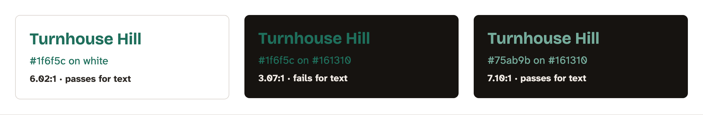
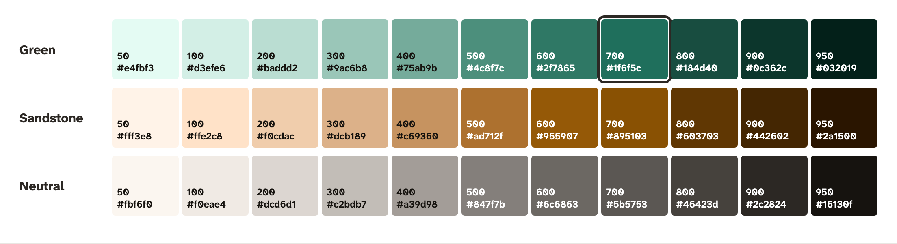
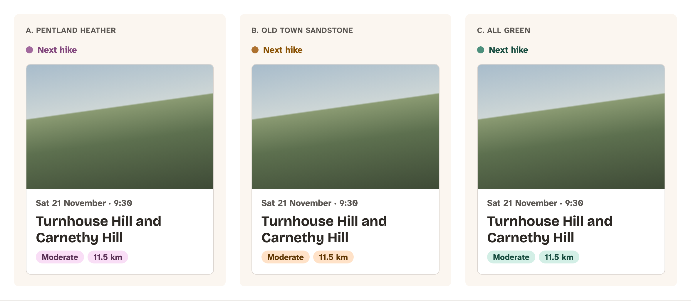
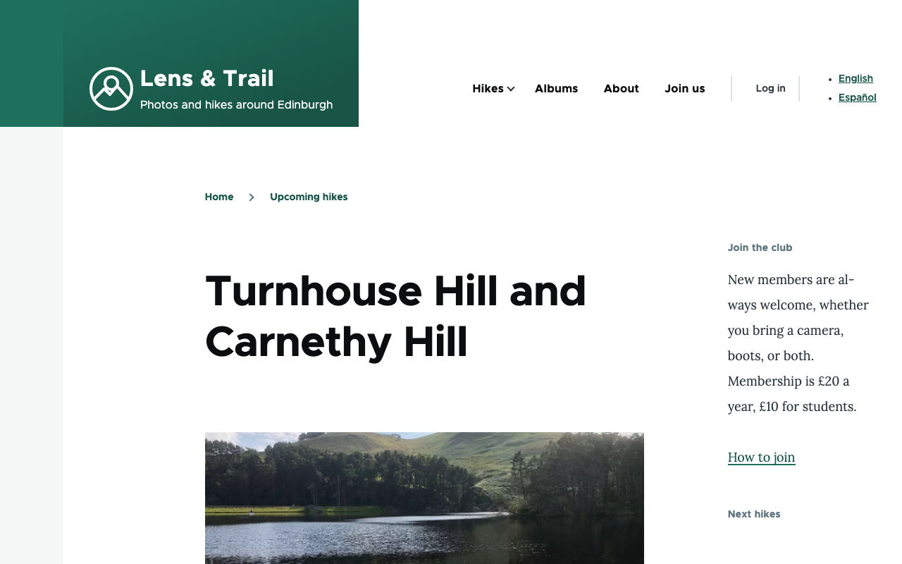
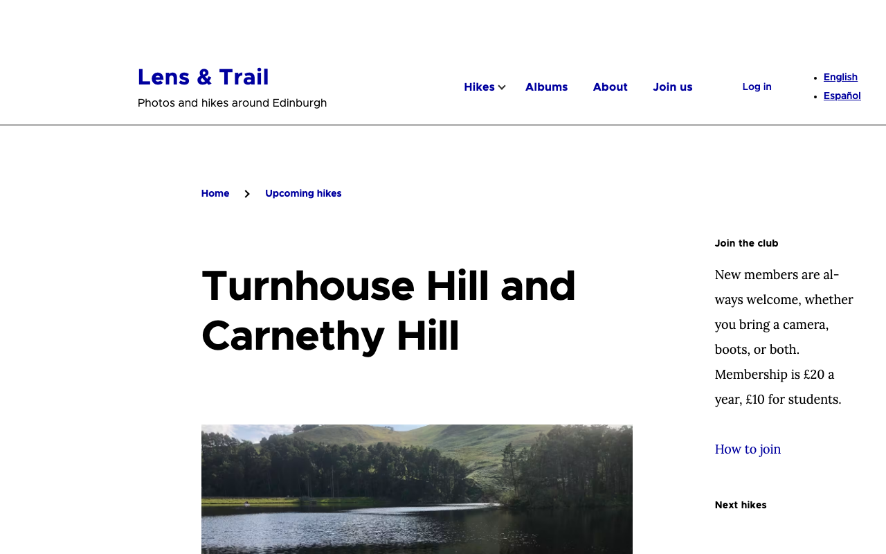

# Designing Lens & Trail

Before we write a line of CSS, we need to know what we're building. What color is a button? How big is a heading on a phone? What does a hike look like in a list, and what does a member need to see first when they open a hike page at the car park, five minutes before the walk starts? A theme answers all of these, so someone has to decide them first. In a real project that's a designer. In this book, it's us, together, in the open.

This chapter makes the club's design decisions and explains each one: the brief, the colors, the fonts, the spacing, how a hike is shown, the logo, what moves on the page, and what a printed hike page looks like. For the big decisions we show the options the club turned down, too, because seeing why one option lost teaches as much as seeing why the other one won. The next chapter puts the decisions into Penpot, a free design tool, as design tokens and wireframes, and the chapter after that turns them into two themes.

You don't need to be a designer for this chapter, and we won't pretend to turn you into one. A theme developer spends their days between a designer's files and Drupal's markup, and the better you understand why a design is the way it is, the better your theme will be. You'll also know which questions to ask when a design arrives without answers. There's no code to run in this chapter, except a small script for checking colors; the decisions end up as files in the book's `design/` folder.

The two sites start where Book 1 left them: Olivero on the core site, with the club's green and Book 1's logo, and Mercury on the Drupal CMS site. Nothing on them changes in this chapter.

## The brief

A design starts with a **brief**: a short description of who the site is for, what they need from it, and how it should feel. It's the thing you go back to when two good options are on the table and you need a reason to choose. Without one, every decision becomes a matter of taste, and taste is a poor tie-breaker in a committee.

### Who visits the club's site

Book 1 built the site for the people in the club, so we know them already:

- **Someone thinking of joining.** They found the club through a photo or a friend. They want to know what the club does, whether they'd fit in, when the next hike is, and how to join. They're probably on a phone.
- **A member on the way to a hike.** Saturday morning, 9:15, at Flotterstone car park. They want the meeting place, the time, and the distance, fast, on a phone with one bar of signal and cold fingers.
- **Jordi, a hike leader.** He'd like to print the hike page and put it in his map case.
- **Lucía, and the club's other Spanish speakers.** They read the site in Spanish (Book 1's Chapter 18). Spanish text runs longer than English, often by a fifth or more, so every button, menu and heading has to have room to grow.
- **Everyone, after a hike.** They want to see the photos: the albums, big, one after another.

### What comes first

From those visitors, an order of importance, which becomes the order of things on the page:

1. **The next hike**: when, where, how far, how hard.
2. **How to join**.
3. **The photos**.

And one decision that follows from the first two visitors: we design for **phones first**. The small screen is the hardest one, because there's room for very little, so we decide what goes there first and let the bigger screens add to it, not the other way round.

### How it should feel

Lens & Trail is a photography club that walks. The photos are the best thing the club has, so **the photos lead and the interface stays quiet**: no busy backgrounds, no decorations competing with a sunset over the Pentland Hills. The outdoors and Edinburgh come through in the colors and the type, not in drawings of mountains.

The club asked for a little spice, too: a hero slider on the front page, a lightbox for looking at photos one at a time, and a touch of parallax (the background moving a little slower than the page as you scroll). Those are fun, and they're also where sites most often go wrong for people who use a keyboard or feel sick from motion, so we'll design them carefully in "Motion, with a little spice" below.

### Learning from a site that works

You rarely design from nothing. Looking at a site that already does the job well saves you from rediscovering its answers. For the hikes, we looked at [Út um allt](https://utumallt.is) ("out and about"), a guide to walking, cycling and running routes around Reykjavík, made by Hilmar's company, Um að gera ehf. Its look isn't ours (it's dark blue, with pale blue badges), but two things in it are exactly what the club needs.

**A route in a list is a card**: a photo, the title, the length and the difficulty as badges, with the difficulty in words ("Level 1", "For Everybody"), a short teaser, and the municipality. Nothing about the route that you'd only need once you've chosen it.


*Figure 3.1: Routes as cards on Út um allt. The badges say the length and the difficulty in words.*

**A route's own page has a block of key facts**: duration, distance, difficulty, elevation gain, maximum altitude, when it's open, each with an icon, a label and a value. The six most useful facts are shown, and a **More** button opens the rest (surface, width of the path, hazards, obstacles, services, the GPX file). Above the facts are the description and an **Open Map** button with the route's starting point.


*Figure 3.2: A route's key facts on Út um allt, with the less important ones behind More.*

That's a good fit for Book 1's Hike content type, which has a date, a meeting place, a distance, a difficulty, a hike leader, an area and a photo. One thing we'll change: Út um allt's visitors read about a route before they choose it, so the facts can come after the description. The club's members have already chosen: they're at the car park, so the club's facts move up, right under the title. We'll come back to the card and the page in "The pieces of a hike".

> **Try it:** Pick two outdoor or club websites you like (a hiking club, a running club, a mountain rescue team). For each, write down in one sentence who it's for and what it shows first on a phone. Does the first screen match what its visitors need first? You've reverse-engineered a brief.

### The brief, written down

Short enough to fit on a sticky note, which is the point:

> **Lens & Trail, the brief.** A website for a photography and hiking club in Edinburgh, in English and Spanish. Visitors want, in order: the next hike (when, where, how far, how hard, and how to get there), how to join, and the photos. Most of them are on a phone, often outdoors. The photos lead; the interface stays quiet, warm and readable, with a little movement on the front page. It works for everyone: with a keyboard, with a screen reader, in dark mode, in high contrast mode, with reduced motion, and on paper.

## Color

### Starting from the club's green

In Book 1's Chapter 16 the club chose a green, `#1f6f5c`, for the Pentland Hills, and typed it into Olivero's settings. It's the club's color now, people recognize it, and it stays. Everything else is built around it.

The first question about any color on a website is whether text on it, or in it, can be read. The Web Content Accessibility Guidelines (**WCAG**, version 2.2, the standard most laws point to) measure that with a **contrast ratio**: how much brighter the lighter color is than the darker one, from 1:1 (the same color) to 21:1 (black on white). Level AA, the level we aim for, asks for:

- **4.5:1** for normal text;
- **3:1** for large text (about 24 pixels, or 19 pixels bold) and for the parts of the interface you need to see to use it: the border of a text field, a focus ring, an icon that's a button.

And one more rule that's often forgotten: **color alone must never carry the meaning**. A red "Hard" badge is fine, as long as it also says "Hard".

So, the club's green. As text on white, it's 6.02:1: it passes. As text on a near-black dark mode background, it's 3.07:1: it fails, by a long way.


*Figure 3.3: The club's green works on white, but not on a dark background. Dark mode needs a lighter green of its own.*

That one measurement shapes the whole color system: the club can't have *one* green. It needs a family of greens, from very light to very dark, and the right one for each job.

You can check contrast with WebAIM's contrast checker (see "Want to know more?"), with your browser's developer tools (Chrome and Firefox show the ratio when you inspect a text color), or with this small script, which does the same sum WCAG does:

`contrast.py` ([source](../code/chapter03/snippets/contrast.py))

```
#!/usr/bin/env python3
"""The contrast ratio between two colors, as WCAG 2.2 calculates it.

    python3 contrast.py 1f6f5c ffffff

The colors are six-digit hex values, with or without the #.
"""
import sys

def channel(value):
    """One color channel (0-255) as linear light (0-1)."""
    c = value / 255
    return c / 12.92 if c <= 0.04045 else ((c + 0.055) / 1.055) ** 2.4

def luminance(hex_color):
    """How bright a color looks to the eye: 0 is black, 1 is white."""
    h = hex_color.lstrip("#")
    r, g, b = (channel(int(h[i:i + 2], 16)) for i in (0, 2, 4))
    return 0.2126 * r + 0.7152 * g + 0.0722 * b

def ratio(first, second):
    """From 1 (no contrast) to 21 (black on white)."""
    light, dark = sorted((luminance(first), luminance(second)), reverse=True)
    return (light + 0.05) / (dark + 0.05)

if __name__ == "__main__":
    if len(sys.argv) != 3:
        sys.exit(__doc__)
    r = ratio(sys.argv[1], sys.argv[2])
    print(f"{r:.2f}:1")
    for need, what in ((4.5, "text"), (3, "large text, and interface parts")):
        print(f"  {'passes' if r >= need else 'fails '} {need}:1 for {what}")
```

```console
$ python3 code/chapter03/snippets/contrast.py 1f6f5c 161310
3.07:1
  fails  4.5:1 for text
  passes 3:1 for large text, and interface parts
```

The `luminance()` function is the interesting part: it weighs green much more than red, and red much more than blue (`0.7152`, `0.2126`, `0.0722`), because that's how our eyes see brightness. That's why a pure blue looks so much darker than a pure green of the same strength.

You'll also meet **APCA**, a newer way of measuring contrast that takes the size and weight of the text into account. It's planned for a future version of WCAG, but it isn't the standard yet, so we use WCAG 2.2's ratio and keep an eye on it.

### A scale from one color

A **color scale** is a family of one hue, numbered from light to dark: 50 for the lightest, 950 for the darkest, and the steps 100 to 900 in between. You'll see the same numbering in Tailwind, in many design systems, and in our Drupal CMS theme, which is one reason we use it.

We made the club's scales with **OKLCH**, a way of describing color as lightness, chroma (how colorful) and hue (which color). Its lightness matches what our eyes see, so steps that are evenly spaced in OKLCH also *look* evenly spaced, and that's hard to do by picking hex values by hand. The club's green turns out to have an OKLCH lightness of 0.49, so it sits at step 700, with lighter greens above it and darker ones below. CSS understands OKLCH directly (`oklch()` has been widely available since November 2025), but the club's scales are written out as hex values, because every tool, Penpot included, understands those.


*Figure 3.4: The club's three color scales. The outlined green is Book 1's `#1f6f5c`.*

### The accent: three options

One color is a bit monotonous, so most designs have a second one, the **accent**: a color for highlights, used sparingly. On the club's site it marks things like "Next hike" and the difficulty badges. It's never used for links or buttons, which are always green, so a visitor learns quickly that green means "you can click this".

We looked at three accents:

- **A. Pentland heather**: a heather purple, the Pentland Hills in August.
- **B. Old Town sandstone**: an ochre, from Edinburgh's stone buildings and the bracken on the hills in autumn.
- **C. All green**: no second color at all. Highlights are pale greens, and the photos carry all the color.


*Figure 3.5: The three accents. The club chose B, Old Town sandstone.*

The club chose **B, Old Town sandstone**. It's warm next to the cool green, so the two don't blur into each other, and it's at home in both of the club's landscapes, the hills and the city. Heather was lovely but close to a link's traditional purple, and "All green" was calm but made the badges and the links look too alike.

### Neutrals

Most of a page isn't green or sandstone: it's the background, the text, the borders. Those are **neutrals**, the grays. A pure gray tends to look cold and a little unfinished next to warm colors, so the club's neutrals have a touch of sandstone in them: the page background, `#fbf6f0`, is a very light warm white rather than pure white. Cards on it are pure white, which lifts them off the page without a shadow.

### Two tiers: values and roles

Here's the idea that makes dark mode possible, and that the whole token system in the next chapters rests on. There are two kinds of color names:

- **Values** say what a color *is*: `green-700`, `sand-300`, `neutral-50`. They never change.
- **Roles** say what a color is *for*: the page background, the text, a link, a button. A role points at a value, and in dark mode it points at a different one.

The theme's CSS uses only the roles. A button doesn't say "green-700", it says "action". In light mode, *action* is green-700; in dark mode, it's green-400. The button never needs to know which mode it's in.

These are the club's roles, and the contrast of each pair that has to be read:

| Role | What it's for | Light | Dark |
|---|---|---|---|
| **background** | The page | neutral-50 `#fbf6f0` | `#161310` |
| **surface** | Cards, menus, dialogs | white `#ffffff` | `#221f1b` |
| **text** | Body text and headings | neutral-900 `#2c2824`: 13.61:1 on the background | neutral-100 `#f0eae4`: 15.51:1 |
| **muted** | Dates, captions, teasers | neutral-700 `#5b5753`: 7.16:1 on a card | neutral-400 `#a39d98`: 6.12:1 |
| **border** | Card and field edges (decorative) | neutral-200 `#dcd6d1` | neutral-800 `#46423d` |
| **action** | Links, buttons, focus rings | green-700 `#1f6f5c`: 5.61:1 on the background | green-400 `#75ab9b`: 7.10:1 |
| **on-action** | Text on a button | white: 6.02:1 on the button | neutral-950 `#16130f`: 7.10:1 |
| **accent** | Markers, dots (not text) | sand-500 `#ad712f`: 4.05:1 on a card | sand-400 `#c69360`: 6.05:1 |
| **accent-text** | Accent-colored words | sand-700 `#895103`: 6.03:1 on the background | sand-300 `#dcb189`: 9.42:1 |
| **tint** / **on-tint** | Badges | sand-100 with sand-800: 8.30:1 | sand-900 with sand-200: 9.21:1 |

Every pair passes AA, most of them comfortably. Two details are worth a second look. The *accent* role is only for things that aren't text, so it needs only 3:1, and the darker *accent-text* exists for when sandstone has to be read. And the borders are decorative: a card's edge isn't needed to use the card (the whole card is a link with a clear title), so the borders are allowed to be soft. A text field's border is different, because you need to see it to find the field, so form fields will get a darker border in the forms chapter.


*Figure 3.6: The same roles, pointing at different values in light and dark mode.*

> **Drupalism: token.** In design, a **design token** is a named design decision, like `color-action` or `space-m`, stored in a file that both designers and developers use. Drupal has *tokens* too, and they're something else entirely: placeholders like `[node:title]` that Drupal replaces with a value, as in Book 1's Pathauto patterns. In this book, "token" means a design token, unless we're talking about Pathauto.

### Dark mode, with a toggle

Phones and computers have a light and a dark appearance, and a website can follow it: CSS can ask for the visitor's setting with the `prefers-color-scheme` media query. That's the minimum, and it's what most sites do.

The club goes one step further, with a **toggle** in the header: three choices, **Light**, **Dark** and **System**. *System* is the default, so a visitor who never touches the toggle gets their device's setting. Someone who reads the club's site at night with their phone in light mode can switch the site alone.

A toggle is a nice teaching moment, because it touches several things a theme has to get right:

- **CSS**: both palettes, and a way for the visitor's choice to beat the device's setting. CSS's `light-dark()` function picks between two colors depending on the page's `color-scheme`, which the toggle can change. It's been in every major browser since May 2024, and becomes "widely available" on Baseline's scale in November 2026.
- **JavaScript**: the toggle is a button, and the choice is remembered in the browser (`localStorage`), not on the server.
- **Drupal's page cache**: for anonymous visitors, Drupal sends the same cached page to everyone. So the server can't put the visitor's choice into the HTML; the browser has to apply it, before the page is painted, or the page flashes white before turning dark. We'll build this in the JavaScript chapter, where that problem gets the attention it deserves.
- **Accessibility**: the toggle is a real `<button>` (or a group of radio buttons), it says what it does, and it says which choice is active.

Without JavaScript, the toggle isn't shown and the site follows the device: nobody loses anything.

### Forced colors

Some people need very high contrast, or a particular combination of colors, to read at all. Windows has **contrast themes** for them (they used to be called High Contrast Mode), and when one is on, the browser goes into **forced colors** mode: it throws away the site's colors, backgrounds and shadows, and uses the few colors from the visitor's theme for everything.

That sounds like it would break any design, and that's the point: the design has to survive it. Things to check:

- Anything that relies on a **background color** to be seen disappears: a button that's only a green rectangle with no border, a card that's only a white box on a beige page.
- **Images stay as they are**, and that includes an SVG logo shown with ``.
- **Focus rings** must still be visible: an outline survives, a `box-shadow` doesn't.
- **Icons** drawn with `currentColor` follow the visitor's text color; icons with a fixed color might vanish.

> **Try it:** Look at the club's site in forced colors mode, without Windows. Open a hike on the core site (`https://lens-and-trail-theme.ddev.site:8443/hikes/turnhouse-hill`) in Chrome, open the developer tools (**More tools** > **Developer tools**), open the **Rendering** panel (the three-dot menu in the developer tools, **More tools** > **Rendering**), and set **Emulate CSS media feature forced-colors** to **forced-colors: active**. What happened to the club's logo?


*Figure 3.7: The hike in Olivero, with Book 1's logo on the club's green.*


*Figure 3.8: The same page in forced colors mode. The green background is removed, and Book 1's white logo disappears with it.*

Book 1's logo is white lines on nothing: it only shows because Olivero puts it on a green background. In forced colors, the background goes, and the logo is white on white. Our logo will have to bring its own background ("The logo", below).

The `forced-colors` media query, which lets a theme make small fixes for forced colors mode, has been widely available since March 2025. We use it in the CSS architecture chapter.

## Type

### A pair of fonts

Most designs use two fonts, a **pair**: one for headings, with some personality, and one for body text, built for long reading. Each has a job, and a pair lets each be good at its job instead of one font being fair at both. More than two rarely helps, and every font is a file the visitor has to download.

The club looked at three pairs:

1. **Fraunces + Atkinson Hyperlegible Next**: a soft, slightly old-fashioned serif for headings, warm and bookish.
2. **Source Serif 4 + Source Sans 3**: a matched family, drawn to work together: safe, very readable, a little anonymous.
3. **Bricolage Grotesque + Atkinson Hyperlegible Next**: two sans-serifs, a lively, slightly quirky heading face over a very legible body face.


*Figure 3.9: The three pairs, with English and Spanish text from the club's site.*

The club chose **3, Bricolage Grotesque and Atkinson Hyperlegible Next**. Bricolage Grotesque has the energy of a poster for an outing, and it looks at home next to photos, where a serif felt a little like a newspaper. **Atkinson Hyperlegible Next** comes from the Braille Institute of America and was designed for readers with low vision: letters that look alike in many fonts (capital I, lowercase l and the number 1; O and 0) are drawn to look different. That's a gift on a phone outdoors, and it matters for a club that gives out times and distances.

Both have every letter Spanish needs (á, é, í, ó, ú, ü, ñ, ¿ and ¡) and the pound sign for the membership fee. We checked the font files, not only the specimen pages; a font that's missing ñ shows it in a fallback font, and it looks like a mistake.

### Variable fonts

A font used to come as a separate file for every weight: regular, bold, light, each one a download. A **variable font** has all of them in one file, along one or more **axes**. Pick any value on an axis, not only the named weights, and the browser draws it.

The club's two fonts are variable:

- **Atkinson Hyperlegible Next** has a weight axis (`wght`) from 200 to 800, and a separate italic file with the same axis.
- **Bricolage Grotesque** has three axes: weight (`wght`, 200 to 800), width (`wdth`, 75 to 100, from condensed to normal) and **optical size** (`opsz`, 12 to 96).


*Figure 3.10: Bricolage Grotesque's three axes.*

Optical size is the clever one. Type that's printed small needs to be sturdier and more loosely spaced to stay readable, and big type looks better tighter and finer; type designers used to draw separate versions for each. With an `opsz` axis, the browser picks the right one for the size automatically (`font-optical-sizing: auto` is the default). The width axis will come in handy, too: a long Spanish heading on a phone can get a little narrower instead of breaking onto a third line.

### Self-hosting, and the licenses

Both fonts are under the **SIL Open Font License** (OFL), which lets anyone use, share and change them, including on a website and bundled with a theme, as long as the license goes along with them. That's what lets this book put them in its repository, under `design/fonts/`, each with its `OFL.txt`.

We **host the fonts ourselves**: the files are part of the theme, and the visitor's browser downloads them from the club's own site. The alternative, linking to a font service like Google Fonts, is convenient, but every page view then tells another company the visitor's address. A German court ruled in 2022 that doing so without consent broke the GDPR, and since then self-hosting has been the safe default in Europe. It's also faster (no extra connection to another server) and it keeps working if the service changes.

The files under `design/fonts/` are the original TrueType (`.ttf`) files. When we generate the themes we'll convert them to **WOFF2**, a compressed format made for the web, and in the performance chapter we'll make them smaller still by keeping only the characters the club needs (**subsetting**).

> **Try it:** Drop `design/fonts/bricolage-grotesque/BricolageGrotesque[opsz,wdth,wght].ttf` onto [Wakamai Fondue](https://wakamaifondue.com) (it runs in your browser; the file isn't uploaded anywhere). It shows the font's axes with sliders, every character it has, and the CSS to use it. Find ñ and ¿, and slide the optical size axis from 12 to 96.

### A fluid type scale

A **type scale** is a set of sizes for text, each a fixed **ratio** bigger than the one below: if body text is 17 pixels and the ratio is 1.2, the next size up is 20.4, then 24.5, and so on. Using a scale instead of picking sizes one at a time keeps the page in proportion, and it gives you a short list of sizes (the **steps**) instead of dozens.

A phone and a wide screen want different scales, though. On a phone, a big ratio makes headings huge and crowds out everything else; on a wide screen, a small ratio makes the headings timid. The usual answer was a different scale at each breakpoint, so sizes jumped as the window got wider. The club's scale is **fluid** instead: each step grows smoothly with the width of the screen, from a minimum on a 360-pixel phone to a maximum on a 1280-pixel screen. Body text goes from 17 to 18 pixels, and the ratio from 1.2 to 1.25.


*Figure 3.11: The club's type scale on a phone and on a wide screen. The bigger the step, the more it grows.*

CSS's `clamp()` function does it: a minimum, a preferred size that grows with the window's width (the `vw` part), and a maximum. This is what the scale looks like as CSS, and you don't need to work out the numbers by hand: a script will write them from the design tokens when we generate the themes.

`fluid-type.css` ([source](../code/chapter03/snippets/fluid-type.css))

```css
/*
 * The club's type scale: each step grows smoothly from its size at 360px
 * wide (body text 17px, ratio 1.2) to its size at 1280px (18px, ratio 1.25).
 * In Chapter 5, tools/tokens.py writes these lines from design/tokens.json.
 */
:root {
  --step--1: clamp(0.885rem, 0.880rem + 0.025vw, 0.900rem);
  --step-0: clamp(1.063rem, 1.038rem + 0.109vw, 1.125rem);
  --step-1: clamp(1.275rem, 1.224rem + 0.228vw, 1.406rem);
  --step-2: clamp(1.530rem, 1.441rem + 0.396vw, 1.758rem);
  --step-3: clamp(1.836rem, 1.695rem + 0.628vw, 2.197rem);
  --step-4: clamp(2.203rem, 1.991rem + 0.945vw, 2.747rem);
  --step-5: clamp(2.644rem, 2.335rem + 1.373vw, 3.433rem);
}
```

A fluid scale has one accessibility trap to avoid: text sized only in `vw` doesn't grow when the visitor zooms, which WCAG requires up to 200%. Because each step is mostly `rem` (which follows the browser's font size and zoom) with a little `vw` added, zooming still works. It's worth checking anyway, and we will, when the CSS exists.

### Line length

Long lines are hard to read: your eye loses its place going back to the start of the next line. The comfortable length for body text is about **45 to 75 characters** per line. The club's text column is at most `65ch` wide (`ch` is the width of the zero in the current font), so a paragraph never stretches across a wide screen. Headings get `text-wrap: balance`, which evens out the lines of a heading that breaks, so you don't get a lonely last word. It's not "widely available" yet, but a browser that doesn't know it wraps the heading as usual, which is fine.

## Space, shape and layout

### A spacing scale

Space works like type: a short list of sizes, used everywhere, makes a page look calm and deliberate. The club's spacing scale is built on 4 pixels (0.25 rem):

| Step | Size | Typical use |
|---|---|---|
| `3xs` | 4 px | Between an icon and its label |
| `2xs` | 8 px | Between badges |
| `xs` | 12 px | Inside a badge or a small button |
| `s` | 16 px | Inside a card; the page's side margin on a phone |
| `m` | 24 px | Between cards |
| `l` | 32 px | Between parts of a page |
| `xl` | 48 px | Above a section heading |
| `2xl` | 64 px | Between sections on a wide screen |
| `3xl` | 96 px | Around the front page hero on a wide screen |

### Corners and shadows

Three corner radiuses: **small** (4 pixels) for buttons and form fields, **medium** (8 pixels) for cards and photos, and **round** for badges and round buttons (the slider's). Two shadows: **raised**, very soft, for a card that's being hovered over, and **overlay**, for things that float above the page: dropdown menus, the lightbox, dialogs. Most things have no shadow at all; a shadow means "this is above the page", and it stops meaning anything if everything has one.

### Breakpoints and containers

A **breakpoint** is a width at which a layout changes, written as a media query on the width of the window. The club's page layout has two, and they're in `rem` so they follow the visitor's font size:

- below **40 rem** (640 pixels): one column, the phone layout;
- from **40 rem**: two columns where there's room (a hike's facts next to its description);
- from **64 rem** (1024 pixels): the full menu instead of the menu button, and up to three cards in a row.

Components are different. A hike card can be in a three-column grid, in a narrow sidebar, or full width on a phone, and the *window's* width tells it nothing about the space it actually has. **Container queries** ask about the width of the card's container instead, so the card can lay itself out for the space it's given, wherever it's placed. They've been widely available since August 2025, and they're one of the reasons the core site needs no build tools. The club's components switch layout at a container width of **30 rem**: below it, a card has the photo on top; above it, the photo sits beside the text.

Two more sizes complete the layout: the page content is at most **80 rem** (1280 pixels) wide, and running text at most `65ch`, as above.

### Sizes for fingers

WCAG 2.2 added a rule for things you tap or click: a target must be at least **24 by 24 pixels**, or have enough space around it. The club's site aims higher, at **44 by 44 pixels** for everything in the header, the slider and the lightbox: they're used on phones, outdoors, sometimes with gloves.

### Focus

When someone moves through the page with the Tab key, the browser draws a **focus ring** around the link or button they're on. Some designs remove it because it looks untidy, and that makes the site unusable with a keyboard. The club's focus ring is a 3-pixel outline in the *action* color, 2 pixels away from the element, so it's visible on every background in both modes, survives forced colors (outlines do), and looks like it belongs.

WCAG 2.2 also asks that the focused element isn't hidden behind something else, such as a sticky header. Keep that in mind for the header chapter.

## The pieces of a hike

### The hike card

Hikes appear in lists all over the site: the front page, the hikes page, the sidebar, the archive. Each time, as a **card**, following the Út um allt pattern.


*Figure 3.12: The hike card's parts.*

1. The **photo**, from the hike's Photo field, cropped to **3:2**.
2. The **date and time**, before the title: for an outing, "when" decides whether you read on.
3. The **title**, which is the card's link. One link per card, not three (photo, title, "Read more") all going to the same place, which a screen reader user would hear three times.
4. The **difficulty** and the **distance**, as badges. Difficulty is a word (*Easy*, *Moderate*, *Hard*, from Book 1's Difficulty field) with a small icon, never only a color.
5. A **teaser**, the first sentence or two of the description.
6. The **area**, from Book 1's Areas vocabulary, as plain text. On the hike page it's a link to the area's page; on the card, the title is the only link.

### The hike page

On a hike's own page, the order follows the brief: when, then what, then everything a member checks at the trailhead, then how to get there.


*Figure 3.13: The hike page on a phone, as a grey wireframe. The colors come later; a wireframe is about what goes where.*

The **key facts** grid is the Út um allt idea, moved up: a small label and a big value, in a grid of two columns on a phone, so the meeting place and the distance are on screen without scrolling. A hike has four facts, so they all fit, and there's no need for a More button. The one button is **Directions**: it opens a map app at the meeting place, which is what a member needs on a Saturday morning. (There's no "Join the hike" button: the club doesn't take bookings, as Book 1's How to join page says.) The **map** below it shows where the walk starts; making it is a short how-to later in the book. And at the bottom, Book 1's "Albums from this hike" block, as square photos.

This is a **wireframe**: a drawing of a page in grey boxes, without colors or real images, to decide what goes where before deciding what it looks like. The next chapter draws wireframes for the club's main pages in Penpot.

## Photos, icons and the logo

### Photo shapes

A photo on the club's site is almost always cropped to a fixed shape (an **aspect ratio**), so cards line up and pages don't jump as photos load:

| Where | Shape | Why |
|---|---|---|
| Hike cards, album cards | **3:2** | The shape most cameras take, so the least is cut off. |
| Heroes, a hike's main photo | **16:9** | Wide, so the text and the facts below it stay on screen on a phone. |
| Album thumbnails, the gallery grid | **1:1** | Squares make a calm grid of very different photos. |
| The lightbox | **The original** | When you look at one photo, you see all of it. |

Book 1 made image styles for some of these (Banner, 16:9, in its Chapter 9); the images chapter adds the rest, with art direction for photos that crop badly. Every photo keeps its credit (the photographer and the license), as Book 1 promised: on a photography club's site, the credit matters even on a card.

### Icons

The club's site needs about fifteen small icons: a calendar, a pin for the meeting place, a route, a mountain for the difficulty, a clock, a camera, the sun and moon of the dark mode toggle, a menu button, a close button, arrows, pause and play for the slider, and a download. We take them from **[Lucide](https://lucide.dev)**, an open source icon set under the ISC license (a short permissive license, like MIT), as SVG files in the theme. No icon font and no icon service: an SVG can be read by screen readers when it needs to be, hidden from them when it's decoration, and drawn in `currentColor` so it follows the text's color in both modes and in forced colors.

### The logo

Book 1 gave the club a logo in its Chapter 16: a circle (the lens), a smaller circle (the sun) and a line of hills, in white. It's the club's, and people know it, so we keep the drawing. But we saw what happens to it in forced colors, and on the club's new light background it would be white on almost white. So the logo gets **its own background**: a cream disc inside the lens, with the lens and the hills in the club's green and the sun in sandstone.


*Figure 3.14: Book 1's logo, and the same drawing redrawn for the club's theme. With a background of its own, it works on light and dark pages, and in forced colors mode.*

The logo is `design/logo.svg`. It has a `<title>`, so a screen reader can name it when it's shown on its own; in the header it's next to the site name, so there it'll be marked as decoration instead, which is a detail for the header chapter. At 32 pixels the sun and the hills are still readable, which matters for the favicon (the little icon in the browser tab), made from the same drawing in the header chapter.

## Motion, with a little spice

Movement on a page draws the eye, which is exactly why it has to be used with care. Most of the club's site barely moves: links and buttons change color in **150 milliseconds**, menus and the lightbox open in **250**, and nothing bounces. And the club asked for three things that move more.

### Sliders for heroes

The front page opens with a **hero**: a big photo with a heading and a button. The club's is a **slider** (also called a carousel): a few slides, such as the next hike, the latest album and an invitation to join, one after another.


*Figure 3.15: The hero slider, with its controls and the photo's credit.*

Sliders have a bad reputation, and it's earned: most of them move on their own, too fast to read, with no way to stop them, and few visitors get past the first slide. The club's slider is designed to avoid the worst of it:

- **It can always be paused**, with a real button, the first of the controls. WCAG requires this for anything that moves on its own for more than five seconds.
- It **stops moving** while the mouse is over it or anything in it has keyboard focus, and it waits at least **seven seconds** on each slide.
- **Previous** and **Next** are buttons, 44 pixels round, and the dots say which slide you're on (and to a screen reader, "Slide 1 of 3").
- **With reduced motion, it doesn't move on its own at all** (see below).
- **The first slide is the most important**, the next hike, because it's the only one many visitors will see.
- **The text is on a dark gradient**, not on the photo itself, so it can be read on any photo. The figure shows why: the photo credit sat on the bright sky, white on light blue, until it got a dark background too.

### A lightbox for the albums

On an album page, clicking a photo opens it in a **lightbox**: the photo as big as the screen allows, on a dark background, with its credit, Previous and Next, and a Close button. The arrow keys move between photos, Escape closes it, and when it closes, focus goes back to the photo you opened. Without JavaScript, the photo link opens the photo itself, so nothing is lost.

The club asked for **Colorbox**, a popular Drupal module that has done this for years. At the time of writing, though, Colorbox has no release for Drupal 12 (its newest release supports Drupal 10 and 11), and it's built on an older jQuery plugin. The images chapter decides how we build the lightbox: Colorbox or another module if one supports Drupal 12 by then, or a small one of our own with HTML's `<dialog>` element, which is widely available and does much of the hard work (focus, Escape, the dark backdrop) for free. The design is the same either way.

### A little parallax on the front page

**Parallax** is the effect of the background moving more slowly than the page as you scroll, as if it were further away. The club's front page has a little of it, in one place only: the photo in the hero drifts up a little slower than the text over it.

CSS can now do this without JavaScript, with **scroll-driven animations**, which tie an animation to the scroll position. They became available in every major browser in October 2026, very recently, so they're "newly available" and not yet "widely available". That's fine here, because parallax is a decoration: in a browser without them, the photo scrolls with the page.

### Reduced motion

Movement can make some people dizzy or sick, people with vestibular disorders in particular, and parallax is one of the worst offenders. Phones and computers have a setting for it (**Reduce motion** on Apple devices, **Animation effects** turned off on Windows), and CSS can read it with the `prefers-reduced-motion` media query.

With reduced motion on, the club's site:

- doesn't move the **slider** on its own, and changes slides without sliding;
- has **no parallax**;
- opens menus and the lightbox **without animating** them (a quick fade at most);
- keeps every color change, which isn't motion.

> **Try it:** Does Olivero respect reduced motion? Search its stylesheets for the media query, in the core test site's folder: `grep -rl prefers-reduced-motion web/themes/contrib/olivero/css` finds nothing, while `grep -rl forced-colors web/themes/contrib/olivero/css` finds several files. Even a theme built with great care for accessibility covers some settings and not others. Then, in the same **Rendering** panel of Chrome's developer tools, set **Emulate CSS media feature prefers-reduced-motion** to **reduce**, make the window narrow, and open Olivero's mobile menu: does it still slide in?

## Print: a hike handout

Hike leaders like Jordi print the hike page and put it in a map case. A web page printed as it is wastes paper on the menu, the footer and the sidebar, and leaves out what matters on paper: where a link goes. So the club's theme has a **print stylesheet** (CSS that's only used when printing), designed now and built in the chapter on templates for content.


*Figure 3.16: The hike page, printed.*

On paper:

- **Only the hike**: no menu, footer, sidebar, slider or toggle, and no hero photo, which is mostly ink.
- **The facts first**, as a list of labels and values, in black on white, whatever mode the screen was in.
- **Links written out**: on paper you can't click, so the map link prints its address after it, and the bottom of the page says which page it was printed from.
- The logo and the club's name at the top, so a page found in a car's glove box a month later says whose it is.

## The design, in short

| Decision | The club's choice |
|---|---|
| Colors | The green `#1f6f5c` (green-700), a sandstone accent, warm neutrals; scales from 50 to 950. |
| Roles | Values and roles; only the roles change in dark mode. All text pairs pass WCAG 2.2 AA. |
| Dark mode | Light, dark and system, with a toggle; system by default. |
| Fonts | Bricolage Grotesque (headings) and Atkinson Hyperlegible Next (body), variable, self-hosted, OFL. |
| Type scale | Seven fluid steps, body text 17 to 18 pixels, ratio 1.2 to 1.25, between 360 and 1280 pixels wide. |
| Space | A scale on 4 pixels, from `3xs` (4) to `3xl` (96). |
| Layout | Breakpoints at 40 and 64 rem; components switch at a container width of 30 rem; content at most 80 rem, text at most `65ch`. |
| Shapes | Radiuses of 4 and 8 pixels and round; two shadows; a 3-pixel focus outline in the action color. |
| Photos | 3:2 cards, 16:9 heroes, 1:1 grids, the original in the lightbox; the credit always shown. |
| Icons and logo | Lucide icons as SVG; Book 1's logo on a cream disc of its own. |
| Motion | 150 and 250 milliseconds; a pausable hero slider, a lightbox, a little parallax; nothing moves with reduced motion. |
| Print | The hike page as a handout. |

Designs change, and this one will too. When a later chapter finds a decision that doesn't work (a color that fails somewhere we didn't check, a size that's too small in Spanish), it changes the design in the open, in a box called **Revisiting the design**: first the design files, then the tokens, then the themes. That's how a real project changes course, and it's no failure: you learn things building a design that you couldn't know drawing it.

> **Coming from WordPress?** A block theme keeps its design decisions in `theme.json`: the color palette, the font sizes (fluid ones included), the spacing scale, and the fonts. That's very close to what this chapter calls design tokens, and if you've written a `theme.json`, you already know how to think about them. What you need to adapt to: Drupal has no `theme.json`. A Drupal theme's design decisions live in its CSS (as custom properties) or, on the Drupal CMS site, in Tailwind's configuration, and the editor's interface doesn't read them. The club keeps them in a design token file instead, outside the theme, and generates the CSS from it.

## Summary

You can now:

- write a brief for a site: who visits, what they need first, and how it should feel, and use it to choose between options;
- measure the contrast of two colors, know what WCAG 2.2 AA asks for text and for interface parts, and explain why a brand color often needs a different shade in dark mode;
- build a color scale from one color, and choose an accent and neutrals for it;
- explain design tokens in two tiers, values and roles, and why only the roles change in dark mode;
- say what forced colors mode does to a page, and check a site in it and with reduced motion in Chrome's developer tools;
- choose a pair of fonts, read a variable font's axes, and explain why the club hosts its fonts itself;
- explain a fluid type scale with `clamp()`, a spacing scale, and the difference between breakpoints and container queries;
- design a card and a page for a piece of content, from the fields it has and what its visitors need first;
- design sliders, a lightbox and parallax that respect keyboards and reduced motion, and a page that prints well.

## Exercises

1. Run `code/chapter03/snippets/contrast.py` for the club's *muted* color on the page background, in both modes (the values are in the roles table). Then find the lightest neutral that still passes 4.5:1 as text on white. Which step is it?
2. Look at a site you use every day in forced colors mode and with reduced motion, as in this chapter's Try its. Find one thing that disappears or breaks, and say how its design could have avoided it.
3. Sketch a card for a **News** item, on paper or in any drawing tool: what does a News card need that a hike card doesn't, and what does it not need? Use Book 1's News fields.
4. Take the club's longest heading in Spanish you can find on the site (Book 1's Chapter 18 translated them) and set it at step 5 on a 360-pixel-wide screen. How many lines does it take? What would you change: the step, the width axis, or the words? *(challenge)*
5. Design the dark mode toggle: draw it in the header at phone width and at full width, and write down what a screen reader should say for each of its three choices. Compare your answer with the JavaScript chapter, when you get there.
6. *(challenge)* Build a color scale of your own, from a color you choose, with the [OKLCH Color Picker](https://oklch.com): eleven steps from 50 to 950, with your color at the step its lightness puts it. Check with `contrast.py` that step 700 passes 4.5:1 on white, and find the darkest step that passes 4.5:1 on `#161310`.

## Want to know more?

- [Web Content Accessibility Guidelines (WCAG) 2.2](https://www.w3.org/TR/WCAG22/), and the W3C's [Understanding WCAG 2.2](https://www.w3.org/WAI/WCAG22/Understanding/) pages, which explain each rule: [Contrast (Minimum)](https://www.w3.org/WAI/WCAG22/Understanding/contrast-minimum.html), [Pause, Stop, Hide](https://www.w3.org/WAI/WCAG22/Understanding/pause-stop-hide.html) and [Target Size (Minimum)](https://www.w3.org/WAI/WCAG22/Understanding/target-size-minimum.html).
- [WebAIM's contrast checker](https://webaim.org/resources/contrastchecker/), to check two colors in the browser.
- [OKLCH Color Picker](https://oklch.com), to see and pick colors in OKLCH.
- [Baseline](https://web.dev/baseline) on web.dev, for which CSS features are safe to use, and when they became so.
- On MDN: [`prefers-color-scheme`](https://developer.mozilla.org/en-US/docs/Web/CSS/@media/prefers-color-scheme), [`light-dark()`](https://developer.mozilla.org/en-US/docs/Web/CSS/color_value/light-dark), [`forced-colors`](https://developer.mozilla.org/en-US/docs/Web/CSS/@media/forced-colors), [`prefers-reduced-motion`](https://developer.mozilla.org/en-US/docs/Web/CSS/@media/prefers-reduced-motion), [`clamp()`](https://developer.mozilla.org/en-US/docs/Web/CSS/clamp), [variable fonts](https://developer.mozilla.org/en-US/docs/Web/CSS/CSS_fonts/Variable_fonts_guide) and [container queries](https://developer.mozilla.org/en-US/docs/Web/CSS/CSS_containment/Container_queries).
- [Utopia](https://utopia.fyi), for fluid type and space scales, and the thinking behind them.
- [Atkinson Hyperlegible](https://www.brailleinstitute.org/freefont/) from the Braille Institute, and [Bricolage Grotesque](https://github.com/ateliertriay/bricolage) by Atelier Triay.
- [Wakamai Fondue](https://wakamaifondue.com), to see what's inside a font file.
- [Lucide](https://lucide.dev), the club's icons.
- The W3C's [ARIA Authoring Practices: Carousel](https://www.w3.org/WAI/ARIA/apg/patterns/carousel/), for how an accessible slider behaves.
- [Út um allt](https://utumallt.is), by Um að gera ehf., the route guide the club's hike cards and hike pages learned from.
- For comparison, WordPress's [`theme.json`](https://developer.wordpress.org/block-editor/how-to-guides/themes/global-settings-and-styles/) documentation.
