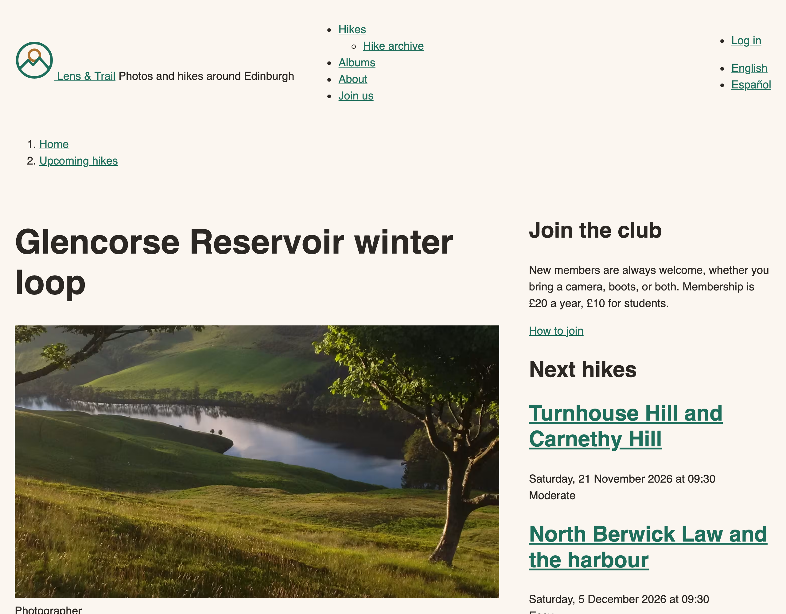
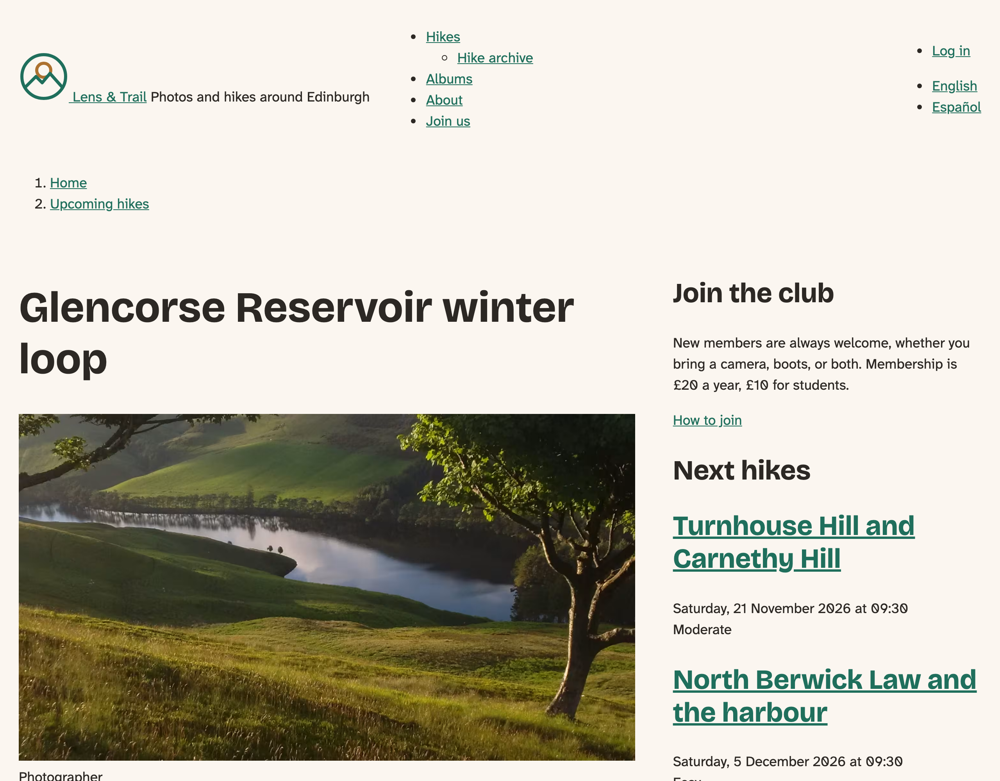
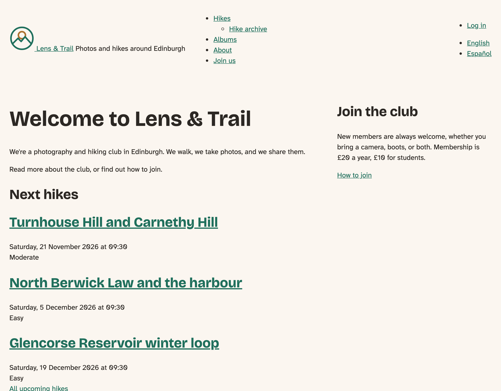
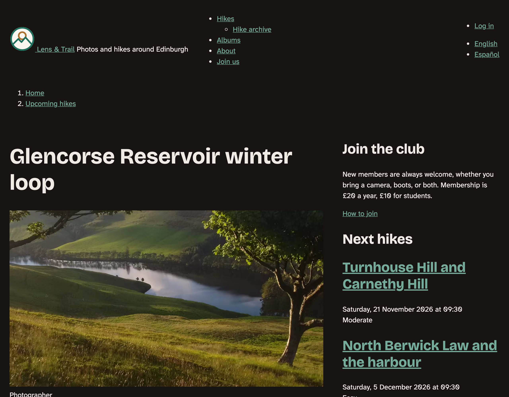
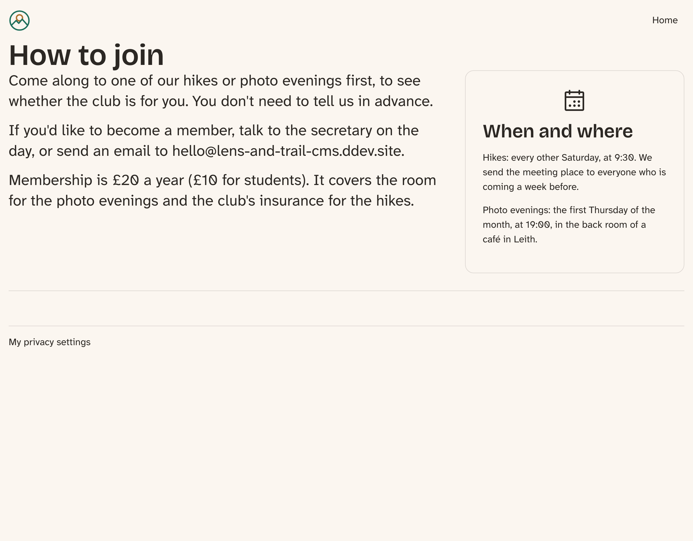

# Libraries and a CSS Architecture

So far, our CSS has been a few files that happened to work. This chapter gives it a plan, before there's so much of it that a plan would be painful to add. We'll clear out most of what Starterkit left us, learn how Drupal loads CSS with **libraries**, put the theme's CSS in order with **cascade layers**, and finally load the club's own fonts.

There's one surprise on the way, and it's the most useful thing in the chapter: moving your CSS into cascade layers makes it *weaker* against CSS that isn't in one. Most of Drupal's CSS isn't. We'll see what that means and what to do about it.

The core site starts at the end of the previous chapter, with its regions and `layout.css`. Near the end, the Drupal CMS site gets a short section of its own.

## Clearing out Starterkit

Chapter 5 removed the templates that were identical to core's. The theme still has 61 templates and 31 files of component CSS, about 20 KB, and none of that CSS uses the club's tokens. It's Starterkit's idea of a neutral site, and every file in your theme is a file you look after.

Here's the rule we used, file by file:

- **CSS that only sets how something looks goes**: breadcrumbs, pagers, tabs, messages, menus. Later chapters style those from the design.
- **CSS that makes something work stays**: dragging table rows, drop buttons, dialogs, progress bars, file uploads, and the form layouts that Chapter 20 will restyle.
- **A template goes when all it adds to core's are classes nothing uses any more.** So the templates leave with their CSS.
- **A template stays with a reason.** Ours are `html` (the body classes), `page` (the regions), `region` (the class `layout.css` uses), `maintenance-page`, and the form and table templates whose classes the remaining CSS needs.

That removes 42 templates and 16 CSS files, along with five libraries that have nothing left in them, and their lines in the info file. **19 templates remain.** You could do this one file at a time with `diff`, comparing each template with core's copy, and it's the method we recommend for your own themes. The result for the club's theme is in the book's repository, in `code/chapter08/steps/01-cleanup/`.

Rebuild the cache, and open some pages. The HTML is simpler, and a few things look plainer: the menu has its bullets back, and a field's label is on its own line.


*Figure 8.1: Plainer, and a great deal less to look after. The later chapters style these parts from the design.*

Nothing broke, and that's what to check for. We loaded the front page, a hike, the hikes list, a basic page and the login form, and looked in the log for errors.

## What a library is

> **Drupalism: library.** Elsewhere, a library is a piece of code you call, like jQuery. In Drupal, an **asset library** is a named group of CSS and JavaScript files, listed in a `.libraries.yml` file. Drupal loads a file only when something on the page asks for its library.

Open `lens_trail.libraries.yml`. Each top-level key is a library. Under `css`, files sit in groups named `base`, `layout`, `component`, `state` and `theme`. Those groups are load order: all the `base` files, on the whole page, come before all the `layout` files, and so on. Inside a group, a lower `weight` loads earlier.

A library can get onto a page in several ways, and the club's theme has a real use for each.

**Globally, from the info file.** `libraries:` in `lens_trail.info.yml` lists what every page gets. Ours is `lens_trail/base`.

**From a template, with `attach_library`.** The styles for the exposed filter form are needed on the hikes list and hardly anywhere else, so they shouldn't be in every visitor's download. We move them to a library of their own, and the template that draws the form asks for it:

```diff
--- templates/views/views-exposed-form.html.twig (before)
+++ templates/views/views-exposed-form.html.twig (after)
@@ -16,6 +16,7 @@
   #}
 {{ q }}
 
+{{ attach_library('lens_trail/exposed-filters') }}
 <div class="form--inline clearfix">
   {{ form }}
 </div>
```

The advantage of asking from the template is that the CSS follows the markup. Wherever that form appears, the styles come along, and where it doesn't, they don't.

**As a dependency.** The new library lists `lens_trail/base` under `dependencies`, so Drupal always loads our base first. A library says what it needs, and Drupal sorts out the order.

**With `libraries-extend`.** The info file has entries such as this one, from Starterkit: when core's `core/drupal.dialog` is loaded, load `lens_trail/dialog` with it. It's how a theme adds its styling to something it didn't attach.

**With `libraries-override`.** This one replaces or removes files from someone else's library. Views' `views.module.css` holds float-based rules for its older Grid style and spacing for display links. The club's site uses neither (its albums use the responsive grid, which has a file of its own), so we can leave it out. Set a file to `false`, and it's gone:

```diff
--- lens_trail.info.yml (before)
+++ lens_trail.info.yml (after)
@@ -4,7 +4,11 @@
 version: 1.0.0
 libraries:
   - lens_trail/base
-  - core/normalize
+libraries-override:
+  views/views.module:
+    css:
+      component:
+        css/views.module.css: false
 libraries-extend:
   core/drupal.dropbutton:
     - lens_trail/dropbutton
```

The path is the one used in that library's own `.libraries.yml`. Use this with care: you're taking something away that a module expects to be there, and a later version of the module may need it. It's worth doing when you've checked, and you know why.

### Aggregation

On a production site, Drupal combines those files into a few larger ones. That's **aggregation**, a setting on **Configuration** > **Development** > **Performance**. Our hike page asks for 20 CSS files, and with aggregation it gets 5. Starterkit's `aggregate_target: css: true` asks Drupal to keep this library's files in an aggregate of their own, so a change elsewhere on the site doesn't change the file every visitor has already downloaded.

While you're developing, turn aggregation off (the theme development mode from the previous chapter does it), so you see each file by its own name in the browser's tools. Then test with it *on* before you trust anything, because that's what the visitors get. It matters this time: we need the order of our files to survive it.

## Cascade layers

Without a plan, CSS is sorted out by specificity and by which rule came last, and you end up writing longer selectors to win arguments with your own earlier work. **Cascade layers** let you name the order up front. A rule in a later layer wins over a rule in an earlier one, however specific that earlier rule is. They've been widely available since September 2024.

Here's the club's plan, in a file of one rule:

`css/layers.css` ([source](../code/chapter08/steps/02-layers/core/lens_trail/css/layers.css))

```css
/*
 * The order of the theme's cascade layers. The first time a layer's name
 * appears decides its place, so this file has to be the first of ours to load.
 * A later layer wins over an earlier one.
 */
@layer reset, tokens, base, layout, components, utilities;
```

Each layer's place is decided by the first time its name appears. So this file has to come before every other file of ours, and that's the job of the `weight: -100`:

```diff
--- lens_trail.libraries.yml (before)
+++ lens_trail.libraries.yml (after)
@@ -4,6 +4,9 @@
     css: true
   css:
     base:
+      css/layers.css:
+        weight: -100
+      css/reset.css: {}
       css/tokens.css: {}
       css/base.css: {}
     layout:
@@ -12,8 +15,6 @@
       css/components/container-inline.css:
         weight: -10
       css/components/details.css:
-        weight: -10
-      css/components/exposed-filters.css:
         weight: -10
       css/components/form.css:
         weight: -10
@@ -62,3 +63,11 @@
     component:
       css/components/tablesort.css:
         weight: -10
+
+exposed-filters:
+  version: VERSION
+  css:
+    component:
+      css/components/exposed-filters.css: {}
+  dependencies:
+    - lens_trail/base
```

We looked in the browser with aggregation on: the statement comes first, then the layers, on each page we tried.

Every file of ours now opens with `@layer base {` or similar. That goes for the 15 component files we kept too. A library can't assign a layer, so each file has to say it for itself. `tokens.css` is generated, so the script gets one more option:

```diff
--- scripts/tokens.py (before)
+++ scripts/tokens.py (after)
@@ -112,7 +112,7 @@
     return f"  {css_name(path)}: {css_value};{comment}"

-def build(sets, tailwind=False):
+def build(sets, tailwind=False, layer=None):
     values, light, dark = (flatten(sets[name]) for name in ("values", "light", "dark"))
     phone, wide = flatten(sets["phone"]), flatten(sets["wide"])
     lines = ["  /* Values */"]
@@ -148,14 +148,19 @@
     # Tailwind's @theme static: every token becomes a custom property on
     # :root, used or not, and the renamed ones become utility classes too.
     opening = "@theme static {" if tailwind else ":root {"
-    return "\n".join(header + [opening] + lines + ["}", ""])
+    block = [opening] + lines + ["}"]
+    # A CSS file can't be put in a cascade layer from a library, so the file
+    # says which layer it belongs to.
+    if layer:
+        block = [f"@layer {layer} {{"] + block + ["}"]
+    return "\n".join(header + block + [""])

-def main(source, target, tailwind=False):
+def main(source, target, tailwind=False, layer=None):
     global renames
     renames = TAILWIND_NAMES if tailwind else {}
     sets = json.loads(Path(source).read_text(encoding="utf-8"))
-    Path(target).write_text(build(sets, tailwind), encoding="utf-8")
+    Path(target).write_text(build(sets, tailwind, layer), encoding="utf-8")
     print(f"Wrote {target}")

@@ -164,6 +169,11 @@
     tailwind = "--tailwind" in arguments
     if tailwind:
         arguments.remove("--tailwind")
+    layer = None
+    for argument in list(arguments):
+        if argument.startswith("--layer="):
+            layer = argument.split("=", 1)[1]
+            arguments.remove(argument)
     if len(arguments) != 2:
         sys.exit(__doc__)
-    main(*arguments, tailwind=tailwind)
+    main(*arguments, tailwind=tailwind, layer=layer)
```

```bash
python3 scripts/tokens.py --layer=tokens design/tokens.json web/themes/custom/lens_trail/css/tokens.css
```

Put the new script in `scripts/` on both sites, in place of the old one.

### The surprise: unlayered CSS wins

Here's the rule that catches people out: **a normal rule outside any layer beats a normal rule inside every layer.** All of Drupal's own CSS, and most contributed modules' CSS, is outside any layer.

So when our CSS moved into layers, it became weaker against Drupal's. Consider `core/normalize`, which Starterkit lists in the info file. Its rule for `h1` sets a font size of `2em`. Before layers, our `h1` came later and won. Now, normalize would beat it, and the club's headings would quietly shrink.

The answer has two halves. For normalize, we replace it. It was written for browsers that differed far more than today's do, and a few lines of our own in the `reset` layer are enough:

`css/reset.css` ([source](../code/chapter08/steps/02-layers/core/lens_trail/css/reset.css))

```css
/*
 * A short reset, in place of normalize.css: only what modern browsers still
 * do differently from what we want.
 */
@layer reset {
  *,
  *::before,
  *::after {
    box-sizing: border-box;
  }

  body {
    margin: 0;
  }

  /* A photo is never wider than the space it's in. */
  img,
  video,
  svg {
    max-inline-size: 100%;
    block-size: auto;
  }

  /* Form controls use the page's font, not the browser's. */
  button,
  input,
  select,
  textarea {
    font: inherit;
  }
}
```

For the rest of Drupal's CSS, we mostly want this behavior. The little files from the System module do things like `.visually-hidden` and `[hidden]`, and they *should* win. When one of them is in the way, deal with that one case: with `libraries-override`, as we did for Views, or with a more honest look at why we're fighting it. We haven't found a case on the club's site yet.

### The base layer

`css/base.css` ([source](../code/chapter08/steps/02-layers/core/lens_trail/css/base.css))

```css
/*
 * The club's first rules: the page's colors, fonts and sizes, from the
 * design tokens in tokens.css, and the things every page needs.
 */
@layer base {
  /* Light or dark, as the visitor's system is set: light-dark() follows this. */
  :root {
    color-scheme: light dark;
  }

  body {
    background-color: var(--color-background);
    color: var(--color-text);
    font-family: var(--font-family-body);
    font-size: var(--font-size-step-0);
    line-height: 1.5;
  }

  h1,
  h2,
  h3 {
    font-family: var(--font-family-heading);
    line-height: 1.2;
  }

  h1 {
    font-size: var(--font-size-step-5);
  }

  h2 {
    font-size: var(--font-size-step-3);
  }

  h3 {
    font-size: var(--font-size-step-2);
  }

  a {
    color: var(--color-action);

    /* A little closer to the text color, in light and in dark mode. */
    &:hover {
      color: color-mix(in oklab, var(--color-action), var(--color-text) 40%);
    }
  }

  /* Where the keyboard is: the same on everything that can take focus. */
  :focus-visible {
    outline: var(--border-focus) solid var(--color-text);
    outline-offset: var(--size-focus-offset);
  }

  /* For visitors who've asked their system for less movement. */
  @media (prefers-reduced-motion: reduce) {
    *,
    *::before,
    *::after {
      animation-duration: 0.01ms !important;
      animation-iteration-count: 1 !important;
      scroll-behavior: auto !important;
      transition-duration: 0.01ms !important;
    }
  }

  /* Forced colors removes backgrounds, so the footer needs a line instead. */
  @media (forced-colors: active) {
    .site-footer {
      border-block-start: var(--border-thin) solid CanvasText;
    }
  }
}
```

Dark mode is unchanged: it's still the tokens and `light-dark()`, and the toggle comes in the chapter on theme settings. There are four new things here.

**`color-mix()`** makes the hover color from two tokens. It works in light and dark mode without another token. Widely available since November 2025.

**`&:hover` inside `a`** is **CSS nesting**, widely available since June 2026. It's what you may know from Sass, now in the browser, with no build step.

**`:focus-visible`** is the rule the Drupal CMS site got in Chapter 6: one visible outline on everything that can take focus, in the width and offset from the design.

**Two media queries for people's settings.** `prefers-reduced-motion` turns animations and transitions down to nothing, for visitors who've asked their system for less movement. `forced-colors` applies when a visitor uses a mode such as Windows High Contrast, where the browser picks the colors and removes backgrounds. The footer depends on a background to stand apart, so there it gets a line instead. We checked both by turning them on in the browser.

> **Try it:** In your browser's developer tools, find the rendering options, and emulate `forced-colors: active`. Look at the footer. Then remove the media query and look again.

`layout.css` from the previous chapter moved into its layer and now uses nesting, with each media query next to the thing it changes:

```diff
--- css/layout.css (before)
+++ css/layout.css (after)
@@ -5,50 +5,51 @@
  * A media query can't use a custom property, so 64rem is written out here:
  * it's the --breakpoint-wide token.
  */
-
-/* The page content is centered, and never wider than the design says. */
-.site-width {
-  max-inline-size: var(--size-content);
-  margin-inline: auto;
-  padding-inline: var(--space-m);
-}
-
-/* On a phone everything is stacked, in the order of the HTML. */
-.site-header {
-  display: grid;
-  gap: var(--space-xs);
-  padding: var(--space-s) var(--space-m);
-}
-
-.page-columns {
-  display: grid;
-  gap: var(--space-xl);
-  padding-block: var(--space-l);
-}
-
-.site-footer {
-  margin-block-start: var(--space-2xl);
-  padding-block: var(--space-xl);
-  background-color: var(--color-surface);
-}
-
-/* The footer's blocks share a row when they fit, however many there are. */
-.site-footer .region-footer {
-  display: grid;
-  grid-template-columns: repeat(auto-fit, minmax(min(100%, 16rem), 1fr));
-  gap: var(--space-l);
-}
-
-@media (min-width: 64rem) {
-  /* Logo on the left, the menu in the middle, the languages on the right. */
-  .site-header {
-    grid-template-columns: auto 1fr auto;
-    align-items: center;
-    gap: var(--space-l);
+@layer layout {
+  /* The page content is centered, and never wider than the design says. */
+  .site-width {
+    max-inline-size: var(--size-content);
+    margin-inline: auto;
+    padding-inline: var(--space-m);
   }

-  /* A second column only on the pages that have something to put in it. */
-  .page-columns:has(> .layout-sidebar) {
-    grid-template-columns: minmax(0, 2fr) minmax(0, 1fr);
+  /* On a phone everything is stacked, in the order of the HTML. */
+  .site-header {
+    display: grid;
+    gap: var(--space-xs);
+    padding: var(--space-s) var(--space-m);
+
+    /* Logo on the left, the menu in the middle, the languages on the right. */
+    @media (min-width: 64rem) {
+      grid-template-columns: auto 1fr auto;
+      align-items: center;
+      gap: var(--space-l);
+    }
+  }
+
+  .page-columns {
+    display: grid;
+    gap: var(--space-xl);
+    padding-block: var(--space-l);
+
+    /* A second column only on the pages that have something to put in it. */
+    @media (min-width: 64rem) {
+      &:has(> .layout-sidebar) {
+        grid-template-columns: minmax(0, 2fr) minmax(0, 1fr);
+      }
+    }
+  }
+
+  .site-footer {
+    margin-block-start: var(--space-2xl);
+    padding-block: var(--space-xl);
+    background-color: var(--color-surface);
+
+    /* The footer's blocks share a row when they fit, however many there are. */
+    & .region-footer {
+      display: grid;
+      grid-template-columns: repeat(auto-fit, minmax(min(100%, 16rem), 1fr));
+      gap: var(--space-l);
+    }
   }
 }
```

**Container queries** are the other modern tool you'll want, and they've been widely available since August 2025. A media query asks how wide the window is; a container query asks how much room a component actually has. They're the right answer for a hike card that appears in three columns or in a sidebar, so we'll use them when we build the card, not before.

## The club's fonts

The core site has been showing its headings and text in a fallback font, while the Drupal CMS site loads full-size TrueType files. Both can do better. Our three font files total about 650 KB. A visitor needs Latin letters, not the rest of the font's character set, and needs only one of Bricolage Grotesque's three variable axes.

**WOFF2** is a compressed font format, supported everywhere that matters. **Subsetting** means keeping only the characters you need. The tool for both is **fontTools**, written in Python, so again no npm:

```bash
python3 -m venv .fonts-venv
.fonts-venv/bin/pip install fonttools brotli
PATH=.fonts-venv/bin:$PATH scripts/fonts.sh
```

Copy `code/chapter08/scripts/fonts.sh` to `scripts/` first, and add `.fonts-venv/` to your `.gitignore`. Here it is:

`scripts/fonts.sh` ([source](../code/chapter08/scripts/fonts.sh))

```bash
#!/usr/bin/env bash
# Make the club's WOFF2 fonts from the TTF files in design/fonts/.
#
#   python3 -m venv .fonts-venv
#   .fonts-venv/bin/pip install fonttools brotli
#   PATH=.fonts-venv/bin:$PATH scripts/fonts.sh
set -euo pipefail

# English and Spanish, typographic punctuation, the euro sign, and the arrows
# and triangles the design uses.
CHARACTERS="U+0020-007E,U+00A0-00FF,U+0131,U+0152-0153,U+2013-2014,U+2018-201A,U+201C-201E,U+2022,U+2026,U+20AC,U+2192,U+2212,U+25B2,U+25BC"

make_woff2() {
  pyftsubset "$1" --unicodes="$CHARACTERS" --layout-features='*' --flavor=woff2 --output-file="$2"
}

cd design/fonts

# Bricolage Grotesque: keep the weight axis, fix optical size and width.
fonttools varLib.instancer "bricolage-grotesque/BricolageGrotesque[opsz,wdth,wght].ttf" \
  opsz=36 wdth=100 -q -o bricolage-grotesque/instanced.ttf
make_woff2 bricolage-grotesque/instanced.ttf bricolage-grotesque/bricolage-grotesque.woff2
rm bricolage-grotesque/instanced.ttf

make_woff2 "atkinson-hyperlegible-next/AtkinsonHyperlegibleNext[wght].ttf" \
  atkinson-hyperlegible-next/atkinson-hyperlegible-next.woff2
make_woff2 "atkinson-hyperlegible-next/AtkinsonHyperlegibleNext-Italic[wght].ttf" \
  atkinson-hyperlegible-next/atkinson-hyperlegible-next-italic.woff2
```

`varLib.instancer` fixes Bricolage Grotesque's optical size and width, so only the weight stays variable. We chose an optical size of 36, which suits the club's heading sizes. `pyftsubset` keeps the characters in the list, and writes WOFF2. If the club adds a language later, the list has to grow.

| Font | TTF | WOFF2 |
|---|---|---|
| Bricolage Grotesque | 408 KB | 45 KB |
| Atkinson Hyperlegible Next | 115 KB | 32 KB |
| Atkinson Hyperlegible Next, italic | 124 KB | 35 KB |

A subset is a modified version of the font, and the Open Font License allows that, as long as the license stays with it and the font's Reserved Font Name, if it has one, isn't used; neither of these fonts declares one. So `OFL.txt` goes with each. Copy the two font folders' `.woff2` files and `OFL.txt` to the theme's `fonts/` folder, and add a stylesheet:

`css/fonts.css` ([source](../code/chapter08/steps/03-fonts/core/lens_trail/css/fonts.css))

```css
/*
 * The club's two fonts, both under the SIL Open Font License (see the OFL.txt
 * next to each font), made smaller by scripts/fonts.sh: Latin characters only,
 * and one variable axis, the weight.
 */

@font-face {
  font-family: "Bricolage Grotesque";
  font-style: normal;
  font-weight: 200 800;
  font-display: swap;
  src: url("../fonts/bricolage-grotesque/bricolage-grotesque.woff2") format("woff2");
}

@font-face {
  font-family: "Atkinson Hyperlegible Next";
  font-style: normal;
  font-weight: 200 800;
  font-display: swap;
  src: url("../fonts/atkinson-hyperlegible-next/atkinson-hyperlegible-next.woff2") format("woff2");
}

@font-face {
  font-family: "Atkinson Hyperlegible Next";
  font-style: italic;
  font-weight: 200 800;
  font-display: swap;
  src: url("../fonts/atkinson-hyperlegible-next/atkinson-hyperlegible-next-italic.woff2") format("woff2");
}
```

Add `css/fonts.css` to the `base` group of the library. There's no `@layer` here: `@font-face` only gives a font its name, and it has no styles to put in order.

`font-display: swap` shows the text straight away in a fallback font, and swaps when the real one arrives, so a slow connection never leaves a visitor looking at a blank page. We don't preload the fonts on the core site. A preload saves a moment on a first visit, and costs some complexity; these files are small now.


*Figure 8.2: The club's own fonts at last.*


*Figure 8.3: The front page.*


*Figure 8.4: Dark mode, unchanged by all of this.*

## On the Drupal CMS site

Tailwind has already made these decisions for Mercury. Tailwind's output is in layers of its own, `theme`, `base`, `components` and `utilities`, plus one called `properties` for its internal variables, so `build/main.min.css` is everything Tailwind found a use for, in those layers.

And now Chapter 6's focus rule makes full sense. Mercury's `src/theme.css` isn't processed by Tailwind and isn't in a layer. It's unlayered, so it wins, by the very rule that makes things awkward for us on the core site. On that site, the same rule works in the theme's favor.

The fonts are the only change. Copy the same `.woff2` and `OFL.txt` files into Mercury's `fonts/` folder, and delete the TTF files there. `src/fonts.css` is the same as the core site's apart from its location, and it needs no build, because it isn't part of what Tailwind makes. The preload links in `templates/includes/preload.twig` now point at the WOFF2 files:

```diff
--- templates/includes/preload.twig (before)
+++ templates/includes/preload.twig (after)
@@ -8,5 +8,5 @@
  */
 #}

-<link rel="preload" href="{{ mercury_path }}/fonts/bricolage-grotesque/BricolageGrotesque[opsz,wdth,wght].ttf" as="font" type="font/ttf" crossorigin />
-<link rel="preload" href="{{ mercury_path }}/fonts/atkinson-hyperlegible-next/AtkinsonHyperlegibleNext[wght].ttf" as="font" type="font/ttf" crossorigin />
+<link rel="preload" href="{{ mercury_path }}/fonts/bricolage-grotesque/bricolage-grotesque.woff2" as="font" type="font/woff2" crossorigin />
+<link rel="preload" href="{{ mercury_path }}/fonts/atkinson-hyperlegible-next/atkinson-hyperlegible-next.woff2" as="font" type="font/woff2" crossorigin />
```

Rebuild the cache and check that a page looks the same as it did. It should look identical, and arrive faster.


*Figure 8.5: Same page, a fraction of the fonts.*

> **Coming from WordPress?** A library is close to what you get with `wp_register_style` and `wp_enqueue_style`: a named asset with dependencies, loaded when it's needed. The differences are that Drupal's are declared in a YAML file and not in PHP, that a template can ask for one with a line of Twig, and that a theme can extend or override a module's libraries without touching the module.

## Summary

You can now:

- audit what a generated theme left you, and remove the CSS and templates you don't need;
- define a library, and load it globally, from a template, or as a dependency;
- use `libraries-extend` and `libraries-override`, and know when an override is worth it;
- check your layout with CSS aggregation on and off;
- plan a theme's CSS with cascade layers, and explain why unlayered CSS beats them;
- use nesting and `color-mix()` without a build step;
- add a visible focus style, and respect reduced motion and forced colors;
- make small WOFF2 fonts from variable TTFs, within the font's license.

## Exercises

1. Pick one of the libraries that the theme still loads on every page (`form.css` is a good one). On which of the club's pages is it actually needed? Could it move to a template with `attach_library`?
2. Open a page with aggregation on and with it off, and count the stylesheets. What's different about the file names? Which would you rather debug?
3. The club makes friends in Kraków. Add the Polish letters (ą, ć, ę, ł, ń, ś, ź, ż and their capitals) to the character list in `fonts.sh`, run it, and compare the file sizes. Which line of the script would you put them on? *(challenge)*
4. Change the `40%` in the hover color to `70%`. Check the contrast of the result against the background in light and dark mode with a contrast checker. Put it back.
5. Put `core/normalize` back in the info file. Find a rule of ours that stops working, and use your browser's developer tools to show why. Then think about what you'd do if you couldn't remove the file. *(advanced)* (The answer is in Appendix B.)

## Want to know more?

- Drupal.org: [Adding assets to a Drupal theme via libraries.yml](https://www.drupal.org/docs/develop/theming-drupal/adding-assets-css-js-to-a-drupal-theme-via-librariesyml).
- MDN: [`@layer`](https://developer.mozilla.org/en-US/docs/Web/CSS/@layer), [CSS nesting](https://developer.mozilla.org/en-US/docs/Web/CSS/CSS_nesting), [`color-mix()`](https://developer.mozilla.org/en-US/docs/Web/CSS/color_value/color-mix), [container queries](https://developer.mozilla.org/en-US/docs/Web/CSS/CSS_containment/Container_queries), [`forced-colors`](https://developer.mozilla.org/en-US/docs/Web/CSS/@media/forced-colors) and [`prefers-reduced-motion`](https://developer.mozilla.org/en-US/docs/Web/CSS/@media/prefers-reduced-motion).
- [fontTools' subsetter](https://fonttools.readthedocs.io/en/latest/subset/).
- Tailwind CSS: [adding custom styles](https://tailwindcss.com/docs/adding-custom-styles), where its layers are explained.
- WordPress: [`wp_enqueue_style`](https://developer.wordpress.org/reference/functions/wp_enqueue_style/).
