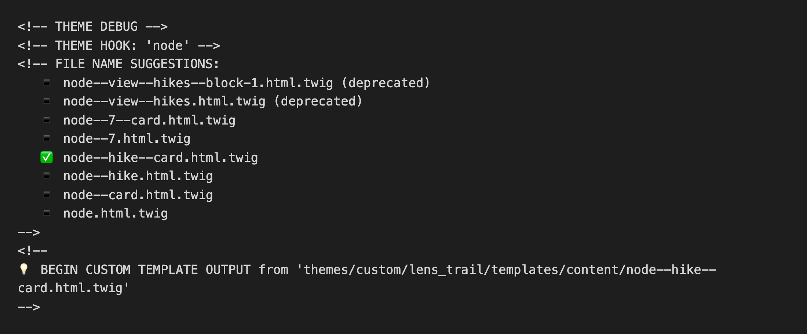
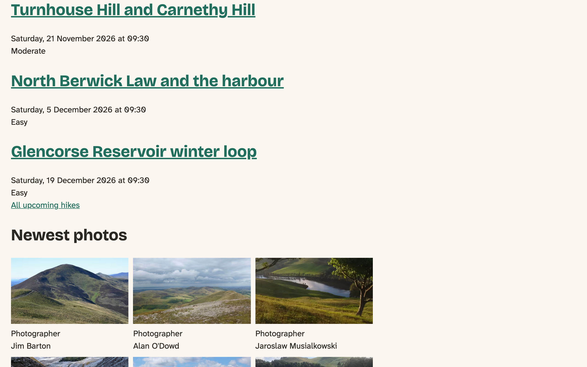
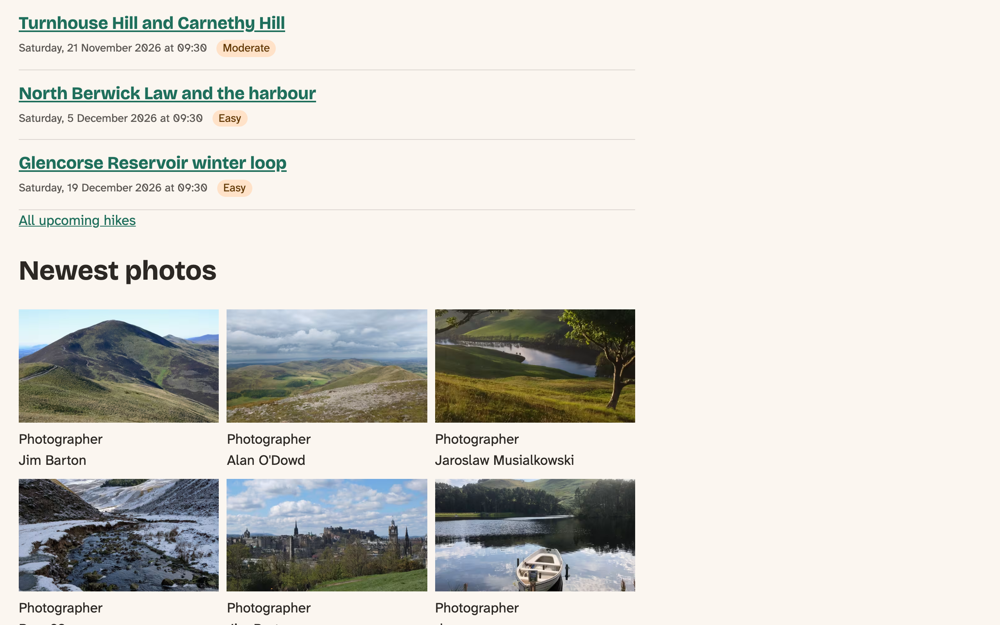
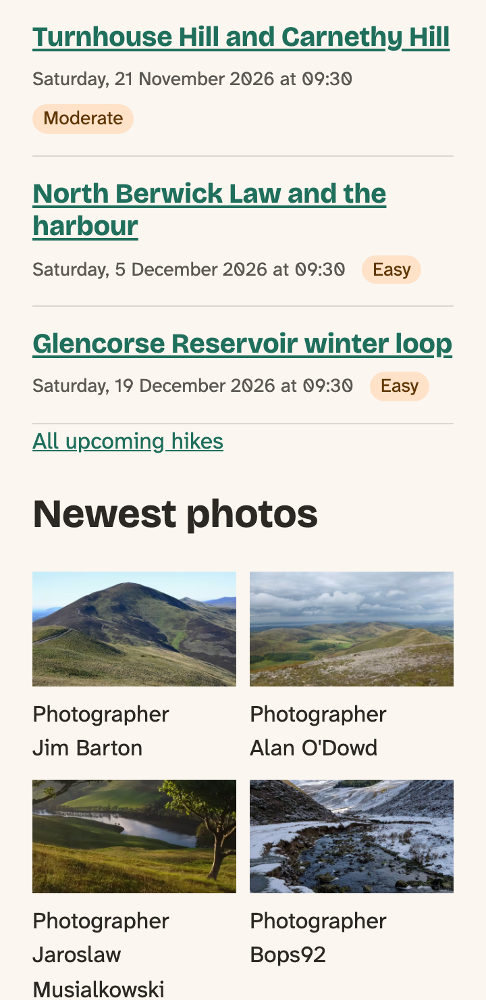
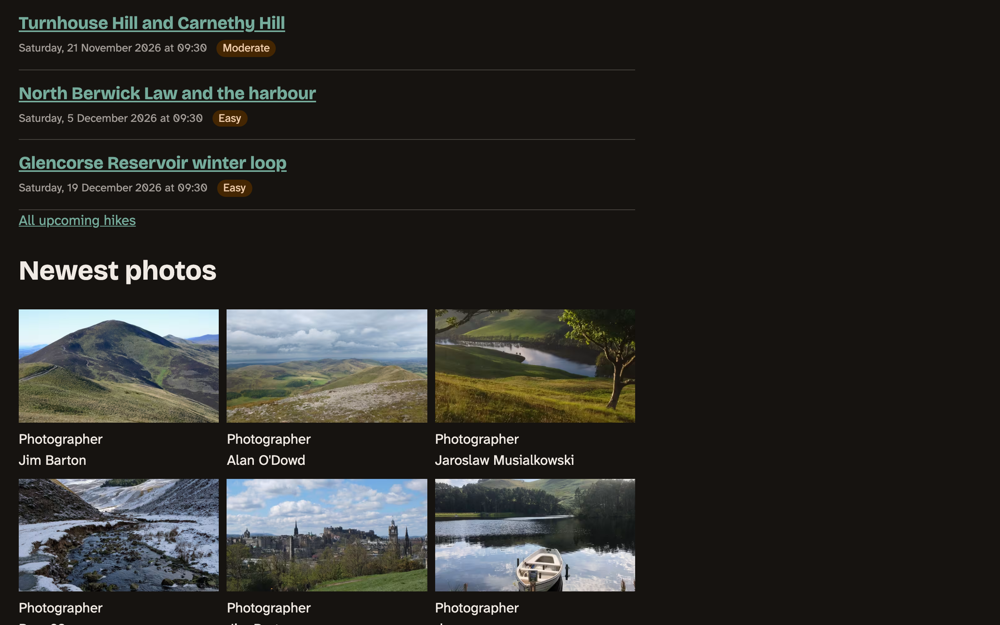
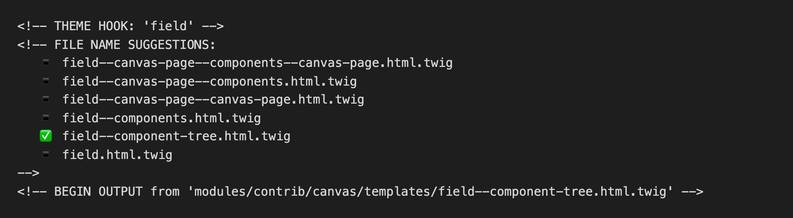

# Twig Basics

We've already edited Twig files, in the chapter on regions, without saying much about the language. This chapter fills that in. We'll learn how to read a Twig template, how to find out which template is producing a piece of a page, and how to change that one piece without taking anything away from Drupal.

We'll do it by building something the club needs. On the front page, the Next hikes block lists three hikes as cards, and the heading order on those cards is wrong. By the end of the chapter, they'll have the right headings, classes of their own and a little CSS, from one small template.

It takes a while for Twig and render arrays to feel natural, so don't worry if some of this seems strange at first. Most of what you need day to day fits in this chapter, and the next-but-one chapter, *Twig in Depth*, goes further.

The core site starts at the end of the previous chapter. The Drupal CMS site gets a short section near the end, with no code to change.

## What a Twig file is made of

Twig is a template language: an HTML file with holes in it, and a few instructions about how to fill them. It has three kinds of markup, and you've now seen all of them in `page.html.twig`:

- `{{ ... }}` **prints** something.
- `` **does** something: a condition, a loop, setting a variable. It prints nothing by itself.
- `{# ... #}` is a **comment**. Twig removes it, so it never reaches the browser, which makes it a safe place for notes that aren't meant for visitors.

Here they all are together:

`twig-syntax.html.twig` ([source](../code/chapter09/snippets/twig-syntax.html.twig))

```twig
{# A comment: Twig removes it, so it never reaches the browser. #}
<p>{{ label }}</p>

  <p>{{ 'Next hike'|t }}</p>



  <p>{{ loop.index }} of {{ hike_count }}: {{ hike }}</p>

```

We rendered that file on the core site with two hikes in the list. Line by line: the comment disappears; `{{ label }}` prints the variable `label`; the `if` prints its paragraph when the view mode is `card`; `set` makes a new variable; and `for` prints one paragraph per hike. Inside a loop, Twig gives you `loop.index`, which counts from 1.

The `|` is a **filter**. It takes what's on its left and changes it: `hikes|length` is the number of hikes, and `'Next hike'|t` is that text, translated. Filters can be chained, and some take arguments in parentheses. A **function** looks like a function in any other language: `link(...)`, and it produces a value of its own rather than changing one.

Where do the variables come from? Drupal hands them to the template. Every template in core starts with a long comment listing what it receives, so the first thing to do with an unfamiliar template is read the top of it. In `web/core/modules/node/templates/node.html.twig`, you'll find `label`, `url`, `view_mode`, `content`, `attributes` and the `node` itself, each with an explanation.

> **Coming from WordPress?** A classic WordPress theme picks a PHP file through the template hierarchy (`single-hike.php`, then `single.php`, then `index.php`), and that file asks for the post's data with functions. In Drupal, the data is prepared first and handed to a template that can't do much more than print it. The list of file names is also different: it's built for each piece of a page, not only for the page as a whole, so a single page is made from dozens of small templates. You'll need to adapt here.

## Which template is it?

Before changing anything, find out what's producing the markup. Turn on **Twig development mode**, as we did in the chapter on regions, and look at the source of the front page. Each hike in the Next hikes block looks like this:


*Figure 9.1: Twig's debug comments around one card, with our template already in place.*

That figure was taken after we'd made the template, so the check mark is beside our file. On your site, right now, it'll be beside `node.html.twig`. Everything else is the same.

There are three things to read in those comments:

- **The theme hook** is `node`. Think of it as the kind of thing being printed. Drupal looks for a template with that name.
- **The file name suggestions** are the names Drupal would accept instead, the most specific first. It uses the first one that exists, starting with your theme.
- **The output line** says which file won and where it is.

Reading the list, `node--7--card` would apply to one hike only, which is too narrow. `node--hike` would change every view mode of every hike, and `node--card` would change the card of every content type. **`node--hike--card.html.twig` is exactly the case we mean**: hikes, in the Card view mode. Book 1 set up that view mode, and here it pays off.

The double dashes separate the parts of the name, and single dashes stand for underscores in a machine name.

The two names at the top, marked *deprecated*, come from Views. They're being removed in Drupal 13, so don't build on them. Use the view mode instead, which is what we're doing.

> **Try it:** Find a teaser on `/hikes` in the page source. Which suggestion would change only hike teasers? Which template is printing the date inside that teaser?

## The first template, for a real reason

Here's the Next hikes block now.


*Figure 9.2: The cards before. The titles are as large as the section heading they belong to.*

Look at the headings. The block's own title, "Next hikes", is an `<h2>`, and core's template makes each card's title an `<h2>` too. To someone moving through the page by headings with a screen reader, the three hikes are the block's equals, when they're its contents.

Remember the order we try things in. Could site building fix this? The display settings can't change a heading level. Could CSS? It can make the text smaller, but the element would still be an `<h2>`, and the screen reader would still say so. Could `attributes`? They change an element's attributes, not which element it is. So this is a job for a template, and for the most specific suggestion we can find. We checked where the Card view mode is used: only in this block, so the level is always the same, and `<h3>` is right every time. (The `/hikes` list uses the Teaser view mode, directly under the page's `<h1>`, so its `<h2>` is correct and stays.)

Chapter 8 removed the `templates/content/` folder along with what was in it, so make it again, and copy core's template. From the root of your site:

`mkdir -p web/themes/custom/lens_trail/templates/content`

`cp web/core/modules/node/templates/node.html.twig web/themes/custom/lens_trail/templates/content/node--hike--card.html.twig`

We copy from core, as we did for `page.html.twig`. Starterkit has its own `node.html.twig` too, full of classes, and it's the one to reach for if you want those classes. We don't: every class in the theme should be there because something uses it.

Now cut it down. The card is only ever shown in a list, so the check for the `full` view mode can go. Hikes don't show "Submitted by", so that part can go as well. Change the `h2` to `h3`, and replace the long comment with a short one saying why this file exists. Whoever opens it next, very possibly you, will want to know.

`templates/content/node--hike--card.html.twig` ([source](../code/chapter09/steps/01-card/core/lens_trail/templates/content/node--hike--card.html.twig))

```twig
{#
/**
 * @file
 * A hike in the Card view mode, as in the Next hikes block.
 *
 * Differs from core's node.html.twig in the heading: the block's title is the
 * h2, so each card's title is an h3. For the variables, see core's template.
 */
#}
<article{{ attributes }}>

  {{ title_prefix }}
  <h3{{ title_attributes }}>
    <a href="{{ url }}" rel="bookmark">{{ label }}</a>
  </h3>
  {{ title_suffix }}

  <div{{ content_attributes }}>
    {{ content }}
  </div>

</article>
```

Rebuild the cache, because Drupal has to discover that a new template exists. After that, in development mode, changes to the file show up when you reload the page.

Notice what we kept: `title_prefix` and `title_suffix`. They look like nothing, and they're empty for visitors, but modules use them. It's where the pencil icon for contextual links gets attached. The rule for a template you've copied is to take out what you know isn't needed, and to leave what you don't understand yet.

## Adding classes without losing Drupal's

Now we want classes, so the card can have some CSS. There's a wrong way that looks right: writing `<article class="hike-card">` in the template. That replaces the `{{ attributes }}` that was there, and with it everything modules have put on the element. The Contextual Links module, for example, adds its class there, and without it the pencil icon has nothing to attach to.

So we add to the attributes instead. A node template gets three of them, and each belongs to one element:

- **`attributes`** for the outermost element, the `<article>`;
- **`title_attributes`** for the heading;
- **`content_attributes`** for the element around the fields.

Each one is an object with a method, `addClass()`, that adds a class and keeps everything else.

Now the fields. We want a class on the date and another on the difficulty, and those elements are printed by `field.html.twig`, not by our template. We could override the field templates, but that's two more files to look after, for one class each. Instead, the `add_class` filter puts a class on what `content.field_date` is about to print. That means printing the fields one at a time. Here's what changes:

```diff
--- templates/content/node--hike--card.html.twig (before)
+++ templates/content/node--hike--card.html.twig (after)
@@ -4,19 +4,23 @@
  * A hike in the Card view mode, as in the Next hikes block.
  *
  * Differs from core's node.html.twig in the heading: the block's title is the
- * h2, so each card's title is an h3. For the variables, see core's template.
+ * h2, so each card's title is an h3, and it gives the card and two of its
+ * fields classes. For the variables, see core's template.
  */
 #}
-<article{{ attributes }}>
+{{ attach_library('lens_trail/hike-card') }}
+<article{{ attributes.addClass('hike-card') }}>

   {{ title_prefix }}
-  <h3{{ title_attributes }}>
+  <h3{{ title_attributes.addClass('hike-card__title') }}>
     <a href="{{ url }}" rel="bookmark">{{ label }}</a>
   </h3>
   {{ title_suffix }}

-  <div{{ content_attributes }}>
-    {{ content }}
+  <div{{ content_attributes.addClass('hike-card__facts') }}>
+    {{ content.field_date|add_class('hike-card__date') }}
+    {{ content.field_difficulty|add_class('hike-card__difficulty') }}
+    {{ content|without('field_date', 'field_difficulty') }}
   </div>

 </article>
```

<details><summary>The complete file</summary>

`templates/content/node--hike--card.html.twig` ([source](../code/chapter09/steps/02-classes/core/lens_trail/templates/content/node--hike--card.html.twig))

```twig
{#
/**
 * @file
 * A hike in the Card view mode, as in the Next hikes block.
 *
 * Differs from core's node.html.twig in the heading: the block's title is the
 * h2, so each card's title is an h3, and it gives the card and two of its
 * fields classes. For the variables, see core's template.
 */
#}
{{ attach_library('lens_trail/hike-card') }}
<article{{ attributes.addClass('hike-card') }}>

  {{ title_prefix }}
  <h3{{ title_attributes.addClass('hike-card__title') }}>
    <a href="{{ url }}" rel="bookmark">{{ label }}</a>
  </h3>
  {{ title_suffix }}

  <div{{ content_attributes.addClass('hike-card__facts') }}>
    {{ content.field_date|add_class('hike-card__date') }}
    {{ content.field_difficulty|add_class('hike-card__difficulty') }}
    {{ content|without('field_date', 'field_difficulty') }}
  </div>

</article>
```

</details>

Those are two ways of adding a class, and they're often mixed up. **`attributes.addClass()` is for an attributes object. `|add_class` is for a render array**, the bundle of data and instructions that Drupal turns into HTML, which is what `content.field_date` is. We'll look inside render arrays in *Twig in Depth*. For now, it's enough to recognize that anything under `content` is one.

The line after them, with the `without` filter, looks odd. We'll come to why it matters in a moment.

The first line of the template, `attach_library()`, is the function we used for the exposed filters in the previous chapter. The card's CSS loads only on pages that show a card. Add the library:

`lens_trail.libraries.yml` ([source](../code/chapter09/steps/02-classes/core/lens_trail/lens_trail.libraries.yml))

```yaml
hike-card:
  version: VERSION
  css:
    component:
      css/components/hike-card.css: {}
  dependencies:
    - lens_trail/base
```

And the CSS, in the `components` layer:

`css/components/hike-card.css` ([source](../code/chapter09/steps/02-classes/core/lens_trail/css/components/hike-card.css))

```css
/**
 * @file
 * The hike card, in the Next hikes block. Chapter 13 makes it a component.
 */
@layer components {
  .hike-card {
    padding-block: var(--space-s);
    border-block-end: var(--border-thin) solid var(--color-border);
  }

  .hike-card__title {
    margin-block: 0 var(--space-2xs);
    font-size: var(--font-size-step-1);
  }

  .hike-card__facts {
    display: flex;
    flex-wrap: wrap;
    align-items: center;
    gap: var(--space-2xs) var(--space-xs);
    font-size: var(--font-size-step--1);
  }

  .hike-card__date {
    color: var(--color-muted);
  }

  .hike-card__difficulty {
    padding-inline: var(--space-2xs);
    border-radius: var(--radius-round);
    background: var(--color-tint);
    color: var(--color-on-tint);
  }
}
```

Rebuild the cache, since the libraries file changed.


*Figure 9.3: The cards now. The headings are in the right order, and the difficulty is a badge.*


*Figure 9.4: The same cards on a phone. The facts wrap by themselves.*


*Figure 9.5: In dark mode. The colors come from the tokens, so there was nothing more to do.*

We checked the card's accessibility as we went. The page's headings now read `h1` Welcome, `h2` Next hikes, then three `h3`s. The badge's text against its background is 8.3:1 in light mode and 9.21:1 in dark mode, and the date is 6.66:1 and 6.9:1. The difficulty is a word, so it doesn't depend on color, and that also means nothing is lost in forced colors mode, where backgrounds go away.

## Printing parts of `content` safely

`{{ content }}` prints all the fields, in the order set on **Manage display**. Taking it apart, as we did for the classes, is common and useful. It's also where a theme can quietly break the site's caching, so let's look at how.

Drupal stores finished HTML so it doesn't have to rebuild pages, and it needs to know when a stored page has gone out of date. So each piece of a page carries labels saying what it was built from. These are **cache tags**: a hike page carries `node:14` for the hike and `taxonomy_term:58` for its area. When someone renames that area, Drupal throws away everything tagged `taxonomy_term:58`.

Those labels travel with the render arrays, and they reach the page **when the render array is printed**. That leads to two ways of losing them.

The first is going around the render array to reach the value:

`node--hike--full.html.twig` ([source](../code/chapter09/snippets/node--hike--full.loses-tag.html.twig))

```twig
<article{{ attributes }}>
  {# Prints the right text, but the term's cache tag is lost. #}
  <p>{{ node.field_area.entity.label }}</p>
</article>
```

The second is printing one field and forgetting the rest:

`node--hike--full.html.twig` ([source](../code/chapter09/snippets/node--hike--full.part-only.html.twig))

```twig
<article{{ attributes }}>
  {# The rest of content is never printed, so its cache tags are lost. #}
  {{ content.field_date }}
</article>
```

And this is the way to do it:

`node--hike--full.html.twig` ([source](../code/chapter09/snippets/node--hike--full.keeps-tag.html.twig))

```twig
<article{{ attributes }}>
  {{ content.field_date }}
  {# Everything else in content: printed, and its cache tags kept. #}
  {{ content|without('field_date') }}
</article>
```

The `without` filter gives you `content` minus the fields you name, so the fields you've already printed don't appear twice. We tried each of these on the hike page of the Glencorse Reservoir winter loop, whose area is term 58, and looked at the tags on the result:

| In the template | The area's name on the page? | `taxonomy_term:58` in the tags? |
|---|---|---|
| `{{ content }}` | Yes | Yes |
| `{{ content.field_area }}` | Yes | Yes |
| `{{ node.field_area.entity.label }}` | Yes | **No** |
| `{{ content.field_date }}` alone | No | **No** |
| `{{ content.field_date }}` and `{{ content\|without('field_date') }}` | Yes | Yes |

The third row is the dangerous one. The page looks perfect, today. Rename the area, and visitors who get the stored page keep seeing the old name, and nothing in the log tells you why. Whereas the `without` line in our card costs nothing: if someone adds another field to the Card display later, it appears by itself.

So two habits: **print from `content`**, and **when you take `content` apart, finish with `content|without(...)`**. We can explain why this works properly once we've opened up render arrays in *Twig in Depth*.

## What Twig escapes for you

Anything a visitor or an editor typed could contain HTML, and if it reached the page as HTML, someone could run a script in another visitor's browser. Twig defends against that by default: when you print a string, it **escapes** it, turning `<` into `&lt;`, so it's shown as text.

We tried it with a title of *Turnhouse \<em\>Hill\</em\>*, in this template:

`escaping.html.twig` ([source](../code/chapter09/snippets/escaping.html.twig))

```twig
<p>{{ title }}</p>
<p>{{ title|raw }}</p>
```

The first line came out as `Turnhouse &lt;em&gt;Hill&lt;/em&gt;`, harmless, with the tags visible on the page. The second came out as `Turnhouse <em>Hill</em>`, as real HTML, because **`|raw` turns escaping off**.

So treat `|raw` as a warning sign. If the value could have come from a person, even an editor you trust, don't use it. When something seems to come out escaped when it shouldn't, the usual cause is that you've reached past the render array to a plain value, and the cure is the same as in the previous section: print from `content`, and let the field's formatter and text format decide what's safe. *Twig in Depth* covers the other half of this, the sandbox that limits what a template can do.

## What Drupal adds to Twig

Twig itself comes with its own filters and functions: `length`, `date`, `join`, `first`, and many more, listed in [Twig's documentation](https://twig.symfony.com/doc/3.x/). On top of those, Drupal adds 25. This is the whole list from Drupal 12, so you can recognize them when you meet them. We've used several already.

| Filter | What it does |
|---|---|
| `t`, `trans` | Translates a string. The two are the same. |
| `placeholder` | Escapes a value and marks it for emphasis, for use inside ``. |
| `escape`, `e` | Escapes, as Twig normally does; Drupal's version knows about render arrays and safe markup. |
| `drupal_escape` | What the two above run. You won't write it yourself. |
| `safe_join` | Joins a list with a separator, escaping each item. |
| `without` | A copy of a render array without the keys you name. |
| `clean_class` | Makes a string safe as a class name (`Very hard` becomes `very-hard`). |
| `clean_id` | The same, for an `id`. |
| `clean_unique_id` | The same, adding a suffix if needed so the `id` is unique on the page. |
| `add_class` | Adds classes to a render array. |
| `set_attribute` | Sets an attribute on a render array. |
| `add_suggestion` | Adds a template suggestion to a render array. |
| `render` | Renders a value to a string, which you rarely need. |
| `format_date` | Formats a timestamp with one of the site's date formats. |

| Function | What it does |
|---|---|
| `url()` | The absolute address of a route. |
| `path()` | The relative path of a route. |
| `link()` | A complete link, from text and a URL. |
| `file_url()` | The address of a file, from its URI. |
| `attach_library()` | Loads a library wherever the template is used. |
| `create_attribute()` | A new attributes object, for elements Drupal didn't give you one for. |
| `active_theme()` | The machine name of the active theme. |
| `active_theme_path()` | The path of the active theme, for files such as icons. |
| `render_var()` | Used internally by `{{ }}`. You won't write it yourself. |

## On the Drupal CMS site

Twig is the same on the Drupal CMS site, and so are the suggestions and the debug comments. There's one surprise when you turn on debugging and look at `/join`.


*Figure 9.6: On a Canvas page, the content is one field.*

The theme's layout templates are there, as you'd expect: `html`, `page`, regions, menus. But all the content of that page goes through one template from the Canvas module, `field--component-tree.html.twig`, and there are no debug comments for what's inside it. The page is built from components, not from fields in templates. We counted 14 templates on the whole page.

So on this site, a change to the hero or a card doesn't start with a suggestion. It starts with a component, and that's what *Single Directory Components* is about. Everything in this chapter still holds for the Twig inside those components. The theme doesn't change in this chapter.

## Summary

You can now:

- read a Twig file: printing, tags, comments, filters and functions;
- find where a template's variables are documented;
- use Twig's debug comments to find the theme hook and pick the most specific suggestion;
- make a template by copying core's and keeping only what the case needs;
- add classes with `attributes.addClass()` and `|add_class`, and say which is for what;
- print parts of `content` without losing cache tags;
- explain what Twig escapes, and why `|raw` is a warning sign.

The club's cards have the right headings and a little CSS, from one template of about twenty lines. In a later chapter that template will hand its markup to a component.

## Exercises

1. Find the suggestions for a hike teaser on `/hikes`. Write down which one you'd pick to change only hike teasers, and which one would change the teasers of every content type.
2. Go to **Structure** > **Content types** > **Hike** > **Manage display** > **Card**, and move **Distance** into the displayed fields. Did you need to change the template? Which line made that work? Move it back.
3. Copy `code/chapter09/snippets/node--hike--full.loses-tag.html.twig` to your theme as `node--hike--full.html.twig`, and rebuild the cache. Open the hike page as an anonymous visitor (twice, so it's stored), rename the area, and reload. What do you see? Delete the file and rebuild the cache.
4. Add `{{ dump(view_mode) }}` to the card, with development mode on. Then try `{{ dump(label) }}`. Why does one come out so much longer than the other? Remove them. *(challenge)*
5. Give each card a class saying its difficulty, such as `hike-card--moderate`, and make the "Hard" badge look different. Which value do you build the class from, and did you lose any cache tags? *(advanced)* (The answer is in Appendix B.)

## Want to know more?

- [Twig's documentation](https://twig.symfony.com/doc/3.x/), for everything that's Twig's and not Drupal's.
- Drupal.org: [Twig in Drupal](https://www.drupal.org/docs/develop/theming-drupal/twig-in-drupal), [Working with Twig templates](https://www.drupal.org/docs/develop/theming-drupal/twig-in-drupal/working-with-twig-templates), [Filters](https://www.drupal.org/docs/develop/theming-drupal/twig-in-drupal/filters-modifying-variables-in-twig-templates) and [Functions](https://www.drupal.org/docs/develop/theming-drupal/twig-in-drupal/functions-in-twig-templates).
- Drupal.org: [Cache tags](https://www.drupal.org/docs/8/api/cache-api/cache-tags), and the [change record](https://www.drupal.org/node/3541462) for the deprecated Views suggestions.
- MDN: [heading elements](https://developer.mozilla.org/en-US/docs/Web/HTML/Reference/Elements/Heading_Elements).
- WordPress: [the template hierarchy](https://developer.wordpress.org/themes/classic-themes/templates/template-hierarchy/).
