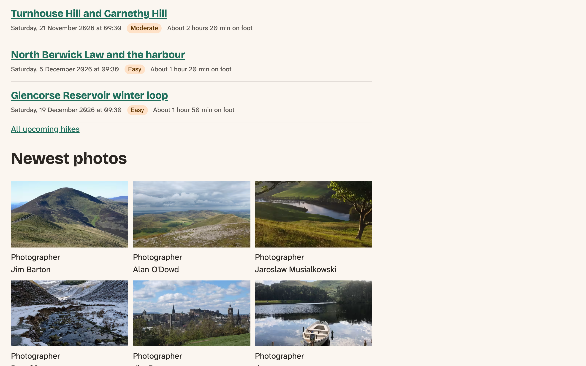
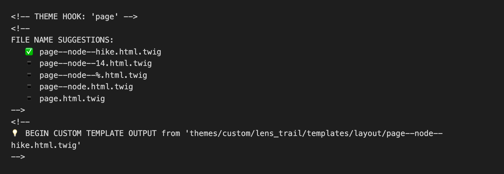
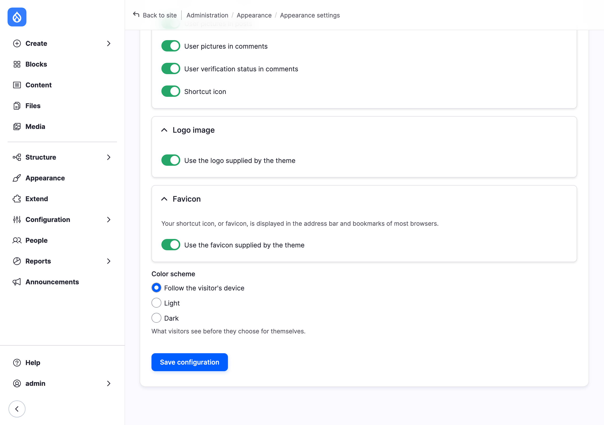

# Preprocess Functions and Theme Settings

Twig prints what it's given. Sometimes what it's given isn't quite enough, and that's where a theme's PHP comes in. In this chapter, we'll give a template a value it didn't have, add template names Drupal doesn't offer, and give the site's administrators a setting of their own.

Then comes the part we most want you to take from this chapter. Once you can override anything, you need to know how to decide when not to, so the chapter finishes with that.

The core site starts at the end of the previous chapter, with its hike cards. The Drupal CMS site gets a short section, with nothing to change.

## Where a theme's PHP lives

Drupal lets code join in at set moments, and those moments are called **hooks**. "Before a node template is printed" is one of them. A theme takes part by saying which hook it wants, and giving Drupal a method to call.

Starterkit already set that up in Chapter 5, in `src/Hook/LensTrailHooks.php`. Open it, and you'll see one method with a line above it that says `#[Hook('preprocess_image_widget')]`. That line is a PHP **attribute**, a label on the method, and this one says "call me for this hook".

Drupal looks for these labels when the cache is rebuilt, so **a new hook needs a cache rebuild** before it runs.

The class can also ask Drupal for services. List them in the constructor with their type, and Drupal hands them over. We'll use that in a moment.

> **The `.theme` file.** Older themes, and much of what you'll find online, keep this code in a file named after the theme, with functions named after the hook:
>
> `lens_trail.theme` ([source](../code/chapter10/snippets/lens_trail.theme))
>
> ```php
> <?php
>
> /**
>  * @file
>  * The older way: a function named after the theme, in lens_trail.theme.
>  */
>
> /**
>  * Implements hook_preprocess_block().
>  */
> function lens_trail_preprocess_block(array &$variables): void {
>   $variables['attributes']['data-from-dot-theme'] = 'yes';
> }
> ```
>
> Drupal 12 still runs these. We tried it. Its own themes have moved to classes, though, and we will too. One warning if you meet a theme using both: **a theme can implement each hook only once**. With `preprocess_node` in the class and in `.theme`, every page on our site gave a 500 error, and the log said *Theme lens_trail should not implement preprocess_node more than once*.

> **Coming from WordPress?** `functions.php` is the nearest thing, and `add_filter()` is the nearest thing to a hook. The difference to adapt to is that Drupal finds the hooks when the cache is rebuilt, rather than when your file runs, so a new one does nothing until you rebuild the cache.

## Preprocess: giving a template what it needs

A **preprocess** hook runs right before a template, and changes the variables the template will receive. Anything you add to `$variables` becomes a variable in Twig.

The club's members keep asking the same thing about a hike: how long will it take? There's a very good Scottish answer. In 1892, the mountaineer William Naismith came up with a rule that walkers still use: allow 12 minutes for each kilometer, and 10 more for each 100 meters of climb. We have the distance and the climb in Book 1's fields, so the theme can work it out.

Could Twig do this? It can multiply, so yes. But a calculation with a blank to allow for and a duration to format is a poor fit for a template, which is about markup. When you have to think about the *logic*, it belongs in PHP. When it's a matter of which element to print, it belongs in Twig.

Here's what changes in the class:

```diff
--- src/Hook/LensTrailHooks.php (before)
+++ src/Hook/LensTrailHooks.php (after)
@@ -2,12 +2,18 @@

 namespace Drupal\lens_trail\Hook;

+use Drupal\Core\Datetime\DateFormatterInterface;
 use Drupal\Core\Hook\Attribute\Hook;

 /**
  * Hook implementations for lens_trail.
  */
 class LensTrailHooks {
+
+  public function __construct(
+    protected DateFormatterInterface $dateFormatter,
+  ) {}
+
   /**
    * @file
    * Functions to support theming.
@@ -28,4 +34,22 @@
     }
   }

+  /**
+   * Implements hook_preprocess_node().
+   *
+   * Adds an estimated walking time to hike cards, with Naismith's rule: 12
+   * minutes for each kilometer, and 10 more for each 100 meters of climb.
+   */
+  #[Hook('preprocess_node')]
+  public function preprocessNode(array &$variables): void {
+    $node = $variables['node'];
+    if ($node->bundle() !== 'hike' || $variables['view_mode'] !== 'card' || $node->get('field_distance')->isEmpty()) {
+      return;
+    }
+    $minutes = $node->get('field_distance')->value * 12
+      + (int) $node->get('field_elevation_gain')->value / 100 * 10;
+    // It's an estimate: nearest ten minutes.
+    $variables['walking_time'] = $this->dateFormatter->formatInterval(round($minutes / 10) * 600);
+  }
+
 }
```

Reading it from the top:

- **The constructor** asks for the date formatter service, because core already knows how to write "2 hours 20 min", in any language the site speaks.
- **The first `if`** leaves right away unless this is a hike, in the Card view mode, with a distance. `preprocess_node` runs for every node on every page, and it must not do anything to the others.
- **A blank climb** counts as zero, through the `(int)`. On the test site, no hike has a climb yet.
- **`round()`** gives the nearest ten minutes, because anything more exact would be pretending.

Now the template can use it, and it should say nothing at all if there's no value. In `node--hike--card.html.twig`:

```diff
--- templates/content/node--hike--card.html.twig (before)
+++ templates/content/node--hike--card.html.twig (after)
@@ -20,6 +20,9 @@
   <div{{ content_attributes.addClass('hike-card__facts') }}>
     {{ content.field_date|add_class('hike-card__date') }}
     {{ content.field_difficulty|add_class('hike-card__difficulty') }}
+    
+      <div class="hike-card__walking-time">{{ 'About @time on foot'|t({'@time': walking_time}) }}</div>
+    
     {{ content|without('field_date', 'field_difficulty') }}
   </div>

```

The words go through `|t`, with `@time` standing in for the value, so a translator can move it wherever the language wants it. In `hike-card.css`, the new element shares the date's muted color:

```diff
--- css/components/hike-card.css (before)
+++ css/components/hike-card.css (after)
@@ -21,7 +21,8 @@
     font-size: var(--font-size-step--1);
   }

-  .hike-card__date {
+  .hike-card__date,
+  .hike-card__walking-time {
     color: var(--color-muted);
   }

```

Rebuild the cache.


*Figure 10.1: The walking time, from a value the template didn't have before.*

> **Try it:** Edit the Turnhouse hike, and put 500 in the elevation gain. Rebuild nothing, reload the front page, and watch "2 hours 20 min" become "3 hours 10 min". Saving the hike clears what was stored, because the hike's cache tag is on the card. Put the field back as it was.

Is caching safe here? Yes, and that's the reason we picked this example. The walking time depends only on the hike, and the card already carries the hike's cache tag.

> **Careful with time.** A natural idea would be "in 12 days". Drupal stores the finished page for anonymous visitors, and that text would still say 12 days tomorrow, and the day after. Setting a maximum age on the card doesn't help, because core's page cache for anonymous visitors doesn't look at it. For values that change with the clock, print the date, and let JavaScript work out the rest in the visitor's browser. The next-but-one chapter is about that.

## Suggestions of your own

Twig's debug comments show the template names Drupal will accept. A theme can add more with `hook_theme_suggestions_HOOK_alter()`, where `HOOK` is the thing being printed.

Let's be open about something first. **The club's site doesn't need any of these.** We went through every template on the front page, and core already offers a name for everything we plan to do. We're going to add four anyway, because they do real work on other sites, try each one, and then take them all out. Some of them will look ridiculous on a photo club's site. That's fine: the point is to see what's possible.

Each of them is a method in a class. You can put them in a file of their own beside `LensTrailHooks.php`. The whole file is `code/chapter10/snippets/SuggestionHooks.php`; here are its four parts.

**A page template per content type.** This is the most-wanted one. Core gives you `page--node--14`, for one node, but nothing for all hikes.

`src/Hook/SuggestionHooks.php` ([source](../code/chapter10/snippets/SuggestionHooks.php))

```php
/**
 * By content type: page--node--hike.html.twig.
 */
#[Hook('theme_suggestions_page_alter')]
public function pageByContentType(array &$suggestions, array $variables): void {
  $node = $this->routeMatch->getParameter('node');
  if ($node instanceof NodeInterface) {
    $suggestions[] = 'page__node__' . $node->bundle();
  }
}
```

When you'd want it: when a content type's page really has different HTML around it. A landing page with no header, say, or an event page with a booking bar. On the hike page it would be overkill, because a second copy of `page.html.twig` is a second place to make each future change, and blocks and CSS can do what we need.


*Figure 10.2: A suggestion we added, chosen by Drupal like any other.*

Notice that it's above `page--node--14`. Drupal tries the last one you added first, so a suggestion added this way beats everything already in the list. Here, that means a template for one particular hike could no longer win. When that matters, put yours where it belongs in the list, as the third example does.

**A field template per view mode.** Core has a name for a field on a content type, but none that means "on the card".

`src/Hook/SuggestionHooks.php` ([source](../code/chapter10/snippets/SuggestionHooks.php))

```php
/**
 * By view mode: field--node--field-date--card.html.twig.
 */
#[Hook('theme_suggestions_field_alter')]
public function fieldByViewMode(array &$suggestions, array $variables): void {
  $element = $variables['element'];
  $suggestions[] = 'field__' . $element['#entity_type'] . '__' . $element['#field_name'] . '__' . $element['#view_mode'];
}
```

When you'd want it: when a field needs different markup in a list than on its own page, and formatters and `|add_class` can't get there. An image that needs a wrapping link only in one view mode is a common case. With this in place, `field--node--field-date--card.html.twig` took over the date on all three cards.

**A block template per region.** Blocks don't know where they've been placed, as far as suggestions go.

`src/Hook/SuggestionHooks.php` ([source](../code/chapter10/snippets/SuggestionHooks.php))

```php
/**
 * By region: block--footer.html.twig.
 */
#[Hook('theme_suggestions_block_alter')]
public function blockByRegion(array &$suggestions, array $variables): void {
  $id = $variables['elements']['#id'] ?? NULL;
  if ($id && $block = Block::load($id)) {
    // Before the others, so the block's own suggestions still win.
    array_unshift($suggestions, 'block__' . $block->getRegion());
  }
}
```

When you'd want it: when every block in a region needs the same different wrapper, such as footer blocks that become columns with a heading of a certain level. Moving a block to another region then changes its markup by itself. `array_unshift()` puts the name at the start of the list, so it's the *least* specific of the block's suggestions, and a template for one particular block can still win.

**A template chosen by a field's value.** This is the one to be most careful with.

`src/Hook/SuggestionHooks.php` ([source](../code/chapter10/snippets/SuggestionHooks.php))

```php
/**
 * By a field's value: node--hike--card--hard.html.twig.
 */
#[Hook('theme_suggestions_node_alter')]
public function nodeByDifficulty(array &$suggestions, array $variables): void {
  $node = $variables['elements']['#node'];
  if ($node->bundle() === 'hike' && !$node->get('field_difficulty')->isEmpty()) {
    $suggestions[] = 'node__hike__' . $variables['elements']['#view_mode'] . '__' . $node->get('field_difficulty')->value;
  }
}
```

With that, `node--hike--card--moderate.html.twig` took over the Moderate hikes, and the Easy ones kept the normal card. When you'd want it: when the markup really is different, a sold-out event with no booking button, for instance. If only the look changes, a class is far cheaper, and the advanced exercise in *Twig Basics* did exactly that. And it works safely only because the value comes from the hike, so it's covered by the hike's cache tag. Don't build one on the current user or today's date without understanding how the cache will treat it.

> **Try it:** Copy `code/chapter10/snippets/SuggestionHooks.php` into `src/Hook/`, and rebuild the cache. With Twig development mode on, find the new names in the page source. Copy `page.html.twig` to `page--node--hike.html.twig`, put a line of text at the top of it, rebuild the cache, and open a hike. Then delete both files and rebuild the cache again, as we did. A suggestion with no template behind it is code doing nothing.

## A setting for the site's administrators

The theme so far follows the visitor's device for light or dark. A club might want to say "we're always light", without asking a developer. That's a **theme setting**: a value stored in the site's configuration, with a form on **Appearance** > **Settings**. It takes three pieces.

**The form.** The hook `form_system_theme_settings_alter` adds a field to the form Drupal already has for the theme:

```diff
--- src/Hook/LensTrailHooks.php (before)
+++ src/Hook/LensTrailHooks.php (after)
@@ -3,15 +3,21 @@
 namespace Drupal\lens_trail\Hook;

 use Drupal\Core\Datetime\DateFormatterInterface;
+use Drupal\Core\Extension\ThemeSettingsProvider;
+use Drupal\Core\Form\FormStateInterface;
 use Drupal\Core\Hook\Attribute\Hook;
+use Drupal\Core\StringTranslation\StringTranslationTrait;

 /**
  * Hook implementations for lens_trail.
  */
 class LensTrailHooks {

+  use StringTranslationTrait;
+
   public function __construct(
     protected DateFormatterInterface $dateFormatter,
+    protected ThemeSettingsProvider $themeSettings,
   ) {}

   /**
@@ -52,4 +58,35 @@
     $variables['walking_time'] = $this->dateFormatter->formatInterval(round($minutes / 10) * 600);
   }

+  /**
+   * Implements hook_form_system_theme_settings_alter().
+   */
+  #[Hook('form_system_theme_settings_alter')]
+  public function themeSettingsAlter(array &$form, FormStateInterface $form_state): void {
+    $form['color_scheme'] = [
+      '#type' => 'radios',
+      '#title' => $this->t('Color scheme'),
+      '#description' => $this->t('What visitors see before they choose for themselves.'),
+      '#options' => [
+        'system' => $this->t("Follow the visitor's device"),
+        'light' => $this->t('Light'),
+        'dark' => $this->t('Dark'),
+      ],
+      '#default_value' => $this->themeSettings->getSetting('color_scheme') ?? 'system',
+    ];
+  }
+
+  /**
+   * Implements hook_preprocess_html().
+   *
+   * Tells the CSS when the site has a fixed color scheme.
+   */
+  #[Hook('preprocess_html')]
+  public function preprocessHtml(array &$variables): void {
+    $scheme = $this->themeSettings->getSetting('color_scheme');
+    if (in_array($scheme, ['light', 'dark'], TRUE)) {
+      $variables['html_attributes']->setAttribute('data-color-scheme', $scheme);
+    }
+  }
+
 }
```

<details><summary>The complete file</summary>

`src/Hook/LensTrailHooks.php` ([source](../code/chapter10/steps/02-color-scheme/core/lens_trail/src/Hook/LensTrailHooks.php))

```php
<?php

namespace Drupal\lens_trail\Hook;

use Drupal\Core\Datetime\DateFormatterInterface;
use Drupal\Core\Extension\ThemeSettingsProvider;
use Drupal\Core\Form\FormStateInterface;
use Drupal\Core\Hook\Attribute\Hook;
use Drupal\Core\StringTranslation\StringTranslationTrait;

/**
 * Hook implementations for lens_trail.
 */
class LensTrailHooks {

  use StringTranslationTrait;

  public function __construct(
    protected DateFormatterInterface $dateFormatter,
    protected ThemeSettingsProvider $themeSettings,
  ) {}

  /**
   * @file
   * Functions to support theming.
   */

  /**
   * Implements hook_preprocess_image_widget().
   */
  #[Hook('preprocess_image_widget')]
  public function preprocessImageWidget(array &$variables): void {
    $data = &$variables['data'];
    // This prevents image widget templates from rendering preview container
    // HTML to users that do not have permission to access these previews.
    // @todo revisit in https://drupal.org/node/953034
    // @todo revisit in https://drupal.org/node/3114318
    if (isset($data['preview']['#access']) && $data['preview']['#access'] === FALSE) {
      unset($data['preview']);
    }
  }

  /**
   * Implements hook_preprocess_node().
   *
   * Adds an estimated walking time to hike cards, with Naismith's rule: 12
   * minutes for each kilometer, and 10 more for each 100 meters of climb.
   */
  #[Hook('preprocess_node')]
  public function preprocessNode(array &$variables): void {
    $node = $variables['node'];
    if ($node->bundle() !== 'hike' || $variables['view_mode'] !== 'card' || $node->get('field_distance')->isEmpty()) {
      return;
    }
    $minutes = $node->get('field_distance')->value * 12
      + (int) $node->get('field_elevation_gain')->value / 100 * 10;
    // It's an estimate: nearest ten minutes.
    $variables['walking_time'] = $this->dateFormatter->formatInterval(round($minutes / 10) * 600);
  }

  /**
   * Implements hook_form_system_theme_settings_alter().
   */
  #[Hook('form_system_theme_settings_alter')]
  public function themeSettingsAlter(array &$form, FormStateInterface $form_state): void {
    $form['color_scheme'] = [
      '#type' => 'radios',
      '#title' => $this->t('Color scheme'),
      '#description' => $this->t('What visitors see before they choose for themselves.'),
      '#options' => [
        'system' => $this->t("Follow the visitor's device"),
        'light' => $this->t('Light'),
        'dark' => $this->t('Dark'),
      ],
      '#default_value' => $this->themeSettings->getSetting('color_scheme') ?? 'system',
    ];
  }

  /**
   * Implements hook_preprocess_html().
   *
   * Tells the CSS when the site has a fixed color scheme.
   */
  #[Hook('preprocess_html')]
  public function preprocessHtml(array &$variables): void {
    $scheme = $this->themeSettings->getSetting('color_scheme');
    if (in_array($scheme, ['light', 'dark'], TRUE)) {
      $variables['html_attributes']->setAttribute('data-color-scheme', $scheme);
    }
  }

}
```

</details>

You'll see `theme-settings.php` in a lot of themes, and Drupal still reads that file. We've kept all of the theme's PHP in one class instead, as Mercury does. There's no save handler to write, either: Drupal stores every value on this form in `lens_trail.settings`.

The same diff has the second half of the job, `preprocess_html`. It reads the setting and, unless it's `system`, puts it on the `<html>` element for the CSS to find. We read it with `ThemeSettingsProvider`, because the older function `theme_get_setting()`, which you'll see everywhere, is on its way out in Drupal 13.

**The CSS.** A rule for each fixed choice, after the one that's already in `base.css`. The tokens already use `light-dark()`, which follows `color-scheme`, so this is all it takes:

```diff
--- css/base.css (before)
+++ css/base.css (after)
@@ -6,6 +6,15 @@
   /* Light or dark, as the visitor's system is set: light-dark() follows this. */
   :root {
     color-scheme: light dark;
+  }
+
+  /* The site's color scheme setting, when it isn't "system". */
+  :root[data-color-scheme="light"] {
+    color-scheme: light;
+  }
+
+  :root[data-color-scheme="dark"] {
+    color-scheme: dark;
   }

   body {
```

**The configuration files.** One file gives the default for a new site, and one describes the setting's shape:

`config/install/lens_trail.settings.yml` ([source](../code/chapter10/steps/02-color-scheme/core/lens_trail/config/install/lens_trail.settings.yml))

```yaml
color_scheme: system
```

`config/schema/lens_trail.schema.yml` ([source](../code/chapter10/steps/02-color-scheme/core/lens_trail/config/schema/lens_trail.schema.yml))

```yaml
lens_trail.settings:
  type: theme_settings
  label: 'Lens & Trail settings'
  mapping:
    color_scheme:
      type: string
      label: 'Color scheme'
      constraints:
        Choice:
          choices:
            - system
            - light
            - dark
```

The **schema** tells Drupal what the value is, so it can check it, translate it and export it properly. `type: theme_settings` brings in everything every theme already has, such as the logo settings. The `Choice` constraint rejects anything else: we tried `purple`, and Drupal refused. On Drupal 12, the list needs the name `choices:` above it. Without that, checking the value stops with an error.

The file in `config/install` is read only when a theme is installed. Our theme is already installed, so on our site it does nothing, and that's why the code has `?? 'system'` and only reacts to `light` and `dark`. Always write settings code so that a missing value is safe.

Rebuild the cache, go to **Appearance**, and choose **Settings** beside the club's theme.


*Figure 10.3: The setting, under the ones every theme gets.*

Set it to **Dark**, save, and open the site in a private window. We tested each choice with an anonymous visitor whose device was in light mode: the page changes on the next load, because saving a theme's settings clears everything stored with the `rendered` cache tag.

The toggle the design promises lets each visitor choose. That comes with JavaScript, and this setting will be what it starts from. Whichever one an administrator picks, the colors are safe: both sets passed their contrast checks in the design chapter.

## On the Drupal CMS site

Everything here works the same way on Drupal CMS, and Mercury makes a good second example to read. Open `src/Hook/ThemeHooks.php` in the `mercury` theme:

- It asks for its services in a constructor, as ours does, and `ThemeSettingsProvider` is one of them.
- It has `form_system_theme_settings_alter`, adding the **Color scheme** setting you tried in the chapter on the Mercury theme.
- Its `preprocess_html` reads that setting into a variable, and `html.html.twig` turns it into a class on the `<html>` element.

That's the same three steps as ours, with a class instead of an attribute. Mercury's schema, in `config/schema/mercury.schema.yml`, lists its choices without the `choices:` name. That's fine on the Drupal 11 site this theme is running on, and it's something to fix if you move it to Drupal 12.

We aren't adding the walking time to this site now. Its cards are components, and we'll come to those.

## How much to override

By now you can replace any template and alter almost anything. So here's the most important thing in this chapter: **a theme that overrides a hundred templates and hooks is the wrong way to write a theme, however well each override works on its own.**

Every override is a copy, and a copy has costs:

- **It misses fixes.** When core improves its markup, for security, accessibility or anything else, your copy stays as it was.
- **Upgrades become work.** Each major version turns into comparing a hundred files by hand.
- **Modules stop matching.** A contributed module's CSS and JavaScript expect its own markup.
- **Nobody can tell what's what.** The next developer can't see which markup is Drupal's and which is yours, or why.

We've seen a real site's move to components end with over a hundred overrides. Each one had looked reasonable on the day. So think hard before every one.

Before you override anything, go through this list, in this order, and stop at the first one that works:

1. **Can site building do it?** View modes, display settings, block settings, all from Book 1.
2. **Can CSS do it**, on the markup Drupal already gives you?
3. **Can `attributes` or a class do it?** `addClass()` and `|add_class`, as on the hike card.
4. **Is there a specific suggestion**, so the override touches one case and not all of them? `node--hike--card`, never a copy of `node.html.twig`.
5. **Can a component be called from one template**, rather than overriding many?
6. **Only then**: a preprocess function, or an override of a theme hook.

We've tried to follow that all the way through the book. The hike card's template exists only because no CSS can change a heading level, and its fields got their classes from a filter, so they have no templates.

It helps to look at the whole picture from time to time. `code/chapter10/scripts/audit_overrides.py` lists a theme's templates, compares each with core's, and lists its hooks. From the root of the site, adjusting the path to wherever you keep the book's files:

`python3 ../theming-drupal/code/chapter10/scripts/audit_overrides.py web/themes/custom/lens_trail web/core`

The club's theme ends with this:

`output` ([source](../code/chapter10/snippets/audit-output.txt))

```text

hook: preprocess_image_widget
hook: preprocess_node
hook: form_system_theme_settings_alter
hook: preprocess_html

20 templates: 19 changed, 1 new, 0 the same as core
4 hooks
```

There are no copies that are the same as core's, and four hooks, each of which we can give a reason for. Of the 19 "changed" templates, `page`, `html` and `region` are there for reasons we gave in earlier chapters, and most of the rest are Starterkit's form and table templates, kept for the classes the remaining CSS needs. Chapter 20, on forms, will look at those again. Having a number is the point: you'll notice when it starts to climb.

<details><summary>The script</summary>

`scripts/audit_overrides.py` ([source](../code/chapter10/scripts/audit_overrides.py))

```python
#!/usr/bin/env python3
"""List what a theme overrides, so that each override can be questioned.

    audit_overrides.py web/themes/custom/lens_trail web/core

Each template is compared with core's template of the same name, ignoring
Twig comments and whitespace, and the theme's PHP is searched for hooks.
"""
import re
import sys
from pathlib import Path

def normalized(path):
    text = re.sub(r"\{#.*?#\}", "", path.read_text(encoding="utf-8"), flags=re.S)
    return " ".join(text.split())

def core_templates(core):
    """Core's templates by file name. Starterkit's are copies for themes."""
    return {
        path.name: path
        for path in sorted(core.rglob("*.html.twig"))
        if "/themes/" not in str(path) and "/tests/" not in str(path)
    }

def main(theme, core):
    originals = core_templates(core)
    counts = {}
    for path in sorted(theme.rglob("*.html.twig")):
        original = originals.get(path.name)
        if original is None:
            base = path.name.split("--")[0] + ".html.twig"
            state = f"new, from a suggestion of {base}" if "--" in path.name else "no core original"
            key = "new"
        elif normalized(path) == normalized(original):
            state, key = "SAME AS CORE: remove it", "same"
        else:
            state, key = "changed", "changed"
        counts[key] = counts.get(key, 0) + 1
        print(f"{path.relative_to(theme)}: {state}")

    hooks = []
    for path in sorted(theme.rglob("*.php")) + sorted(theme.glob("*.theme")):
        text = path.read_text(encoding="utf-8")
        hooks += re.findall(r"#\[Hook\('([^']+)'", text)
        hooks += re.findall(r"^function \w+?_(preprocess_\w+|theme_suggestions_\w+|form_\w+)\(", text, re.M)
    print()
    for hook in hooks:
        print(f"hook: {hook}")
    print()
    print(f"{sum(counts.values())} templates: {counts.get('changed', 0)} changed, "
          f"{counts.get('new', 0)} new, {counts.get('same', 0)} the same as core")
    print(f"{len(hooks)} hooks")

if __name__ == "__main__":
    if len(sys.argv) != 3:
        sys.exit(__doc__)
    main(Path(sys.argv[1]), Path(sys.argv[2]))
```

</details>

## Summary

You can now:

- add a theme's hooks to its class, and say why a new one needs a cache rebuild;
- recognize a `.theme` file, and know not to implement a hook twice;
- add a variable with a preprocess hook, and decide between PHP and Twig;
- add template suggestions, and say when they're worth having;
- add a theme setting, with its form, schema and default;
- keep values that change with time away from stored pages;
- go through the checklist before you override anything.

The club's cards show how long a walk will take, and its administrators can fix the color scheme. The theme has 20 templates and four hooks.

## Exercises

1. Run the audit script on your theme, and pick one of the "changed" templates. Use `diff` to find what it adds to core's. Does anything still use it?
2. Show the walking time only if it's more than two hours. Where would you make that decision, in PHP or in Twig, and why?
3. Add a second setting, a checkbox that hides the walking time. Remember the schema, and check what happens on a site where it has never been saved. *(challenge)*
4. Take three things you changed in a theme you've worked on, and go through the checklist with each one. How far down the list did you need to go?
5. The walking time is in the theme, so the Drupal CMS site can't have it, and it disappears if the club changes themes. Move the calculation somewhere better, so that it shows up on **Manage display**. *(advanced)* (The answer is in Appendix B.)

## Want to know more?

- Drupal.org: [Twig template naming conventions](https://www.drupal.org/docs/develop/theming-drupal/twig-in-drupal/twig-template-naming-conventions), [Creating advanced theme settings](https://www.drupal.org/docs/develop/theming-drupal/creating-advanced-theme-settings), and [Implementing hooks](https://www.drupal.org/docs/develop/creating-modules/implementing-hooks).
- Drupal API: [the theme system overview](https://api.drupal.org/api/drupal/core%21lib%21Drupal%21Core%21Render%21theme.api.php/group/themeable).
- The [change record](https://www.drupal.org/node/3035289) for `theme_get_setting()`.
- Wikipedia: [Naismith's rule](https://en.wikipedia.org/wiki/Naismith%27s_rule), and the corrections people have made to it.
- WordPress: [`functions.php`](https://developer.wordpress.org/themes/classic-themes/basics/theme-functions/).
