# Single Directory Components

So far, the hike card has lived in three places: a template in `templates/content`, a stylesheet in `css/components`, and a library that ties them together. To change the card, you open all three, and to use it somewhere new, you'd copy at least one of them. This chapter puts all of it in one folder, as a **component**, and then puts that same card in three places: the Next hikes block, the list of upcoming hikes, and, on the Drupal CMS site, a page an editor builds by hand in Canvas.

This is the pilot chapter. It's the first one where both sites get real work, so it's also where we find out how the two ways of building a theme sit together in one book.

The core site starts where the JavaScript chapter left it, with the Hike card as `node--hike--card.html.twig` from the chapter on Twig basics. The Drupal CMS site starts as the CSS architecture chapter left the `mercury` theme.

## What a component is

A **Single Directory Component**, SDC for short, is a folder with everything one piece of a page needs:

- `hike-card.component.yml` says what the component is called and what it takes;
- `hike-card.twig` is its markup;
- `hike-card.css` and `hike-card.js`, if it has them, are attached by Drupal wherever the component is used. No library to write, and no `attach_library()`.

The folder goes in `components/` in a theme or a module, at any depth. Drupal finds it by itself, and gives it an ID made of the theme's name and the folder's name: ours will be `lens_trail:hike-card`. That's what templates use to call it.

The point isn't only tidiness. A component has a **contract**: the `.component.yml` lists the values it takes, what type each one is, and which are required. Templates that use the card have to keep to that contract, and Drupal checks that they do. And because the component doesn't know where its values come from, the same card can be filled from a node, from a list, from a styleguide, or by an editor.

> **Drupalism:** "Component" means an SDC in this book, and in most theming talk. But Drupal's own code also has "Components": the PHP libraries under `core/lib/Drupal/Component`, such as `Utility` and `Serialization`, that can be used outside Drupal. They have nothing to do with themes. If someone says "a Drupal component", ask which they mean.

## The Hike card as a component

Make a folder, `components/hike-card`, in the theme. First, the contract:

`components/hike-card/hike-card.component.yml` ([source](../code/chapter13/steps/01-component/core/lens_trail/components/hike-card/hike-card.component.yml))

```yaml
$schema: https://git.drupalcode.org/project/drupal/-/raw/HEAD/core/assets/schemas/v1/metadata.schema.json
name: Hike card
description: A hike in a list, with its title, date and difficulty.
group: Lens & Trail
status: stable
props:
  type: object
  required:
    - title
    - url
  properties:
    title:
      type: string
      title: Title
      description: The hike's title, as plain text.
      examples:
        - Glencorse Reservoir winter loop
    url:
      type: string
      format: uri-reference
      title: Link
      description: Where the title links to, usually the hike's page.
      examples:
        - /hikes/glencorse-reservoir-winter-loop
    heading_level:
      # number, not integer: SDC Styleguide can't read an integer from a demo
      # file. With the enum, only 2, 3 and 4 get through either way.
      type: number
      title: Heading level
      description: The title's heading level, one below the heading the cards are under.
      enum:
        - 2
        - 3
        - 4
      default: 3
slots:
  facts:
    title: Facts
    description: The date, the difficulty and the walking time, rendered by Drupal.
libraryOverrides:
  # The layers are declared in the base library's first file, so it has to
  # come first, or this file would declare a layer out of order.
  dependencies:
    - lens_trail/base
```

The `$schema` line lets a code editor check the file as you type. Then a name and a description for people, and a `group`, which tools such as the styleguide later in this chapter use to sort components.

The component takes two kinds of input:

- **Props** are plain values: a string, a number, a yes or no. They're described in **JSON Schema**, a standard way of saying what a piece of data should look like. The title is a `string`. The link is a string with `format: uri-reference`, which means any link, including one like `/hikes/glencorse-reservoir-winter-loop`. The heading level is a number, and `enum` lists the only values allowed. (Why it's a `number` and not an `integer` is a story for the styleguide section.) `examples` don't change anything on the site, but tools that show the component use them.
- **Slots** are places for markup that someone else has rendered. The card doesn't know or care what the facts are. Drupal renders the date and the difficulty with their field formatters, as it did before, and hands the card the result.

A rule of thumb: if the component has to *do* something with a value (put it in an attribute, compare it, choose a heading with it), it's a prop. If the component only has to *place* it, it's a slot.

The last lines, `libraryOverrides`, need a word. Drupal makes a library for every component by itself, and loads it whenever the component is used. But our CSS is in layers, and `layers.css` in the `base` library says in which order the layers go. If the card's CSS were loaded first, its `@layer components` would be the first layer the browser heard of, and the order would be wrong. So we say that the component depends on `lens_trail/base`.

Now the markup, in `hike-card.twig`:

`components/hike-card/hike-card.twig` ([source](../code/chapter13/steps/01-component/core/lens_trail/components/hike-card/hike-card.twig))

```twig
{#
/**
 * @file
 * The Hike card: a hike in a list.
 *
 * Props: title, url, heading_level. Slots: facts.
 */
#}

<article{{ attributes.addClass('hike-card') }}>
  <{{ heading }} class="hike-card__title">
    <a href="{{ url }}">{{ title }}</a>
  </{{ heading }}>
  <div class="hike-card__facts">
    
      {{ facts }}
    
  </div>
</article>
```

Props arrive as variables with their own names, and a slot arrives the same way, as `facts`. The `` around it is what lets a template fill the slot with `embed`, as you'll see in a moment. `attributes` is there even though we never declared it: Drupal adds it to every component, with a `data-component-id` attribute in it.

The CSS moves too. `css/components/hike-card.css` becomes `components/hike-card/hike-card.css`, with the same rules, and its library goes away:

```diff
--- lens_trail.libraries.yml (before)
+++ lens_trail.libraries.yml (after)
@@ -73,14 +73,6 @@
   dependencies:
     - lens_trail/base

-hike-card:
-  version: VERSION
-  css:
-    component:
-      css/components/hike-card.css: {}
-  dependencies:
-    - lens_trail/base
-
 color-scheme-early:
   version: VERSION
   header: true
```

### Calling the component

The node template is still how Drupal shows a hike in the Card view mode, and it stays. But now all it does is hand the node's values to the component:

```diff
--- templates/content/node--hike--card.html.twig (before)
+++ templates/content/node--hike--card.html.twig (after)
@@ -3,27 +3,23 @@
  * @file
  * A hike in the Card view mode, as in the Next hikes block.
  *
- * Differs from core's node.html.twig in the heading: the block's title is the
- * h2, so each card's title is an h3, and it gives the card and two of its
- * fields classes. For the variables, see core's template.
+ * The markup and styles are in the Hike card component. This template only
+ * hands it the node's values. The block's title is the h2, so each card's
+ * title is an h3. For the variables, see core's node.html.twig.
  */
 #}
-{{ attach_library('lens_trail/hike-card') }}
-<article{{ attributes.addClass('hike-card') }}>
-
-  {{ title_prefix }}
-  <h3{{ title_attributes.addClass('hike-card__title') }}>
-    <a href="{{ url }}" rel="bookmark">{{ label }}</a>
-  </h3>
-  {{ title_suffix }}
-
-  <div{{ content_attributes.addClass('hike-card__facts') }}>
+
+  
+    {{ title_suffix }}
     {{ content.field_date|add_class('hike-card__date') }}
     {{ content.field_difficulty|add_class('hike-card__difficulty') }}
     
       <div class="hike-card__walking-time">{{ 'About @time on foot'|t({'@time': walking_time}) }}</div>
     
     {{ content|without('field_date', 'field_difficulty') }}
-  </div>
-
-</article>
+  
+
```

<details><summary>The complete file</summary>

`templates/content/node--hike--card.html.twig` ([source](../code/chapter13/steps/01-component/core/lens_trail/templates/content/node--hike--card.html.twig))

```twig
{#
/**
 * @file
 * A hike in the Card view mode, as in the Next hikes block.
 *
 * The markup and styles are in the Hike card component. This template only
 * hands it the node's values. The block's title is the h2, so each card's
 * title is an h3. For the variables, see core's node.html.twig.
 */
#}

  
    {{ title_suffix }}
    {{ content.field_date|add_class('hike-card__date') }}
    {{ content.field_difficulty|add_class('hike-card__difficulty') }}
    
      <div class="hike-card__walking-time">{{ 'About @time on foot'|t({'@time': walking_time}) }}</div>
    
    {{ content|without('field_date', 'field_difficulty') }}
  

```

</details>

`embed` calls the component with some props, and lets us fill its `facts` block. Inside the block we write what the old template had. `title_suffix` comes along too, because that's where Drupal puts the contextual links that let an editor jump to **Edit** from the card. We checked: they're still there when you're logged in, because the node template's `attributes` reach the component too, `contextual-region` class and all.

Notice `node.label` for the title. In the chapter on Twig in depth, we learned that `label` is a render array, not text. Try it with `label`:

`node--hike--card.html.twig` ([source](../code/chapter13/snippets/node--hike--card.label.html.twig))

```twig
{# Wrong: label is a render array, and the title prop wants a string. #}


```

We expected an error, because the prop wants a string. There wasn't one. Drupal deliberately lets a render array through to a string prop, so the page worked, but the link now had the field template's `<span>` inside it. `node.label` is the title as plain text, which is what the contract asked for.

After a cache rebuild, the front page looks exactly as it did:

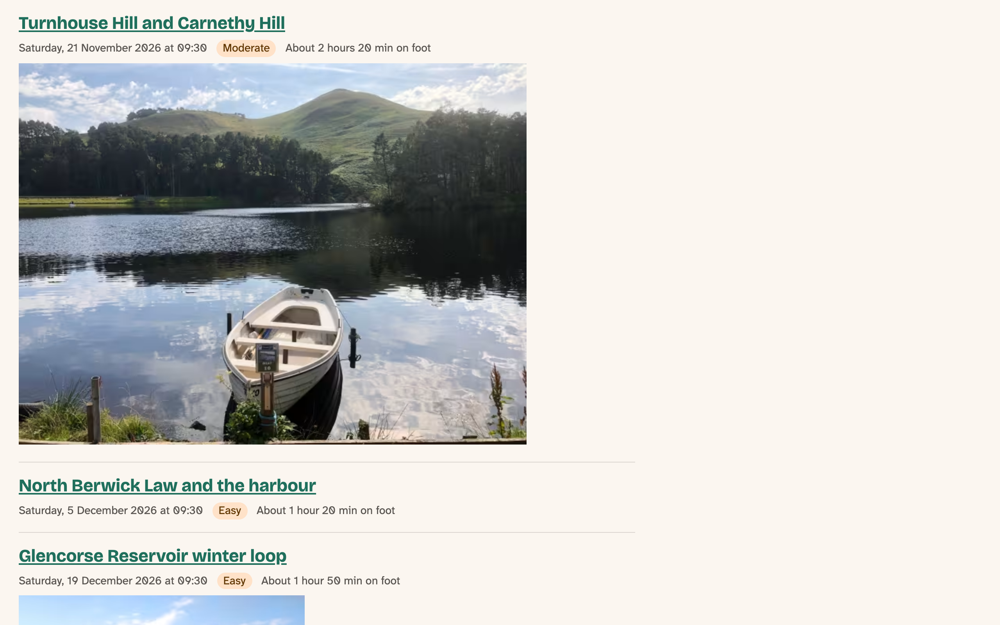
*Figure 13.1: The Next hikes block, now drawn by the component. It looks the same, which was the point*

The difference is in the source: each card is `<article data-component-id="lens_trail:hike-card" class="hike-card">`. With Twig debugging on, the comments name the node template as before, and then add `Component start: lens_trail:hike-card`, so you can see where one ends and the other begins.

### When the contract is broken

Let's break it on purpose. Give the heading a level the component doesn't allow:

`node--hike--card.html.twig` ([source](../code/chapter13/snippets/node--hike--card.level5.html.twig))

```twig
{# Wrong: 5 isn't one of the heading levels the component allows. #}


```

The front page stopped with "The website encountered an unexpected error", and **Reports** › **Recent log messages** said exactly what was wrong:

`output` ([source](../code/chapter13/snippets/level5-error.txt))

```text
Component validation failed in Twig file [themes/custom/lens_trail/templates/content/node--hike--card.html.twig] for component [lens_trail:hike-card]: [lens_trail:hike-card/heading_level] Does not have a value in the enumeration [2,3,4]. The provided value is: "5".
```

That check runs only when PHP's assertions are turned on, which they are in DDEV and in Drupal's development settings. On a production server they're usually off, so the card would have quietly printed an `h5`. That's the right trade: mistakes are loud while you work, and visitors never get an error page because of a heading. But it means you have to look at your pages before you deploy.

## `include` or `embed`?

In the chapter on Twig in depth, we promised to compare these two properly, and here they both are. This is the same card with `include`:

`node--hike--card.html.twig` ([source](../code/chapter13/snippets/node--hike--card.include.html.twig))

```twig
{# The same card with include: the facts are captured first, then passed. #}

  {{ title_suffix }}
  {{ content.field_date|add_class('hike-card__date') }}
  {{ content.field_difficulty|add_class('hike-card__difficulty') }}
  
    <div class="hike-card__walking-time">{{ 'About @time on foot'|t({'@time': walking_time}) }}</div>
  
  {{ content|without('field_date', 'field_difficulty', 'field_photo') }}

{{ include('lens_trail:hike-card', {
  attributes: attributes,
  title: node.label,
  url: url,
  heading_level: heading_level|default(3),
  variant: 'beside',
  photo: content.field_photo|render,
  facts: facts,
}, with_context = false) }}
```

With `include`, a slot is a value like any other, so the facts have to be made first. ` ... ` collects whatever is rendered between the tags into a variable. `with_context = false` is `only` for the `include()` function: the component sees what's listed, and nothing else. Because of that, we have to pass `attributes` ourselves.

It worked, and the HTML was the same as with `embed`. So which one?

| | `include` | `embed` |
|---|---|---|
| A slot is filled with | a value, made first | a ``, written in place |
| Sees the template's variables | only what you pass, with `only` | yes, unless you add `only` |
| Reads best when | all the inputs are props, or slots are short | a slot holds real markup |
| The component needs | nothing special | a `` for each slot |

That second row hides a trap. Since the chapter on Twig in depth, we've used `only` with `include`, so it's tempting to add it to `embed` too:

`node--hike--card.html.twig` ([source](../code/chapter13/snippets/node--hike--card.embed-only.html.twig))

```twig
{# Wrong: with only, the block can't see content or walking_time. #}

  
    {{ content.field_date }}
    {{ content.field_difficulty }}
  

```

No error, and no facts: the cards had a title and an empty box. A block in an `embed` runs with the embedded template's variables, and `only` left only `title` and `url` among them. So `content` was empty, and Twig doesn't complain about an empty variable.

We kept `embed` for the card. The facts are markup, and they read better where they go. When a component has only props, `include` with `only` is the tidier choice.

## A photo, and room to move

The design's card has a photo, on top on a phone and in a grid, and beside the text in the single-column list on a tablet. Doing that takes three things: the photo in the Card view mode, a slot for it in the component, and a way for the card to know how much room it has.

### The photo in the Card view mode

This part is site building, as in the first book's chapter on display modes:

1. Go to **Structure** › **Content types** › **Hike** › **Manage display**, and open the **Card** tab.
2. Drag **Photo** up from **Disabled**, and set its label to **- Hidden -**.
3. Set its format to **Thumbnail**, then use the gear to choose the image style **Max 650x650**, with no link. Leave lazy loading on.
4. **Save**.

The Thumbnail formatter shows the media item's image, with its alt text, in an image style. It's a stopgap: the images chapter gives the card proper responsive images, and the photo credit the design puts in its corner.

### A photo slot, and variants

The contract grows by one slot and two **variants**:

```diff
--- components/hike-card/hike-card.component.yml (before)
+++ components/hike-card/hike-card.component.yml (after)
@@ -1,6 +1,6 @@
 $schema: https://git.drupalcode.org/project/drupal/-/raw/HEAD/core/assets/schemas/v1/metadata.schema.json
 name: Hike card
-description: A hike in a list, with its title, date and difficulty.
+description: A hike in a list, with its photo, title, date and difficulty.
 group: Lens & Trail
 status: stable
 props:
@@ -34,9 +34,19 @@
         - 4
       default: 3
 slots:
+  photo:
+    title: Photo
+    description: The hike's photo, as an image Drupal has rendered. Optional.
   facts:
     title: Facts
     description: The date, the difficulty and the walking time, rendered by Drupal.
+variants:
+  top:
+    title: Photo on top
+    description: The photo above the text, at any width.
+  beside:
+    title: Photo beside
+    description: The photo beside the text when the card is at least 30rem wide, on top when it's narrower.
 libraryOverrides:
   # The layers are declared in the base library's first file, so it has to
   # come first, or this file would declare a layer out of order.
```

A variant is a named version of the same component: same props, same slots, different presentation. `top` keeps the photo on top whatever happens. `beside` puts it beside the text, but only when the card is wide enough. You choose a variant with a `variant` value, and Drupal writes it into the component's attributes as `data-component-variant`, where the CSS can find it.

```diff
--- components/hike-card/hike-card.twig (before)
+++ components/hike-card/hike-card.twig (after)
@@ -3,17 +3,26 @@
  * @file
  * The Hike card: a hike in a list.
  *
- * Props: title, url, heading_level. Slots: facts.
+ * Props: title, url, heading_level. Slots: photo, facts.
+ * Variants: top (the default), beside. Drupal puts the variant in the
+ * data-component-variant attribute, and the CSS reads it from there.
  */
 #}
 
 <article{{ attributes.addClass('hike-card') }}>
-  <{{ heading }} class="hike-card__title">
-    <a href="{{ url }}">{{ title }}</a>
-  </{{ heading }}>
-  <div class="hike-card__facts">
-    
-      {{ facts }}
-    
+  <div class="hike-card__layout">
+    <div class="hike-card__text">
+      <{{ heading }} class="hike-card__title">
+        <a href="{{ url }}">{{ title }}</a>
+      </{{ heading }}>
+      <div class="hike-card__facts">
+        
+          {{ facts }}
+        
+      </div>
+    </div>
+    
+      <div class="hike-card__photo">{{ photo }}</div>
+    
   </div>
 </article>
```

The photo comes *after* the text in the HTML, so a screen reader meets the title first, and the CSS moves it to the top. And there's a new wrapper, `hike-card__layout`, which the CSS below explains.

The node template hands over the photo and chooses the variant:

```diff
--- templates/content/node--hike--card.html.twig (before)
+++ templates/content/node--hike--card.html.twig (after)
@@ -5,13 +5,17 @@
  *
  * The markup and styles are in the Hike card component. This template only
  * hands it the node's values. The block's title is the h2, so each card's
- * title is an h3. For the variables, see core's node.html.twig.
+ * title is an h3, unless a template that includes this one says otherwise.
+ * The photo goes beside the text when the card is wide enough.
+ * For the variables, see core's node.html.twig.
  */
 #}
 
   
     {{ title_suffix }}
@@ -20,6 +24,6 @@
     
       <div class="hike-card__walking-time">{{ 'About @time on foot'|t({'@time': walking_time}) }}</div>
     
-    {{ content|without('field_date', 'field_difficulty') }}
+    {{ content|without('field_date', 'field_difficulty', 'field_photo') }}
   
 
```

The photo is filled in the other way, as a value: `content.field_photo|render`. The `|render` is the empty-field trap from the chapter on Twig in depth again. A hike without a photo still has a `field_photo` key with cache information in it, which Twig counts as something. Rendered, it's an empty string, and the component's `` leaves the photo's `div` out. That's two of the hikes on the test site.

### A card that knows its own width

Now the CSS. A media query asks how wide the *screen* is, but the card doesn't care about the screen. In the Next hikes block it may be narrow on a wide screen, and in a list it may be wide on a tablet. What it needs to know is how wide *it* is, and that's what a **container query** asks:

`components/hike-card/hike-card.css` ([source](../code/chapter13/steps/02-variants/core/lens_trail/components/hike-card/hike-card.css))

```css
/**
 * @file
 * The Hike card component. Drupal attaches it wherever the card is used.
 */
@layer components {
  .hike-card {
    /* The card's own width decides the layout, not the screen's. A
       container no longer takes its width from what's inside it, so in a
       wrapper that shrinks to fit, it would shrink to nothing. */
    container-type: inline-size;
    inline-size: 100%;
    overflow: hidden;
    border: var(--border-thin) solid var(--color-border);
    border-radius: var(--radius-medium);
    background: var(--color-surface);
  }

  .hike-card__layout {
    display: grid;
  }

  /* The photo comes after the text in the HTML, so a screen reader meets the
     title first, and it's drawn on top. */
  .hike-card__photo {
    order: -1;

    & img {
      display: block;
      width: 100%;
      height: auto;
      aspect-ratio: 3 / 2;
      object-fit: cover;
    }
  }

  .hike-card__text {
    padding: var(--space-s);
  }

  .hike-card__title {
    margin-block: 0 var(--space-2xs);
    font-size: var(--font-size-step-1);
  }

  .hike-card__facts {
    display: flex;
    flex-wrap: wrap;
    align-items: center;
    gap: var(--space-2xs) var(--space-xs);
    font-size: var(--font-size-step--1);
  }

  .hike-card__date,
  .hike-card__walking-time {
    color: var(--color-muted);
  }

  .hike-card__difficulty {
    padding-inline: var(--space-2xs);
    border-radius: var(--radius-round);
    background: var(--color-tint);
    color: var(--color-on-tint);
  }

  /* Photo beside, when the card has room for it: Chapter 3's 30rem. A
     container query can't style the container itself, so it's the layout
     inside the card that changes. */
  @container (inline-size >= 30rem) {
    [data-component-variant="beside"] .hike-card__layout:has(.hike-card__photo) {
      grid-template-columns: 2fr 3fr;
      align-items: start;
    }
  }
}
```

`container-type: inline-size` makes the card a container, and `@container (inline-size >= 30rem)` asks about the nearest container around the element being styled. 30rem is Chapter 3's container switch. Three things here took us a try or two:

- **A container can't query itself.** The card is the container, so a rule inside `@container` can style what's in the card, but not the card. That's why the grid is on the new `hike-card__layout` inside it.
- **A container doesn't take its width from what's inside it.** In a normal block that makes no difference. But in a wrapper that shrinks to fit its content, as the styleguide's is later in this chapter, the card shrank to nothing. `inline-size: 100%` fixes that.
- `:has(.hike-card__photo)` keeps a card without a photo in one column, instead of an empty one on the left.

Container queries have been in every major browser since February 2023, and widely available on Baseline's scale since August 2025. `:has()` became widely available in June 2026.

Last, a little space between the rows of a list, in `css/layout.css`, until the chapter on Views gives lists their own layout:

```diff
--- css/layout.css (before)
+++ css/layout.css (after)
@@ -40,6 +40,12 @@
     }
   }

+  /* Space between the rows of a list, such as the hike cards. Lists get
+     their own layout in the chapter on views. */
+  .views-row + .views-row {
+    margin-block-start: var(--space-m);
+  }
+
   .site-footer {
     margin-block-start: var(--space-2xl);
     padding-block: var(--space-xl);
```

After a cache rebuild, the Next hikes block has photos, beside the text, because the block is in the wide content column:

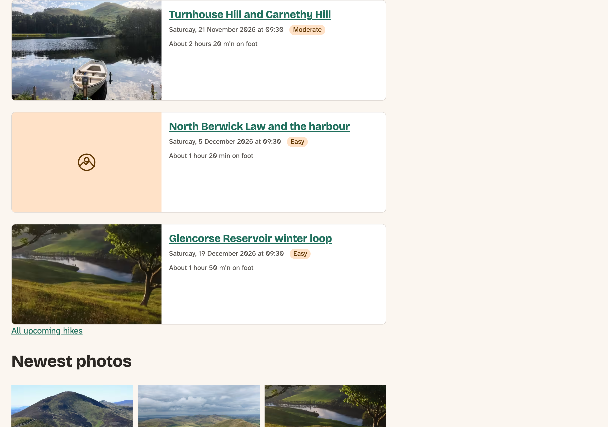
*Figure 13.2: Photos beside the text, because the cards have room. North Berwick has no photo yet, and its card is one column*

## One card, two headings

Now the list of upcoming hikes on `/hikes`. It shows hikes in the Teaser view mode, and we'd like the same cards there. In the View, that's one setting. But look at the headings. In the Next hikes block, the block's title is the `h2`, so each card's title is an `h3`. On `/hikes`, the page title is the `h1`, and there's nothing in between, so each card should be an `h2`. Skipping from `h1` to `h3` makes the page's outline harder to follow for screen reader users, who often move around a page by its headings.

That's what `heading_level` is for. But who decides it? The tempting answer is the node template: "if I'm in the list, use 2". We tried a version of that, and it can't work. Drupal keeps a rendered copy of each node **per view mode**, and reuses it wherever that node is shown in that view mode. To see it, we put the time, `{{ "now"|date("H:i:s") }}`, into the card, switched `/hikes` to the Card view mode, and loaded the front page and then `/hikes`, three seconds later. Both showed `16:53:09`, and both had `h3` headings. Whichever page drew a card first decided its heading for both.

So the place has to be a different view mode, and that's site building again:

1. **Structure** › **Display modes** › **View modes** › **Add view mode**, for **Content**. Call it **Card in a list**. Its machine name becomes `card_list`.
2. In the Hike content type's **Manage display**, open **Custom display settings** at the bottom of the **Default** tab, tick **Card in a list**, and **Save**.
3. On the new **Card in a list** tab, show **Date**, **Difficulty** and **Photo** as in **Card** (Photo as **Thumbnail**, **Max 650x650**), and hide the rest.
4. In **Structure** › **Views**, edit **Hikes**, and choose the **Page** display (`/hikes`). Under **Format**, click **Content** next to **Show**, choose **This page (override)**, set the view mode to **Card in a list**, and **Apply**, then **Save** the View.

Drupal now looks for `node--hike--card-list.html.twig` for those cards. It's the same card, one level up, so the whole template is this:

`templates/content/node--hike--card-list.html.twig` ([source](../code/chapter13/steps/02-variants/core/lens_trail/templates/content/node--hike--card-list.html.twig))

```twig
{#
/**
 * @file
 * A hike in the Card in a list view mode, as on /hikes.
 *
 * The same card as in the Card view mode, but under the page's h1, so its
 * title is an h2.
 */
#}

```

It includes the Card template and gives it one value. The Card template reads it, with `heading_level|default(3)`, so it works on its own too. And the walking time from the preprocess chapter has to know about the new view mode:

```diff
--- src/Hook/LensTrailHooks.php (before)
+++ src/Hook/LensTrailHooks.php (after)
@@ -49,7 +49,7 @@
   #[Hook('preprocess_node')]
   public function preprocessNode(array &$variables): void {
     $node = $variables['node'];
-    if ($node->bundle() !== 'hike' || $variables['view_mode'] !== 'card' || $node->get('field_distance')->isEmpty()) {
+    if ($node->bundle() !== 'hike' || !in_array($variables['view_mode'], ['card', 'card_list'], TRUE) || $node->get('field_distance')->isEmpty()) {
       return;
     }
     $minutes = $node->get('field_distance')->value * 12
```

After a cache rebuild:

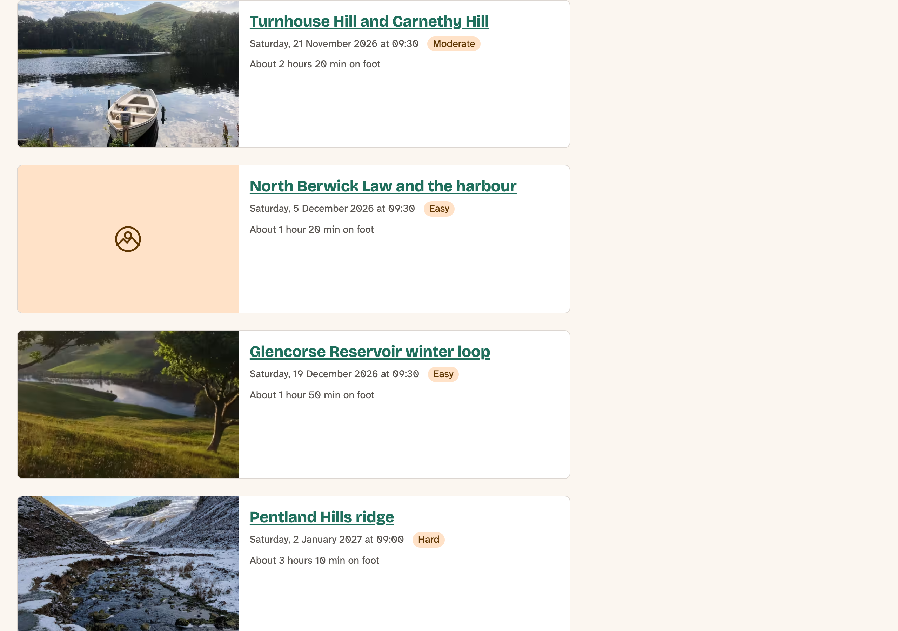
*Figure 13.3: The upcoming hikes, with `h2` titles under the page's `h1`*

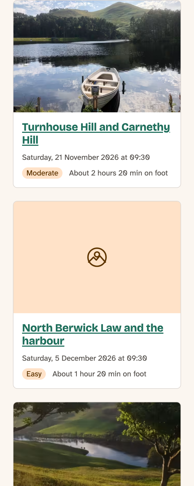
*Figure 13.4: On a phone, the cards are narrower than 30rem, and the photos go on top*

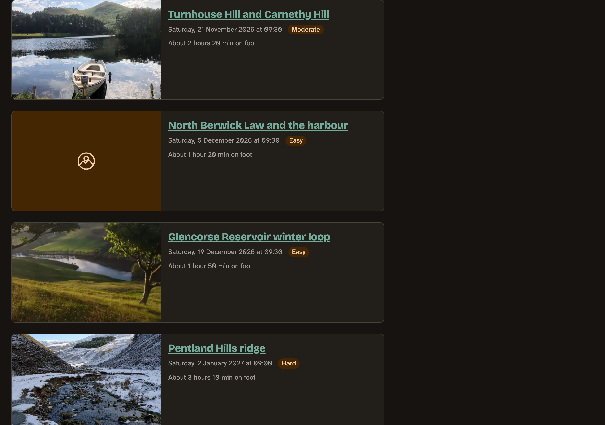
*Figure 13.5: In dark mode. The card uses the color roles, so it needed no changes*

We checked the cards with the keyboard (each card is one stop, its title link, with the focus ring), at 320 pixels wide with no sideways scrolling, and in forced colors, where the border and the links take the system's colors and the difficulty badge loses its background but still reads as a word. The muted text on the card's surface has a contrast of 7.2:1 in light mode and 6.1:1 in dark, and the title links 6.0:1 and 6.3:1.

> **Try it:** Put `{{ "now"|date("H:i:s") }}` in the facts block, and load the front page and `/hikes`. Different times this time, because they're different view modes. Then take it out again.

## Previewing components

To check a component, you've had to find a page that uses it, with content that shows what you want to see: a long title, no photo, a narrow column. A **styleguide** shows components on their own, with made-up values, so you can see every case on one page, before any content exists.

The best known is **Storybook**, and there's a Drupal module for it. But Storybook needs Node and npm, which the core site has managed without, and when we looked (November 2026) the Storybook module's newest release, 1.0.4, supported Drupal up to 11, not 12. So we tried **SDC Styleguide**, a module with no build step:

`terminal` ([source](../code/chapter13/snippets/styleguide-install.sh))

```bash
ddev composer require drupal/sdc_styleguide
ddev drush pm:install sdc_styleguide
```

It adds **/styleguide/explorer**, for people with the **Use the SDC Explorer** permission. Each component shows up there, and each **demo** file next to it becomes one example. A demo is named `<component>.demo.<name>.yml`:

`components/hike-card/hike-card.demo.beside.yml` ([source](../code/chapter13/steps/03-styleguide/core/lens_trail/components/hike-card/hike-card.demo.beside.yml))

```yaml
name: Photo beside
description: In a wide list, as on /hikes. Make the window narrower to see the photo move on top.
props:
  title: Glencorse Reservoir winter loop
  url: '#'
  heading_level: 2
  variant: beside
slots:
  photo: ''
  facts: '<div class="hike-card__date"><time datetime="2026-12-19T09:30:00Z">Saturday, 19 December 2026 at 09:30</time></div><div class="hike-card__difficulty">Easy</div><div class="hike-card__walking-time">About 1 hour 50 min on foot</div>'
```

The module's README calls these `.story.` files, but the code looks for `.demo.`, and only those worked when we tried. For the photo, we used the club's default photo, `design/default-photo.svg`, copied into the component's `demo` folder, because the club's photos aren't the theme's to ship. There are four demos in the step: photo beside, photo on top, no photo, and a long title.

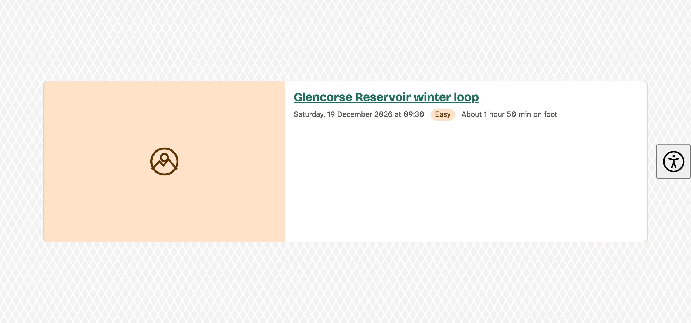
*Figure 13.6: The Photo beside demo. Make the window narrower, and the photo moves on top*

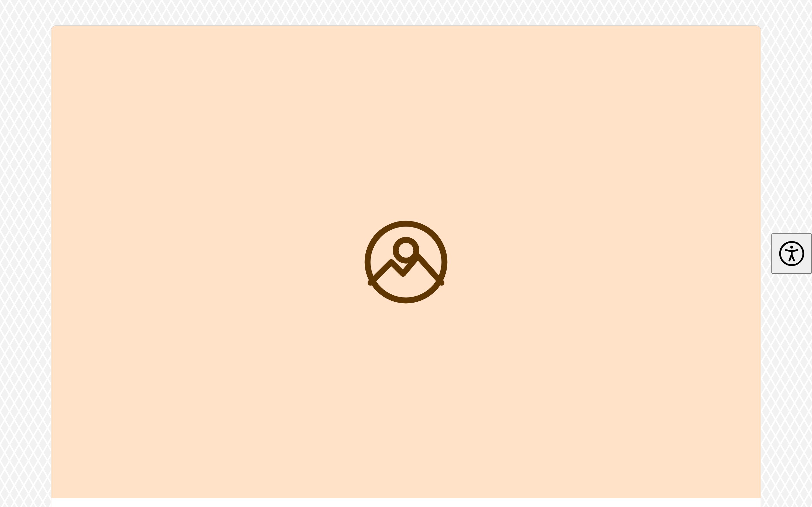
*Figure 13.7: The Photo on top demo, the `top` variant*

Two things went wrong on the way, and both were useful:

- At first every demo stopped with "NULL value found, but an integer is required" for the heading level, even the one that set it. The module couldn't read the number from the demo file, and said so in the log:

`output` ([source](../code/chapter13/snippets/styleguide-integer-warning.txt))

```text
[warning] Message: Cannot read value from demo file for property Heading level type integer.
```

  It knows `number` but not `integer`, so the prop is a `number`. With the `enum`, it lets through exactly what `integer` did. Mercury's own heading level is a `number` too.
- Then the card was there, but zero pixels wide. That was the container width from the section on container queries, and it's why `inline-size: 100%` is in the CSS. A styleguide is good at finding exactly this kind of thing.

The styleguide also can't set the variant through the component's `variants`, but it passes any prop it's given, and `variant` is one.

Whether Storybook earns its place in this book is still an open question. For now, SDC Styleguide does what the core site needs without Node.

## On the Drupal CMS site

The Drupal CMS site has no hikes: its content is pages built in **Canvas**, Drupal CMS's page builder. Editors put components on a page and fill them in, and SDC components show up in Canvas by themselves. So here the Hike card is something an editor uses, and that changes the contract.

### What travels, and what doesn't

Copy the folder to `components/hike-card` in the `mercury` theme, and look at what's still right:

- **The idea and the name**: a hike's title, link, date, difficulty and walking time, and a photo.
- **The heading level**, for the same reason as on the core site.

And what isn't:

- **The CSS.** Mercury styles with Tailwind classes in the markup, so `hike-card.css` goes, and the classes go into the Twig.
- **The slots.** On the core site, Drupal rendered the facts and the photo. In Canvas, an editor fills in a form, and a form needs fields. A slot would leave the editor an empty box to drop other components into: anything at all, in any order. Props give them a date picker and a list of three difficulties, and the schema stops anything else. So here everything is a prop.
- **The variants.** Canvas (1.12, the version on the site) doesn't offer a component's `variants` to editors. Mercury uses an `enum` prop instead, `orientation` on its own card, and so do we, with `layout`.

The contract on this site:

`components/hike-card/hike-card.component.yml` ([source](../code/chapter13/steps/04-canvas/cms/mercury/components/hike-card/hike-card.component.yml))

```yaml
$schema: https://git.drupalcode.org/project/drupal/-/raw/HEAD/core/assets/schemas/v1/metadata.schema.json
name: Hike card
description: A hike in a list, with its photo, title, date and difficulty.
group: Lens & Trail
status: stable
props:
  type: object
  required:
    - title
    - url
    - date
    - difficulty
  properties:
    title:
      type: string
      title: Title
      examples:
        - Glencorse Reservoir winter loop
    url:
      type: string
      format: uri-reference
      title: Link
      description: The hike's page.
      examples:
        - /
    heading_level:
      type: number
      title: Heading level
      description: One below the heading the cards are under.
      enum:
        - 2
        - 3
        - 4
      default: 3
      examples:
        - 3
    layout:
      type: string
      title: Layout
      description: Beside means beside the text when the card is wide enough.
      enum:
        - top
        - beside
      meta:enum:
        top: Photo on top
        beside: Photo beside
      default: top
      examples:
        - top
    photo:
      $ref: json-schema-definitions://canvas.module/image
      type: object
      title: Photo
    date:
      type: string
      format: date-time
      title: Date and time
      examples:
        - '2026-12-19T09:30:00Z'
    difficulty:
      type: string
      title: Difficulty
      enum:
        - easy
        - moderate
        - hard
      meta:enum:
        easy: Easy
        moderate: Moderate
        hard: Hard
      examples:
        - easy
    walking_time:
      type: string
      title: Walking time
      description: For example, About 2 hours on foot.
      examples:
        - About 1 hour 50 min on foot
```

`photo` refers to Canvas's own definition of an image, which gives editors the media library. `date` is a `string` with `format: date-time`, which gives them a date and a time. `meta:enum` gives each value a label people can read. And every required prop has an example, because Canvas uses it for a new card.

The first time, the card didn't appear in Canvas at all. Canvas checks every component, and ours had failed: "Prop "date" has invalid example value: [] Invalid date-time "2026-12-19T09:30:00", expected format YYYY-MM-DDThh:mm:ssZ or YYYY-MM-DDThh:mm:ss+hh:mm". A date and time needs a time zone. Edinburgh is on GMT in December, so `Z` it is.

The markup, with the club's tokens as Tailwind classes:

`components/hike-card/hike-card.twig` ([source](../code/chapter13/steps/04-canvas/cms/mercury/components/hike-card/hike-card.twig))

```twig
{#
/**
 * @file
 * The Hike card: the core theme's component, styled with Tailwind.
 *
 * In Canvas, editors fill everything in by hand, so the facts are props here,
 * not a slot.
 */
#}



<article{{ attributes.addClass('@container w-full overflow-hidden rounded-lg border border-club-border bg-club-surface') }}>
  <div class="grid{{ beside ? ' @[30rem]:grid-cols-[2fr_3fr] @[30rem]:items-start' }}">
    <div class="p-club-s">
      <{{ heading }} class="mb-club-2xs text-step-1 font-semibold">
        <a href="{{ url }}" class="text-club-action underline hover:no-underline">{{ title }}</a>
      </{{ heading }}>
      <div class="flex flex-wrap items-center gap-x-club-xs gap-y-club-2xs text-step--1">
        <time datetime="{{ date }}" class="text-club-muted">{{ date|date('U')|format_date('long') }}</time>
        <span class="rounded-full bg-club-tint px-club-2xs text-club-on-tint">{{ difficulty_labels[difficulty] }}</span>
        
          <span class="text-club-muted">{{ walking_time }}</span>
        
      </div>
    </div>
    
      
    
  </div>
</article>
```

The structure is the core site's, so the two cards stay recognizably the same thing. `@container` and `@[30rem]:` are Tailwind's container queries, the same rule as ours, written as classes. The date arrives as text, and `|date('U')|format_date('long')` turns it into a date in the site's language. And the difficulty's labels go through `|t`, so the Spanish site can translate them.

Tailwind only builds the classes it finds in the theme's files, so the new classes need a build, as in the chapter on the Drupal CMS theme:

`terminal` ([source](../code/chapter13/snippets/mercury-build.sh))

```bash
ddev exec -d /var/www/html/web/themes/custom/mercury npm run build
```

### The card in Canvas

Open the Home page in Canvas, and the card is in the **Library**, under **Lens & Trail**, the component's `group`:

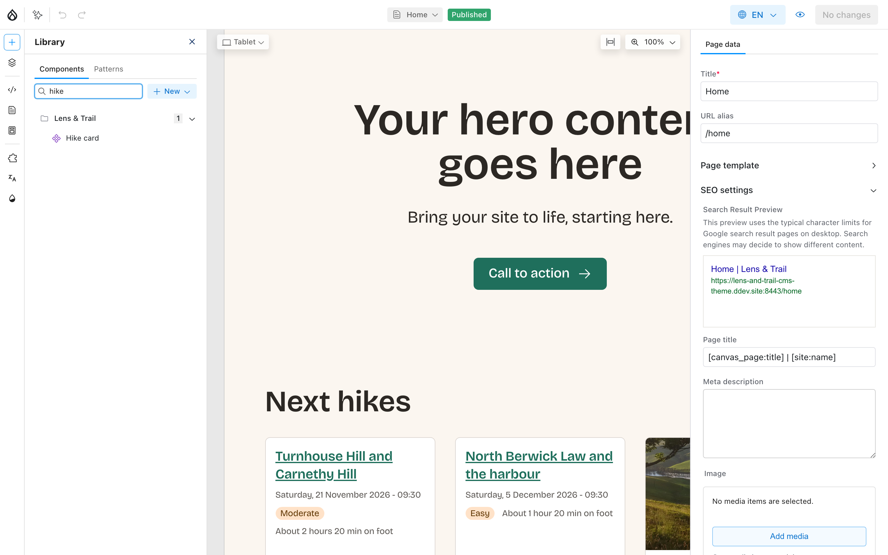
*Figure 13.8: The Hike card in the Canvas library*

We gave the Home page a Next hikes section:

1. Drag a **Section** from the library to below the hero. In its settings, set **Grid layout** to **33-33-33** and **Columns on mobile** to **1**, and turn on **Show header region**.
2. Drag a **Heading** into the section's **Header**, with the text **Next hikes** and the **Heading level** **2**.
3. Drag three **Hike cards** into the section's **Grid**, and fill them in with the first book's next three hikes. The Glencorse card gets the site's photo of Glencorse Reservoir from the media library. The other two have no photo on this site.
4. Click **Review changes**, and publish the page from there.

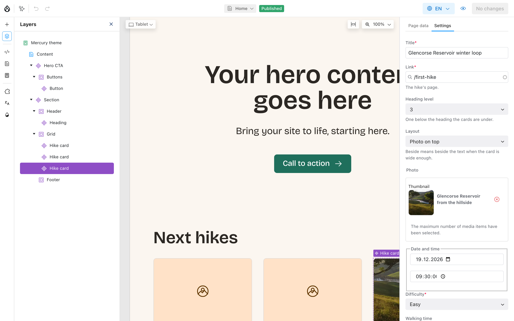
*Figure 13.9: Every field in the form comes from the component's schema*

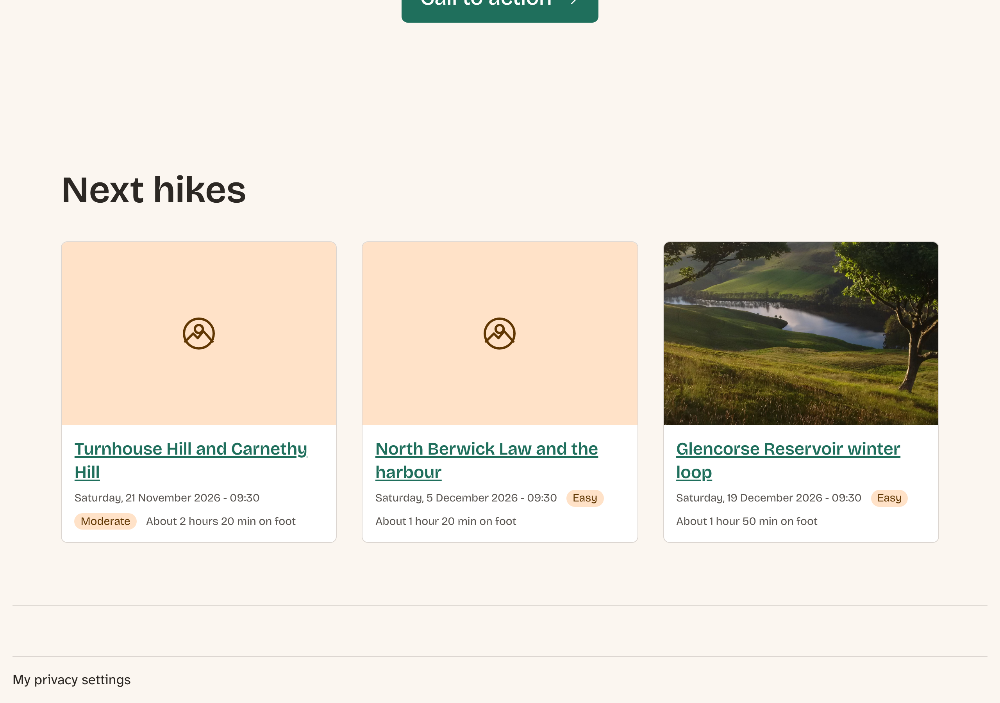
*Figure 13.10: The Next hikes section on the Drupal CMS site*

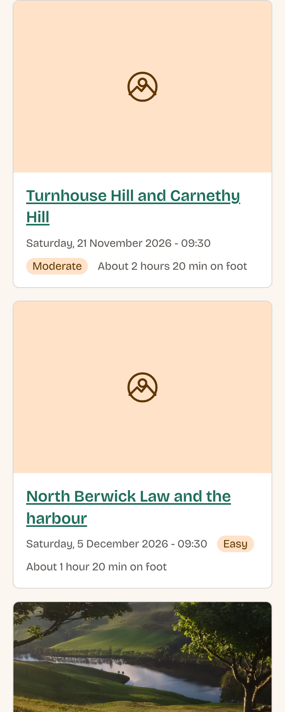
*Figure 13.11: On a phone*

Try typing in the date, or choosing a difficulty: the editor can't give the card anything the schema doesn't allow. That's the difference between the two sites' cards in a sentence. On the core site, the contract is between templates and the component, and Drupal checks it while you work. On the Drupal CMS site, it's also between the component and an editor, and Canvas checks it every time someone fills it in. The chapter on components in Canvas and Layout Builder goes much further with this.

## Summary

You can now:

- make a component with a `.component.yml`, a Twig file and CSS, and know where Drupal looks for it;
- describe a component's props in JSON Schema, and choose between a prop and a slot;
- call a component from a template with `embed` or `include`, and know why `only` breaks `embed`;
- give a component variants, and read the variant from `data-component-variant` in CSS;
- make a component fit any column with a container query;
- explain why a node can't have two different headings in one view mode, and fix it with another view mode;
- preview components with SDC Styleguide and demo files;
- turn a component for templates into one for editors in Canvas, with props instead of slots.

The Hike card is now one folder on each site. It shows up in the Next hikes block and the list of upcoming hikes on the core site, and on the Drupal CMS site's front page, where the editors can use it themselves.

## Exercises

1. Add a demo for a hike with a short title and no walking time. Does anything in the card look wrong?
2. Give the Hike card an optional `distance` prop, and show it in the card. Which template passes it in, and where does the number come from? Would it be better as part of the `facts` slot? Why?
3. Use the `top` variant in the Card template. Where does the site look better, and where worse? Put it back.
4. On the Drupal CMS site, add a fourth card, and type a difficulty that isn't in the list. What does Canvas do? *(challenge)*
5. Make the whole Hike card clickable, so a click on the photo opens the hike too, without putting a link inside a link. Keep it working with the keyboard, and keep the editors' contextual links working. *(advanced)* (The answer is in Appendix B.)

## Want to know more?

- Drupal.org: [Single-Directory Components](https://www.drupal.org/docs/develop/theming-drupal/using-single-directory-components) and [Annotated example component.yml](https://www.drupal.org/docs/develop/theming-drupal/using-single-directory-components/annotated-example-componentyml).
- [JSON Schema: Understanding JSON Schema](https://json-schema.org/understanding-json-schema/), for everything a prop can say.
- The modules: [SDC Styleguide](https://www.drupal.org/project/sdc_styleguide), [Storybook](https://www.drupal.org/project/storybook) and [Canvas](https://www.drupal.org/project/canvas).
- MDN: [Container queries](https://developer.mozilla.org/en-US/docs/Web/CSS/CSS_containment/Container_queries) and [`:has()`](https://developer.mozilla.org/en-US/docs/Web/CSS/:has).
- Tailwind CSS: [Container queries](https://tailwindcss.com/docs/responsive-design#container-queries).
