# Menus, in Depth

The main menu is how most visitors get around the club's site, and it's the part of a theme where good intentions most often go wrong. A dropdown that only opens on hover shuts out everyone on a phone and everyone with a keyboard. A hamburger that hides the menu but leaves it reachable with Tab sends keyboard users through links they can't see. A mega menu built from blocks pasted into a template is gone the next time an editor changes the menu. We've seen all three on real sites, and built a couple of them ourselves, years ago. ;-)

This chapter builds the club's menus one step at a time, each for a reason the club actually has:

1. **The menu's own template**, so the theme can name its parts, and the section you're in is marked.
2. **A dropdown** under Hikes, for the hike archive: a button that opens a list.
3. **A mega menu**: the Hikes dropdown grows into a panel with the areas, the next two hikes and a photo, all of it content the club's editors can change.
4. **A Menu button and a side panel** on narrow screens, as a modal `<dialog>`.
5. **The breadcrumb**, styled, with a short version for phones.
6. **The same on the Drupal CMS site**, with Mercury's Navbar, adapted, and the search moved next to its menu button.

The core site starts where the header chapter left it: the main menu is a row of four links that wraps when it runs out of room, Hike archive isn't shown at all, and the round search and toggle buttons sit on the right. The Drupal CMS site starts the same way, in Mercury's Navbar.

## How a menu reaches the page

A menu in Drupal is a tree of **menu links**, kept per menu: Main navigation, Footer, User account menu. A link comes from one of three places. Some are **content**: an editor adds them on **Structure** > **Menus**, and they're stored like nodes, with a title, a target, a parent and a weight. Some are **declared by a module or a view**: the first book's Hikes link is one of these, made by the hikes view's page display, which has a **Menu** setting of its own. And some are declared in a module's code, such as **My account** in the User account menu.

The theme never sees where a link came from. A **menu block** loads the tree, keeps the part it's set to show, and hands it to the `menu.html.twig` template. The block's settings decide which part:

- **Initial visibility level**: where the tree starts. Level 1 is the top of the menu.
- **Number of levels to display**: how deep it goes. The header chapter set it to 1, so Hike archive, which is under Hikes, wasn't in the HTML at all.
- **Expand all menu links**: whether a link's children are in the tree even when you're not on that link's page. Without it, Drupal only includes the children of links that are marked **Show as expanded**, or that are in the **active trail**.

The **active trail** is the path from the top of the menu down to the page you're on. On the hike archive, it's Hikes, then Hike archive. The template gets each link with a few values that say where it is:

- `title` and `url`: what the link says and where it goes.
- `below`: the links under it, in the same shape, so the template can call itself for the next level.
- `in_active_trail`: true when the link is on the way to the current page.
- `is_expanded`: true when the link's children are in the tree, and `is_collapsed` when it has some that aren't.
- `attributes`: the `<li>`'s attributes, where the theme adds its classes.

> **Coming from WordPress?** A WordPress classic theme prints a menu with `wp_nav_menu()`, and changes its markup with a **walker**, a PHP class with a method for each level and each item. Drupal's equivalent is the template: `menu.html.twig` and its suggestions, with a Twig macro that calls itself for each level. WordPress's menu locations are close to Drupal's menu blocks in regions. A WordPress block theme's Navigation block has its own submenu and overlay settings; in Drupal, those are the theme's job, which is what this chapter is about.

## The menu's own template

So the first step is site building: on **Block layout**, **Configure** next to **Main navigation**, set **Number of levels to display** to **2**, and save. Hike archive is in the HTML again, as a list inside the Hikes item.

The header chapter styled the menu with selectors such as `.region-primary-menu a`, and that was enough for one level. With two, the CSS needs to tell the first list from the second, and the links in the active trail from the rest. Core's template has none of that in its markup, so this is the time for a template of our own. Twig's debug comments name the suggestions:

`html` ([source](../code/chapter16/snippets/menu-suggestions.txt))

```text
<!-- THEME HOOK: 'menu__main' -->
<!--
FILE NAME SUGGESTIONS:
   ▪️ menu--main.html.twig
   ✅ menu.html.twig
-->
<!-- BEGIN OUTPUT from 'core/modules/system/templates/menu.html.twig' -->
```

`menu--main.html.twig` is for the menu whose machine name is `main`, wherever it's placed. We copy core's `menu.html.twig` there, in `templates/navigation/`, and give its parts names:

`templates/navigation/menu--main.html.twig` ([source](../code/chapter16/steps/01-menu/core/lens_trail/templates/navigation/menu--main.html.twig))

```twig
{#
/**
 * @file
 * The main menu: core's menu.html.twig, with classes for the theme.
 *
 * - main-menu on the first list, main-menu__submenu on the lists under it.
 * - main-menu__item--active-trail on the items on the way to the current
 *   page: on the hike archive, Hikes is in the active trail.
 * - main-menu__item--has-submenu on the items with links under them.
 *
 * See core's menu.html.twig for the variables: items, and in each item
 * title, url, below, in_active_trail, is_expanded and attributes.
 */
#}


{{ menus.menu_links(items, attributes, 0) }}


  
  
    
      <ul{{ attributes.addClass('main-menu') }}>
    
      <ul class="main-menu__submenu">
    
    
      
      <li{{ item.attributes.addClass(classes) }}>
        {{ link(item.title, item.url, { class: ['main-menu__link'] }) }}
        
          {{ menus.menu_links(item.below, attributes, menu_level + 1) }}
        
      </li>
    
    </ul>
  

```

The **macro** is core's, and it's worth reading slowly once. `menu_links` prints a list, and for each item that has links `below` it, it calls itself, one level deeper. That's how one short template prints a menu of any depth. The first list gets the menu's own `attributes` and the class `main-menu`; the lists under it get `main-menu__submenu`. Each item gets `main-menu__item`, plus `--active-trail` and `--has-submenu` when they apply. The names follow the same BEM pattern as the rest of the theme, from the CSS architecture chapter: a block (`main-menu`), its elements (`__item`, `__link`), and modifiers (`--active-trail`).

The CSS moves to the new classes, and gains two rules:

```diff
--- css/components/main-menu.css (before)
+++ css/components/main-menu.css (after)
@@ -1,43 +1,51 @@
 /**
  * @file
  * The main menu in the header: one row of links that wraps when it runs out
- * of room. The dropdown and the phone's Menu button come in the menus
- * chapter.
+ * of room. The classes come from templates/navigation/menu--main.html.twig.
  */
 @layer components {
-  .region-primary-menu {
-    & ul {
-      display: flex;
-      flex-wrap: wrap;
-      gap: 0 var(--space-xs);
-      /* The links' padding would push the first one in from the logo. */
-      margin: 0;
-      margin-inline-start: calc(-1 * var(--space-2xs));
-      padding: 0;
-      list-style: none;
+  .main-menu {
+    display: flex;
+    flex-wrap: wrap;
+    gap: 0 var(--space-xs);
+    /* The links' padding would push the first one in from the logo. */
+    margin: 0;
+    margin-inline-start: calc(-1 * var(--space-2xs));
+    padding: 0;
+    list-style: none;
+  }
+
+  .main-menu__link {
+    display: inline-flex;
+    align-items: center;
+    min-block-size: var(--size-target);
+    padding-inline: var(--space-2xs);
+    color: var(--color-text);
+    font-weight: var(--font-weight-semibold);
+    text-decoration: none;
+    text-underline-offset: 0.3em;
+
+    &:hover {
+      color: var(--color-action);
+      text-decoration: underline;
     }

-    & a {
-      display: inline-flex;
-      align-items: center;
-      min-block-size: var(--size-target);
-      padding-inline: var(--space-2xs);
-      color: var(--color-text);
-      font-weight: var(--font-weight-semibold);
-      text-decoration: none;
-      text-underline-offset: 0.3em;
-
-      &:hover {
-        color: var(--color-action);
-        text-decoration: underline;
-      }
-
-      /* The page you're on: Drupal marks the link for us. */
-      &[aria-current="page"] {
-        color: var(--color-action);
-        text-decoration: underline;
-        text-decoration-thickness: 2px;
-      }
+    /* The page you're on: Drupal marks the link for us. */
+    &[aria-current="page"] {
+      color: var(--color-action);
+      text-decoration: underline;
+      text-decoration-thickness: 2px;
     }
   }
+
+  /* The section you're in: Hikes, on the hike archive. Only for the eye; the
+     breadcrumb says it in words. */
+  .main-menu__item--active-trail > .main-menu__link {
+    color: var(--color-action);
+  }
+
+  /* The second level waits for the dropdown, in the next step. */
+  .main-menu__submenu {
+    display: none;
+  }
 }
```

The current page already had its style from the header chapter, through the `aria-current="page"` that Drupal adds. The new rule is for the *section*: on the hike archive, Hikes is in the action color too, without the underline. That's only for the eye; the breadcrumb, at the end of this chapter, says it in words. The second level is hidden until the next step gives it a way to open.

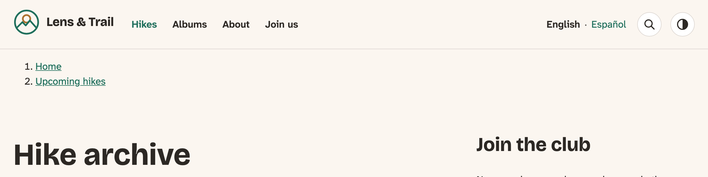
*Figure 16.1: Hikes is marked as the section you're in*

## A dropdown, the honest way

The wireframe shows Hikes with a small arrow, and the hike archive under it. There are two common ways to build that, and the club's site uses neither of the most common ones.

The first is **hover only**: the list appears when the mouse is over Hikes. It's a few lines of CSS (`:hover`), and it shuts out everyone without a mouse. A phone has no hover; a keyboard has no hover; and a screen reader user doesn't know there's anything to open.

The second is ARIA's **menu** pattern: `role="menu"` and `role="menuitem"` on the lists and links, with arrow keys to move between them. It sounds like exactly the thing for a menu, and it isn't. It's the pattern for an *application* menu, such as **File** > **Save** in a desktop program. Screen readers switch into a different mode for it, and announce the links as menu items, not links, and keyboard users who press Tab, as they do everywhere else on the web, find that it doesn't work the way the pattern expects. The ARIA Authoring Practices Guide says so itself, and has a separate example for site navigation.

That example is a **disclosure**, the pattern from the header chapter's toggle and search: a real `<button>` next to the link, which shows and hides the list, and says whether it's showing it with `aria-expanded`. Hikes stays a link to the hikes page, and the button is a second, separate thing to click or tab to. Every link in the dropdown is a normal link, reached with Tab.

### Click, not hover

The dropdown opens on a **click** (or Enter, or Space), not on hover. That was a decision, and the design chapter's reasons still hold. Hover menus open by accident when the mouse crosses them on its way somewhere else, and close by accident when it slips off the edge, and a dropdown that opens on hover *and* on a click opens and then closes again for anyone who hovers and clicks, which is most people. WCAG has a criterion for content that appears on hover, **Content on Hover or Focus** (1.4.13): it must stay open while the pointer is over it, it must be possible to close it without moving the pointer, and it mustn't vanish on its own. All of that can be done, but a click does it with no timers at all.

> **Try it:** Open a few big sites you use, and hover over their main menus. Count how many open on hover, how many on a click, and how many do both. Then put the mouse away and try each of them with Tab and Enter only.

### The script

The button is added by a script, `js/main-menu.js`, because without JavaScript it couldn't do anything: no script, no button, and the dropdown stays hidden. The hike archive is still linked from the hikes page, so nothing is lost.

`js/main-menu.js` ([source](../code/chapter16/steps/02-dropdown/core/lens_trail/js/main-menu.js))

```javascript
/**
 * @file
 * The main menu's dropdown: a button next to each link that has links under
 * it (Hikes), which shows and hides them.
 *
 * The same disclosure as the color scheme toggle and the search: a real
 * button, with aria-expanded saying whether the list is shown. Hikes stays a
 * link to the hikes page; the button is a second, separate target next to
 * it. Without JavaScript there's no button, and the list stays hidden: the
 * hikes page links to the archive.
 */
(function (Drupal, once) {
  // A small arrow pointing down. It turns when the list is open (CSS).
  const arrow =
    '<svg viewBox="0 0 24 24" aria-hidden="true" focusable="false">' +
    '<path d="m6 9 6 6 6-6" fill="none" stroke="currentColor" stroke-width="2" stroke-linecap="round" stroke-linejoin="round"/>' +
    '</svg>';

  function enhance(item, index) {
    const link = item.querySelector(':scope > .main-menu__link');
    const submenu = item.querySelector(':scope > .main-menu__submenu');
    submenu.id = submenu.id || `main-menu-submenu-${index + 1}`;
    submenu.hidden = true;

    const button = document.createElement('button');
    button.type = 'button';
    button.className = 'main-menu__toggle';
    button.setAttribute('aria-expanded', 'false');
    button.setAttribute('aria-controls', submenu.id);
    // Its name says what it opens: "More in Hikes". Drupal.t() escapes the
    // title (@), so it's safe as HTML.
    const name = document.createElement('span');
    name.className = 'visually-hidden';
    name.innerHTML = Drupal.t('More in @title', { '@title': link.textContent.trim() });
    button.innerHTML = arrow;
    button.append(name);
    link.after(button);

    function setOpen(open) {
      button.setAttribute('aria-expanded', String(open));
      submenu.hidden = !open;
    }

    button.addEventListener('click', () => {
      setOpen(submenu.hidden);
    });

    // Escape closes the list and puts the focus back on the button.
    item.addEventListener('keydown', (event) => {
      if (event.key === 'Escape' && !submenu.hidden) {
        setOpen(false);
        button.focus();
      }
    });

    // A click anywhere else closes it, and so does tabbing out of it.
    document.addEventListener('click', (event) => {
      if (!item.contains(event.target)) {
        setOpen(false);
      }
    });
    item.addEventListener('focusout', (event) => {
      if (event.relatedTarget && !item.contains(event.relatedTarget)) {
        setOpen(false);
      }
    });
  }

  Drupal.behaviors.lensTrailMainMenu = {
    attach(context) {
      once('lens-trail-main-menu', '.main-menu__item--has-submenu', context).forEach(enhance);
    },
  };
})(Drupal, once);
```

What it does, from the top:

- **The button's name.** A button with only an arrow in it would be announced as "button", which says nothing. Its name is a visually hidden text, "More in Hikes", made from the link's own text, so it works for any link with a dropdown, in any language. `Drupal.t()` translates the text, and the `@` placeholder escapes the title, so it's safe to put in the page as HTML.
- **`aria-expanded` and `aria-controls`.** The first says whether the list is open, and screen readers announce it ("collapsed", "expanded"). The second names the list the button controls.
- **The `hidden` attribute** on the list, set and removed by `setOpen()`. It's the one place that says whether the list is shown, for the CSS and for screen readers alike.
- **Escape** closes the list and puts the focus back on the button, so a keyboard user isn't left on a link that has disappeared.
- **A click anywhere else** closes it, and so does **tabbing out of it**: the `focusout` event says where the focus went, in `relatedTarget`, and if that's outside the item, the list closes.

The script is a library of its own, and the template attaches it, so it's only on pages that have the menu:

```diff
--- lens_trail.libraries.yml (before)
+++ lens_trail.libraries.yml (after)
@@ -83,6 +83,14 @@
   dependencies:
     - lens_trail/base

+main-menu:
+  version: VERSION
+  js:
+    js/main-menu.js: {}
+  dependencies:
+    - core/drupal
+    - core/once
+
 footer:
   version: VERSION
   css:
```

```diff
--- templates/navigation/menu--main.html.twig (before)
+++ templates/navigation/menu--main.html.twig (after)
@@ -6,13 +6,16 @@
  * - main-menu on the first list, main-menu__submenu on the lists under it.
  * - main-menu__item--active-trail on the items on the way to the current
  *   page: on the hike archive, Hikes is in the active trail.
- * - main-menu__item--has-submenu on the items with links under them.
+ * - main-menu__item--has-submenu on the items with links under them:
+ *   js/main-menu.js gives them a button that opens the list.
  *
  * See core's menu.html.twig for the variables: items, and in each item
  * title, url, below, in_active_trail, is_expanded and attributes.
  */
 #}
 
+{# The dropdown's script, only on pages that have the menu. #}
+{{ attach_library('lens_trail/main-menu') }}

 {{ menus.menu_links(items, attributes, 0) }}

```

And the CSS: the button, its arrow that turns when the list is open, and the list itself, under Hikes:

<details><summary>css/components/main-menu.css, changed</summary>

```diff
--- css/components/main-menu.css (before)
+++ css/components/main-menu.css (after)
@@ -1,7 +1,8 @@
 /**
  * @file
  * The main menu in the header: one row of links that wraps when it runs out
- * of room. The classes come from templates/navigation/menu--main.html.twig.
+ * of room, and a dropdown under Hikes. The classes come from
+ * templates/navigation/menu--main.html.twig, the button from js/main-menu.js.
  */
 @layer components {
   .main-menu {
@@ -13,6 +14,12 @@
     margin-inline-start: calc(-1 * var(--space-2xs));
     padding: 0;
     list-style: none;
+  }
+
+  .main-menu__item {
+    position: relative;
+    display: flex;
+    align-items: center;
   }

   .main-menu__link {
@@ -44,8 +51,60 @@
     color: var(--color-action);
   }

-  /* The second level waits for the dropdown, in the next step. */
+  /* The dropdown's button: as tall as the link, so it's easy to hit, but
+     narrow, so it stays next to the word it belongs to. */
+  .main-menu__toggle {
+    display: inline-grid;
+    place-items: center;
+    inline-size: 1.75rem;
+    block-size: var(--size-target);
+    margin-inline-start: calc(-1 * var(--space-2xs));
+    padding: 0;
+    border: 0;
+    border-radius: var(--radius-small);
+    background: none;
+    color: inherit;
+    cursor: pointer;
+
+    &:hover {
+      color: var(--color-action);
+    }
+
+    & svg {
+      inline-size: 1.25rem;
+      block-size: 1.25rem;
+      transition: rotate var(--duration-fast);
+    }
+
+    &[aria-expanded="true"] svg {
+      rotate: 180deg;
+    }
+  }
+
+  /* Without the script there's no button, and the list stays hidden: the
+     hikes page links to the archive. With it, the hidden attribute decides. */
   .main-menu__submenu {
     display: none;
   }
+
+  .main-menu__item:has(> .main-menu__toggle) > .main-menu__submenu:not([hidden]) {
+    position: absolute;
+    z-index: 10;
+    inset-block-start: 100%;
+    inset-inline-start: 0;
+    display: block;
+    min-inline-size: 14rem;
+    margin: 0;
+    padding: var(--space-2xs);
+    list-style: none;
+    border: var(--border-thin) solid var(--color-border);
+    border-radius: var(--radius-medium);
+    background-color: var(--color-surface);
+    box-shadow: var(--shadow-overlay);
+
+    & .main-menu__link {
+      display: flex;
+      padding-inline: var(--space-xs);
+    }
+  }
 }
```

</details>

The rule that shows the list says `.main-menu__item:has(> .main-menu__toggle) > .main-menu__submenu:not([hidden])`: a list that isn't hidden, in an item that has a button. Without the script there's no button, so the rule never matches, and the list stays hidden by the rule before it.

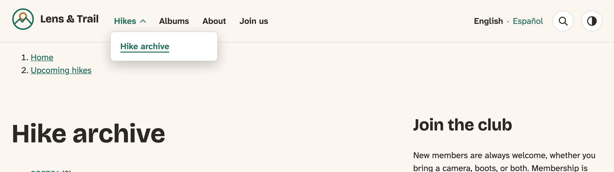
*Figure 16.2: The dropdown under Hikes*

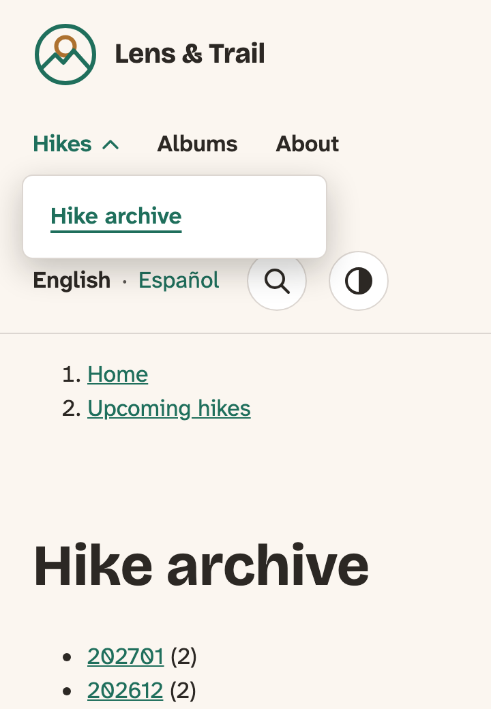
*Figure 16.3: On a phone, the dropdown covers what's under it. The side panel fixes that, in a few pages.*

This is what a screen reader gets, from the browser's **accessibility tree**. You can see it in Chrome's and Firefox's developer tools: open them on the button, and look for the **Accessibility** tab. It's the same information a screen reader uses, so it's a quick check before you try one:

`accessibility-tree` ([source](../code/chapter16/snippets/dropdown-accessibility.txt))

```text
# Closed
- listitem:
  - link "Hikes":
    - /url: /hikes
  - button "More in Hikes"

# Open
- listitem:
  - link "Hikes":
    - /url: /hikes
  - button "More in Hikes" [expanded]
```

Hikes is a link, and next to it, a button called "More in Hikes". After a press, the button is "expanded", and what it opened comes right after it, in the order of the page.

## A mega menu

The design has more under Hikes than one link. The wireframe's Hikes panel has three columns: the club's **areas** (Pentland Hills, East Lothian, Edinburgh), the **next two hikes**, with their dates, and a **photo** from the hills. On a site with dozens of sections, a panel like that is how visitors see what's there before they click. On the club's site, it's how they see that there's a hike next Saturday.

All of it is content that changes: the areas are a vocabulary, the hikes are nodes, and the photo should be one the editors can swap with the seasons. So the question is where the panel gets its content, and there are four answers.

- **Deeper menu levels.** Add the areas and the hikes as menu links under Hikes. It's site building only, but the editors would have to update the menu every time a hike is added, and a menu link can't show a date or a photo.
- **Blocks in the menu template.** Render a view block and an image from inside `menu--main.html.twig`. It works, and it's the most common answer we see, but now the theme decides what's in the menu, and an editor can't change the photo without a developer.
- **A region for the panel.** A new region in the header, with blocks placed on **Block layout**, shown when Hikes is opened. The editors can change it, but the region knows nothing about the menu: a second panel, for Albums, would need a second region.
- **Fields on menu links.** Give each menu link fields, such as a list of views and a photo, so the panel's content is part of the link itself, edited on the link's own form. That's what the club's site does.

Core's menu links can't have fields: they're content, but without bundles you can add fields to. Two contributed modules change that, and we use both.

**[Menu Item Extras](https://www.drupal.org/project/menu_item_extras)** makes menu links fieldable. Each menu becomes a **bundle** of menu links, the way each content type is a bundle of nodes, so Main navigation gets **Manage fields**, **Manage form display** and **Manage display** tabs, like a content type. And it hands the rendered fields to the menu template, as `content` in each item. It's actively maintained, and its 3.2 release supports Drupal 10.3 to 12. We chose it over writing a block region per panel, because the panel's content then lives with the link it belongs to, and a second panel is a second link with the same fields.

**[Views Reference](https://www.drupal.org/project/viewsreference)** adds a field type that points at a **view display**, with a few settings per field value, such as whether to show the view's title. The panel's lists are view displays, and this lets the editors choose them on the menu link: the areas today, perhaps the photo themes next year. The alternative is an entity reference to blocks, which works too, but then each list is a block that has to be placed somewhere first. Views Reference's 2.0 release is a beta, and it needed a patch for Drupal 12; the box below has the details.

> **Patches for Drupal 12.** The core site runs Drupal 12, and Views Reference 8.x-2.0-beta14 says it supports it, but on Drupal 12 it doesn't run. When we wrote this (November 2026), there was no fix in its issue queue, so we wrote a patch, in the book's repository at `code/chapter16/patches/viewsreference-drupal-12.patch`. It fixes four things, each a change in Drupal 12:
>
> - A method in its form widget, `massageFormValues()`, has no return type, and Drupal 12's base class now declares one. PHP stops with a fatal error on *every* form that shows field widgets, not only the menu link's.
> - It finds its settings plugins (Include View Title, Pager and so on) by **annotations**, the comments above a class, and Drupal 12 only finds plugins by PHP **attributes**. The patch adds the attribute class, and keeps the annotations for Drupal 11.
> - Its formatter merges the view's cache information into a copy and throws the copy away. Drupal 12's PHP warns about that, and it's a real bug: a list could stay cached after its view changed.
> - It sets the view's title in a `template_preprocess_HOOK()` function in its `.module` file, which Drupal 12 no longer calls. Without the fix, the lists in the panel have no headings.
>
> Menu Item Extras' 3.2 release needed nothing. On the Drupal CMS site, which runs Drupal 11, the patch isn't needed, and applies without changing anything that matters. Install both, in the site's folder:
>
> `terminal` ([source](../code/chapter16/site/03-mega-modules.sh))
>
> ```bash
> # Usage, from the core test site's folder (../lens-and-trail-theme):
> #   bash ../theming-drupal/code/chapter16/site/03-mega-modules.sh
> set -euo pipefail
> BOOK2=$(cd "$(dirname "$0")/../../.." && pwd)
>
> mkdir -p patches
> cp "$BOOK2/code/chapter16/patches/viewsreference-drupal-12.patch" patches/
> ddev composer config --json extra.patches.drupal/viewsreference '[{"description": "Drupal 12: massageFormValues() return type, and an attribute class for the settings plugins. Ours (2026-11-14)", "url": "patches/viewsreference-drupal-12.patch"}]'
> ```
>
> The site keeps its patches in `patches.lock.json`, as in the images chapter, so `patches-relock` makes that list again and `patches-repatch` applies them.

### Hikes, as a link of its own

The first catch is the Hikes link itself. It isn't content: the first book made it on the hikes view, in the page display's **Menu** setting, so it's declared by the view and has nowhere to keep fields. So it becomes an ordinary menu link:

1. On **Structure** > **Views**, edit **Hikes**, open the **Page** display, and under **Page settings**, click the **Menu** setting. Choose **No menu entry**, apply and save the view. Hikes disappears from the menu, and Hike archive, which was under it, moves to the top level.
2. On **Structure** > **Menus** > **Main navigation**, **Add link**: **Hikes**, linking to `/hikes`, with **Show as expanded** checked and a weight of 1, so it comes first. On its **Translate** tab, add the Spanish title, **Excursiones**.
3. Edit **Hike archive**, and set its **Parent link** to **Hikes**.

The menu looks as it did, but Hikes is now content.

### Fields on menu links

Menu Item Extras' second catch: when it gives Main navigation its own bundle, the first book's setting that made menu links **translatable** was for the old bundle, `menu_link_content`, and doesn't apply to the new one, `main`. So, before adding fields, on **Configuration** > **Regional and language** > **Content language and translation**, find **Custom menu link**, check **Main navigation** (and its **Translatable** column), and save. Without that, the Spanish menu would lose its translations the next time a link is edited.

Then, on **Structure** > **Menus** > **Main navigation** > **Manage fields**, two fields:

- **Panel lists**, of the type **Views reference**, with an **unlimited** number of values. In its settings, preselect the **Areas** and **Hikes** views, so the editors don't have to look through every view on the site, allow only **block** displays, and enable the **Include View Title** setting. Uncheck **Users may translate this field**: the lists are the same in both languages, because the views are translated themselves.
- **Panel photo**, a **Media** reference to **Image** media, one value, and not translatable either: a media item has its own translations, for its name and alt text.

On **Manage form display**, Panel lists gets the **Views reference select list** widget, and Panel photo the **Media library**. On **Manage display**, Panel lists is shown with the **Views reference** formatter, and Panel photo as a **Rendered entity** in a new **Menu panel** view mode for media: the photo at 640 pixels wide (Chapter 14's **Banner small** image style), then its photographer, license and source, for the credit. (Make the view mode on **Structure** > **Display modes** > **View modes**, then turn it on under **Custom display settings** on the Image media type's **Manage display**.)

### Two lists for the panel

The panel's two lists are views, and each needs a block display:

- **Areas**, a new view of **Taxonomy terms** of the vocabulary **Areas**, showing only the top level: add a filter on **Parent term** equal to **0**. The term names, linked to the terms, as an HTML list, sorted by weight. A block display, **Top-level areas**, with the title **Areas**.
- **Next hikes, in the menu**, a new block display on the existing **Hikes** view, so it keeps the view's filter (only hikes that haven't happened yet) and its sort (the next first). On the new display only, which matters, so choose **This block (override)** each time: two items, as an HTML list of fields, the hike's date with a custom format, `D j F · G:i` (*Sat 21 November · 9:30*), and the title, linked. And a **more** link, always shown, with the text **All upcoming hikes**.

The date gets the CSS class `hike-date` in its **Style settings**, so the panel can make it small and muted.

> **On the override:** a new display on a view shares everything with the view's **Default** display until you override it. If you change the number of items without choosing **This block (override)**, you change it for the hikes page too. We did exactly that the first time, and the club's hikes page showed two hikes, in a bulleted list, until we noticed.

Last, the panel's Spanish headings. View titles and more-link texts are configuration, translated on the view's **Translate** tab: **Áreas** on Areas, **Próximas excursiones** and **Todas las próximas excursiones** on the Hikes view's new display.

### The Hikes link's panel

Now edit **Hikes** on **Main navigation**. Its form has the two new fields: in **Panel lists**, choose **Areas** with the display **Top-level areas**, and **Hikes** with **Next hikes, in the menu**, and check **Include View Title** in each one's **Options**. In **Panel photo**, choose a winter photo from the Pentland Hills.


*Figure 16.4: The panel's content, on the Hikes link*

### The template, under a new name

Reload the front page, and the menu has changed in a way we didn't ask for: Menu Item Extras' own template has taken over. Twig's debug comments show why:

`html` ([source](../code/chapter16/snippets/menu-extras-suggestions.txt))

```text
<!-- THEME HOOK: 'menu' -->
<!--
FILE NAME SUGGESTIONS:
   ▪️ menu--extras--main--primary-menu.html.twig
   ✅ menu--extras--main.html.twig
   ▪️ menu--extras.html.twig
   ▪️ menu--main.html.twig
   ▪️ menu.html.twig
-->
<!-- 💡 BEGIN CUSTOM TEMPLATE OUTPUT from 'themes/custom/lens_trail/templates/navigation/menu--extras--main.html.twig' -->
```

The module adds two suggestions of its own, `menu--extras` and `menu--extras--main`, and they come *before* our `menu--main`, so they win. That's a pattern worth remembering: when a module starts to render something you've themed, look at the suggestions first. So our template moves to `menu--extras--main.html.twig`, and grows:

`templates/navigation/menu--extras--main.html.twig` ([source](../code/chapter16/steps/03-mega/core/lens_trail/templates/navigation/menu--extras--main.html.twig))

```twig
{#
/**
 * @file
 * The main menu, with Menu Item Extras: menu--main.html.twig under the name
 * the module's suggestion asks for, and a panel for links that have fields.
 *
 * - main-menu on the first list, main-menu__submenu on the lists under it.
 * - main-menu__item--active-trail on the items on the way to the current
 *   page: on the hike archive, Hikes is in the active trail.
 * - main-menu__dropdown around what opens under a link: the links under it,
 *   and, when the link has them, its Panel lists and Panel photo
 *   (main-menu__item--has-panel). js/main-menu.js gives the link a button
 *   that shows and hides it.
 *
 * Menu Item Extras adds, in each item:
 * - content: the menu link's fields, rendered. We print the two fields one
 *   by one, not the whole of content: see the chapter.
 * - entity: the menu link itself.
 */
#}

{# The dropdown's script, only on pages that have the menu. #}
{{ attach_library('lens_trail/main-menu') }}

{{ menus.menu_links(items, attributes, 0) }}


  
  
    
      <ul{{ attributes.addClass('main-menu') }}>
    
      <ul class="main-menu__submenu">
    
    
      
      
      
      
      <li{{ item.attributes.addClass(classes) }}>
        {{ link(item.title, item.url, { class: ['main-menu__link'] }) }}
        
          <div class="main-menu__dropdown">
            {{ lists }}
            {{ menus.menu_links(item.below, attributes, menu_level + 1) }}
            
              <div class="main-menu__photo">{{ photo }}</div>
            
          </div>
        
      </li>
    
    </ul>
  

```

- Everything that opens under a link is now in one wrapper, `main-menu__dropdown`: the panel's lists, the links under Hikes, and the photo, in that order, which is also the order you tab through them.
- An item has a dropdown when it has links under it **or** a panel; `--has-panel` marks the second kind.
- The two fields are printed **one by one**, `item.content.field_panel_lists` and `item.content.field_panel_photo`, not as one `item.content`. There are two reasons. The panel's grid needs to place the lists and the photo in different columns, around the archive link, so they can't come as one block. And on the core site, printing the whole of `content` the way the module's own template does gave us an empty box: Menu Item Extras renders the link in a way that Drupal 12's protection against rendering an entity inside itself seems to stop. On the Drupal CMS site, with Drupal 11, it works. We didn't need it, so we left it there, and noted it in the project's log.
- Each field is rendered with `|render` and kept in a variable, so the template can ask whether it's empty before it prints a wrapper around it.

Two more templates take the wrappers away. The Panel lists field prints each list as a `main-menu__list`, with no field wrapper around them, so the grid can place each one:

`templates/field/field--menu-link-content--field-panel-lists.html.twig` ([source](../code/chapter16/steps/03-mega/core/lens_trail/templates/field/field--menu-link-content--field-panel-lists.html.twig))

```twig
{#
/**
 * @file
 * A menu link's Panel lists: one element for each list, and no wrappers, so
 * the panel's grid can place them.
 *
 * See field.html.twig for the variables.
 */
#}

  <div{{ item.attributes.addClass('main-menu__list') }}>{{ item.content }}</div>

```

And the photo, in its Menu panel view mode, is the Photo component from the images chapter, with the credit below and the media item's name as the caption:

`templates/media/media--image--menu-panel.html.twig` ([source](../code/chapter16/steps/03-mega/core/lens_trail/templates/media/media--image--menu-panel.html.twig))

```twig
{#
/**
 * @file
 * A photo in a menu panel (the Menu panel view mode): the Photo component,
 * with the media's name as the caption and the credit below.
 *
 * See media.html.twig for the variables.
 */
#}
<div{{ attributes }}>
  {{ title_suffix.contextual_links }}
  {{ include('lens_trail:photo', {
    image: content.field_media_image,
    caption: media.label,
    photographer: media.field_photographer.value,
    license: content.field_license.0['#markup'],
    source: media.field_source.uri,
    credit: 'below',
  }, with_context = false) }}
</div>
```

The script changes in name only: what it opens is now the dropdown, not the submenu.

```diff
--- js/main-menu.js (before)
+++ js/main-menu.js (after)
@@ -1,16 +1,17 @@
 /**
  * @file
- * The main menu's dropdown: a button next to each link that has links under
- * it (Hikes), which shows and hides them.
+ * The main menu's dropdown: a button next to each link that has something
+ * under it (Hikes), which shows and hides it: the links under it, and on wide
+ * screens the panel with the areas, the next hikes and a photo.
  *
  * The same disclosure as the color scheme toggle and the search: a real
- * button, with aria-expanded saying whether the list is shown. Hikes stays a
+ * button, with aria-expanded saying whether the dropdown is shown. Hikes stays a
  * link to the hikes page; the button is a second, separate target next to
- * it. Without JavaScript there's no button, and the list stays hidden: the
- * hikes page links to the archive.
+ * it. Without JavaScript there's no button, and the dropdown stays hidden:
+ * the hikes page links to the archive.
  */
 (function (Drupal, once) {
-  // A small arrow pointing down. It turns when the list is open (CSS).
+  // A small arrow pointing down. It turns when the dropdown is open (CSS).
   const arrow =
     '<svg viewBox="0 0 24 24" aria-hidden="true" focusable="false">' +
     '<path d="m6 9 6 6 6-6" fill="none" stroke="currentColor" stroke-width="2" stroke-linecap="round" stroke-linejoin="round"/>' +
@@ -18,15 +19,15 @@

   function enhance(item, index) {
     const link = item.querySelector(':scope > .main-menu__link');
-    const submenu = item.querySelector(':scope > .main-menu__submenu');
-    submenu.id = submenu.id || `main-menu-submenu-${index + 1}`;
-    submenu.hidden = true;
+    const dropdown = item.querySelector(':scope > .main-menu__dropdown');
+    dropdown.id = dropdown.id || `main-menu-dropdown-${index + 1}`;
+    dropdown.hidden = true;

     const button = document.createElement('button');
     button.type = 'button';
     button.className = 'main-menu__toggle';
     button.setAttribute('aria-expanded', 'false');
-    button.setAttribute('aria-controls', submenu.id);
+    button.setAttribute('aria-controls', dropdown.id);
     // Its name says what it opens: "More in Hikes". Drupal.t() escapes the
     // title (@), so it's safe as HTML.
     const name = document.createElement('span');
@@ -38,16 +39,16 @@

     function setOpen(open) {
       button.setAttribute('aria-expanded', String(open));
-      submenu.hidden = !open;
+      dropdown.hidden = !open;
     }

     button.addEventListener('click', () => {
-      setOpen(submenu.hidden);
+      setOpen(dropdown.hidden);
     });

-    // Escape closes the list and puts the focus back on the button.
+    // Escape closes the dropdown and puts the focus back on the button.
     item.addEventListener('keydown', (event) => {
-      if (event.key === 'Escape' && !submenu.hidden) {
+      if (event.key === 'Escape' && !dropdown.hidden) {
         setOpen(false);
         button.focus();
       }
@@ -68,7 +69,7 @@

   Drupal.behaviors.lensTrailMainMenu = {
     attach(context) {
-      once('lens-trail-main-menu', '.main-menu__item--has-submenu', context).forEach(enhance);
+      once('lens-trail-main-menu', '.main-menu__item--has-dropdown', context).forEach(enhance);
     },
   };
 })(Drupal, once);
```

### The panel's CSS

The panel is the dropdown, made wide. From the wide breakpoint (64rem), an item with a panel is no longer the dropdown's positioned ancestor: the header is (Chapter 7's layout), so `inset-inline: 0` makes the panel as wide as the header, under it. Inside, a grid of three columns: the areas, the next hikes with the two links under them, and the photo. Below 64rem, the lists and the photo are hidden, and Hikes opens the small dropdown with the archive link, as before. The side panel, in the next section, takes over there anyway.

<details><summary>css/components/main-menu.css, changed</summary>

```diff
--- css/components/main-menu.css (before)
+++ css/components/main-menu.css (after)
@@ -1,8 +1,11 @@
 /**
  * @file
  * The main menu in the header: one row of links that wraps when it runs out
- * of room, and a dropdown under Hikes. The classes come from
- * templates/navigation/menu--main.html.twig, the button from js/main-menu.js.
+ * of room, a dropdown under Hikes, and on wide screens the Hikes panel. The
+ * classes come from templates/navigation/menu--extras--main.html.twig, the
+ * button from js/main-menu.js.
+ *
+ * A media query can't use a custom property: 64rem is --breakpoint-wide.
  */
 @layer components {
   .main-menu {
@@ -81,30 +84,144 @@
     }
   }

-  /* Without the script there's no button, and the list stays hidden: the
+  /* Without the script there's no button, and the dropdown stays hidden: the
      hikes page links to the archive. With it, the hidden attribute decides. */
-  .main-menu__submenu {
+  .main-menu__dropdown {
     display: none;
   }

-  .main-menu__item:has(> .main-menu__toggle) > .main-menu__submenu:not([hidden]) {
+  .main-menu__item:has(> .main-menu__toggle) > .main-menu__dropdown:not([hidden]) {
     position: absolute;
     z-index: 10;
     inset-block-start: 100%;
     inset-inline-start: 0;
     display: block;
     min-inline-size: 14rem;
-    margin: 0;
     padding: var(--space-2xs);
-    list-style: none;
     border: var(--border-thin) solid var(--color-border);
     border-radius: var(--radius-medium);
     background-color: var(--color-surface);
     box-shadow: var(--shadow-overlay);
+  }
+
+  .main-menu__submenu {
+    margin: 0;
+    padding: 0;
+    list-style: none;

     & .main-menu__link {
       display: flex;
       padding-inline: var(--space-xs);
     }
   }
+
+  /* The panel's lists and photo are for wide screens. On a narrow one, the
+     dropdown has only the links under Hikes. */
+  .main-menu__list,
+  .main-menu__photo {
+    display: none;
+  }
+
+  /* The Hikes panel: as wide as the header, under it. The header is the
+     positioned ancestor (layout.css), so the item mustn't be one. */
+  @media (min-width: 64rem) {
+    .main-menu__item--has-panel {
+      position: static;
+
+      /* The same :has() as the dropdown's rule above, so this one wins. */
+      &:has(> .main-menu__toggle) > .main-menu__dropdown:not([hidden]) {
+        inset-inline: 0;
+        display: grid;
+        grid-template-columns: minmax(10rem, 1fr) minmax(14rem, 1.5fr) minmax(16rem, 1.5fr);
+        grid-template-rows: auto 1fr;
+        gap: var(--space-xs) var(--space-xl);
+        min-inline-size: 0;
+        /* Lines up with the content, like the header's own row. */
+        padding-block: var(--space-l);
+        padding-inline: max(var(--space-m), (100% - var(--size-content)) / 2 + var(--space-m));
+        border-width: 0 0 var(--border-thin);
+        border-radius: 0;
+      }
+
+      /* Areas on the left, the next hikes and the links in the middle, the
+         photo on the right: the order of the HTML, so the order you tab. */
+      & .main-menu__list {
+        display: block;
+      }
+
+      & .main-menu__list:first-child {
+        grid-row: 1 / span 2;
+      }
+
+      & .main-menu__submenu {
+        grid-column: 2;
+      }
+
+      & .main-menu__photo {
+        display: block;
+        grid-column: 3;
+        grid-row: 1 / span 2;
+
+        & img {
+          border-radius: var(--radius-medium);
+        }
+      }
+    }
+  }
+
+  /* What's inside the panel: the views' titles as small labels, plain lists. */
+  .main-menu__list {
+    & .viewsreference--view-title {
+      margin-block-end: var(--space-2xs);
+      color: var(--color-muted);
+      font-size: var(--font-size-step--1);
+      font-weight: var(--font-weight-semibold);
+    }
+
+    & ul {
+      margin: 0;
+      padding: 0;
+      list-style: none;
+    }
+
+    & li + li {
+      margin-block-start: var(--space-2xs);
+    }
+
+    & a {
+      color: var(--color-text);
+      font-weight: var(--font-weight-semibold);
+      text-decoration: none;
+
+      &:hover {
+        color: var(--color-action);
+        text-decoration: underline;
+      }
+    }
+
+    & .hike-date {
+      display: block;
+      color: var(--color-muted);
+      font-size: var(--font-size-step--1);
+    }
+  }
+
+  /* "All upcoming hikes" and "Hike archive": links onwards, with an arrow
+     that's only for the eye. */
+  .main-menu__item--has-panel .more-link a,
+  .main-menu__item--has-panel .main-menu__submenu .main-menu__link {
+    display: inline-flex;
+    padding-inline: 0;
+    color: var(--color-action);
+    font-weight: var(--font-weight-semibold);
+
+    &::after {
+      content: " →" / "";
+      white-space: pre;
+    }
+  }
+
+  .main-menu__item--has-panel .more-link {
+    margin-block-start: var(--space-s);
+  }
 }
```

</details>

<details><summary>The complete file</summary>

`css/components/main-menu.css` ([source](../code/chapter16/steps/03-mega/core/lens_trail/css/components/main-menu.css))

```css
/**
 * @file
 * The main menu in the header: one row of links that wraps when it runs out
 * of room, a dropdown under Hikes, and on wide screens the Hikes panel. The
 * classes come from templates/navigation/menu--extras--main.html.twig, the
 * button from js/main-menu.js.
 *
 * A media query can't use a custom property: 64rem is --breakpoint-wide.
 */
@layer components {
  .main-menu {
    display: flex;
    flex-wrap: wrap;
    gap: 0 var(--space-xs);
    /* The links' padding would push the first one in from the logo. */
    margin: 0;
    margin-inline-start: calc(-1 * var(--space-2xs));
    padding: 0;
    list-style: none;
  }

  .main-menu__item {
    position: relative;
    display: flex;
    align-items: center;
  }

  .main-menu__link {
    display: inline-flex;
    align-items: center;
    min-block-size: var(--size-target);
    padding-inline: var(--space-2xs);
    color: var(--color-text);
    font-weight: var(--font-weight-semibold);
    text-decoration: none;
    text-underline-offset: 0.3em;

    &:hover {
      color: var(--color-action);
      text-decoration: underline;
    }

    /* The page you're on: Drupal marks the link for us. */
    &[aria-current="page"] {
      color: var(--color-action);
      text-decoration: underline;
      text-decoration-thickness: 2px;
    }
  }

  /* The section you're in: Hikes, on the hike archive. Only for the eye; the
     breadcrumb says it in words. */
  .main-menu__item--active-trail > .main-menu__link {
    color: var(--color-action);
  }

  /* The dropdown's button: as tall as the link, so it's easy to hit, but
     narrow, so it stays next to the word it belongs to. */
  .main-menu__toggle {
    display: inline-grid;
    place-items: center;
    inline-size: 1.75rem;
    block-size: var(--size-target);
    margin-inline-start: calc(-1 * var(--space-2xs));
    padding: 0;
    border: 0;
    border-radius: var(--radius-small);
    background: none;
    color: inherit;
    cursor: pointer;

    &:hover {
      color: var(--color-action);
    }

    & svg {
      inline-size: 1.25rem;
      block-size: 1.25rem;
      transition: rotate var(--duration-fast);
    }

    &[aria-expanded="true"] svg {
      rotate: 180deg;
    }
  }

  /* Without the script there's no button, and the dropdown stays hidden: the
     hikes page links to the archive. With it, the hidden attribute decides. */
  .main-menu__dropdown {
    display: none;
  }

  .main-menu__item:has(> .main-menu__toggle) > .main-menu__dropdown:not([hidden]) {
    position: absolute;
    z-index: 10;
    inset-block-start: 100%;
    inset-inline-start: 0;
    display: block;
    min-inline-size: 14rem;
    padding: var(--space-2xs);
    border: var(--border-thin) solid var(--color-border);
    border-radius: var(--radius-medium);
    background-color: var(--color-surface);
    box-shadow: var(--shadow-overlay);
  }

  .main-menu__submenu {
    margin: 0;
    padding: 0;
    list-style: none;

    & .main-menu__link {
      display: flex;
      padding-inline: var(--space-xs);
    }
  }

  /* The panel's lists and photo are for wide screens. On a narrow one, the
     dropdown has only the links under Hikes. */
  .main-menu__list,
  .main-menu__photo {
    display: none;
  }

  /* The Hikes panel: as wide as the header, under it. The header is the
     positioned ancestor (layout.css), so the item mustn't be one. */
  @media (min-width: 64rem) {
    .main-menu__item--has-panel {
      position: static;

      /* The same :has() as the dropdown's rule above, so this one wins. */
      &:has(> .main-menu__toggle) > .main-menu__dropdown:not([hidden]) {
        inset-inline: 0;
        display: grid;
        grid-template-columns: minmax(10rem, 1fr) minmax(14rem, 1.5fr) minmax(16rem, 1.5fr);
        grid-template-rows: auto 1fr;
        gap: var(--space-xs) var(--space-xl);
        min-inline-size: 0;
        /* Lines up with the content, like the header's own row. */
        padding-block: var(--space-l);
        padding-inline: max(var(--space-m), (100% - var(--size-content)) / 2 + var(--space-m));
        border-width: 0 0 var(--border-thin);
        border-radius: 0;
      }

      /* Areas on the left, the next hikes and the links in the middle, the
         photo on the right: the order of the HTML, so the order you tab. */
      & .main-menu__list {
        display: block;
      }

      & .main-menu__list:first-child {
        grid-row: 1 / span 2;
      }

      & .main-menu__submenu {
        grid-column: 2;
      }

      & .main-menu__photo {
        display: block;
        grid-column: 3;
        grid-row: 1 / span 2;

        & img {
          border-radius: var(--radius-medium);
        }
      }
    }
  }

  /* What's inside the panel: the views' titles as small labels, plain lists. */
  .main-menu__list {
    & .viewsreference--view-title {
      margin-block-end: var(--space-2xs);
      color: var(--color-muted);
      font-size: var(--font-size-step--1);
      font-weight: var(--font-weight-semibold);
    }

    & ul {
      margin: 0;
      padding: 0;
      list-style: none;
    }

    & li + li {
      margin-block-start: var(--space-2xs);
    }

    & a {
      color: var(--color-text);
      font-weight: var(--font-weight-semibold);
      text-decoration: none;

      &:hover {
        color: var(--color-action);
        text-decoration: underline;
      }
    }

    & .hike-date {
      display: block;
      color: var(--color-muted);
      font-size: var(--font-size-step--1);
    }
  }

  /* "All upcoming hikes" and "Hike archive": links onwards, with an arrow
     that's only for the eye. */
  .main-menu__item--has-panel .more-link a,
  .main-menu__item--has-panel .main-menu__submenu .main-menu__link {
    display: inline-flex;
    padding-inline: 0;
    color: var(--color-action);
    font-weight: var(--font-weight-semibold);

    &::after {
      content: " →" / "";
      white-space: pre;
    }
  }

  .main-menu__item--has-panel .more-link {
    margin-block-start: var(--space-s);
  }
}
```

</details>

Two details. The views' titles are small, muted labels, not headings that compete with the links. And "All upcoming hikes" and "Hike archive" get an arrow, "→", as generated content with empty alternative text, like the language switcher's dot: it says "onwards" to the eye, and nothing to a screen reader, which already knows it's a link.


*Figure 16.5: The Hikes panel*

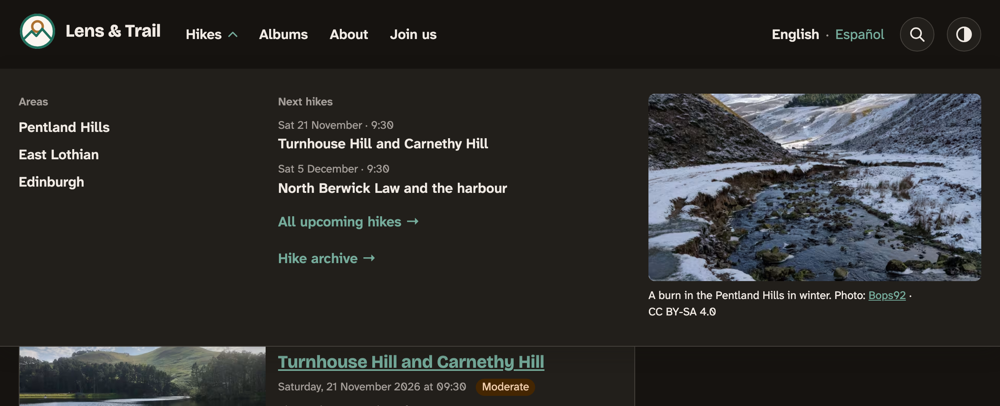
*Figure 16.6: In dark mode, from the tokens alone*

The tab order is the HTML's: Hikes, its button, the three areas, the two hikes, All upcoming hikes, Hike archive, the photographer's link, and then Albums. Tab out of the photographer's link, and the panel closes behind you.

## A Menu button, and a panel from the side

On a phone, the header is three rows: the logo, the menu, and the languages with the buttons. The wireframe has one: the logo on the left, and the search and a **Menu** button on the right. The button opens the menu, the languages and the toggle in a panel from the side.

### `<dialog>`, or a hidden `div`?

For years, a panel like this was a `<div>` with `display: none`, and a script that did everything else: show it, put the focus in it, keep the focus from wandering to the page behind it, close it on Escape, and give the focus back. Each of those is a few lines, and each can go wrong. The hardest is the third. A hidden panel's page is still there behind it, so Tab walks out of the panel into links the user can't see. The usual fix, a **focus trap**, catches Tab on the panel's last element and sends it back to the first.

HTML now has an element for this. A `<dialog>` opened with `showModal()` is **modal**: the browser makes the rest of the page **inert**, so it can't be reached with Tab, clicked, or read by a screen reader while the dialog is open. It puts the focus in the dialog, closes it on Escape, and draws a `::backdrop` behind it, in the top layer, above everything else, so no `z-index` can cover it. Every main browser has supported it since 2022.

So the club's panel is a modal `<dialog>`. There's no focus trap to write, because there's nothing outside the dialog to escape to. (When you Tab past the last element in the panel, the focus goes to the browser's own address bar, and then back to the panel's first button. That's the browser being a browser, not the page leaking.)

> **And the Popover API?** The header chapter's advanced exercise used `popover`, which also puts an element in the top layer, with Escape and a click outside for free. But a popover isn't modal: the page behind it stays reachable. That's right for a small box of choices, and wrong for a panel that covers most of a phone's screen. A `<dialog>` can be opened without being modal, too (`show()` instead of `showModal()`); the panel needs the modal one.

### The script

`js/nav-panel.js` ([source](../code/chapter16/steps/04-off-canvas/core/lens_trail/js/nav-panel.js))

```javascript
/**
 * @file
 * The header on narrow screens: a Menu button that opens the main menu, the
 * languages and the color scheme toggle in a panel from the side.
 *
 * The panel is a modal <dialog>. showModal() does most of the work: the rest
 * of the page can't be reached with the keyboard or a screen reader while
 * it's open (it's inert), Escape closes it, and the browser draws the
 * ::backdrop behind it. The script adds the button, Close, a click on the
 * backdrop, and putting the focus back on the button.
 *
 * The panel borrows the menu, the languages and the toggle while it's open,
 * and puts them back when it closes: there's only ever one of each on the
 * page. On wide screens there's no button, and they stay in the header.
 * Without JavaScript there's no button either: the header shows them as a
 * row that wraps, as in the header chapter.
 */
(function (Drupal, once) {
  const wide = window.matchMedia('(min-width: 64rem)');

  // Three lines: the usual sign for a menu, next to the word.
  const icon =
    '<svg viewBox="0 0 24 24" aria-hidden="true" focusable="false">' +
    '<path d="M4 7h16M4 12h16M4 17h16" fill="none" stroke="currentColor" stroke-width="2" stroke-linecap="round"/>' +
    '</svg>';

  function enhance(header) {
    const tools = header.querySelector('.site-header__tools');
    const borrowed = () => [
      header.querySelector('.region-primary-menu'),
      header.querySelector('.language-switcher-language-url'),
      header.querySelector('.color-scheme-toggle'),
    ].filter(Boolean);

    const dialog = document.createElement('dialog');
    dialog.className = 'nav-panel';
    dialog.id = 'nav-panel';
    dialog.setAttribute('aria-label', Drupal.t('Menu'));
    const close = document.createElement('button');
    close.type = 'button';
    close.className = 'nav-panel__close';
    close.innerHTML = `${Drupal.t('Close')} <span aria-hidden="true">×</span>`;
    const body = document.createElement('div');
    body.className = 'nav-panel__body';
    dialog.append(close, body);
    document.body.append(dialog);

    const button = document.createElement('button');
    button.type = 'button';
    button.className = 'nav-panel__button';
    button.setAttribute('aria-expanded', 'false');
    button.setAttribute('aria-controls', dialog.id);
    button.innerHTML = `${icon}<span>${Drupal.t('Menu')}</span>`;
    tools.append(button);
    header.setAttribute('data-nav-panel', '');

    // Where each borrowed element lives in the header: a marker before it.
    let markers = [];

    function open() {
      markers = borrowed().map((element) => {
        const marker = document.createComment('nav-panel');
        element.before(marker);
        body.append(element);
        return marker;
      });
      dialog.showModal();
      button.setAttribute('aria-expanded', 'true');
    }

    // Runs however the panel closes: Close, Escape, the backdrop, or a
    // window that got wide.
    dialog.addEventListener('close', () => {
      markers.forEach((marker) => {
        marker.replaceWith(body.firstElementChild);
      });
      markers = [];
      button.setAttribute('aria-expanded', 'false');
      if (!wide.matches) {
        button.focus();
      }
    });

    button.addEventListener('click', open);
    close.addEventListener('click', () => dialog.close());
    // A click on the backdrop is a click on the dialog itself, outside its
    // content.
    dialog.addEventListener('click', (event) => {
      if (event.target === dialog) {
        dialog.close();
      }
    });
    wide.addEventListener('change', () => {
      if (wide.matches && dialog.open) {
        dialog.close();
      }
    });
  }

  Drupal.behaviors.lensTrailNavPanel = {
    attach(context) {
      once('lens-trail-nav-panel', '.site-header', context).forEach(enhance);
    },
  };
})(Drupal, once);
```

The panel **borrows** the menu, the languages and the toggle: when it opens, the script moves them into the dialog, and leaves a marker (an HTML comment) where each was; when it closes, it puts each one back at its marker. There's only ever one of each on the page, with one `id` and one set of event listeners. A copy of the menu would have been simpler to make, and every script that changes the menu, such as the dropdown's, would have had to know there were two.

The `close` event is where everything is put back, because it fires however the dialog closes: the **Close** button, Escape, a click on the backdrop (which is a click on the dialog itself, outside its content), or a window that got wide enough for the header's row. And the focus goes back to the Menu button, so a keyboard user carries on from where they were.

The CSS hides the borrowed elements in the header when there's a Menu button, and lays them out in the panel: the menu as a column of big links, with the archive always shown, since there's room, and no dropdown button. The panel comes in from the right, the full height of the window, and the page behind it doesn't scroll:

<details><summary>css/components/nav-panel.css</summary>

`css/components/nav-panel.css` ([source](../code/chapter16/steps/04-off-canvas/core/lens_trail/css/components/nav-panel.css))

```css
/**
 * @file
 * The Menu button and the panel it opens, made by js/nav-panel.js, on
 * narrow screens. 64rem is --breakpoint-wide.
 */
@layer components {
  .nav-panel__button {
    display: inline-flex;
    align-items: center;
    gap: var(--space-2xs);
    min-block-size: var(--size-target);
    padding-inline: var(--space-s);
    border: var(--border-thin) solid var(--color-border);
    border-radius: var(--radius-round);
    background-color: var(--color-surface);
    color: var(--color-text);
    font: inherit;
    font-weight: var(--font-weight-semibold);
    cursor: pointer;

    &:hover {
      border-color: var(--color-action);
    }

    & svg {
      inline-size: 1.25rem;
      block-size: 1.25rem;
    }
  }

  @media (max-width: 63.99rem) {
    /* With the button, the header is one row: the logo, then the search and
       the button. The menu, the languages and the toggle wait for the panel. */
    .site-header[data-nav-panel] {
      & .site-header__inner {
        grid-template-columns: 1fr auto;
        align-items: center;
      }

      & :is(.region-primary-menu, .language-switcher-language-url, .color-scheme-toggle) {
        display: none;
      }
    }
  }

  @media (min-width: 64rem) {
    .nav-panel__button {
      display: none;
    }
  }

  /* The panel: the full height of the window, from the right. */
  .nav-panel {
    inset-inline: auto 0;
    inline-size: min(20rem, 100% - 2.5rem);
    max-inline-size: none;
    block-size: 100dvh;
    max-block-size: none;
    margin: 0;
    padding: var(--space-m);
    border: 0;
    background-color: var(--color-surface);
    color: var(--color-text);
    box-shadow: var(--shadow-overlay);

    &::backdrop {
      background-color: rgb(0 0 0 / 0.45);
    }
  }

  /* The page behind doesn't scroll while the panel is open. */
  :root:has(.nav-panel[open]) {
    overflow: hidden;
  }

  .nav-panel__close {
    display: flex;
    align-items: center;
    gap: var(--space-2xs);
    min-block-size: var(--size-target);
    margin-inline-start: auto;
    padding-inline: var(--space-s);
    border: var(--border-thin) solid var(--color-border);
    border-radius: var(--radius-small);
    background: none;
    color: inherit;
    font: inherit;
    font-weight: var(--font-weight-semibold);
    cursor: pointer;

    &:hover {
      border-color: var(--color-action);
    }
  }

  .nav-panel__body {
    display: grid;
    gap: var(--space-m);
    margin-block-start: var(--space-m);
  }

  /* In the panel, the menu is a column of big links, with the links under
     Hikes always shown: there's room, and no dropdown to open. */
  .nav-panel .main-menu {
    flex-direction: column;
    margin: 0;
    font-size: var(--font-size-step-1);

    & .main-menu__item {
      flex-wrap: wrap;
    }

    & .main-menu__link {
      flex: 1;
      padding-inline: var(--space-s);
      border-radius: var(--radius-medium);
    }

    & .main-menu__item--active-trail > .main-menu__link {
      background-color: var(--color-tint);
      color: var(--color-on-tint);
    }

    & .main-menu__toggle {
      display: none;
    }

    /* Shown even when the dropdown's script has hidden it. */
    & .main-menu__dropdown {
      position: static;
      display: block;
      flex-basis: 100%;
      padding: 0;
      padding-inline-start: var(--space-s);
      border: 0;
      background: none;
      box-shadow: none;
      font-size: var(--font-size-step-0);
    }

    & .main-menu__submenu .main-menu__link::after {
      content: none;
    }
  }

  /* In the panel, the toggle's choices line up with its left edge. */
  .nav-panel .color-scheme-toggle__choices {
    inset-inline: 0 auto;
  }
}
```

</details>

Both files go in the `header` library, which is on every page already:

```diff
--- lens_trail.libraries.yml (before)
+++ lens_trail.libraries.yml (after)
@@ -80,7 +80,12 @@
       css/components/site-branding.css: {}
       css/components/main-menu.css: {}
       css/components/language-switcher.css: {}
+      css/components/nav-panel.css: {}
+  js:
+    js/nav-panel.js: {}
   dependencies:
+    - core/drupal
+    - core/once
     - lens_trail/base

 main-menu:
```

The button's and the panel's words, *Menu* and *Close*, are Drupal's own, and Spanish already has them. The dropdown button's "More in @title" is ours: translate it on **Configuration** > **Regional and language** > **User interface translation**, as *Más en @title*. (Search for the string; Drupal only lists it after a page with the script has been visited.)

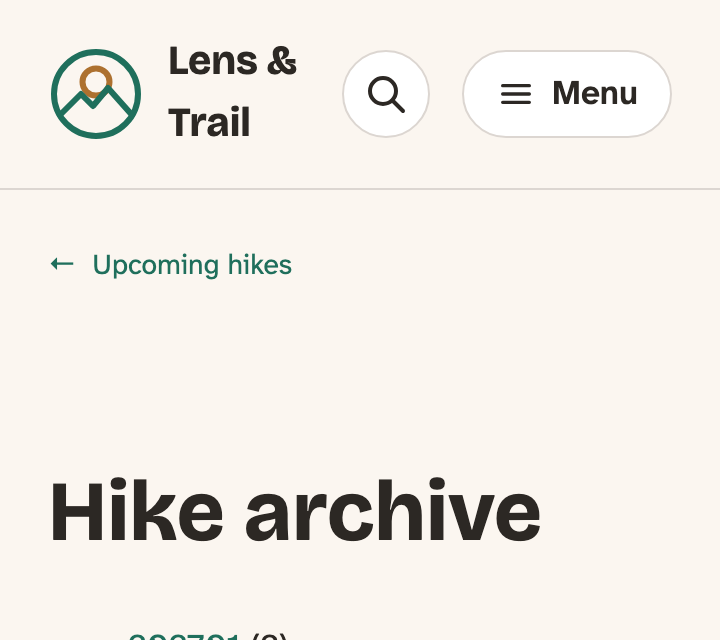
*Figure 16.7: The header on a phone*


*Figure 16.8: The side panel*

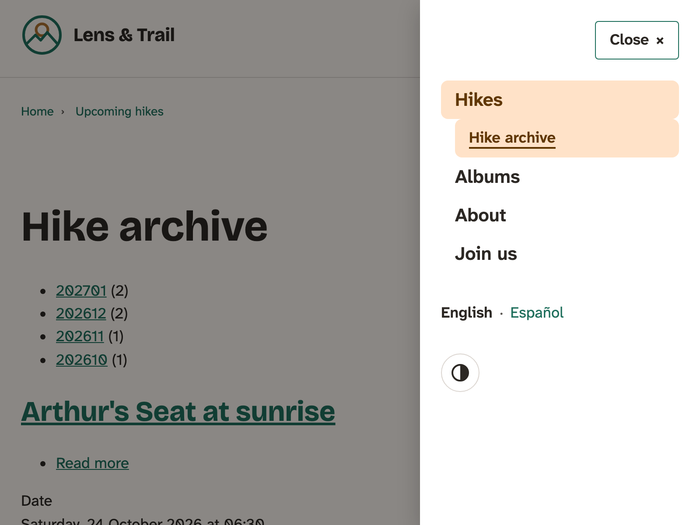
*Figure 16.9: On a tablet, the same panel, with more of the page behind it*

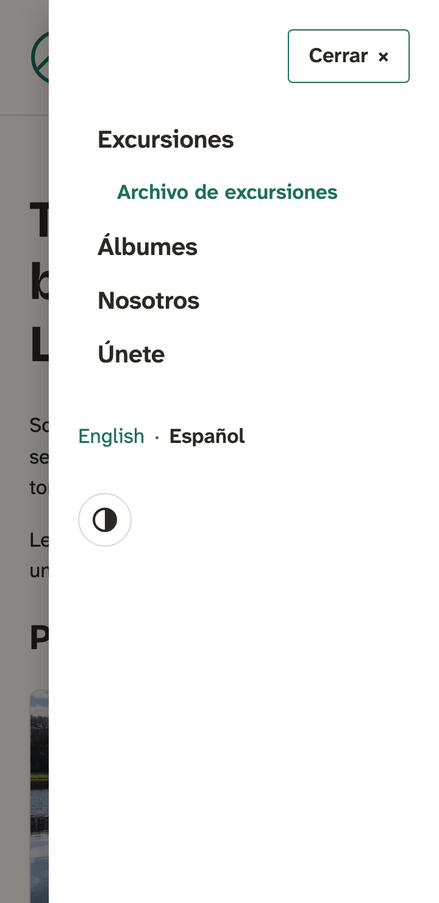
*Figure 16.10: In Spanish*

This is the panel in the accessibility tree. The header has a button called "Menu"; the open panel is a dialog called "Menu", with the Close button, the menu, the languages and the toggle, and nothing else:

`accessibility-tree` ([source](../code/chapter16/snippets/panel-accessibility.txt))

```text
# The header on a phone
- banner:
  - link "Lens & Trail":
    - /url: /
  - button "Search"
  - button "Menu"

# The open panel
- dialog "Menu":
  - button "Close"
  - navigation "Main navigation":
    - heading "Main navigation" [level=2]
    - list:
      - listitem:
        - link "Hikes":
          - /url: /hikes
        - list:
          - listitem:
            - link "Hike archive":
              - /url: /hikes/archive
      - listitem:
        - link "Albums":
          - /url: /galleries
      - listitem:
        - link "About":
          - /url: /about
      - listitem:
        - link "Join us":
          - /url: /join
  - navigation "Language":
    - list:
      - listitem:
        - link "English":
          - /url: /hikes/archive
      - listitem:
        - link "Español":
          - /url: /es/excursiones/archivo
  - button "Color scheme"
```

### Without JavaScript

Turn JavaScript off, and there's no Menu button, no dialog and no dropdown button: the header is the header chapter's, a row of links that wraps on a phone, and the hikes page links to the archive. That's **progressive enhancement**, from the JavaScript chapter: the menu works first, and the script makes it better.

## The breadcrumb

The first book's site shows a breadcrumb above each page's title: *Home › Upcoming hikes* on the hike archive. Core's **path-based breadcrumb** makes it from the page's URL: `/hikes/archive` is under `/hikes`, which is under the front page, so it lists those two, with their titles. It leaves the current page out, because the page's title comes right after it.

The design wants it small and quiet, with the separators drawn, not typed, and on a phone, only the way up: *← Upcoming hikes*. Core's template is close already; ours, `templates/navigation/breadcrumb.html.twig`, changes three things:

`templates/navigation/breadcrumb.html.twig` ([source](../code/chapter16/steps/05-breadcrumb/core/lens_trail/templates/navigation/breadcrumb.html.twig))

```twig
{#
/**
 * @file
 * Theme override for a breadcrumb trail.
 *
 * Core's path-based breadcrumb lists the pages above this one and leaves
 * the current page out: the page title comes right after it.
 *
 * Available variables:
 * - breadcrumb: Breadcrumb trail items.
 */
#}

  {{ attach_library('lens_trail/breadcrumb') }}
  <nav class="breadcrumb" aria-label="{{ 'Breadcrumb'|t }}">
    <ol class="breadcrumb__list">
    
      <li class="breadcrumb__item">
        
          <a class="breadcrumb__link" href="{{ item.url }}">{{ item.text }}</a>
        
          {# A trail from a contributed module may end on the current page. #}
          <span aria-current="page">{{ item.text }}</span>
        
      </li>
    
    </ol>
  </nav>

```

- The `<nav>` is named with `aria-label` instead of a visually hidden `<h2>`. Core's heading is there so a screen reader user can find the breadcrumb by its heading, but it comes *before* the page's `<h1>`, and puts a level-two heading above the page's own title in the list of headings. The landmark's name does the same job without that.
- Classes, for the CSS.
- An item without a link gets `aria-current="page"` when it's the last one. Core's breadcrumb never ends on the current page, so on the club's site this does nothing today; a contributed breadcrumb module that adds the current page, as many do, gets it marked right.

`css/components/breadcrumb.css` ([source](../code/chapter16/steps/05-breadcrumb/core/lens_trail/css/components/breadcrumb.css))

```css
/**
 * @file
 * The breadcrumb: Home › Next hikes on wide screens, ← Next hikes on phones.
 */
@layer components {
  .breadcrumb {
    margin-block: var(--space-s);
    font-size: var(--font-size-step--1);
  }

  .breadcrumb__list {
    display: flex;
    flex-wrap: wrap;
    align-items: center;
    margin: 0;
    padding: 0;
    list-style: none;
  }

  .breadcrumb__link {
    display: inline-flex;
    align-items: center;
    min-block-size: var(--size-target);
    color: var(--color-action);
    text-decoration: none;

    &:hover {
      text-decoration: underline;
    }
  }

  /* Phones: only the way up, the last link in the trail, with an arrow. */
  .breadcrumb__item:not(:last-child) {
    display: none;
  }

  .breadcrumb__item:last-child .breadcrumb__link::before {
    content: "←" / "";
    margin-inline-end: var(--space-2xs);
  }

  /* 40rem is --breakpoint-medium: room for the whole trail. */
  @media (min-width: 40rem) {
    .breadcrumb__item:not(:last-child) {
      display: list-item;
    }

    .breadcrumb__item:last-child .breadcrumb__link::before {
      content: none;
    }

    /* The separator comes from CSS, so a screen reader doesn't read it: the
       text after the slash is what it says instead, nothing. */
    .breadcrumb__item + .breadcrumb__item::before {
      content: "›" / "";
      padding-inline: var(--space-2xs);
      color: var(--color-muted);
    }
  }
}
```

The separator is the language switcher's trick again: a `›` drawn with generated content, with empty alternative text, so a screen reader says "Home, link, Upcoming hikes, link", and not "greater than". On a phone, every item but the last is hidden, and the last gets an arrow. Because core leaves the current page out, the last item is always the page one level up, so "← Upcoming hikes" is exactly the way back.

```diff
--- lens_trail.libraries.yml (before)
+++ lens_trail.libraries.yml (after)
@@ -88,6 +88,14 @@
     - core/once
     - lens_trail/base

+breadcrumb:
+  version: VERSION
+  css:
+    component:
+      css/components/breadcrumb.css: {}
+  dependencies:
+    - lens_trail/base
+
 main-menu:
   version: VERSION
   js:
```

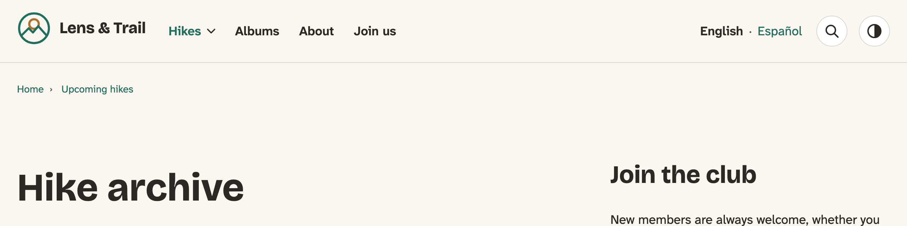
*Figure 16.11: The breadcrumb*


*Figure 16.12: On a phone, only the way up*

**Why no Home in the main menu?** The wireframe and the Drupal CMS site have a Home link in the main menu; the core site doesn't, and we left it that way. The logo already links to the front page, as visitors expect, and so does the breadcrumb's first item. A fifth link in a row of four is a cost for every visitor, for something nearly all of them already know how to do.

## On Drupal CMS

The Drupal CMS site gets the same menus, in Mercury's way. The header there is Mercury's **Navbar** component, in Canvas's page template, as the header chapter showed: the logo, the main menu block, and the CTAs slot with the languages, the search and the toggle. On a phone, Mercury already has a hamburger button, which opens the menu and the CTAs in a panel over the whole screen.

We kept Mercury's panel and its button, and changed as little as we could. Two things the club needs aren't there: a dropdown, and a place for the search next to the hamburger.

### The same modules, the same site building

First, Menu Item Extras and Views Reference, with the same commands as on the core site, and the same site building: Hikes as a menu link, the translation setting, the two views, the view mode and the fields, and the Hikes link's panel. One difference: Drupal CMS doesn't have Chapter 14's banner image styles, so the Menu panel view mode uses one of Focal Point's 16:9 styles, **16:9 608×342** (*16_9_608x342_focal_point_webp*).

The Drupal CMS site's Spanish menu already has *Inicio* for Home and *Únete* for Join us, from the first book's own site, so the header chapter's open item is done.

### The dropdown

Mercury's Navbar has a script that refers to a dropdown, but Mercury doesn't have one: its main menu template prints one level of links, and that's all. So the dropdown is ours, and it's the core site's. Mercury's `menu--main.html.twig` moves to `menu--extras--main.html.twig`, for the same reason as on the core site, and gets the core template's structure, with Mercury's Tailwind classes kept on the first level:

<details><summary>templates/navigation/menu--extras--main.html.twig</summary>

`templates/navigation/menu--extras--main.html.twig` ([source](../code/chapter16/steps/06-cms/cms/mercury/templates/navigation/menu--extras--main.html.twig))

```twig
{#
/**
 * @file
 * The main menu, with Menu Item Extras: Mercury's menu--main.html.twig under
 * the name the module's suggestion asks for, with the core theme's dropdown.
 *
 * Mercury's own template printed the first level only. This one adds, as on
 * the core site:
 * - main-menu__dropdown around what opens under a link: the links under it,
 *   and, when the link has them, its Panel lists and Panel photo
 *   (main-menu__item--has-panel). js/main-menu.js, the core theme's script,
 *   gives the link a button that shows and hides it.
 * - The BEM classes the script and css/main-menu.css look for, next to
 *   Mercury's Tailwind classes.
 *
 * Available variables: see Mercury's menu.html.twig. Menu Item Extras adds,
 * in each item, content (the menu link's fields, rendered) and entity (the
 * menu link itself).
 */
#}

{{ attach_library('mercury/main-menu') }}

{# Mercury made the nav "relative"; the Hikes panel is placed against the
   whole Navbar instead, so it isn't. #}



<nav {{ attributes }} aria-label="{{ menu_label }}">
  {{ menus.menu_links(items, 0) }}
</nav>


  
  
    
      <ul class="main-menu flex flex-col gap-1 p-0 font-body md:w-auto md:flex-row" data-level="1">
    
      <ul class="main-menu__submenu">
    
    
      
      
        {{- item.url -}}
      
      
      
      
      
      <li{{ item.attributes.addClass(item_classes) }}>
        
          
            <a
              href="{{ url }}"
              {# Lens & Trail: links as on the core site, not Mercury's pills. #}
              class="main-menu__link flex min-h-11 shrink-1 grow-1 basis-0 items-center gap-1 p-2 font-semibold underline-offset-[0.3em] duration-150 hover:text-primary hover:underline {{ item.in_active_trail ? 'text-primary underline decoration-2' : 'text-foreground no-underline' }}"
              data-level="1"
            >
              {{ title }}
            </a>
          
            <a href="{{ url }}" class="main-menu__link">{{ title }}</a>
          
        
        
          <div class="main-menu__dropdown">
            {{ lists }}
            {{ menus.menu_links(item.below, menu_level + 1) }}
            
              <div class="main-menu__photo">{{ photo }}</div>
            
          </div>
        
      </li>
    
    </ul>
  

```

</details>

The script is the core theme's `js/main-menu.js`, unchanged: it only looks for the BEM classes. Its CSS is the core theme's too, in plain CSS like the search's, with Mercury's variable names and breakpoints: the small dropdown from Mercury's `md` (48rem), where the menu becomes a row, and the panel from `lg` (64rem). On a phone, in Mercury's panel, the dropdown opens in place, under Hikes. One extra rule: Mercury's menu wrapper is `position: relative`, which would make it the panel's positioned ancestor, so from 64rem it's `static`, and the panel spans the whole Navbar.

<details><summary>css/main-menu.css</summary>

`css/main-menu.css` ([source](../code/chapter16/steps/06-cms/cms/mercury/css/main-menu.css))

```css
/**
 * @file
 * The main menu's dropdown and the Hikes panel: the core theme's CSS, with
 * Mercury's variable names and breakpoints. Plain CSS, like the search's.
 *
 * Mercury's md (48rem): the menu is a row in the Navbar, and Hikes opens a
 * small dropdown with the links under it. Mercury's lg (64rem): the whole
 * panel, as wide as the Navbar, under it. On a phone, in Mercury's menu
 * panel, the dropdown opens in place, under Hikes.
 */

.main-menu__toggle {
  display: inline-grid;
  place-items: center;
  inline-size: 1.75rem;
  block-size: 2.75rem;
  padding: 0;
  border: 0;
  border-radius: calc(var(--radius) - 2px);
  background: none;
  color: inherit;
  cursor: pointer;

  &:hover {
    color: var(--primary);
  }

  & svg {
    inline-size: 1.25rem;
    block-size: 1.25rem;
    transition: rotate 150ms;
  }

  &[aria-expanded="true"] svg {
    rotate: 180deg;
  }
}

/* Without the script there's no button, and the dropdown stays hidden: the
   hikes page links to the archive. With it, the hidden attribute decides. */
.main-menu__dropdown {
  display: none;
}

.main-menu__item:has(> .main-menu__toggle) > .main-menu__dropdown:not([hidden]) {
  display: block;
  flex-basis: 100%;
  padding-inline-start: 1rem;
}

.main-menu__submenu {
  margin: 0;
  padding: 0;
  list-style: none;

  & .main-menu__link {
    display: flex;
    align-items: center;
    min-block-size: 2.75rem;
    padding-inline: 0.5rem;
    color: var(--foreground);
    font-weight: 600;
    text-decoration: none;

    &:hover {
      color: var(--primary);
      text-decoration: underline;
    }
  }
}

/* The panel's lists and photo are for wide screens. On a narrower one, the
   dropdown has only the links under Hikes. */
.main-menu__list,
.main-menu__photo {
  display: none;
}

@media (min-width: 48rem) {
  .main-menu__item:has(> .main-menu__toggle) > .main-menu__dropdown:not([hidden]) {
    position: absolute;
    z-index: 10;
    inset-block-start: 100%;
    inset-inline-start: 0;
    min-inline-size: 14rem;
    padding: 0.5rem;
    border: 1px solid var(--border);
    border-radius: var(--radius);
    background-color: var(--card);
    box-shadow: var(--shadow-lg);
  }
}

/* The Hikes panel, under the whole Navbar: the Navbar is Mercury's
   positioned element, so the item and the menu's wrapper mustn't be one. */
@media (min-width: 64rem) {
  .navbar--dropdown-menu-wrapper:has(.main-menu__item--has-panel) {
    position: static;
  }

  .main-menu__item--has-panel {
    position: static;

    /* The same :has() as the dropdown's rule above, so this one wins. */
    &:has(> .main-menu__toggle) > .main-menu__dropdown:not([hidden]) {
      inset-inline: 1rem;
      display: grid;
      grid-template-columns: minmax(10rem, 1fr) minmax(14rem, 1.5fr) minmax(16rem, 1.5fr);
      grid-template-rows: auto 1fr;
      gap: 0.5rem 2.5rem;
      min-inline-size: 0;
      padding: 1.5rem;
    }

    /* Areas on the left, the next hikes and the links in the middle, the
       photo on the right: the order of the HTML, so the order you tab. */
    & .main-menu__list {
      display: block;
    }

    & .main-menu__list:first-child {
      grid-row: 1 / span 2;
    }

    & .main-menu__submenu {
      grid-column: 2;
    }

    & .main-menu__photo {
      display: block;
      grid-column: 3;
      grid-row: 1 / span 2;

      & img {
        border-radius: var(--radius);
      }
    }
  }
}

/* What's inside the panel: the views' titles as small labels, plain lists. */
.main-menu__list {
  & .viewsreference--view-title {
    margin-block-end: 0.5rem;
    color: var(--muted-foreground);
    font-size: 0.875rem;
    font-weight: 600;
  }

  & ul {
    margin: 0;
    padding: 0;
    list-style: none;
  }

  & li + li {
    margin-block-start: 0.5rem;
  }

  & a {
    color: var(--foreground);
    font-weight: 600;
    text-decoration: none;

    &:hover {
      color: var(--primary);
      text-decoration: underline;
    }
  }

  & .hike-date {
    display: block;
    color: var(--muted-foreground);
    font-size: 0.875rem;
  }
}

/* "All upcoming hikes" and "Hike archive": links onwards, with an arrow
   that's only for the eye. */
.main-menu__item--has-panel .more-link a,
.main-menu__item--has-panel .main-menu__submenu .main-menu__link {
  display: inline-flex;
  padding-inline: 0;
  color: var(--primary);
  font-weight: 600;

  &::after {
    content: " →" / "";
    white-space: pre;
  }
}

.main-menu__item--has-panel .more-link {
  margin-block-start: 0.75rem;
}
```

</details>

```diff
--- mercury.libraries.yml (before)
+++ mercury.libraries.yml (after)
@@ -34,3 +34,17 @@
   header: true
   js:
     js/color-scheme-early.js: {}
+
+# The main menu's dropdown and the Hikes panel: the core theme's script,
+# unchanged, and its CSS with Mercury's variable names. Attached by
+# menu--extras--main.html.twig.
+main-menu:
+  version: VERSION
+  css:
+    component:
+      css/main-menu.css: {}
+  js:
+    js/main-menu.js: {}
+  dependencies:
+    - core/drupal
+    - core/once
```

The field and media templates are the core theme's, with `mercury:photo` for the Photo component. Mercury's copy of the Photo component had no caption, so it gets the core component's optional `caption` prop:

```diff
--- components/photo/photo.twig (before)
+++ components/photo/photo.twig (after)
@@ -2,12 +2,14 @@
 /**
  * @file
  * A photo with its credit: the core theme's Photo component, with Tailwind.
+ * Below the photo, a caption can come first.
  */
 #}
 
 <figure class="relative m-0 [&_img]:block [&_img]:h-auto [&_img]:w-full">
   {{ image }}
   <figcaption class="{{ over ? 'absolute end-0 bottom-0 max-w-full bg-club-neutral-950 px-club-xs py-club-3xs text-club-neutral-0' : 'pt-club-2xs' }} text-step--1">
+    <span class="font-semibold">{{ caption }}.</span>
     {{ 'Photo:'|t }}
     <a href="{{ source }}" class="{{ over ? 'text-inherit' : 'text-club-action' }} underline">{{ photographer }}</a>{{ photographer }}
     · <span class="whitespace-nowrap">{{ license }}</span>
```


*Figure 16.13: The Hikes panel on the Drupal CMS site*

### Mercury's hamburger, finished

Mercury's hamburger opens its panel and puts the focus in it, but it doesn't say whether the panel is open, Escape doesn't close it, and closing it leaves the focus nowhere, so a keyboard user starts again from the top of the page. Three changes to the Navbar's script, each marked *Lens & Trail* in a comment:

```diff
--- components/navbar/navbar.js (before)
+++ components/navbar/navbar.js (after)
@@ -10,6 +10,25 @@
     this.menu = this.el.querySelector(".navbar--menu");

     measureScrollbarAndObserve(this.el.querySelector(".navbar--dropdown-menu"));
+
+    // Lens & Trail: the menu button says whether the panel is open, and
+    // which element it opens, as the core theme's Menu button does.
+    this.menu.id ||= "navbar-menu";
+    this.menuButton.setAttribute("aria-controls", this.menu.id);
+    this.menuButton.setAttribute("aria-expanded", "false");
+
+    // Escape closes the panel, unless a dropdown in it is open: then
+    // main-menu.js closes the dropdown first. This listener runs before
+    // that one (capture), so it sees the dropdown still open.
+    this.menu.addEventListener(
+      "keydown",
+      (event) => {
+        if (event.key === "Escape" && this.isOpen && !this.menu.querySelector('.main-menu__toggle[aria-expanded="true"]')) {
+          this.isOpen = false;
+        }
+      },
+      true,
+    );

     this.menuButton.addEventListener("click", () => {
       this.menu.querySelectorAll(".dropdown-menu__expand-button--has-been-opened").forEach((button) => {
@@ -65,7 +84,13 @@
     } else {
       this.menu.classList.remove("navbar--menu--open");
       document.documentElement.classList.remove("navbar-modal-open");
+      // Lens & Trail: back to the button that opened it, not to the top of
+      // the page, which is where the focus goes when it disappears.
+      if (this.#savedAsOpen) {
+        this.menuButton.focus();
+      }
     }
+    this.menuButton.setAttribute("aria-expanded", String(!!value));

     this.#savedAsOpen = !!value;
   }
```

- The hamburger gets `aria-controls` and `aria-expanded`, kept up to date in the `isOpen` setter, which is where Mercury opens and closes the panel.
- **Escape** closes the panel, unless a dropdown in it is open. Then the dropdown's own Escape closes the dropdown first, and a second Escape closes the panel. The listener is in the **capture** phase, so it runs before the dropdown's and sees the dropdown still open.
- When the panel closes, the focus goes back to the hamburger.

Mercury's panel isn't a `<dialog>`, so the page behind it isn't inert. We left that as it is: changing it would mean rewriting Mercury's panel, and the exercises have a smaller fix.

### The search, next to the hamburger

On a phone, everything in the Navbar's CTAs slot is in Mercury's panel, so the header chapter's search was there too, after the languages. The design has it next to the Menu button, as on the core site. That needs a place outside the panel, so the Navbar gets a slot of its own, **Next to the menu button**, between the panel and the hamburger:

```diff
--- components/navbar/navbar.component.yml (before)
+++ components/navbar/navbar.component.yml (after)
@@ -21,6 +21,9 @@
     title: Navigation menu
   links:
     title: CTAs
+  tools:
+    title: Next to the menu button
+    description: Stays in the Navbar's top row on a phone, next to the menu button, instead of going into the menu panel. Lens & Trail's own slot.

 libraryOverrides:
   js:
```

```diff
--- components/navbar/navbar.twig (before)
+++ components/navbar/navbar.twig (after)
@@ -95,6 +95,12 @@
     </div>
   </div>

+  {# Lens & Trail: a slot next to the menu button, outside the menu panel, so
+     what's in it (the search) stays in the top row on a phone. #}
+  <div class="navbar--tools ms-auto flex shrink-0 items-center gap-2 self-center ps-4">
+    
+  </div>
+
   <div class="navbar--hamburger-container flex min-h-[44px] min-w-[44px] shrink-0 grow-0 items-center justify-center md:hidden">
     <button class="navbar--hamburger flex items-center justify-center" aria-label="{{ 'Show menu'|t }}">
       {{
```

Then, in Canvas, open the page template, and in the **Layers** panel, drag the search (**Exposed form: search-search**) from the Navbar's **CTAs** to its new **Next to the menu button** slot, and publish. Canvas uses the version of a component it was placed with, so if the new slot doesn't show up, the Navbar in the template is still on the old version: remove it and add it again, or let Canvas offer the update.

The search's panel used to be placed in two ways, under the Navbar from `md`, and in the CTAs row on a phone. Now it's always under the Navbar:

```diff
--- components/search/search.css (before)
+++ components/search/search.css (after)
@@ -5,7 +5,7 @@
  */

 /* The wrapper steps aside, so the icon and the panel are items of the
-   Navbar's links row (a wrapping flex row) like the toggle next to them. */
+   Navbar's row, like the menu button next to them. */
 .search {
   display: contents;
 }
@@ -38,11 +38,19 @@
   }
 }

-/* On a phone, the Navbar's links are at the bottom of Mercury's menu panel:
-   the field opens there, on a line of its own after the row's other items. */
+/* Under the whole Navbar, from one side of the container to the other: the
+   Navbar is the nearest positioned element. The search is in the Navbar's
+   own slot next to the menu button (Chapter 16), so this is the same on a
+   phone and on a wide screen. */
 .search__panel {
-  order: 1;
-  flex-basis: 100%;
+  position: absolute;
+  z-index: 600;
+  inset-inline: 0;
+  inset-block-start: 100%;
+  padding: 0.75rem 1rem;
+  border-block-end: 1px solid var(--border);
+  background-color: var(--background);
+  box-shadow: 0 0.5rem 1rem rgb(0 0 0 / 0.1);

   &[hidden] {
     display: none;
@@ -65,31 +73,11 @@
       inline-size: 100%;
     }

-    /* Mercury gives the actions an equal share of a form row, and makes
-       the Navbar's buttons (its call-to-action links) nearly full width on
-       a phone, with a margin on each side. */
+    /* Mercury gives the actions an equal share of a form row. (Out of the
+       CTAs slot, Mercury's rule for the Navbar's buttons no longer reaches
+       the search's button, so Chapter 15's .button.button rule is gone.) */
     & .form-actions {
       flex: none;
-
-      & .button.button {
-        inline-size: auto;
-        margin: 0;
-      }
     }
   }
 }
-
-/* From Mercury's md breakpoint, under the whole Navbar, from one side of the
-   container to the other: the Navbar is the nearest positioned element. */
-@media (min-width: 48rem) {
-  .search__panel {
-    position: absolute;
-    z-index: 600;
-    inset-inline: 0;
-    inset-block-start: 100%;
-    padding: 0.75rem 1rem;
-    border-block-end: 1px solid var(--border);
-    background-color: var(--background);
-    box-shadow: 0 0.5rem 1rem rgb(0 0 0 / 0.1);
-  }
-}
```

The templates have new Tailwind classes, so build Mercury's CSS again:

`terminal` ([source](../code/chapter15/snippets/mercury-build.sh))

```bash
# tools/use-step.sh replaces the theme's folder, node_modules included, so
# install the packages again before the build.
ddev exec -d /var/www/html/web/themes/custom/mercury npm ci
ddev exec -d /var/www/html/web/themes/custom/mercury npm run build
```

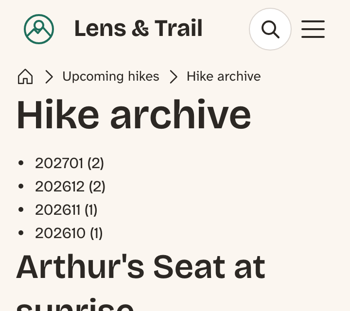
*Figure 16.14: The search, next to the hamburger*

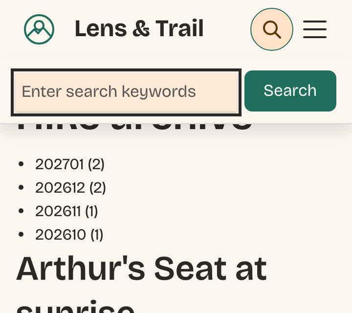
*Figure 16.15: The search opens under the Navbar*

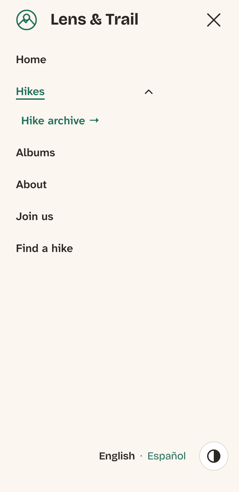
*Figure 16.16: The dropdown, in Mercury's panel*

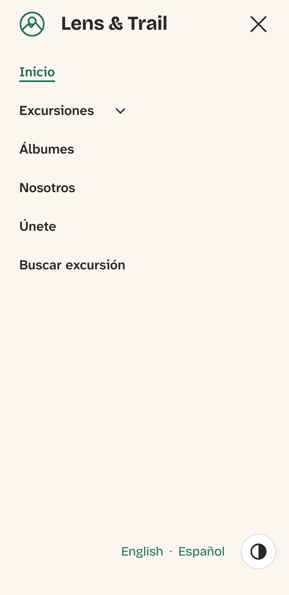
*Figure 16.17: In Spanish, with Inicio and Únete*


*Figure 16.18: The panel in Spanish*

## Summary

You can now:

- explain where Drupal's menu links come from (content, views, code), and how a menu block's levels and the active trail decide what reaches the template;
- write a menu template with a macro that calls itself, and give a menu's parts classes of their own;
- build a dropdown as a disclosure (a link, and a button with `aria-expanded`), and explain why not hover and not ARIA's `menu` role;
- close what you open with Escape, a click outside and tabbing away, and put the focus back where it belongs;
- make menu links fieldable with Menu Item Extras, and fill a mega menu from views and media, so the club's editors decide what's in it;
- find out why a module's template takes over, from the suggestions, and take it back;
- patch a contributed module for a new Drupal version with composer-patches, and know what to look for;
- build an off-canvas panel as a modal `<dialog>`, and know what the browser does for you there;
- style core's breadcrumb, with a short version for phones;
- finish another theme's hamburger, and add a slot to a component for something that has to stay outside its panel.

The header is done. The next chapter is the first thing under it on the front page: the hero.

## Exercises

1. Add a dropdown under **Albums** with two links to **Photo themes**, such as *Landscape* and *Winter*, from the first book's vocabulary. What do you change in the theme? (Check the dropdown on a phone, in the side panel, too.)
2. With the mouse put away, Tab through the core site's header at 1280 pixels wide, and then on a phone, with the panel open. Write down the order you reach things in, and compare it with the order you see them in. Do the same on the Drupal CMS site.
3. Turn JavaScript off in your browser's developer tools, and look at the header on a phone and on a wide screen, on both sites. What's still there, what's gone, and can you still get to the hike archive?
4. On the Drupal CMS site, Mercury's menu panel isn't a `<dialog>`: Tab past its last link, and the focus goes on, into the page hidden under the panel. Close the panel when the focus leaves it, with a `focusout` listener like the dropdown's. Where does the focus go then? *(challenge)*
5. Make the core site's dropdown open on hover too, with a mouse, on wide screens, and keep it accessible: it mustn't open when the mouse only passes over Hikes, it must stay open while the mouse crosses into the panel, and Escape must close it without moving the mouse. *(advanced)* (The answer is in Appendix B.)

## Want to know more?

- Drupal.org: [the Menu UI module](https://www.drupal.org/docs/core-modules-and-themes/core-modules/menu-ui-module), [Menu Item Extras](https://www.drupal.org/project/menu_item_extras) and [Views Reference](https://www.drupal.org/project/viewsreference).
- The W3C's ARIA Authoring Practices Guide: [a disclosure navigation menu](https://www.w3.org/WAI/ARIA/apg/patterns/disclosure/examples/disclosure-navigation/), [the Breadcrumb pattern](https://www.w3.org/WAI/ARIA/apg/patterns/breadcrumb/) and [the modal Dialog pattern](https://www.w3.org/WAI/ARIA/apg/patterns/dialog-modal/).
- Adrian Roselli: [Don't Use ARIA Menu Roles for Site Nav](https://adrianroselli.com/2017/10/dont-use-aria-menu-roles-for-site-nav.html).
- WCAG 2.2: [Understanding Content on Hover or Focus](https://www.w3.org/WAI/WCAG22/Understanding/content-on-hover-or-focus.html) and [Understanding Focus Order](https://www.w3.org/WAI/WCAG22/Understanding/focus-order.html).
- MDN: [the `<dialog>` element](https://developer.mozilla.org/en-US/docs/Web/HTML/Reference/Elements/dialog), [`inert`](https://developer.mozilla.org/en-US/docs/Web/HTML/Reference/Global_attributes/inert) and [the Popover API](https://developer.mozilla.org/en-US/docs/Web/API/Popover_API).
