# Hero Sections

The first thing under the header on most sites is a **hero**: a big photo as wide as the window, a heading over it, and a button. It's the part of a page that says what the site is about before anyone reads a word, and it's the part that's most often slow, hard to read, or moving when nobody asked it to. A hero is also a lot of things at once: an image that has to load first, text that has to be readable on any photo, a heading that has to fit the page's outline, and, on the club's site, a slider. So it gets a chapter of its own.

Chapter 3 designed the club's hero as a **slider** with three slides: the next hike, the newest album, and an invitation to join. It promised a Pause button, at least seven seconds a slide, nothing moving with reduced motion, and a little parallax on the photo. This chapter keeps those promises, one step at a time:

1. **A Hero component**, and the next hike in it, at the top of the front page.
2. **The other two slides**, and a slider that works without JavaScript: a row you can scroll sideways.
3. **The controls**: Pause, Previous, Next and the dots, in a script.
4. **A little parallax**, in CSS only.
5. **The hero photo as the page's Largest Contentful Paint**: what loads first, and what waits.
6. **The same on the Drupal CMS site**, in Canvas.

The core site starts where the menus chapter left it: the front page opens with the page title, "Welcome to Lens & Trail", the club's two sentences and the Next hikes cards, and the Hero region from Chapter 7 is empty. The Drupal CMS site's Home opens with Mercury's **CTA** component, the same welcome with a How to join button, on the page's background color.

## What makes a hero

Every hero we've built has the same four parts, and each has its own trap:

- **The photo.** It's the biggest thing on the screen, so it decides how fast the page *feels*. And it's a photo of someone else's: on the club's site, every photo carries its credit, the hero's too.
- **The text over it.** White text on a photo is readable on the dark parts and lost on the bright ones, and you don't know in advance which part of a photo will be under the text. The club's photos come from its members, so the theme can't count on a dark sky.
- **The heading.** A hero's heading is big, but it's rarely the page's main heading. On the front page, the page is "Welcome to Lens & Trail", and the next hike is one thing on it.
- **The button.** A link that says where it goes: "See the hike", never "Read more".

Not every page gets a hero. The design gives the hike page its photo in the content column, under the date and the title (see the hike page wireframe in Chapter 4), and Chapter 14 built it that way: the Banner, art-directed, loaded first. That's still the right choice: on a hike page, the facts next to the photo (where to meet, how far, how hard) are what people come for, and a hero would push them below the first screen. So the hero is the front page's, and this chapter doesn't touch the hike page.

## The Hero component

A hero is a component in the sense of Chapter 13: it has props (the heading, the link), slots (the photo) and variants. The club needs two variants. **Photo**, with white text on a photo, and **Color**, with the text on the tint color, for a slide that has no photo. The Join the club slide is one of those, and so is a hike whose leader hasn't added a photo yet.

The component's definition:

`components/hero/hero.component.yml` ([source](../code/chapter17/steps/01-hero/core/lens_trail/components/hero/hero.component.yml))

```yaml
$schema: https://git.drupalcode.org/project/drupal/-/raw/HEAD/core/assets/schemas/v1/metadata.schema.json
name: Hero
description: A big band at the top of a page, as wide as the window, with a heading and a link. Text over a photo, or on the tint color.
group: Lens & Trail
status: stable
props:
  type: object
  required:
    - heading
  properties:
    eyebrow:
      type: string
      title: Eyebrow
      description: A few words above the heading that say what it is, such as "Next hike". Optional.
      examples:
        - Next hike
    heading:
      type: string
      title: Heading
      examples:
        - Turnhouse Hill and Carnethy Hill
    heading_level:
      # number, not integer, as in the Hike card: SDC Styleguide can't read
      # an integer from a demo file.
      type: number
      title: Heading level
      description: 2 when the page has its own h1, as the front page has.
      enum:
        - 1
        - 2
        - 3
      default: 2
    text:
      type: string
      title: Text
      description: A sentence under the heading. Optional.
      examples:
        - Membership is £20 a year, £10 for students.
    url:
      type: string
      format: uri-reference
      title: Link
      description: Where the button goes. Without it, there's no button.
      examples:
        - /hikes/turnhouse-hill-and-carnethy-hill
    link_text:
      type: string
      title: Link text
      description: What the button says. Say where it goes, not "Read more".
      examples:
        - See the hike
slots:
  meta:
    title: Meta
    description: A line between the eyebrow and the heading, such as the hike's date, rendered by Drupal. Optional.
  photo:
    title: Photo
    description: The photo behind the text, as Drupal has rendered it, with its credit. Only in the Photo variant.
variants:
  photo:
    title: Photo
    description: White text on a photo, darkened by a gradient where the text is.
  color:
    title: Color
    description: Text on the tint color, for a hero without a photo.
libraryOverrides:
  # As in the Hike card: the layers are declared in the base library's first
  # file, so it has to come first. The photo in the slot is usually a Photo
  # component, which brings its own CSS; this makes sure it's there when the
  # slot is filled some other way, such as in a demo.
  dependencies:
    - lens_trail/base
    - core/components.lens_trail--photo
```

The **meta** slot is for a line between the eyebrow and the heading, the hike's date: Drupal renders it, with a `<time>` element and the date in the visitor's language, so it's a slot and not a string. The **photo** slot takes whatever Drupal rendered, which on the club's site is the Photo component from Chapter 14, with the credit. The dependency on the Photo component's library (`core/components.lens_trail--photo`, the name Drupal gives a component's library) makes sure its CSS is there even when a demo fills the slot by hand.

The template:

`components/hero/hero.twig` ([source](../code/chapter17/steps/01-hero/core/lens_trail/components/hero/hero.twig))

```twig
{#
/**
 * @file
 * The Hero: a big band at the top of a page.
 *
 * Props: eyebrow, heading, heading_level, text, url, link_text.
 * Slots: meta, photo. Variants: photo (the default), color. Drupal puts the
 * variant in the data-component-variant attribute, and the CSS reads it from
 * there.
 *
 * The photo comes after the text in the HTML, so a screen reader meets the
 * heading first and the photo's credit last. The CSS puts it behind the text.
 */
#}

<div{{ attributes.addClass('hero') }}>
  <div class="hero__text">
    
      <p class="hero__eyebrow">{{ eyebrow }}</p>
    
    
      <div class="hero__meta">{{ meta }}</div>
    
    <{{ heading_tag }} class="hero__heading">{{ heading }}</{{ heading_tag }}>
    
      <p class="hero__intro">{{ text }}</p>
    
    
      <a class="hero__link" href="{{ url }}">{{ link_text }}</a>
    
  </div>
  
    <div class="hero__photo">{{ photo }}</div>
  
</div>
```

Two choices in it are worth a sentence each. The **heading level** is a prop, because the same hero could be a page's only big heading somewhere else; on the front page it's an h2. And the **photo comes after the text** in the HTML. A screen reader reads the heading first and the credit last, which is the order that makes sense when you can't see the picture. The CSS puts the photo behind the text, so nobody who can see it notices.

### Text over a photo

The CSS starts with the box: a grid, as tall as most of the screen but never taller than 36rem, so the next thing on the page always peeks out under it:

`components/hero/hero.css` ([source](../code/chapter17/steps/01-hero/core/lens_trail/components/hero/hero.css))

```css
/**
 * @file
 * The Hero component: text over a photo, or on the tint color.
 */
@layer components {
  .hero {
    /* The photo and the gradient go behind the text, but not behind the
       page: isolation keeps their negative z-index inside the hero. */
    position: relative;
    isolation: isolate;
    display: grid;
    align-items: end;
    min-block-size: clamp(30rem, 80svh, 36rem);
    overflow: hidden;
    /* White on the photo in both color schemes, like the photo's credit:
       it's on a photo, not on the page. The background is for the moment
       before the photo arrives. */
    background: var(--color-neutral-950);
    color: var(--color-neutral-0);

    @media (min-width: 48rem) {
      align-items: center;
    }
  }

  /* The text lines up with the page content under the hero. */
  .hero__text {
    inline-size: 100%;
    max-inline-size: var(--size-content);
    margin-inline: auto;
    padding: var(--space-xl) var(--space-m) var(--space-3xl);

    & > * {
      max-inline-size: 34rem;
    }
  }
```

`isolation: isolate` deserves a word. The photo and its gradient get a negative `z-index`, to sit behind the text. Without isolation, a negative `z-index` goes behind the hero's parent too, and then behind the page's background, where nobody would see it. `isolation` makes the hero a **stacking context** of its own: what's inside is layered within the hero, and the hero as a whole stays where it is.

Then the photo, cut to the hero's shape with `object-fit: cover`. It's a few elements deep (the media item's `div`, the Photo component's `figure`, the `picture`), and each of them has to be as tall as the hero too:

`components/hero/hero.css` ([source](../code/chapter17/steps/01-hero/core/lens_trail/components/hero/hero.css))

```css
   tall as the hero too. */
.hero__photo {
  position: absolute;
  z-index: -1;
  inset: 0;

  & :is(div, figure, picture) {
    block-size: 100%;
  }

  & img {
    inline-size: 100%;
    block-size: 100%;
    object-fit: cover;
  }

  /* On a phone, the slider's controls take the bottom corner, so the
     credit goes to the top. */
  & .photo__caption {
    @media (max-width: 47.99rem) {
      inset-block: 0 auto;
    }
  }
}
```

And the part that makes the text readable: a **gradient**, from almost black where the text is to clear where it isn't. At the bottom on a phone, where the text sits, and on the left on a wider screen:

`components/hero/hero.css` ([source](../code/chapter17/steps/01-hero/core/lens_trail/components/hero/hero.css))

```css
/* The gradient: the darkest where the text is, at the bottom on a phone and
   on the left on a wider screen. text-shadow alone isn't enough: on a white
   sky, white text with a shadow is still hard to read. After the photo in
   the HTML, so it's drawn over it. */
.hero:has(.hero__photo)::after {
  content: "";
  position: absolute;
  z-index: -1;
  inset: 0;
  background: linear-gradient(to top, rgb(22 19 15 / 0.85) 0%, rgb(22 19 15 / 0.7) 55%, rgb(22 19 15 / 0.1) 100%);
  pointer-events: none;

  @media (min-width: 48rem) {
    background: linear-gradient(to right, rgb(22 19 15 / 0.85) 0%, rgb(22 19 15 / 0.7) 45%, rgb(22 19 15 / 0) 80%);
  }
}
```

Why not `text-shadow`, which is what most heroes we've seen use? Because a shadow helps the edges of the letters and does nothing for the space between them. On a white sky, white text with a shadow still has a contrast of about 1:1 with what's around it. WCAG asks for 4.5:1 for normal text and 3:1 for large text, and it doesn't say "except on photos". So we worked it out for the worst photo there could be, a white sky everywhere: where the gradient is at its lightest under the text (70% black, on the right of the text on a wide screen), white text has a contrast of about 7:1, and at the top of the text on a phone, where the gradient fades out, about 5:1. Both pass for any photo, whatever is in it.

> **Try it:** In the browser's developer tools, turn off the `::after` rule on the front page hero and look at the album's slide later in this chapter, Jim Barton's photo with a bright sky in the top right. Then turn it back on.

The Color variant changes the colors and nothing else: the tint, and the page's own button colors, which work in dark mode as they are.

`components/hero/hero.css` ([source](../code/chapter17/steps/01-hero/core/lens_trail/components/hero/hero.css))

```css
/* No photo: the tint color, and the page's own text and button colors. */
.hero[data-component-variant="color"] {
  min-block-size: 0;
  background: var(--color-tint);
  color: var(--color-on-tint);

  & .hero__text {
    padding-block: var(--space-2xl);
  }

  & .hero__link {
    background: var(--color-action);
    color: var(--color-on-action);

    &:focus-visible {
      outline-color: var(--color-action);
    }
  }
}
```

SDC Styleguide, from Chapter 13, shows both variants from their demo files. The Photo demo uses the Turnhouse Hill photo, copied into the component's `demo` folder with a note of its credit:


*Figure 17.1: The Hero component in SDC Styleguide.*

## The next hike, in a hero

The component draws a hero. The front page needs one with the next hike in it, which is site building first: a view that finds the next hike, a view mode that says which of its fields the hero shows, and a block in the Hero region.

### A view mode for the hero, and an image style

A **view mode** is a named way to show an entity: Full content, Teaser, and the Card that Chapter 9 made for hikes. A hike in a hero shows two fields, the photo and the date, so it gets a view mode of its own. Its photo is a media item, and the photo in a hero is bigger than anywhere else, so the media item gets one too.

First, the size of the photo. A hero is as wide as the window, so the `sizes` is `100vw`, and Chapter 14's Banner image styles already have the right shapes: 4:3 for phones and 16:9 for wider screens, each cut around the photo's focal point. Go to **Configuration** › **Media** › **Responsive image styles**, and **Add responsive image style**:

1. **Label**: Hero. **Breakpoint group**: Lens & Trail, as for the Banner.
2. Open **1x Narrow**: **Select multiple image styles and use the sizes attribute**, **Sizes** `100vw`, and check **Banner phone** and **Banner phone large**.
3. Open **1x Medium**: the same, **Sizes** `100vw`, with **Banner small**, **Banner** and **Banner large**.
4. **Fallback image style**: Banner. **Save**.

Then the view modes, on **Structure** › **Display modes** › **View modes**:

1. **Add view mode** for **Media**, named **Hero**.
2. **Add view mode** for **Content**, also named **Hero**.

On **Structure** › **Media types** › **Image** › **Manage display**, open **Custom display settings** at the bottom, check **Hero**, and save. On the new **Hero** tab, set it up like the **Banner** tab, with two changes: the image's **Responsive image style** is **Hero**, and its **Image loading** is **Eager**. It's the first thing a visitor sees, so it mustn't wait to be scrolled to.

On **Structure** › **Content types** › **Hike** › **Manage display**, do the same for **Hero**. On its tab, keep only two fields, and drag the rest to **Disabled**:

- **Photo**, label **Hidden**, format **Rendered entity**, with **View mode** Hero.
- **Date**, label **Hidden**, format **Default**, with **Date format** Day, date and time, as on the Card.

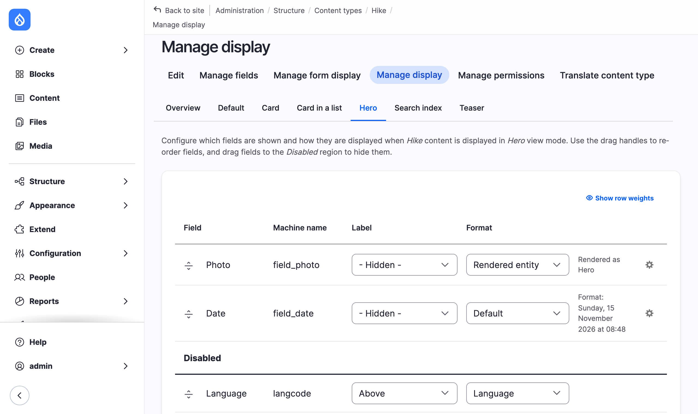
*Figure 17.2: A hike's Hero display: the photo and the date, nothing else.*

The media template is the Banner's, under the view mode's name: the Photo component, with the credit over the photo's corner.

`templates/media/media--image--hero.html.twig` ([source](../code/chapter17/steps/01-hero/core/lens_trail/templates/media/media--image--hero.html.twig))

```twig
{#
/**
 * @file
 * An Image media item in the Hero view modes: the photo behind a hero.
 *
 * The same as the Banner's: the Photo component draws the photo and its
 * credit. Only the view mode's image style and loading differ.
 * For the variables, see core's media.html.twig.
 */
#}
<div{{ attributes }}>
  {{ include('lens_trail:photo', {
    image: content.field_media_image,
    photographer: media.field_photographer.value,
    license: content.field_license.0['#markup'],
    source: media.field_source.uri,
    credit: 'over',
  }, with_context = false) }}
</div>
```

And the Banner's preprocess from Chapter 14, which adds `fetchpriority="high"`, gets the new view mode too:

```diff
--- src/Hook/LensTrailHooks.php (before)
+++ src/Hook/LensTrailHooks.php (after)
@@ -2,12 +2,16 @@

 namespace Drupal\lens_trail\Hook;

+use Drupal\Core\Controller\TitleResolverInterface;
 use Drupal\Core\Datetime\DateFormatterInterface;
 use Drupal\Core\Extension\ThemeSettingsProvider;
 use Drupal\Core\Form\FormStateInterface;
 use Drupal\Core\Hook\Attribute\Hook;
+use Drupal\Core\Path\PathMatcherInterface;
+use Drupal\Core\Routing\RouteMatchInterface;
 use Drupal\Core\StringTranslation\StringTranslationTrait;
 use Drupal\image\Entity\ImageStyle;
+use Symfony\Component\HttpFoundation\RequestStack;

 /**
  * Hook implementations for lens_trail.
@@ -19,6 +23,10 @@
   public function __construct(
     protected DateFormatterInterface $dateFormatter,
     protected ThemeSettingsProvider $themeSettings,
+    protected PathMatcherInterface $pathMatcher,
+    protected TitleResolverInterface $titleResolver,
+    protected RequestStack $requestStack,
+    protected RouteMatchInterface $routeMatch,
   ) {}

   /**
@@ -67,13 +75,14 @@
    * Implements hook_preprocess_field().
    *
    * The Banner photo is the biggest thing at the top of a hike or news page,
-   * so the browser should fetch it before anything else it finds on the way.
-   * Drupal has a setting for loading="eager", but none for fetchpriority.
+   * and the Hero photo at the top of the front page, so the browser should
+   * fetch it before anything else it finds on the way. Drupal has a setting
+   * for loading="eager", but none for fetchpriority.
    */
   #[Hook('preprocess_field')]
   public function preprocessField(array &$variables): void {
     $element = $variables['element'];
-    if ($element['#field_name'] !== 'field_media_image' || $element['#view_mode'] !== 'banner') {
+    if ($element['#field_name'] !== 'field_media_image' || !in_array($element['#view_mode'], ['banner', 'hero'], TRUE)) {
       return;
     }
     foreach ($variables['items'] as &$item) {
@@ -127,6 +136,22 @@
   }

   /**
+   * Implements hook_preprocess_region().
+   *
+   * On the front page, the page's title goes in the Hero region, which comes
+   * before the content region, so the h1 comes before the hero's headings.
+   * The page title block is hidden on the front page in Block layout.
+   */
+  #[Hook('preprocess_region')]
+  public function preprocessRegion(array &$variables): void {
+    if ($variables['region'] !== 'hero' || !$this->pathMatcher->isFrontPage()) {
+      return;
+    }
+    $route = $this->routeMatch->getRouteObject();
+    $variables['page_title'] = $this->titleResolver->getTitle($this->requestStack->getCurrentRequest(), $route);
+  }
+
+  /**
    * Implements hook_form_system_theme_settings_alter().
    */
   #[Hook('form_system_theme_settings_alter')]
```

(The diff also shows a second hook, for the page's heading. We come to it in a moment.)

### The next hike

The view that finds the next hike already exists: the first book's Next hikes block, in the **Hikes** view, shows the next three, in date order, from today on. The hero needs the same list, cut to one, in the new view mode.

On **Structure** › **Views**, edit **Hikes**, open the **Block** display (Next hikes), and **Duplicate Block** from the menu on the right. On the copy, change these, each with **This block (override)**:

1. **Display name**: Hero.
2. **Title**: Next hike. **Block name**: Next hike, in the hero.
3. **Pager**: **Display a specified number of items**, 1.
4. **Show**: **Content**, with **View mode** Hero.
5. **More link**: off.

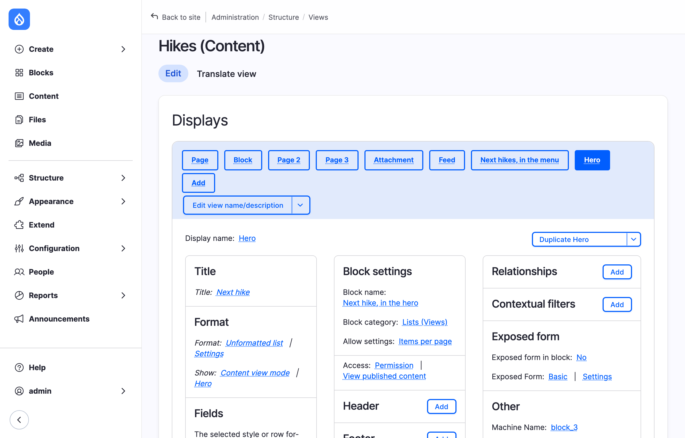
*Figure 17.3: The Hero display, a copy of Next hikes with one hike.*

On **Block layout**, place **Next hike, in the hero** in **Hero**, with **Display title** off, and on the **Pages** tab, show it only on `<front>`.

### The template

The node template hands the hike to the component, as Chapter 13's card template does:

`templates/content/node--hike--hero.html.twig` ([source](../code/chapter17/steps/01-hero/core/lens_trail/templates/content/node--hike--hero.html.twig))

```twig
{#
/**
 * @file
 * A hike in the Hero view mode: the next hike, at the top of the front page.
 *
 * The markup and styles are in the Hero component. This template only hands
 * it the node's values. Without a photo, the hero is the Color variant.
 * For the variables, see core's node.html.twig.
 */
#}

{{ include('lens_trail:hero', {
  eyebrow: 'Next hike'|t,
  meta: content.field_date,
  heading: node.label,
  url: url,
  link_text: 'See the hike'|t,
  variant: photo ? 'photo' : 'color',
  photo: photo,
}, with_context = false) }}
```

The photo is rendered once, into `photo`, and then used twice: to choose the variant, and in the slot. Printing `content.field_photo` twice wouldn't work, because Drupal marks a render array as printed the first time, and the second time it prints nothing. A hike without a photo gets the Color variant, so no hero is ever a dark box with nothing in it.

### The page's heading

There's a catch on the front page. The Hero region comes before the Content region, so the hero's h2 comes before the page title's h1. A screen reader user who lists the page's headings would meet "Turnhouse Hill and Carnethy Hill" first, and "Welcome to Lens & Trail" after it, one level up. And the design has no welcome heading above the hero; it starts with the photo.

So on the front page, the page title moves into the Hero region, before the hero, and is hidden from sight but not from screen readers. That's two changes. In **Block layout**, configure **Page title**, and on its **Pages** tab, **Hide for the listed pages**: `<front>`. And the region gets its own template, which prints the title when there is one:

`templates/layout/region--hero.html.twig` ([source](../code/chapter17/steps/01-hero/core/lens_trail/templates/layout/region--hero.html.twig))

```twig
{#
/**
 * @file
 * The Hero region: the full-width band at the top of the front page.
 *
 * It comes before the content region, and so before the page title. On the
 * front page, the title moves here, as the page's h1, for screen readers
 * only: the hero's own heading is an h2, and it shouldn't come before the h1.
 * The page title block is hidden on the front page in Block layout, and
 * lens_trail's preprocess_region adds page_title here.
 *
 * @see \Drupal\lens_trail\Hook\LensTrailHooks::preprocessRegion()
 */
#}

  <div{{ attributes.addClass('region', 'region-hero') }}>
    
      <h1 class="visually-hidden">{{ page_title }}</h1>
    
    {{ content }}
  </div>

```

The title itself comes from a preprocess function, the second hook in the diff above. Drupal's **title resolver** is the service that works out a page's title from its route, the same one the Page title block uses, so the h1 says whatever that block would have said, in the page's language. `visually-hidden` is Drupal core's class for text that's for screen readers only.

After a cache rebuild, the front page opens with the next hike:


*Figure 17.4: The next hike, in a hero.*

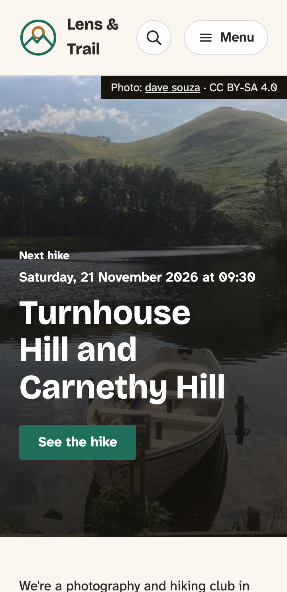
*Figure 17.5: On a phone, the gradient comes up from the bottom, and the credit goes to the top.*

On a phone, the photo is the Banner phone crop, 4:3, cut again by `object-fit` to a hero that's taller than it's wide. The focal point from Chapter 14 keeps the boat in it. The credit moves to the top right corner, for a reason that comes with the slider's controls.

## Three slides

Chapter 3 says why sliders have a bad name: they move on their own, too fast, with no way to stop them, and few visitors get past the first slide. The club's design answers each of these, and the last one in its order of slides: the next hike comes first, because it's the one many visitors will see. The other two are the newest album and an invitation to join.

### The newest album

An album's slide shows its first photo. The album's photos are a field with many values, and the hero should load only one photo, lazily, because it isn't the first slide. So the media item gets a second view mode, a copy of Hero that loads lazily:

1. On **Structure** › **Display modes** › **View modes**, add a **Media** view mode, **Hero, later slides**.
2. On **Image**'s **Manage display**, turn it on, and set it up like **Hero**, with **Image loading** **Lazy**.
3. On **Album**'s **Manage display**, turn on **Hero**, and keep only **Photos**: label **Hidden**, **Rendered entity**, **View mode** Hero, later slides.
4. In the **Albums** view, add a **Block** display named **Hero**: **Title** Newest album, **Block name** Newest album, in the hero, one item, **Show** **Content** in the **Hero** view mode, and **Hide block if the view output is empty** on. The view's default sort, the hike's date, newest first, gives the newest album.

The template prints the first photo only. The display renders all of them, but only what's printed goes into the page:

`templates/content/node--gallery--hero.html.twig` ([source](../code/chapter17/steps/02-slides/core/lens_trail/templates/content/node--gallery--hero.html.twig))

```twig
{#
/**
 * @file
 * An album in the Hero view mode: the newest album, in the front page's
 * slider.
 *
 * The first photo only: the field's display renders them all, but only the
 * one that's printed is drawn, and only its image is in the page.
 * For the variables, see core's node.html.twig.
 */
#}

{{ include('lens_trail:hero', {
  eyebrow: 'Newest album'|t,
  heading: node.label,
  url: url,
  link_text: 'See the photos'|t,
  variant: photo ? 'photo' : 'color',
  photo: photo,
}, with_context = false) }}
```

The media template for the new view mode is the Hero's, included, because nothing about the markup differs:

`templates/media/media--image--hero-later.html.twig` ([source](../code/chapter17/steps/02-slides/core/lens_trail/templates/media/media--image--hero-later.html.twig))

```twig
{#
/**
 * @file
 * An Image media item in the Hero, later slides view mode: the same as the
 * Hero's. Only the display differs: its image loads lazily.
 */
#}

```

### Join the club, written by the club

The third slide isn't content the site already has: it's a few words someone at the club writes, and changes when the membership fee does. That's what **content blocks** are for (Book 1 made the Join the club block in the sidebar with one). A hero needs a heading, a sentence, a link and maybe a photo, in separate fields, so it gets a **block type** of its own. On **Structure** › **Block types**, **Add block type**:

1. **Label**: Hero slide. Save.
2. **Manage fields**: **Heading** (Text, plain, required), **Text** (Text, plain), **Link** (Link, required, **Link text** required), and **Photo** (Media, Image only).
3. On **Configuration** › **Regional and language** › **Content language and translation**, make **Hero slide** content blocks translatable, with all four fields.

Then add one, on **Content** › **Blocks**:

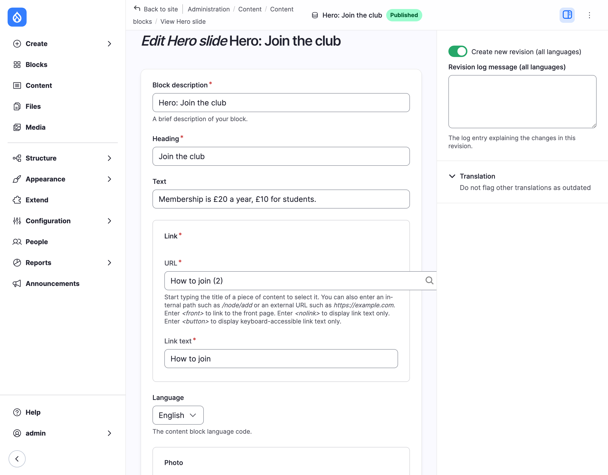
*Figure 17.6: The Join the club slide, as an editor writes it.*

Translate it into Spanish (Únete al club, La cuota es de 20 £ al año, 10 £ para estudiantes., Cómo unirse), and place it in the Hero region, after the newest album, without its title, on `<front>`. On **Block layout**, the Hero region now has the three slides, in their order:

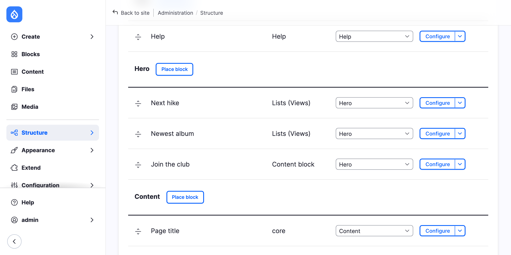
*Figure 17.7: The three slides, in the Hero region. Their order on the page is their order here.*

The block's template uses the Hero component too. The component takes text, so the template takes the text from the block content entity, which Drupal hands to the block's render array as `#block_content`, already in the page's language:

`templates/block/block--block-content--type--hero-slide.html.twig` ([source](../code/chapter17/steps/02-slides/core/lens_trail/templates/block/block--block-content--type--hero-slide.html.twig))

```twig

{#
/**
 * @file
 * A block that shows a Hero slide content block: a hero the club's editors
 * write themselves, such as the invitation to join.
 *
 * The Hero component takes text, so the text fields' values come from the
 * block content entity, in the page's language, and only the photo is
 * rendered. Without a photo, the hero is the Color variant.
 */
#}

  
  
  {{ include('lens_trail:hero', {
    heading: slide.field_heading.value,
    text: slide.field_text.value,
    url: slide.field_link.0 ? slide.field_link.0.getUrl().toString() : '',
    link_text: slide.field_link.title,
    variant: photo ? 'photo' : 'color',
    photo: photo,
  }, with_context = false) }}
  {# The rest prints nothing, but carries the block's cache tags, so the
     slide changes when an editor changes the block. #}
  {{ content|without('field_heading', 'field_text', 'field_link', 'field_photo') }}

```

The last line looks like it does nothing, and on the page it does print nothing: every field is left out. But `content` also carries the block content's **cache tags**, which tell Drupal to rebuild the cached front page when an editor changes the block. A template that prints only a few pieces of `content` loses them, and the front page would show the old fee until the next cache rebuild. Printing what's left of `content` keeps them. It's a habit worth having in any template that takes a render array apart.

### A slider without JavaScript

Three heroes in a row, one under the other, would push the rest of the front page down by three screens. So the region puts its blocks in a **Hero slider** component, and the component shows them side by side, one at a time. Before any JavaScript, the slider is a row that scrolls sideways:

`components/hero-slider/hero-slider.css` ([source](../code/chapter17/steps/02-slides/core/lens_trail/components/hero-slider/hero-slider.css))

```css
/**
 * @file
 * The Hero slider component.
 */
@layer components {
  /* The slides side by side, each as wide as the slider. The row scrolls
     sideways, and stops at the start of a slide (scroll snap), never between
     two. */
  .hero-slider__slides {
    display: grid;
    grid-auto-columns: 100%;
    grid-auto-flow: column;
    overflow-x: auto;
    overscroll-behavior-x: contain;
    scroll-snap-type: x mandatory;

    & > * {
      scroll-snap-align: start;
      scroll-snap-stop: always;
    }
  }

  /* Every slide as tall as the tallest, all the way down to the hero inside
     it: a slide is a block, the block has the view's wrappers, and the hero
     is somewhere inside them. A grid item stretches to its row, so each
     wrapper that holds a hero is made a grid too. */
  .hero-slider__slides > *,
  .hero-slider__slides > * :has(.hero) {
    display: grid;
  }
}
```

The row is a grid with one column per slide, each as wide as the slider, and it scrolls sideways (`overflow-x: auto`). **CSS scroll snap** makes it stop at the start of a slide, never between two: `scroll-snap-type` on the row, `scroll-snap-align` on each slide, and `scroll-snap-stop: always` so a fast swipe doesn't fly past one. On a phone, that's a swipe from slide to slide; on a laptop, a trackpad's sideways scroll; with a keyboard, the arrow keys once something in the row has focus. Every slide can be reached, with no script at all.

The second rule makes the slides as tall as the tallest. A grid item stretches to its row, but a slide here is a block, with a view's wrappers inside, with the hero somewhere inside them. Each wrapper that holds a hero (`:has(.hero)`) is made a grid too, so the stretch reaches all the way down.

The component's template is short for now:

`components/hero-slider/hero-slider.twig` ([source](../code/chapter17/steps/02-slides/core/lens_trail/components/hero-slider/hero-slider.twig))

```twig
{#
/**
 * @file
 * The Hero slider: several heroes, one at a time.
 *
 * Props: label. Slots: slides.
 *
 * Each element in the slides slot is one slide. Without JavaScript, they're a
 * row that scrolls sideways and stops at each slide (CSS scroll snap), so
 * every slide can be reached.
 *
 * aria-roledescription tells screen readers this section is a carousel,
 * in the page's language, as in the ARIA Authoring Practices' pattern.
 */
#}
<section{{ attributes.addClass('hero-slider') }} aria-roledescription="{{ 'carousel'|t }}" aria-label="{{ label }}">
  <div class="hero-slider__slides">
    {{ slides }}
  </div>
</section>
```

`aria-roledescription` changes what a screen reader calls the section: "carousel" instead of "region", in the page's language. It's what the **ARIA Authoring Practices Guide** (APG), the W3C's collection of patterns for widgets like this one, recommends for a carousel. The `label` prop names it, "Club highlights".

The region template embeds the slider, with the region's blocks as its slides:

```diff
--- templates/layout/region--hero.html.twig (before)
+++ templates/layout/region--hero.html.twig (after)
@@ -3,11 +3,13 @@
  * @file
  * The Hero region: the full-width band at the top of the front page.
  *
- * It comes before the content region, and so before the page title. On the
- * front page, the title moves here, as the page's h1, for screen readers
- * only: the hero's own heading is an h2, and it shouldn't come before the h1.
- * The page title block is hidden on the front page in Block layout, and
- * lens_trail's preprocess_region adds page_title here.
+ * Its blocks are the slides of a Hero slider, in the order of Block layout.
+ *
+ * The region comes before the content region, and so before the page title.
+ * On the front page, the title moves here, as the page's h1, for screen
+ * readers only: the heroes' own headings are h2s, and they shouldn't come
+ * before the h1. The page title block is hidden on the front page in Block
+ * layout, and lens_trail's preprocess_region adds page_title here.
  *
  * @see \Drupal\lens_trail\Hook\LensTrailHooks::preprocessRegion()
  */
@@ -17,6 +19,9 @@
     
       <h1 class="visually-hidden">{{ page_title }}</h1>
     
-    {{ content }}
+    {{ include('lens_trail:hero-slider', {
+      label: 'Club highlights'|t,
+      slides: content,
+    }, with_context = false) }}
   </div>
 
```

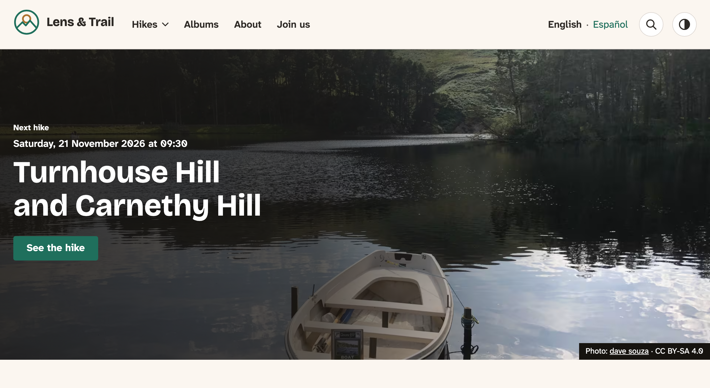
*Figure 17.8: Three slides, one at a time. Without a script, a scroll bar says there's more.*

## A module, or our own?

The slider needs a few buttons and a timer. Drupal has modules that do this, so before writing a script, a look at what they are and what they'd mean for the club.

- **Slick** is the best known. It brings the Slick carousel to Drupal: as a field formatter (a field's values become slides) and as a Views style (a view's rows become slides). The Slick library itself is a jQuery plugin whose last release came out in 2017, and the module needs **Blazy**, a module of the same author for lazy loading, and the library downloaded into the site.
- **Splide** is Slick's successor from the same author, built on Splide, a newer library without jQuery that follows much of the APG's carousel pattern. It also needs Blazy and its library.
- **Swiper formatter** brings Swiper, a popular library for touch sliders, also as a field formatter and a Views style. It's the only one that says it supports Drupal 12; Slick and Splide set no upper limit, which means nobody has said whether they work.
- **Views Slideshow**, the oldest, has no release for Drupal 12.

All of them slide the values of **one field** or the rows of **one view**. The club's three slides come from three places: two views and a content block. We could build a view that finds all three, but it would be a strange view, made to fit a module. And each module brings a library of thousands of lines, with settings for effects the design doesn't want, for something that's about a hundred and fifty lines of our own, half of them comments. If the club wanted a gallery of twenty photos with thumbnails, we'd look again at Splide. For three slides from three places, we write our own, and the APG's pattern tells us what it has to do.

## The controls

The APG's **carousel pattern** comes down to a short list, and Chapter 3's design follows it:

- A button that **stops the slides moving**, first, before the slides, so a keyboard user can stop them before reaching them.
- **Previous** and **Next** buttons, and something that says which slide you're on.
- Each slide is a **group**, called "slide", with a label such as "1 of 3".
- The slides **don't move while the mouse is over them or the focus is in them**, and never again once the visitor has pressed the stop button.
- A screen reader **doesn't announce** a slide that changes on its own; it does announce one that changes because the visitor asked.

The controls go in the template, hidden, and the script shows them. Without the script they couldn't do anything, and a button that does nothing is worse than none:

```diff
--- components/hero-slider/hero-slider.twig (before)
+++ components/hero-slider/hero-slider.twig (after)
@@ -3,17 +3,45 @@
  * @file
  * The Hero slider: several heroes, one at a time.
  *
- * Props: label. Slots: slides.
+ * Props: label, interval. Slots: slides.
  *
  * Each element in the slides slot is one slide. Without JavaScript, they're a
  * row that scrolls sideways and stops at each slide (CSS scroll snap), so
- * every slide can be reached.
+ * every slide can be reached. hero-slider.js adds the rest.
  *
- * aria-roledescription tells screen readers this section is a carousel,
- * in the page's language, as in the ARIA Authoring Practices' pattern.
+ * The markup follows the carousel pattern of the ARIA Authoring Practices:
+ * aria-roledescription tells screen readers the section is a carousel, and
+ * the controls come first, so a keyboard user can pause the slides before
+ * reaching them.
+ *
+ * The controls are hidden until the script shows them: without it, they
+ * couldn't do anything. Their text is here, not in the script, so Drupal
+ * translates it with the rest of the page. The script reads the texts it
+ * needs to fill in from the data attributes.
  */
 #}
-<section{{ attributes.addClass('hero-slider') }} aria-roledescription="{{ 'carousel'|t }}" aria-label="{{ label }}">
+<section{{ attributes.addClass('hero-slider') }}
+  aria-roledescription="{{ 'carousel'|t }}"
+  aria-label="{{ label }}"
+  data-interval="{{ interval|default(7) }}"
+  data-slide="{{ 'slide'|t }}"
+  data-slide-label="{{ '@number of @total'|t }}">
+  <div class="hero-slider__controls" hidden>
+    <button type="button" class="hero-slider__button hero-slider__play" data-pause="{{ 'Pause the slides'|t }}" data-play="{{ 'Play the slides'|t }}">
+      <svg class="hero-slider__icon-pause" viewBox="0 0 24 24" aria-hidden="true" focusable="false"><rect x="6" y="5" width="4" height="14" rx="1"/><rect x="14" y="5" width="4" height="14" rx="1"/></svg>
+      <svg class="hero-slider__icon-play" viewBox="0 0 24 24" aria-hidden="true" focusable="false"><path d="M8 5.5v13a1 1 0 0 0 1.5.86l10.5-6.5a1 1 0 0 0 0-1.72L9.5 4.64A1 1 0 0 0 8 5.5z"/></svg>
+      <span class="visually-hidden">{{ 'Pause the slides'|t }}</span>
+    </button>
+    <button type="button" class="hero-slider__button hero-slider__previous">
+      <svg viewBox="0 0 24 24" aria-hidden="true" focusable="false"><path d="m15 18-6-6 6-6" fill="none" stroke="currentColor" stroke-width="2.5" stroke-linecap="round" stroke-linejoin="round"/></svg>
+      <span class="visually-hidden">{{ 'Previous slide'|t }}</span>
+    </button>
+    <button type="button" class="hero-slider__button hero-slider__next">
+      <svg viewBox="0 0 24 24" aria-hidden="true" focusable="false"><path d="m9 18 6-6-6-6" fill="none" stroke="currentColor" stroke-width="2.5" stroke-linecap="round" stroke-linejoin="round"/></svg>
+      <span class="visually-hidden">{{ 'Next slide'|t }}</span>
+    </button>
+    <div class="hero-slider__dots" data-label="{{ 'Slide @number of @total'|t }}"></div>
+  </div>
   <div class="hero-slider__slides">
     {{ slides }}
   </div>
```

All the text is in the template, with `|t`, not in the script: the buttons' names, "slide", and the labels the script fills in ("Slide @number of @total"), as data attributes. Chapter 12's script used `Drupal.t()`, which works, but Drupal makes the script translations into a file of their own, and Chapter 12's box tells what happens to that file in Drupal 12 with aggregation on. Text in the template is translated with the page, every time, and the script only reads it. It's also one less thing a script has to know.

The script, `hero-slider.js`, sits next to the template in the component's folder, so Drupal attaches it with the component:

`components/hero-slider/hero-slider.js` ([source](../code/chapter17/steps/03-controls/core/lens_trail/components/hero-slider/hero-slider.js))

```javascript
/**
 * @file
 * The hero slider: Pause, Previous, Next and the dots, and the slides
 * changing on their own.
 *
 * Without this script, the slides are a row that scrolls sideways, and that
 * still works. The script only adds to it:
 * - it labels each slide ("1 of 3") and adds a dot for each, as buttons;
 * - it moves to the next slide every few seconds (7 by default), but never
 *   while the mouse is over the slider or the focus is in it, never after
 *   the visitor has pressed Pause, and never with reduced motion;
 * - it makes the slides you can't see inert, so Tab skips their links.
 * The row still scrolls under a finger or a trackpad, and the script
 * follows it: a scroll is a change of slide like any other.
 */
(function (Drupal, once) {
  const reducedMotion = window.matchMedia('(prefers-reduced-motion: reduce)');

  function initSlider(slider) {
    const track = slider.querySelector('.hero-slider__slides');
    const slides = [...track.children];
    const controls = slider.querySelector('.hero-slider__controls');
    // One slide is a hero, not a slider.
    if (slides.length < 2) {
      return;
    }
    const playButton = controls.querySelector('.hero-slider__play');
    const dotsBox = controls.querySelector('.hero-slider__dots');
    const interval = Math.max(7, Number(slider.dataset.interval) || 7) * 1000;
    const label = (text, number) => text.replace('@number', number).replace('@total', slides.length);

    let current = 0;
    let timer = null;
    // Stopped: the visitor pressed Pause, or asked their system for less
    // movement. Held: for a moment, while the mouse or the focus is here.
    let stopped = reducedMotion.matches;
    let hovered = false;
    let focused = false;

    slides.forEach((slide, index) => {
      slide.setAttribute('role', 'group');
      slide.setAttribute('aria-roledescription', slider.dataset.slide);
      slide.setAttribute('aria-label', label(slider.dataset.slideLabel, index + 1));
    });
    const dots = slides.map((slide, index) => {
      const dot = document.createElement('button');
      dot.type = 'button';
      dot.className = 'hero-slider__dot';
      dot.setAttribute('aria-label', label(dotsBox.dataset.label, index + 1));
      dot.addEventListener('click', () => show(index));
      dotsBox.append(dot);
      return dot;
    });

    // The next slide in a few seconds, unless something says not now.
    function schedule() {
      clearTimeout(timer);
      if (!stopped && !hovered && !focused) {
        timer = setTimeout(() => show(current + 1), interval);
      }
    }

    // Scrolls to a slide: smoothly, or at once with reduced motion.
    function show(index) {
      const target = (index + slides.length) % slides.length;
      track.scrollTo({
        left: target * track.clientWidth,
        behavior: reducedMotion.matches ? 'instant' : 'smooth',
      });
      setCurrent(target);
    }

    // Marks a slide as the current one: its dot, and the others inert.
    function setCurrent(index) {
      current = index;
      slides.forEach((slide, i) => {
        slide.inert = i !== index;
      });
      dots.forEach((dot, i) => {
        if (i === index) {
          dot.setAttribute('aria-current', 'true');
        }
        else {
          dot.removeAttribute('aria-current');
        }
      });
      schedule();
    }

    function setStopped(value) {
      stopped = value;
      playButton.dataset.state = stopped ? 'stopped' : 'playing';
      playButton.querySelector('.visually-hidden').textContent = stopped ? playButton.dataset.play : playButton.dataset.pause;
      // A screen reader announces a new slide only when it's the visitor's
      // doing, not every few seconds.
      track.setAttribute('aria-live', stopped ? 'polite' : 'off');
      schedule();
    }

    playButton.addEventListener('click', () => setStopped(!stopped));
    controls.querySelector('.hero-slider__previous').addEventListener('click', () => show(current - 1));
    controls.querySelector('.hero-slider__next').addEventListener('click', () => show(current + 1));

    slider.addEventListener('mouseenter', () => {
      hovered = true;
      schedule();
    });
    slider.addEventListener('mouseleave', () => {
      hovered = false;
      schedule();
    });
    slider.addEventListener('focusin', () => {
      focused = true;
      schedule();
    });
    slider.addEventListener('focusout', (event) => {
      if (!slider.contains(event.relatedTarget)) {
        focused = false;
        schedule();
      }
    });

    // A swipe or a trackpad scroll changes the slide too. Once the row stops
    // moving, the slide that's in view is the current one.
    let settle = null;
    track.addEventListener('scroll', () => {
      clearTimeout(settle);
      settle = setTimeout(() => {
        const index = Math.round(track.scrollLeft / track.clientWidth);
        if (index !== current) {
          setCurrent(index);
        }
      }, 100);
    }, { passive: true });

    // Reduced motion turned on while the page is open: stop.
    reducedMotion.addEventListener('change', () => {
      if (reducedMotion.matches) {
        setStopped(true);
      }
    });

    controls.hidden = false;
    setCurrent(0);
    setStopped(stopped);
  }

  Drupal.behaviors.lensTrailHeroSlider = {
    attach(context) {
      once('hero-slider', '.hero-slider', context).forEach(initSlider);
    },
  };
})(Drupal, once);
```

What it does, from the top:

- **Fewer than two slides, nothing.** One slide is a hero, not a slider. If there's no upcoming hike, the view's block is empty, and the slider has two.
- **Stopped and held.** `stopped` is the visitor's choice: they pressed Pause, or asked their system for **reduced motion**, in which case the slides never move on their own. `hovered` and `focused` hold the slides for a moment, while the mouse is over them or the focus is in them. `schedule()` sets the next change only when all three say yes.
- **`scrollTo()`.** The script doesn't move the slides itself; it scrolls the row, the same row that scrolls under a finger. With reduced motion it jumps (`'instant'`) instead of sliding, as Chapter 3 promised. And a scroll by hand is a change of slide like any other: once the row stops moving, the slide in view becomes the current one.
- **`inert`** on the slides that aren't showing. An inert element can't take focus or clicks, so Tab doesn't wander into a link three slides away, out of sight.
- **`aria-live`.** A **live region** is part of a page whose changes a screen reader announces. The row is one, but `off` while the slides play, so nothing is announced every seven seconds, and `polite` once they're stopped, so a press on Next is.
- **The interval**: never less than seven seconds, whatever the prop says.

The controls' CSS puts them at the bottom of the slider, lined up with the page content, in white round buttons that show on a photo and on the tint alike. The dots sit on a dark pill for the same reason, and each is a 24-pixel button, the smallest target WCAG 2.2 allows, with a smaller circle drawn in it:

<details><summary>components/hero-slider/hero-slider.css, changed</summary>

```diff
--- components/hero-slider/hero-slider.css (before)
+++ components/hero-slider/hero-slider.css (after)
@@ -29,3 +29,112 @@
     display: grid;
   }
 }
+
+/* The controls, once the script has shown them: at the bottom of the
+   slider, lined up with the page content. They're first in the HTML, so
+   they're first when you Tab. */
+@layer components {
+  .hero-slider {
+    position: relative;
+  }
+
+  .hero-slider__controls:not([hidden]) {
+    position: absolute;
+    z-index: 1;
+    inset-block-end: var(--space-m);
+    inset-inline: 0;
+    display: flex;
+    flex-wrap: wrap;
+    align-items: center;
+    gap: var(--space-2xs);
+    max-inline-size: var(--size-content);
+    margin-inline: auto;
+    padding-inline: var(--space-m);
+    /* The box is as wide as the page; only the buttons take clicks. */
+    pointer-events: none;
+
+    & > * {
+      pointer-events: auto;
+    }
+  }
+
+  /* With the controls, the row's scroll bar isn't needed: it still scrolls
+     under a finger or a trackpad. */
+  .hero-slider:has(.hero-slider__controls:not([hidden])) .hero-slider__slides {
+    scrollbar-width: none;
+  }
+
+  /* White and round, on any slide: a photo or the tint color. The border is
+     for the tint, where white alone would hardly show. */
+  .hero-slider__button {
+    display: grid;
+    place-items: center;
+    inline-size: var(--size-target);
+    block-size: var(--size-target);
+    padding: 0;
+    border: var(--border-thin) solid var(--color-neutral-400);
+    border-radius: var(--radius-round);
+    background: var(--color-neutral-0);
+    color: var(--color-neutral-950);
+    cursor: pointer;
+
+    & svg {
+      inline-size: 1.25rem;
+      block-size: 1.25rem;
+      fill: currentColor;
+    }
+
+    &:hover {
+      background: var(--color-neutral-100);
+    }
+
+    &:focus-visible {
+      outline-color: var(--color-neutral-0);
+      box-shadow: 0 0 0 var(--border-focus) var(--color-neutral-950);
+    }
+  }
+
+  /* Pause while the slides play, Play once they're stopped. */
+  .hero-slider__play[data-state="stopped"] .hero-slider__icon-pause,
+  .hero-slider__play:not([data-state="stopped"]) .hero-slider__icon-play {
+    display: none;
+  }
+
+  /* The dots on a dark pill, so they show on any slide. Each dot is a
+     24-pixel button, the smallest target WCAG allows, with a smaller
+     circle drawn inside it. */
+  .hero-slider__dots {
+    display: flex;
+    margin-inline-start: var(--space-2xs);
+    padding-inline: var(--space-3xs);
+    border-radius: var(--radius-round);
+    background: rgb(22 19 15 / 0.6);
+  }
+
+  .hero-slider__dot {
+    display: grid;
+    place-items: center;
+    inline-size: 1.5rem;
+    block-size: 1.5rem;
+    padding: 0;
+    border: 0;
+    background: none;
+    cursor: pointer;
+
+    &::before {
+      content: "";
+      inline-size: 0.625rem;
+      block-size: 0.625rem;
+      border: 2px solid var(--color-neutral-0);
+      border-radius: var(--radius-round);
+    }
+
+    &[aria-current="true"]::before {
+      background: var(--color-neutral-0);
+    }
+
+    &:focus-visible {
+      outline-color: var(--color-neutral-0);
+    }
+  }
+}
```

</details>

The controls are first in the HTML, so they're first when you Tab, and the CSS draws them at the bottom. That's the one place where the order you see isn't the order you Tab, and it's on purpose: the APG puts the stop button before the slides, because it's the way out of what moves.

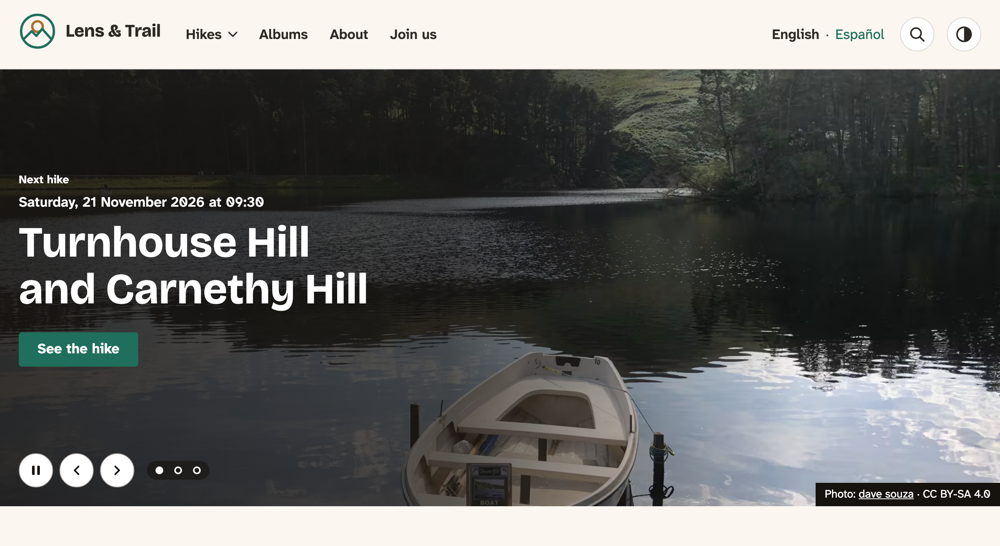
*Figure 17.9: The slider, with its controls.*

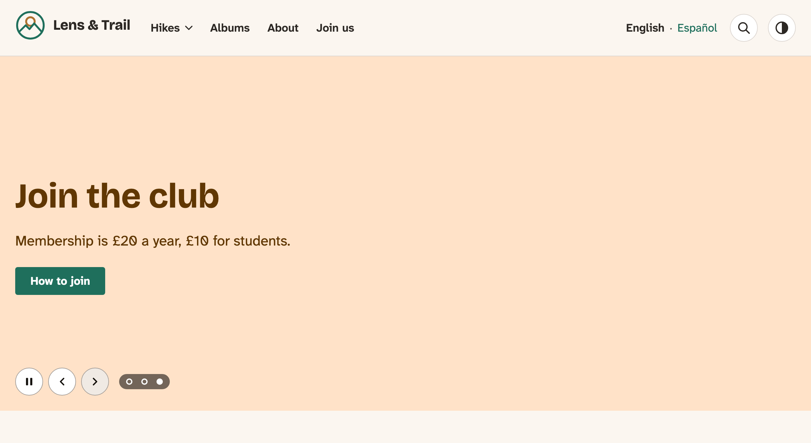
*Figure 17.10: The third slide, in the Color variant.*

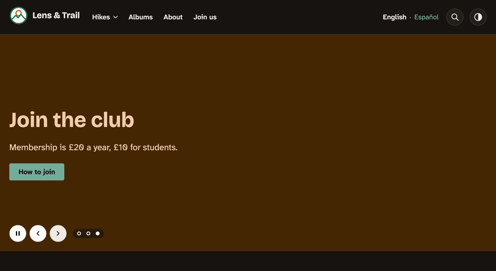
*Figure 17.11: In dark mode, the Color variant follows the page's colors.*

On a phone, the controls take the bottom of the hero, which is why the credit moved to the top:

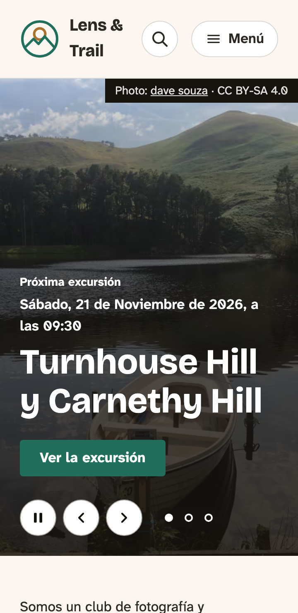
*Figure 17.12: In Spanish, on a phone.*

The new text needs Spanish, on **Configuration** › **Regional and language** › **User interface translation**: Próxima excursión, Ver la excursión, Álbum más reciente, Ver las fotos, Lo último del club, carrusel, diapositiva, @number de @total, Diapositiva @number de @total, Pausar las diapositivas, Reanudar las diapositivas, Diapositiva anterior and Diapositiva siguiente. The photo credit's "Photo:", from Chapter 14, had none yet: Foto:.

This is what a screen reader gets, from the browser's accessibility tree, as in the menus chapter:

`accessibility-tree` ([source](../code/chapter17/snippets/slider-accessibility.txt))

```text
- region "Club highlights":
  - button "Pause the slides"
  - button "Previous slide"
  - button "Next slide"
  - button "Slide 1 of 3"
  - button "Slide 2 of 3"
  - button "Slide 3 of 3"
  - group "1 of 3":
    - paragraph: Next hike
    - time: Saturday, 21 November 2026 at 09:30
    - heading "Turnhouse Hill and Carnethy Hill" [level=2]
    - link "See the hike":
      - /url: /hikes/turnhouse-hill
    - 'figure "Photo: dave souza · CC BY-SA 4.0"':
      - img "Turnhouse Hill seen across Glencorse Reservoir, with a rowing boat at the landing stage"
      - text: "Photo:"
      - link "dave souza":
        - /url: https://commons.wikimedia.org/wiki/File:Glencorse_Reservoir,_Turnhouse_Hill.jpg
      - text: · CC BY-SA 4.0
  - group "2 of 3":
    - paragraph: Newest album
```

A region named "Club highlights" (announced as a carousel), the four controls, and the slides as groups, "1 of 3" and on. The second and third slides follow in the same way.

> **Try it:** Open the front page, put the mouse away, and wait. After seven seconds, the album slides in. Now Tab into the slider: the slides stop while the focus is in it. Press Pause, Tab away, and wait again: nothing moves. Then turn on reduced motion (on a Mac, **System Settings** › **Accessibility** › **Display** › **Reduce motion**; in Chrome's developer tools, **Rendering** › **Emulate CSS media feature prefers-reduced-motion**) and reload: the button says Play from the start, and Next jumps instead of sliding.

## A little parallax

The last of Chapter 3's promises is a little **parallax**: the photo drifts up slower than the text as the page scrolls, as if it were further away. Chapter 3 chose to do it with CSS's **scroll-driven animations**, which tie an animation to a scroll position instead of to time, so there's no script listening to every scroll:

`components/hero/hero.css` ([source](../code/chapter17/steps/04-parallax/core/lens_trail/components/hero/hero.css))

```css
/* A little parallax: as the page scrolls up, the photo drifts up a little
   slower than the text over it, as if it were further away. A scroll-driven
   animation ties the animation to the scroll position instead of time:
   view() is the hero's progress through the window, and the exit range is
   the part where it's leaving at the top. By then the hero's top is out of
   sight, so the gap the photo leaves there is never seen.
   Only with no preference for reduced motion, and only in browsers that
   have scroll-driven animations; elsewhere the photo scrolls with the page.
   In a parent that scrolls sideways, such as the Hero slider, view() would
   follow that parent instead of the page, so a parent can give its own
   timeline in --hero-parallax-timeline. */
@layer components {
  @media (prefers-reduced-motion: no-preference) {
    @supports (animation-timeline: view()) {
      .hero__photo img {
        animation: hero-parallax linear both;
        animation-timeline: var(--hero-parallax-timeline, view());
        animation-range: exit;
      }
    }
  }

  @keyframes hero-parallax {
    to {
      translate: 0 25%;
    }
  }
}
```

- **`animation-timeline: view()`** makes the animation's progress the element's progress through the scroll area: 0% when it comes in at the bottom, 100% when it leaves at the top.
- **`animation-range: exit`** uses only the last part, from the moment the hero's top reaches the top of the window to the moment its bottom does. The photo moves down by up to a quarter of its height as the hero leaves, which on the screen looks like moving up more slowly.
- The photo leaves a gap at the top of the hero as it moves. By then that part of the hero is above the window, so nobody sees it.
- **Reduced motion and older browsers.** The rule is inside `prefers-reduced-motion: no-preference`, so it only applies to visitors who haven't asked for less movement, and inside `@supports`, so a browser without scroll-driven animations ignores it, and the photo scrolls with the page. Chapter 3 says they reached every main browser in October 2026; a decoration is the right place to use something that new.

There was a surprise when we tried it in the slider: nothing moved. `view()` follows the **nearest scroll container**, and inside the slider, that's the row of slides, which scrolls sideways and never up or down. So the hero's photo had a timeline that never moved. The fix is a **named timeline**: the slider declares one for itself, as it moves through the page, and passes its name down in a custom property:

`components/hero-slider/hero-slider.css` ([source](../code/chapter17/steps/04-parallax/core/lens_trail/components/hero-slider/hero-slider.css))

```css

/* The heroes' parallax follows the slider's progress through the window,
   not the row of slides, which only scrolls sideways (see hero.css). */
@layer components {
  .hero-slider {
    view-timeline: --hero-slider block;
    --hero-parallax-timeline: --hero-slider;
  }
}
```

The hero uses `var(--hero-parallax-timeline, view())`: the timeline a parent gives it, or its own. The hero doesn't need to know it's in a slider, and a hero on its own still works. A custom property used this way is a small **contract** between two components: it's in the hero's comment, so the next person who puts a hero somewhere new knows it's there.

## The hero and Largest Contentful Paint

Chapter 14 introduced **Largest Contentful Paint** (LCP): the time until the biggest image or block of text in the first screen is drawn. On the front page, that's now the hero's photo, so it's the image that has to come first. Here's what the browser does as the page loads:

`output` ([source](../code/chapter17/snippets/hero-requests.txt))

```text
Largest Contentful Paint: the img in the first hero (turnhouse-hill-glencorse.jpg.avif)

Photos requested as the front page loads, 1280 pixels wide, with their priority:
  styles/banner/.../turnhouse-hill-glencorse.jpg.avif    High   the first slide
  styles/banner/.../carnethy-from-turnhouse_1.jpg.avif   Low    the second slide, next to it
  eight more, for the Hikes panel and further down       Low
```

- **The first slide's photo is the LCP**, and it's the only one asked for at **High** priority: Eager in its display, and `fetchpriority="high"` from the preprocess.
- **The second slide's photo loads too, at Low.** It's lazy, but lazy means "when it's about to be needed", and a browser counts a photo right next to the screen in a scroll area as about to be needed. That's fine: it's the next one to show, and it doesn't compete with the first.
- **Only one photo is High.** If every slide's photo were, none of them would be first. That's why the album's slide has its own view mode.

There's one thing a slider can do to LCP that a single hero can't: if the first slide changed before its photo arrived, the LCP would be the second one, later. Seven seconds is a long time for a photo, so on the club's site it doesn't happen, but it's one more reason not to rush a slider.

## On Drupal CMS

Mercury comes with heroes of its own, three of them, in Canvas's **Hero** group:

- **Hero billboard**: a photo behind the content, with a height (full screen, large, ribbon), the content's position, and an **overlay**, a flat dark layer over the whole photo at 0 to 75% opacity. Its **Hero content** slot takes any components, such as a heading and buttons. It can also slide under the Navbar.
- **Hero side-by-side**: a photo next to the text, not under it.
- **Hero blog**: the top of a blog post, with the author and the date.

The billboard is close to the club's hero, and it's a fine choice for a site that wants one big photo. For the club's design it lacks four things: the photo has no credit; the overlay darkens the whole photo evenly, where our gradient leaves the part without text alone; there's no Color variant; and there's no slider. So the Drupal CMS site gets the core theme's two components, adapted to Mercury in the way Chapter 16 adapted the menu: the same markup and the same script, plain CSS with Mercury's variable names (`--color-club-*`, `--spacing-club-*`) instead of Tailwind classes, so nothing needs a rebuild of Mercury's CSS.

Three things change on the way:

- **Canvas doesn't use a component's variants**, so the style is a prop, **Style** (Photo or Color), as the Hike card's layout was in Chapter 13.
- **In Canvas, editors fill everything in by hand**, so the date and the photo are props too: a **Meta** line and a **Photo** from the media library, with a **Photo credit** text. A Twig template that has them rendered, such as a hike's Hero view mode, embeds the component and replaces its `meta` and `photo` blocks instead.
- **The slider takes the page's h1.** A Canvas page on Home shows no title of its own; Book 1's h1 was the CTA's heading. The slider has a **Page heading** prop, printed visually hidden, before the controls.

`mercury/components/hero/hero.twig` ([source](../code/chapter17/steps/05-cms/cms/mercury/components/hero/hero.twig))

```twig
{#
/**
 * @file
 * The Hero: the core theme's component, for Canvas.
 *
 * Canvas doesn't use a component's variants, so the style is a prop, like
 * the Hike card's layout. And in Canvas, editors fill everything in by hand,
 * so the date and the photo are props. A template that has them rendered,
 * such as a hike's Hero view mode, embeds the component and replaces the meta
 * and photo blocks instead.
 */
#}


<div{{ attributes.addClass('hero', with_photo ? 'hero--photo' : 'hero--color') }}>
  <div class="hero__text">
    
      <p class="hero__eyebrow">{{ eyebrow }}</p>
    
    
      
        <div class="hero__meta">{{ meta }}</div>
      
    
    <{{ heading_tag }} class="hero__heading">{{ heading }}</{{ heading_tag }}>
    
      <p class="hero__intro">{{ text }}</p>
    
    
      <a class="hero__link" href="{{ url }}">{{ link_text }}</a>
    
  </div>
  
    <div class="hero__photo">
      
        
          <figure>
            
            
              <figcaption class="hero__credit">{{ credit }}</figcaption>
            
          </figure>
        
      
    </div>
  
</div>
```

<details><summary>The other files</summary>

`mercury/components/hero/hero.component.yml` ([source](../code/chapter17/steps/05-cms/cms/mercury/components/hero/hero.component.yml))

```yaml
$schema: https://git.drupalcode.org/project/drupal/-/raw/HEAD/core/assets/schemas/v1/metadata.schema.json
name: Hero
description: A big band at the top of a page, as wide as the window, with a heading and a link. The core theme's Hero component, for Canvas.
group: Lens & Trail
status: stable
props:
  type: object
  required:
    - heading
  properties:
    style:
      type: string
      title: Style
      description: Text over a photo, or on the tint color.
      enum:
        - photo
        - color
      meta:enum:
        photo: Photo
        color: Color
      default: photo
      examples:
        - photo
    eyebrow:
      type: string
      title: Eyebrow
      description: A few words above the heading that say what it is, such as "Next hike".
      examples:
        - Next hike
    meta:
      type: string
      title: Meta
      description: A line between the eyebrow and the heading, such as a date.
      examples:
        - Saturday, 21 November 2026 at 09:30
    heading:
      type: string
      title: Heading
      examples:
        - Turnhouse Hill and Carnethy Hill
    heading_level:
      type: number
      title: Heading level
      description: 2 when the page has its own h1.
      enum: [1, 2, 3]
      default: 2
      examples:
        - 2
    text:
      type: string
      title: Text
      examples:
        - Membership is £20 a year, £10 for students.
    url:
      type: string
      format: uri-reference
      title: Link
      examples:
        - /join
    link_text:
      type: string
      title: Link text
      description: What the button says. Say where it goes, not "Read more".
      examples:
        - How to join
    photo:
      $ref: json-schema-definitions://canvas.module/image
      type: object
      title: Photo
    credit:
      type: string
      title: Photo credit
      description: Who took the photo, and its license, as the club's license asks.
      examples:
        - 'Photo: dave souza · CC BY-SA 4.0'
```

`mercury/components/hero/hero.css` ([source](../code/chapter17/steps/05-cms/cms/mercury/components/hero/hero.css))

```css
/**
 * @file
 * The Hero's look: the core theme's CSS, with Mercury's variable names.
 * Plain CSS, like the search's. See the core theme's hero.css for the why.
 */
.hero {
  position: relative;
  isolation: isolate;
  display: grid;
  align-items: end;
  min-block-size: clamp(30rem, 80svh, 36rem);
  overflow: hidden;
  background: var(--color-club-neutral-950);
  color: var(--color-club-neutral-0);

  @media (min-width: 48rem) {
    align-items: center;
  }
}

.hero__text {
  inline-size: 100%;
  max-inline-size: var(--size-content);
  margin-inline: auto;
  padding: var(--spacing-club-xl) var(--spacing-club-m) var(--spacing-club-3xl);

  & > * {
    max-inline-size: 34rem;
  }
}

.hero__eyebrow {
  margin: 0;
  font-size: var(--text-step--1);
  font-weight: var(--font-weight-bold);
}

.hero__meta {
  margin-block-start: var(--spacing-club-3xs);
  font-weight: var(--font-weight-semibold);
}

.hero__heading {
  margin-block: var(--spacing-club-2xs) var(--spacing-club-m);
  color: inherit;
  font-family: var(--font-family-heading);
  font-size: var(--text-step-5);
  font-weight: var(--font-weight-bold);
  line-height: 1.1;
  text-wrap: balance;
}

.hero__intro {
  margin-block: 0 var(--spacing-club-m);
  font-size: var(--text-step-1);
}

.hero__link {
  display: inline-flex;
  align-items: center;
  min-block-size: var(--size-target);
  padding-inline: var(--spacing-club-m);
  border-radius: var(--radius-small);
  background: var(--color-club-green-700);
  color: var(--color-club-neutral-0);
  font-weight: var(--font-weight-bold);
  text-decoration: none;
  transition: background-color var(--duration-fast);

  &:hover {
    background: var(--color-club-green-800);
  }

  &:focus-visible {
    outline: var(--border-focus) solid var(--color-club-neutral-0);
    outline-offset: 2px;
  }
}

.hero__photo {
  position: absolute;
  z-index: -1;
  inset: 0;

  & :is(div, figure, picture) {
    block-size: 100%;
  }

  & img {
    inline-size: 100%;
    block-size: 100%;
    object-fit: cover;
  }

  /* The credit: the Photo component's, or the Canvas prop's. On a phone, at
     the top, out of the way of the slider's controls. */
  & figcaption {
    position: absolute;
    inset-block: auto 0;
    inset-inline: auto 0;
    max-inline-size: 100%;
    padding: var(--spacing-club-3xs) var(--spacing-club-xs);
    background: var(--color-club-neutral-950);
    color: var(--color-club-neutral-0);
    font-size: var(--text-step--1);

    @media (max-width: 47.99rem) {
      inset-block: 0 auto;
    }
  }
}

.hero--photo::after {
  content: "";
  position: absolute;
  z-index: -1;
  inset: 0;
  background: linear-gradient(to top, rgb(22 19 15 / 0.85) 0%, rgb(22 19 15 / 0.7) 55%, rgb(22 19 15 / 0.1) 100%);
  pointer-events: none;

  @media (min-width: 48rem) {
    background: linear-gradient(to right, rgb(22 19 15 / 0.85) 0%, rgb(22 19 15 / 0.7) 45%, rgb(22 19 15 / 0) 80%);
  }
}

.hero--color {
  min-block-size: 0;
  background: var(--color-club-tint);
  color: var(--color-club-on-tint);

  & .hero__text {
    padding-block: var(--spacing-club-2xl);
  }

  & .hero__link {
    background: var(--color-club-action);
    color: var(--color-club-on-action);

    &:focus-visible {
      outline-color: var(--color-club-action);
    }
  }
}

@media (prefers-reduced-motion: no-preference) {
  @supports (animation-timeline: view()) {
    .hero__photo img {
      animation: hero-parallax linear both;
      animation-timeline: var(--hero-parallax-timeline, view());
      animation-range: exit;
    }
  }
}

@keyframes hero-parallax {
  to {
    translate: 0 25%;
  }
}
```

`mercury/components/hero-slider/hero-slider.component.yml` ([source](../code/chapter17/steps/05-cms/cms/mercury/components/hero-slider/hero-slider.component.yml))

```yaml
$schema: https://git.drupalcode.org/project/drupal/-/raw/HEAD/core/assets/schemas/v1/metadata.schema.json
name: Hero slider
description: Several heroes in one place, one at a time, with Pause, Previous and Next. The core theme's component, for Canvas.
group: Lens & Trail
status: stable
props:
  type: object
  required:
    - label
  properties:
    label:
      type: string
      title: Label
      description: What the slides are, for screen readers, such as "Club highlights".
      examples:
        - Club highlights
    heading:
      type: string
      title: Page heading
      description: The page's h1, for screen readers only, on a page that shows no title of its own, such as Home. Leave it empty anywhere else.
      examples:
        - Welcome to Lens & Trail
    interval:
      type: number
      title: Interval
      description: How many seconds each slide stays. Never less than 7, the design says.
      enum: [7, 10, 15]
      default: 7
      examples:
        - 7
slots:
  slides:
    title: Slides
    description: One component or block for each slide, such as a Hero. The first is the most important.
libraryOverrides:
  dependencies:
    - core/drupal
    - core/once
```

```diff
--- mercury/components/hero-slider/hero-slider.twig (before)
+++ mercury/components/hero-slider/hero-slider.twig (after)
@@ -1,9 +1,16 @@
 {#
 /**
  * @file
- * The Hero slider: several heroes, one at a time.
+ * The Hero slider: the core theme's component, for Canvas.
  *
- * Props: label, interval. Slots: slides.
+ * Props: label, heading, interval. Slots: slides.
+ *
+ * cq-full is Mercury's class for a component as wide as the window, inside
+ * the page's container, as its Hero billboard is.
+ *
+ * One addition: heading, the page's h1 for screen readers. On the core site
+ * the region template prints it; a Canvas page has no title of its own on
+ * Home, so the slider takes it.
  *
  * Each element in the slides slot is one slide. Without JavaScript, they're a
  * row that scrolls sideways and stops at each slide (CSS scroll snap), so
@@ -20,12 +27,15 @@
  * needs to fill in from the data attributes.
  */
 #}
-<section{{ attributes.addClass('hero-slider') }}
+<section{{ attributes.addClass('hero-slider', 'cq-full') }}
   aria-roledescription="{{ 'carousel'|t }}"
   aria-label="{{ label }}"
   data-interval="{{ interval|default(7) }}"
   data-slide="{{ 'slide'|t }}"
   data-slide-label="{{ '@number of @total'|t }}">
+  
+    <h1 class="visually-hidden">{{ heading }}</h1>
+  
   <div class="hero-slider__controls" hidden>
     <button type="button" class="hero-slider__button hero-slider__play" data-pause="{{ 'Pause the slides'|t }}" data-play="{{ 'Play the slides'|t }}">
       <svg class="hero-slider__icon-pause" viewBox="0 0 24 24" aria-hidden="true" focusable="false"><rect x="6" y="5" width="4" height="14" rx="1"/><rect x="14" y="5" width="4" height="14" rx="1"/></svg>
```

</details>

The slider's section gets Mercury's `cq-full` class, the one its Hero billboard uses: Canvas puts every component inside the page's container, and `cq-full` makes it as wide as the window again. Its script is the core theme's, copied unchanged.

### The site building

The site building is the core site's, with one difference in names. Drupal CMS already has a **Hero** view mode for media, which it uses for a page's featured image, with its own crops (5:2 on wide screens). Changing it would change every page with a featured image, so the club's slides get two new media view modes, **Slide** and **Slide, later**, and a responsive image style, **Slide**, from Drupal CMS's own 4:3 and 16:9 focal point styles, at `100vw`. Then, as on the core site: a **Hero** view mode for content, with the hike's photo (in Slide) and date, and the album's photos (in Slide, later); the **Hero** displays of the Hikes and Albums views; and the node templates, which embed Mercury's Hero:

`mercury/templates/content/node--hike--hero.html.twig` ([source](../code/chapter17/steps/05-cms/cms/mercury/templates/content/node--hike--hero.html.twig))

```twig
{#
/**
 * @file
 * A hike in the Hero view mode: the next hike, in the Home page's slider.
 *
 * The Hero component takes the date and the photo as props, for Canvas. Here
 * they're rendered by Drupal, so the template embeds the component and puts
 * them in its meta and photo blocks instead. Without a photo, the hero is
 * the Color style.
 * For the variables, see core's node.html.twig.
 */
#}


  <div class="hero__meta">{{ date }}</div>
  {{ rendered_photo }}

```

`embed` is Twig's way to include a template and replace some of its blocks, as Chapter 11 showed. Here the date and the photo come rendered by Drupal, in the `meta` and `photo` blocks, instead of from the props Canvas would fill.

### The slider in Canvas

Then the Home page, in Canvas:

1. Open **Home** in Canvas, select Mercury's **CTA** at the top (Book 1's welcome), and delete it.
2. From the **Lens & Trail** group, drag a **Hero slider** to the top of the page. Set **Label** to Club highlights, **Page heading** to Welcome to Lens & Trail, and **Interval** to 7.
3. Into its **Slides** slot, drag the **Next hike, in the hero** block, then the **Newest album, in the hero** block (both from **Lists (Views)**), with their titles off.
4. Then a **Hero**, after them: **Style** Color, **Heading** Join the club, **Text** Membership is £20 a year, £10 for students., **Link** How to join, **Link text** How to join.
5. **Publish**, and translate the slider's Label and Page heading and the Hero's text into Spanish, as Book 1 did with Canvas Translate.

The slot mixes two kinds of things, and the slider doesn't mind: two blocks Drupal renders from views, and a component an editor fills in. Each is one element in the slot, so each is one slide.

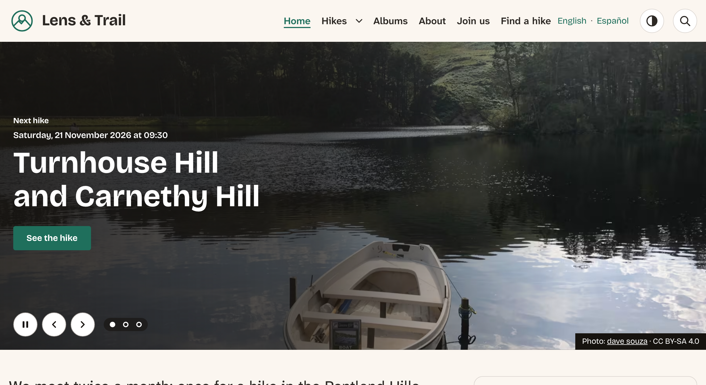
*Figure 17.13: The slider on Drupal CMS's Home.*

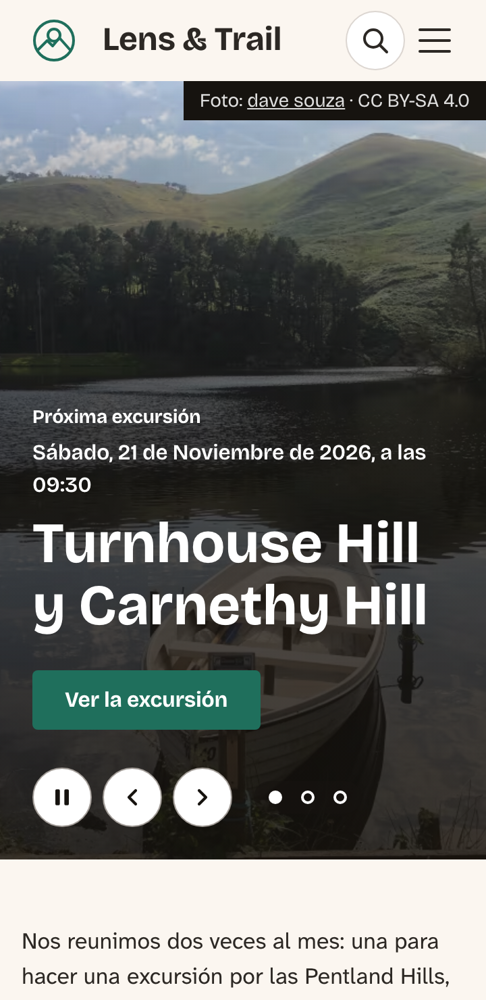
*Figure 17.14: In Spanish, on a phone.*

## Summary

You can now:

- explain the four parts of a hero (the photo, the text over it, the heading, the link) and what goes wrong with each;
- make text readable on any photo with a gradient, and work out its contrast for the worst case, instead of trusting `text-shadow`;
- build a Hero component with two variants, and fill it from a view mode, a view and a content block type;
- keep a page's h1 first when a region comes before the title, with a region template and the title resolver;
- keep cache tags when a template takes `content` apart;
- build a slider that works without JavaScript, with CSS scroll snap, and add the APG's carousel pattern on top: Pause first, Previous and Next, labeled slides, `inert`, and a live region that only speaks when asked;
- put a script's text in the template, so Drupal translates it with the page;
- add parallax with a scroll-driven animation, respect reduced motion, and give a component a named timeline through a custom property;
- make the first slide's photo the only one at high priority, and explain what lazy loading does in a scroll area;
- weigh contributed slider modules against a few lines of your own;
- use the same components in Canvas, with props for what editors fill in and Twig blocks for what Drupal renders.

The front page's top is done. The next chapter goes on to the pages themselves: templates for the club's content, from the hike page to the print stylesheet.

## Exercises

1. Add a fourth slide for the next photo evening, as a **Hero slide** content block with a photo from the media library, after Join the club. Check in the browser's network panel that its photo doesn't load at High priority, and that the slider still says "Slide 4 of 4".
2. Turn on reduced motion in your browser's developer tools (**Rendering** › **Emulate CSS media feature prefers-reduced-motion**), and check everything this chapter moves: the slides, the parallax, and Next. Then do the same on the Drupal CMS site.
3. Take the gradient off the hero in the developer tools, and look at the album's slide. Then put it back, and use the developer tools' color picker to find the lightest point under the eyebrow text. What's its contrast with white? Compare it with the number in the chapter.
4. Show the hero on the core site's **Albums** page too, with only the newest album in it. What do you change in Block layout, and what does the region template do with a single slide? Does the page's h1 still come first? *(challenge)*
5. Make the slides wait while the slider is out of sight: scrolled out of the window, or in a browser tab in the background. Nobody should come back to the front page to find it on the third slide. *(advanced)* (The answer is in Appendix B.)

## Want to know more?

- The W3C's ARIA Authoring Practices Guide: [the Carousel pattern](https://www.w3.org/WAI/ARIA/apg/patterns/carousel/) and [an example with Previous and Next](https://www.w3.org/WAI/ARIA/apg/patterns/carousel/examples/carousel-1-prev-next/).
- WCAG 2.2: [Understanding Pause, Stop, Hide](https://www.w3.org/WAI/WCAG22/Understanding/pause-stop-hide.html), [Understanding Contrast (Minimum)](https://www.w3.org/WAI/WCAG22/Understanding/contrast-minimum.html) and [Understanding Target Size (Minimum)](https://www.w3.org/WAI/WCAG22/Understanding/target-size-minimum.html).
- MDN: [CSS scroll snap](https://developer.mozilla.org/en-US/docs/Web/CSS/CSS_scroll_snap), [CSS scroll-driven animations](https://developer.mozilla.org/en-US/docs/Web/CSS/CSS_scroll-driven_animations), [`view-timeline`](https://developer.mozilla.org/en-US/docs/Web/CSS/view-timeline) and [`inert`](https://developer.mozilla.org/en-US/docs/Web/HTML/Reference/Global_attributes/inert).
- web.dev: [Largest Contentful Paint](https://web.dev/articles/lcp) and [Optimizing resource loading with the Fetch Priority API](https://web.dev/articles/fetch-priority).
- Drupal.org: [Slick](https://www.drupal.org/project/slick), [Splide](https://www.drupal.org/project/splide) and [Swiper formatter](https://www.drupal.org/project/swiper_formatter).
