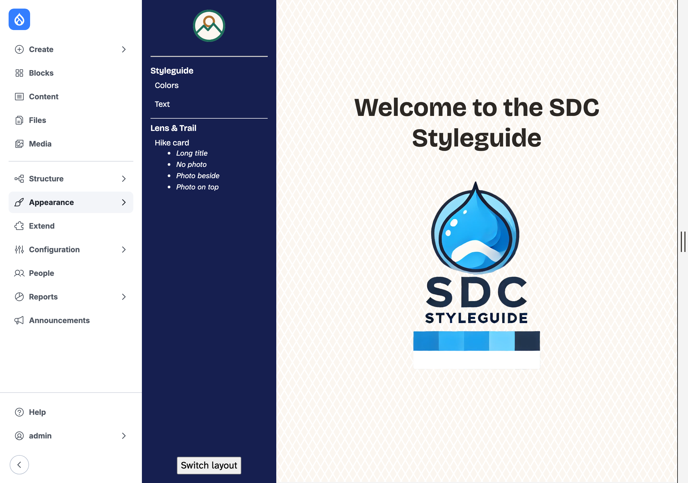
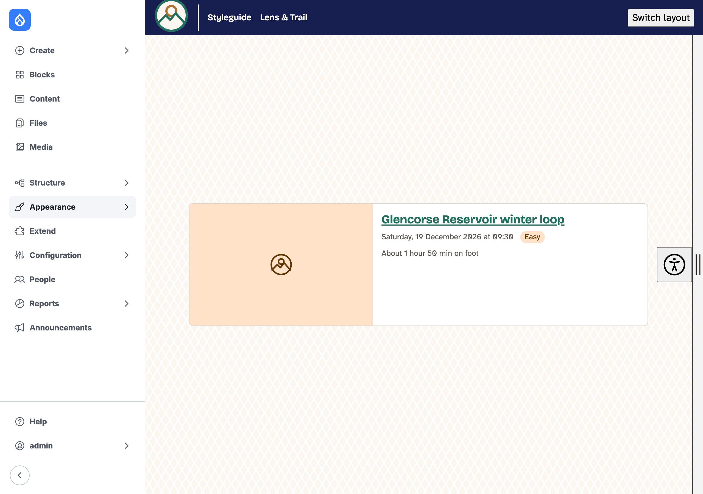
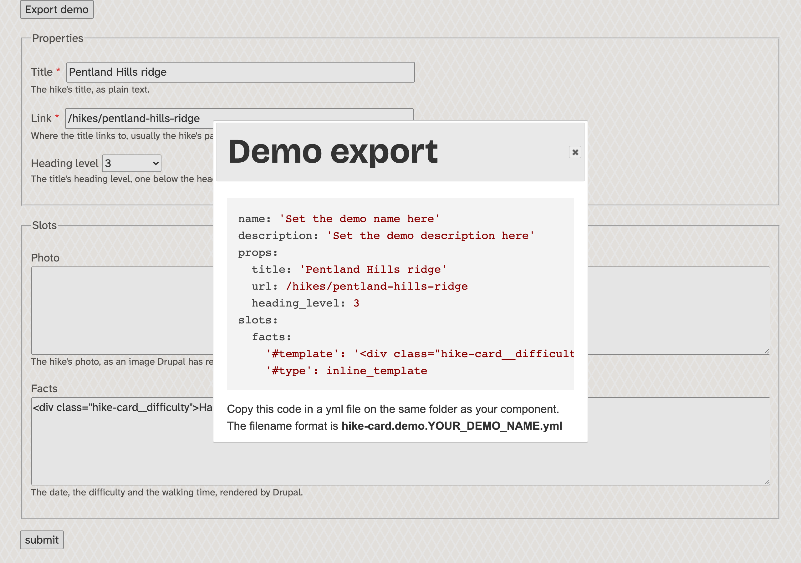
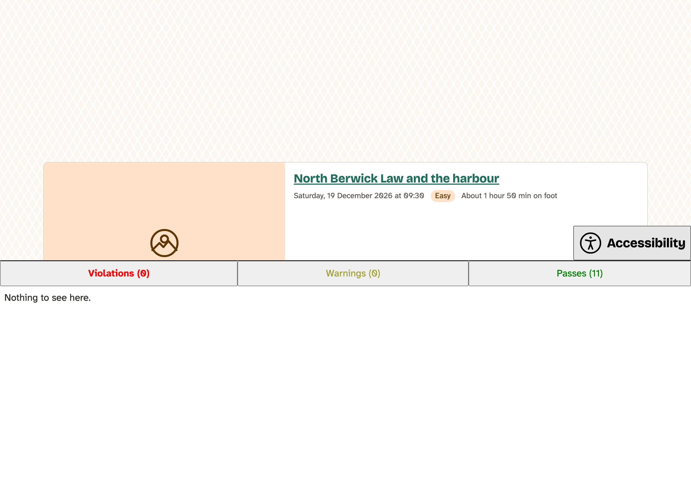
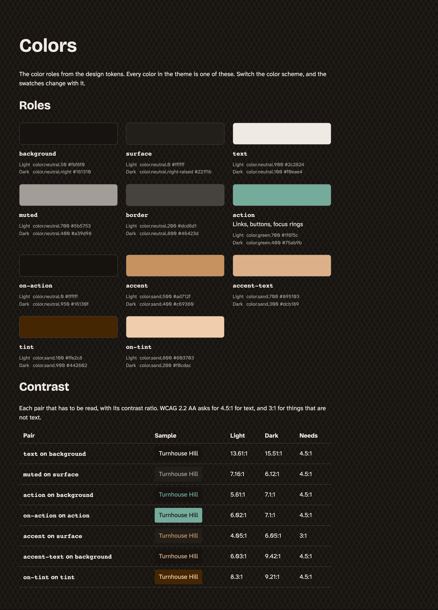
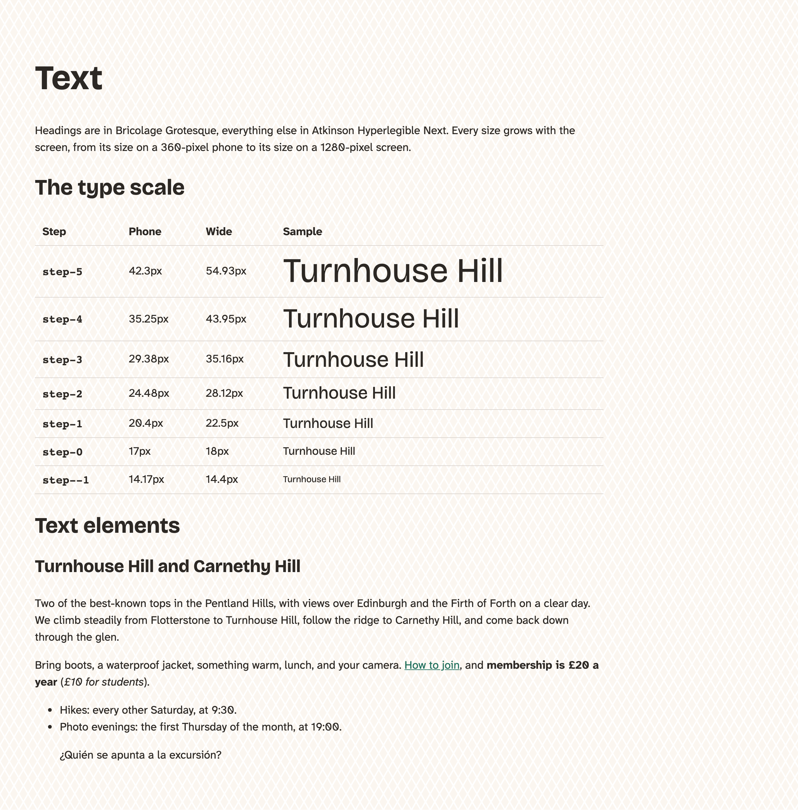
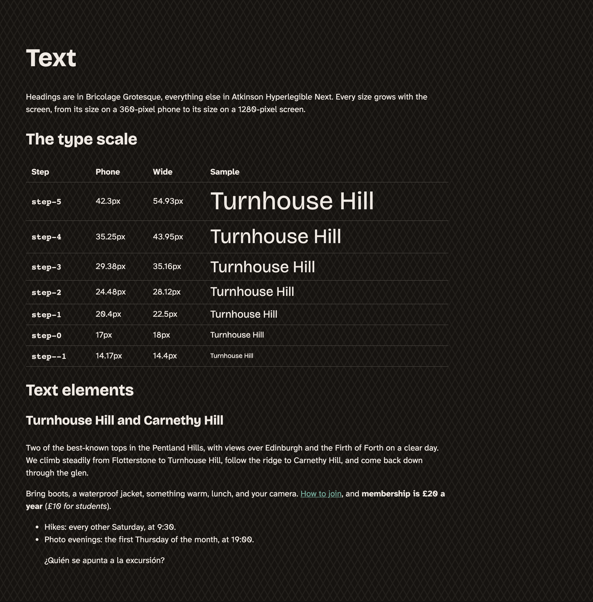
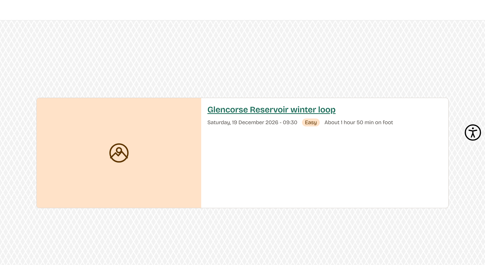

# Appendix D: The Styleguide

A **styleguide** is a place where a site's parts can be seen on their own: every component with made-up content, the colors, the type. In the chapter on Single Directory Components we installed **SDC Styleguide** to check the Hike card, wrote four demos for it, and hid the components that aren't ours. This appendix is the rest of the module: how demos work, the form that writes them for you, the accessibility check under every demo, and the club's own Colors and Text pages, made from the design tokens, in place of the module's samples.

We use SDC Styleguide rather than Storybook, the best-known tool for this, for three reasons. It's part of the site, so a demo is drawn by Drupal with the real theme, its libraries and its Twig, and there's nothing to keep in step. It needs no Node and no build, which the core site has done without all along. And it's small enough to learn in an afternoon. Storybook can do much more, and on a big project with a team of front-end developers it may be worth its weight; the chapter on choosing an approach says more about that.

The core site starts as Chapter 13 leaves it: the module installed, the Navigation module's and Olivero's components hidden. The code for this appendix is in `code/appendix-d/`, and `tools/use-step.sh d 01` puts it on both test sites.

## Installing it, and who can use it

If you skipped the chapter on components, this is all it takes on the core site:

`terminal` ([source](../code/chapter13/snippets/styleguide-install.sh))

```bash
ddev composer require drupal/sdc_styleguide
ddev drush pm:install sdc_styleguide
```

The styleguide is at **Appearance** › **SDC Styleguide** (`/styleguide/explorer`). The explorer, the list on the left, is drawn in the administration theme, and the preview on the right in the site's own theme:


*Figure D.1: The explorer, with only the club's components in it*

Only people with the permission **Use the SDC Explorer** can open it. The module marks it as one to give with care, and with reason: the demo form renders whatever is typed into its slots as a template. Administrators have it already. If the club ever had a designer who should see the styleguide but not run the site, that's a role of their own with this one permission, in **People** › **Roles** and **People** › **Permissions**, as in the first book's chapter on users and roles. We don't make one.

## Demos

A demo is a YAML file next to the component, named `<component>.demo.<name>.yml`. The module finds every one of them by itself, and lists them under the component, under the component's `group`. Here is the No photo demo from Chapter 13:

`components/hike-card/hike-card.demo.no-photo.yml` ([source](../code/chapter13/steps/03-styleguide/core/lens_trail/components/hike-card/hike-card.demo.no-photo.yml))

```yaml
name: No photo
description: A hike nobody has added a photo to yet.
props:
  title: North Berwick Law and the harbour
  url: '#'
  heading_level: 3
  variant: beside
slots:
  facts: '<div class="hike-card__date"><time datetime="2026-12-19T09:30:00Z">Saturday, 19 December 2026 at 09:30</time></div><div class="hike-card__difficulty">Easy</div><div class="hike-card__walking-time">About 1 hour 50 min on foot</div>'
```

`name` is what the explorer shows, and `description` is the tooltip when you hover over it. `props` are the component's props, with the values for this demo. `slots` are its slots, as HTML in a string. Write that HTML as the site would render it, with the same classes, or the demo shows a component the site never draws.

A component without a demo still shows up, under its group or under **Ungrouped**, but its link opens the demo form instead of a preview. That's why Chapter 13 hid the components of core's Navigation module and of Olivero: they have no demos, and nobody at the club will write any.

Two things around the preview are worth knowing:

- **The handle on the right edge** of the preview makes it narrower or wider. Drag it, and watch the Photo beside demo move its photo on top below 30rem. It's the quickest way to test a container query.
- **Switch layout**, at the bottom of the explorer, moves the list into a bar at the top, with each group as a menu, and gives the preview the whole width.


*Figure D.2: Switch layout puts the explorer at the top*

## The demo form

Select a component's name in the explorer, not one of its demos, and you get a form with a field for every prop and slot. The fields come from the component's `.component.yml`: the titles, the descriptions, a list for an `enum`, a star for a required prop. Fill it in and select **submit**, and the preview shows the result above the form.

When it looks right, select **Export demo**. The module writes the demo's YAML for you:


*Figure D.3: Export demo writes the YAML for a new demo file*

Copy it into a new file next to the component, with a name of its own (`hike-card.demo.pentland-hills.yml`, say), replace the `name` and `description`, and rebuild the cache. The export writes a slot as a small render array, `'#type': inline_template` with the HTML as `'#template'`. A plain string, as in our hand-written demos, works as well, and reads more easily.

The form only knows simple types: strings, numbers, booleans, lists. A prop that's an object, such as the Canvas card's photo on the Drupal CMS site, gets no field, and a warning instead.

## The accessibility check

Under every demo is a button with the accessibility symbol. Select it, and the module runs **axe-core**, an open source accessibility checker, on the preview, and lists what it found as **Violations**, **Warnings** and **Passes**:


*Figure D.4: The No photo demo passes all eleven checks that apply to it*

It's a good first check, and a cheap one, because it runs on every demo you write. But it only sees what's in the preview, as it is drawn now: it checks the colors of the color scheme you're in, not the other one, and it can't tell whether the card works with a keyboard or makes sense to a screen reader user. The chapters' own checks (keyboard, contrast in both modes, forced colors, 320 pixels wide) still apply.

## The club's Colors and Text pages

Under **Styleguide** in the explorer are **Colors** and **Text**. Out of the box, they're the module's samples, with somebody else's palette and lorem ipsum, and the module says so on the page: "You must override this." For the club, they should show the club's colors and type, and they should never go out of date. So we make them from the same design tokens as the theme.

### How the module finds its pages

The module asks the active theme for its pages, with an alter hook, `hook_styleguide_sections_alter()`. Each page is a **section**, with a machine name, and the module draws it with a template named after it, `styleguide-section--colors.html.twig` for `colors`. Two details decide how we use it:

- **The explorer's links are fixed.** It always lists Colors and Text, and nothing else, so a theme can fill those two pages but can't add a third.
- **It's all or nothing.** If the theme gives any sections, the module's own are gone. So a theme that only wanted to change Colors has to give Text as well.

That gives us the smallest override that works: the hook, to hand the pages the club's values, and one template for each page. We could have stopped at the two templates, with the colors written into them by hand, but then they'd be one more copy of the design to keep up to date. With the hook, the values come from the tokens.

### The values, from the tokens

`tokens.py`, from the chapter on generating the core theme, already reads the design tokens. It gets one more output, `--styleguide`, which writes JSON instead of CSS: every color role with its light and dark value, the contrast of each pair that has to be read, and the type scale. The contrast is worked out the way Chapter 3 does it, and the pairs are the ones in Chapter 3's table:

```diff
--- scripts/tokens.py (before)
+++ scripts/tokens.py (after)
@@ -3,6 +3,7 @@

     python3 scripts/tokens.py design/tokens.json web/themes/custom/lens_trail/css/tokens.css
     python3 scripts/tokens.py --tailwind design/tokens.json web/themes/custom/mercury/src/tokens.css
+    python3 scripts/tokens.py --styleguide design/tokens.json web/themes/custom/lens_trail/styleguide.json

 Reads Penpot's token file (sets, themes, values as strings, references in
 {curly.braces}) and writes one CSS file of custom properties:
@@ -16,6 +17,11 @@
 With --tailwind, the same custom properties go inside Tailwind's @theme, with
 the names Tailwind turns into utility classes (bg-club-action, p-m,
 text-step-1), for the Drupal CMS site's theme.
+
+With --styleguide, it writes JSON instead, for the styleguide's Colors and
+Text pages: every color role with its light and dark value, the contrast of
+each pair that has to be read, and the type scale's sizes on a phone and on a
+wide screen.

 Only Python 3's standard library: no npm, nothing to install.
 """
@@ -43,6 +49,18 @@
 }
 # The renames in use: main() sets them to TAILWIND_NAMES for --tailwind.
 renames = {}
+# With --styleguide: the pairs of roles that have to be read, as in Chapter 3's
+# table, and the contrast each needs: 4.5:1 for text, 3:1 for things that
+# aren't text (WCAG 2.2 AA).
+PAIRS = [
+    ("text", "background", 4.5),
+    ("muted", "surface", 4.5),
+    ("action", "background", 4.5),
+    ("on-action", "action", 4.5),
+    ("accent", "surface", 3),
+    ("accent-text", "background", 4.5),
+    ("on-tint", "tint", 4.5),
+]

 def flatten(group, path=()):
@@ -110,6 +128,70 @@
     note = token.get("$description")
     comment = f" /* {note} */" if note else ""
     return f"  {css_name(path)}: {css_value};{comment}"
+
+
+def hex_value(token, values):
+    """A color token's hex value, following references to other tokens."""
+    raw = token["$value"]
+    while raw.startswith("{"):
+        raw = values[tuple(raw[1:-1].split("."))]["$value"]
+    return raw
+
+
+def luminance(hex_color):
+    """How bright a color looks to the eye, as WCAG 2.2 calculates it (Chapter 3)."""
+    h = hex_color.lstrip("#")
+    linear = []
+    for i in (0, 2, 4):
+        c = int(h[i:i + 2], 16) / 255
+        linear.append(c / 12.92 if c <= 0.04045 else ((c + 0.055) / 1.055) ** 2.4)
+    return 0.2126 * linear[0] + 0.7152 * linear[1] + 0.0722 * linear[2]
+
+
+def contrast(first, second):
+    light, dark = sorted((luminance(first), luminance(second)), reverse=True)
+    return round((light + 0.05) / (dark + 0.05), 2)
+
+
+def styleguide(sets):
+    """The roles, the pairs and the type scale, for the styleguide."""
+    values, light, dark = (flatten(sets[name]) for name in ("values", "light", "dark"))
+    phone, wide = flatten(sets["phone"]), flatten(sets["wide"])
+    roles = []
+    colors = {}
+    for path, token in light.items():
+        name = path[-1]
+        colors[name] = (hex_value(token, values), hex_value(dark[path], values))
+        roles.append({
+            "name": name,
+            "property": css_name(path),
+            "description": token.get("$description", ""),
+            "light": {"token": token["$value"].strip("{}"), "hex": colors[name][0]},
+            "dark": {"token": dark[path]["$value"].strip("{}"), "hex": colors[name][1]},
+        })
+    # Penpot keeps the roles in the order they were made; Chapter 3's order reads better.
+    order = ["background", "surface", "text", "muted", "border", "action",
+             "on-action", "accent", "accent-text", "tint", "on-tint"]
+    roles.sort(key=lambda role: order.index(role["name"]) if role["name"] in order else len(order))
+    pairs = [{
+        "text": text,
+        "on": on,
+        "needs": need,
+        "light": contrast(colors[text][0], colors[on][0]),
+        "dark": contrast(colors[text][1], colors[on][1]),
+    } for text, on, need in PAIRS]
+    scale = [{
+        "name": path[-1],
+        "property": css_name(path),
+        "phone": float(token["$value"]),
+        "wide": float(wide[path]["$value"]),
+    } for path, token in phone.items()]
+    return {
+        "generated": "By scripts/tokens.py --styleguide from design/tokens.json. Don't edit.",
+        "roles": roles,
+        "pairs": pairs,
+        "type_scale": scale,
+    }

 def build(sets, tailwind=False, layer=None):
@@ -156,11 +238,15 @@
     return "\n".join(header + block + [""])

-def main(source, target, tailwind=False, layer=None):
+def main(source, target, tailwind=False, layer=None, guide=False):
     global renames
     renames = TAILWIND_NAMES if tailwind else {}
     sets = json.loads(Path(source).read_text(encoding="utf-8"))
-    Path(target).write_text(build(sets, tailwind, layer), encoding="utf-8")
+    if guide:
+        output = json.dumps(styleguide(sets), indent=2) + "\n"
+    else:
+        output = build(sets, tailwind, layer)
+    Path(target).write_text(output, encoding="utf-8")
     print(f"Wrote {target}")

@@ -169,6 +255,9 @@
     tailwind = "--tailwind" in arguments
     if tailwind:
         arguments.remove("--tailwind")
+    guide = "--styleguide" in arguments
+    if guide:
+        arguments.remove("--styleguide")
     layer = None
     for argument in list(arguments):
         if argument.startswith("--layer="):
@@ -176,4 +265,4 @@
             arguments.remove(argument)
     if len(arguments) != 2:
         sys.exit(__doc__)
-    main(*arguments, tailwind=tailwind, layer=layer)
+    main(*arguments, tailwind=tailwind, layer=layer, guide=guide)
```

Run it, and rebuild the cache:

`terminal` ([source](../code/appendix-d/snippets/tokens-styleguide.sh))

```bash
python3 scripts/tokens.py --styleguide design/tokens.json web/themes/custom/lens_trail/styleguide.json
ddev drush cache:rebuild
```

The start of what it writes:

`lens_trail/styleguide.json` ([source](../code/appendix-d/steps/01-sections/core/lens_trail/styleguide.json))

```json
{
  "generated": "By scripts/tokens.py --styleguide from design/tokens.json. Don't edit.",
  "roles": [
    {
      "name": "background",
      "property": "--color-background",
      "description": "",
      "light": {
        "token": "color.neutral.50",
        "hex": "#fbf6f0"
      },
      "dark": {
        "token": "color.neutral.night",
        "hex": "#161310"
      }
    },
    {
      "name": "surface",
      "property": "--color-surface",
      "description": "",
      "light": {
        "token": "color.neutral.0",
        "hex": "#ffffff"
      },
      "dark": {
        "token": "color.neutral.night-raised",
        "hex": "#221f1b"
      }
    },
```

The contrast numbers are the same as in Chapter 3's table, which is a good check that nothing went wrong on the way. When the design changes, the order is the same as for `tokens.css`: Penpot, export, and the script, now with both outputs.

### The hook

The theme's hook class gets one more method:

`lens_trail/src/Hook/LensTrailHooks.php`, `styleguideSectionsAlter()` ([source](../code/appendix-d/steps/01-sections/core/lens_trail/src/Hook/LensTrailHooks.php))

```php
/**
 * Implements hook_styleguide_sections_alter().
 *
 * The club's own Colors and Text pages in SDC Styleguide, instead of the
 * module's samples. The values come from the design tokens: styleguide.json
 * is written by scripts/tokens.py --styleguide. When a theme gives the module
 * any sections, the module's own are gone, so both pages are here.
 */
#[Hook('styleguide_sections_alter')]
public function styleguideSectionsAlter(array &$sections): void {
  $tokens = json_decode(file_get_contents(dirname(__DIR__, 2) . '/styleguide.json'), TRUE);
  $sections['colors'] = [
    'name' => $this->t('Colors'),
    'roles' => $tokens['roles'],
    'pairs' => $tokens['pairs'],
  ];
  $sections['text'] = [
    'name' => $this->t('Text'),
    'type_scale' => $tokens['type_scale'],
  ];
}
```

It reads the JSON, and gives each page what its template needs: the name, and the values. `dirname(__DIR__, 2)` is the theme's folder, two levels up from `src/Hook`.

### The templates

The module's own templates are in its `templates` folder. Ours go in the theme's `templates/styleguide/`, and Drupal uses them instead, because a theme's template wins over a module's of the same name. The Colors page:

`templates/styleguide/styleguide-section--colors.html.twig` ([source](../code/appendix-d/steps/01-sections/core/lens_trail/templates/styleguide/styleguide-section--colors.html.twig))

```twig
{#
/**
 * @file
 * The club's colors in SDC Styleguide: every color role, and the contrast of
 * each pair that has to be read.
 *
 * The values come from the design tokens, through the theme's
 * hook_styleguide_sections_alter(). Each swatch is drawn with the role's own
 * custom property, so it shows what the site uses now, in light or dark mode.
 *
 * Variables:
 * - section: The section's machine name, "colors".
 * - information: What the hook gives: name, roles and pairs.
 */
#}
{{ attach_library('lens_trail/styleguide') }}
<div class="styleguide-page">
  <h1>{{ information.name }}</h1>
  <p>{{ 'The color roles from the design tokens. Every color in the theme is one of these. Switch the color scheme, and the swatches change with it.'|t }}</p>

  <h2>{{ 'Roles'|t }}</h2>
  <ul class="styleguide-swatches">
    
      <li class="styleguide-swatch">
        <span class="styleguide-swatch__color" style="background: var({{ role.property }})"></span>
        <code class="styleguide-swatch__name">{{ role.name }}</code>
        
          <div>{{ role.description }}</div>
        
        <dl class="styleguide-swatch__values">
          <dt>{{ 'Light'|t }}</dt>
          <dd>{{ role.light.token }} {{ role.light.hex }}</dd>
          <dt>{{ 'Dark'|t }}</dt>
          <dd>{{ role.dark.token }} {{ role.dark.hex }}</dd>
        </dl>
      </li>
    
  </ul>

  <h2>{{ 'Contrast'|t }}</h2>
  <p>{{ 'Each pair that has to be read, with its contrast ratio. WCAG 2.2 AA asks for 4.5:1 for text, and 3:1 for things that are not text.'|t }}</p>
  <table class="styleguide-table">
    <thead>
      <tr>
        <th scope="col">{{ 'Pair'|t }}</th>
        <th scope="col">{{ 'Sample'|t }}</th>
        <th scope="col">{{ 'Light'|t }}</th>
        <th scope="col">{{ 'Dark'|t }}</th>
        <th scope="col">{{ 'Needs'|t }}</th>
      </tr>
    </thead>
    <tbody>
      
        <tr>
          <th scope="row"><code>{{ pair.text }}</code> {{ 'on'|t }} <code>{{ pair.on }}</code></th>
          <td><span class="styleguide-sample" style="color: var(--color-{{ pair.text }}); background: var(--color-{{ pair.on }})">Turnhouse Hill</span></td>
          <td>{{ pair.light }}:1</td>
          <td>{{ pair.dark }}:1</td>
          <td>{{ pair.needs }}:1</td>
        </tr>
      
    </tbody>
  </table>
</div>
```

Each swatch is drawn with the role's custom property, `var(--color-action)`, not with its hex value. So it shows what the theme uses right now, and in dark mode it shows the dark value. The hex values are printed beside it, for both modes, because that's what a designer will want to compare with Penpot. The contrast table draws each pair as a sample, with the text role on the background role.

<details><summary>The Text page</summary>

`templates/styleguide/styleguide-section--text.html.twig` ([source](../code/appendix-d/steps/01-sections/core/lens_trail/templates/styleguide/styleguide-section--text.html.twig))

```twig
{#
/**
 * @file
 * The club's type in SDC Styleguide: the fluid type scale, and the text
 * elements as the theme styles them, with the club's own words.
 *
 * Variables:
 * - section: The section's machine name, "text".
 * - information: What the hook gives: name and type_scale.
 */
#}
{{ attach_library('lens_trail/styleguide') }}
<div class="styleguide-page">
  <h1>{{ information.name }}</h1>
  <p>{{ 'Headings are in Bricolage Grotesque, everything else in Atkinson Hyperlegible Next. Every size grows with the screen, from its size on a 360-pixel phone to its size on a 1280-pixel screen.'|t }}</p>

  <h2>{{ 'The type scale'|t }}</h2>
  <table class="styleguide-table">
    <thead>
      <tr>
        <th scope="col">{{ 'Step'|t }}</th>
        <th scope="col">{{ 'Phone'|t }}</th>
        <th scope="col">{{ 'Wide'|t }}</th>
        <th scope="col">{{ 'Sample'|t }}</th>
      </tr>
    </thead>
    <tbody>
      
        <tr>
          <th scope="row"><code>{{ step.name }}</code></th>
          <td>{{ step.phone }}px</td>
          <td>{{ step.wide }}px</td>
          <td><p class="styleguide-scale__sample" style="font-size: var({{ step.property }})">Turnhouse Hill</p></td>
        </tr>
      
    </tbody>
  </table>

  <h2>{{ 'Text elements'|t }}</h2>
  <h3>Turnhouse Hill and Carnethy Hill</h3>
  <p>Two of the best-known tops in the Pentland Hills, with views over Edinburgh and the Firth of Forth on a clear day. We climb steadily from Flotterstone to Turnhouse Hill, follow the ridge to Carnethy Hill, and come back down through the glen.</p>
  <p>Bring boots, a waterproof jacket, something warm, lunch, and your camera. <a href="#">How to join</a>, and <strong>membership is £20 a year</strong> (<em>£10 for students</em>).</p>
  <ul>
    <li>Hikes: every other Saturday, at 9:30.</li>
    <li>Photo evenings: the first Thursday of the month, at 19:00.</li>
  </ul>
  <blockquote>
    <p lang="es">¿Quién se apunta a la excursión?</p>
  </blockquote>
</div>
```

</details>

The Text page shows the type scale, largest first, with each step's size on a phone and on a wide screen, and then the text elements as the theme styles them. Its words are the club's own, from the first book: a hike, the membership fee, the meeting times, and a question in Spanish, so a missing letter would show.

Both templates attach a small library for their layout:

```diff
--- lens_trail.libraries.yml (before)
+++ lens_trail.libraries.yml (after)
@@ -91,3 +91,17 @@
     - core/drupalSettings
     - core/once
     - lens_trail/base
+
+styleguide:
+  version: VERSION
+  css:
+    component:
+      css/components/styleguide.css: {}
+  dependencies:
+    - lens_trail/base
+
+styleguide-pattern:
+  version: VERSION
+  css:
+    theme:
+      css/components/styleguide-pattern.css: {}
```

<details><summary>css/components/styleguide.css</summary>

`css/components/styleguide.css` ([source](../code/appendix-d/steps/01-sections/core/lens_trail/css/components/styleguide.css))

```css
/**
 * @file
 * The club's Colors and Text pages in SDC Styleguide.
 */
@layer components {
  .styleguide-page {
    max-inline-size: 60rem;
    padding: var(--space-m);
  }

  .styleguide-swatches {
    display: grid;
    grid-template-columns: repeat(auto-fill, minmax(14rem, 1fr));
    gap: var(--space-m);
    padding: 0;
    list-style: none;
  }

  .styleguide-swatch__color {
    display: block;
    block-size: 4rem;
    margin-block-end: var(--space-xs);
    border: var(--border-thin) solid var(--color-border);
    border-radius: var(--radius-medium);
  }

  .styleguide-swatch__name {
    font-weight: var(--font-weight-semibold);
  }

  .styleguide-swatch__values {
    margin: var(--space-2xs) 0 0;
    font-size: var(--font-size-step--1);
    color: var(--color-muted);

    & dt {
      float: inline-start;
      margin-inline-end: var(--space-2xs);
    }
  }

  .styleguide-table {
    inline-size: 100%;
    border-collapse: collapse;

    & th,
    & td {
      padding: var(--space-2xs) var(--space-xs);
      border-block-end: var(--border-thin) solid var(--color-border);
      text-align: start;
    }
  }

  .styleguide-sample {
    display: inline-block;
    padding: var(--space-2xs) var(--space-xs);
    border-radius: var(--radius-small);
  }

  .styleguide-scale__sample {
    margin: 0;
    font-family: var(--font-family-heading);
    line-height: 1.2;
  }
}
```

</details>

### The background, in the club's colors

The first time we looked at the Colors page in dark mode, it was unreadable: light text on the module's light gray pattern. The pattern is drawn by the module's CSS, with two custom properties of its own, `--c1` and `--c2`. Point them at the club's roles, and the pattern follows the color scheme, on these two pages and behind every demo:

`css/components/styleguide-pattern.css` ([source](../code/appendix-d/steps/01-sections/core/lens_trail/css/components/styleguide-pattern.css))

```css
/**
 * @file
 * SDC Styleguide's background pattern in the club's colors.
 *
 * The module draws its pattern with two custom properties, --c1 and --c2, in
 * a file that isn't in a cascade layer. A rule in one of our layers would lose
 * to it, so this one rule isn't in a layer either. It only changes the two
 * colors, so the pattern follows the color scheme like the rest of the site.
 */
.sdc-styleguide-pattern {
  --c1: var(--color-surface);
  --c2: var(--color-background);
}
```

This is the one rule in the theme that isn't in a cascade layer, and the comment says why. The module's file isn't in a layer, and a rule outside the layers beats any rule inside them, as the CSS architecture chapter's exercise with `core/normalize` shows. Our rule only sets two colors, so being outside the layers does no harm.

The file goes in a library of its own, and `libraries-extend` adds it wherever the module's library is used, so the theme doesn't need to know which pages those are:

```diff
--- lens_trail.info.yml (before)
+++ lens_trail.info.yml (after)
@@ -22,6 +22,8 @@
     - lens_trail/progress
   core/drupal.tablesort:
     - lens_trail/drupal.tablesort
+  sdc_styleguide/global:
+    - lens_trail/styleguide-pattern
 description: 'The theme of Lens & Trail, a photography and hiking club in Edinburgh.'
 core_version_requirement: ^12
 regions:
```

After a cache rebuild, the two pages:


*Figure D.5: The Colors page, made from the design tokens*


*Figure D.6: In dark mode, the swatches change with the color scheme*


*Figure D.7: The Text page*


*Figure D.8: The Text page in dark mode*

> **Try it:** In Penpot, or straight in `design/tokens.json`, make the light *muted* role one step lighter, `color.neutral.600`. Run both outputs of `tokens.py`, rebuild the cache, and look at the Colors page: the swatch is lighter, and the contrast of *muted* on *surface* has gone down. Does it still pass? Put it back.

## On the Drupal CMS site

SDC Styleguide works on the Drupal CMS site too, installed the same way. Two things are different there.

**The explorer is full.** Mercury's components are made for editors in Canvas, and the explorer lists them all, grouped, about thirty of them, none with demos. We leave them in: they're the site's real components, and the demo form is a quick way to see one with your own values.

**A Canvas component's demo has to fill in every prop.** The module passes every prop the demo leaves out as an empty value, and Canvas's components check their props strictly: an optional prop that's empty fails, and the demo stops with an error. So the Canvas card's demo has the walking time and a photo, even though both are optional, and the photo is an object, as Canvas gives it:

`components/hike-card/hike-card.demo.beside.yml` ([source](../code/appendix-d/steps/01-sections/cms/mercury/components/hike-card/hike-card.demo.beside.yml))

```yaml
name: Photo beside
description: As in a wide column. A demo has to fill in every prop, so the photo is the club's default photo.
props:
  title: Glencorse Reservoir winter loop
  url: /first-hike
  heading_level: 3
  layout: beside
  date: '2026-12-19T09:30:00Z'
  difficulty: easy
  walking_time: About 1 hour 50 min on foot
  photo:
    src: /themes/custom/mercury/components/hike-card/demo/default-photo.svg
    alt: ''
    width: 480
    height: 320
```

That also means there's no No photo demo on this site: leave the photo out, and the demo fails. The core site's card doesn't have the problem, because its photo is a slot, not a prop.


*Figure D.9: The Canvas card's demo, with Mercury's styles*

The Colors and Text pages stay the module's samples on this site. Mercury's colors are the same tokens, so the core site's pages already show them.

## Known problems

We found these in SDC Styleguide 1.3.3, in November 2026. Check them again before you rely on them.

- **The README says `.story.` files**, but the module looks for `.demo.` files, and only those work.
- **An `integer` prop** can't be read from a demo file. It arrives empty, and the component fails with "NULL value found, but an integer is required". Use `number`, with an `enum` if only whole numbers make sense, as the Hike card's heading level does.
- **Components whose props have no `title`**, such as core's Navigation components, give PHP warnings in the demo form.
- **Saving the settings** (Exclude Modules, Exclude Themes) doesn't clear the explorer's cache: rebuild the cache yourself.
- **A prop left out of a demo** is passed as an empty value, which fails a component that checks its props strictly, such as a Canvas component.
- **The styleguide loads three libraries from a content delivery network** (cdnjs): axe-core, a syntax highlighter for the exported YAML, and a scrollbar library. Without an internet connection, the accessibility check and the highlighting don't work. That's fine on a development site, but it's a reason not to give the permission to visitors on a live site.

## Want to know more?

- Drupal.org: [SDC Styleguide](https://www.drupal.org/project/sdc_styleguide), and [Adding assets (CSS, JS) to a Drupal theme via *.libraries.yml](https://www.drupal.org/docs/develop/theming-drupal/adding-assets-css-js-to-a-drupal-theme-via-librariesyml), which explains `libraries-extend`.
- [axe-core](https://github.com/dequelabs/axe-core), the accessibility checker under every demo.
- W3C: [Understanding Success Criterion 1.4.3: Contrast (Minimum)](https://www.w3.org/WAI/WCAG22/Understanding/contrast-minimum.html).
- MDN: [`@layer`](https://developer.mozilla.org/en-US/docs/Web/CSS/@layer), for why the pattern rule is outside the layers.
- [Storybook](https://storybook.js.org/), for comparison.
