# The Design in Penpot

In the last chapter, the club made its design decisions: the colors and their roles, the fonts, the type scale, the spacing, what a hike card and a hike page show. Right now those decisions live in a chapter of a book, which is a fine place to explain them and a poor place to work from. A theme developer needs them in a form they can open, measure, and copy values out of, and a designer needs somewhere to draw.

This chapter puts the design into **Penpot**, a free and open source design tool that runs in the browser. We'll make an account and a file for the club, turn Chapter 3's decisions into **design tokens** (a few by hand, so you see how they work, and the rest from a file), and then draw the hike card and the hike page. The other wireframes follow the same steps, and at the end of the chapter everything goes into the book's `design/` folder: the Penpot file, the tokens as `design/tokens.json`, and the wireframes as images, for readers who'd rather not use Penpot at all.

You don't need to have used a design tool before. We hadn't used Penpot either when we started this chapter, and we'll go slowly, one click at a time. Nothing in this chapter changes the two sites: they still run Olivero and Mercury, as Book 1 left them. The next chapter generates the themes, and the tokens from this chapter are where their colors and sizes come from.

%% Author: written as we go (2026-11-08). Done so far: the file, the tokens, the fonts, the hike card and the hike page on a phone. Still to come: the other wireframes, exporting, getting the design without Penpot, the Using Figma? box, Summary, Exercises, Want to know more. %%

## Penpot

Penpot is a design and prototyping tool, in the same family as Figma and Sketch: you draw pages and components on a canvas, give them colors and type, and share them with the people who build them. Three things made it the club's choice:

- **It's open source**, under the Mozilla Public License, like Drupal is under the GPL. The files you make are yours, in an open format, and the book can publish the club's design under its own CC BY-SA license.
- **It's free** for what this book needs. The online version at design.penpot.app has a free plan, and you can also run Penpot on your own server.
- **It understands design tokens.** Tokens are built in, not an add-on, and Penpot reads and writes them in the format of the W3C's design tokens group, the same file the next chapter turns into CSS.

> **Running Penpot yourself.** Penpot publishes Docker images, so you can run your own copy on a server, or even on your laptop. That's what an organization does when its designs mustn't leave its own servers. For this book, the online version is all you need, and it's what our screenshots show; a self-hosted Penpot looks the same.

### An account and a file

1. Go to **design.penpot.app** and create a free account. Penpot asks for your name, an email address and a password, or lets you sign up with an account you already have elsewhere, such as GitHub or Google. It sends you an email to confirm the address; click the link in it, and you're in. Sign-up pages change more often than anything else in a tool, so we don't show this one: if it looks different when you get there, the questions will be the same.
2. After signing up, you land on the **dashboard**: your projects and files. In the sidebar on the left, click **Drafts**. Drafts is a place for files that don't belong to a project yet, which is what the club's design is for now.
3. At the top right, click **+ New file**. Penpot makes a file and opens it.
4. At the top of the left panel, you'll see the file's name, something like *New File 1*. Double-click it, type `Lens & Trail`, and press **Enter**.

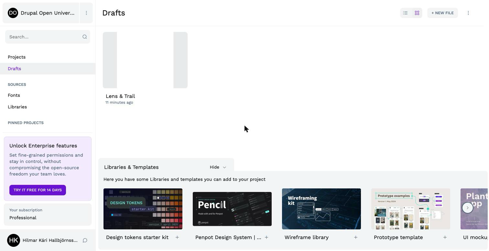
*Figure 4.1: The club's file in Drafts. The libraries and templates at the bottom are Penpot's suggestions; we won't need them.*

The big grey area in the middle of the file is the **canvas**, where the drawing happens. The panel on the left has three tabs: **Layers** (everything on the canvas, as a tree), **Assets** (the file's components, colors and fonts) and **Tokens**, where we start.

## Design tokens in Penpot

Chapter 3 introduced design tokens: named design decisions, like `color.action` or `space.m`, stored in a file both designers and developers use. It also split them into two tiers: **values**, which say what a color *is* (`green-700`), and **roles**, which say what it's *for* (`action`). Penpot has a home for each of these ideas:

- A **token** is one named value: a color, a size, a font, a shadow.
- A **set** is a group of tokens. The club has a set for the values, and one set of roles for each mode: `light` and `dark`.
- A **theme** switches sets on together. The theme *Light* switches on the values and the light roles; *Dark* switches on the values and the dark roles.

Let's make one of each by hand, so you can see how they fit together, and then import the rest of the club's tokens from a file.

### A set for the values

1. In the left panel, click the **Tokens** tab. There are no themes and no sets yet, and below them is a list of token types: **Border Radius**, **Color**, **Dimensions**, **Font Family** and so on.
2. Next to **Sets**, click **+**. A field appears.
3. Type `values` and press **Enter**.

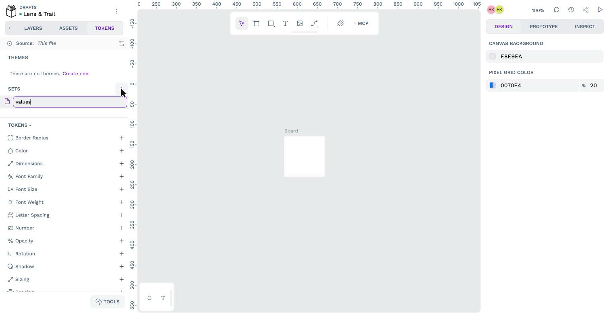
*Figure 4.2: Naming the first set.*

The set appears in the list with an empty checkbox next to it, and the heading above the token types now says **Tokens - values** and *Inactive*. A set that isn't active doesn't count: its tokens can't be used on the canvas. We'll switch sets on with a theme in a moment.

### The first token

The first token is the club's green, Book 1's `#1f6f5c`, which is step 700 of the green scale.

1. With the `values` set selected, click **+** next to **Color**. The **Create new color token** form opens.
2. In **Name**, type `color.green.700`.
3. In **Value**, type `#1f6f5c`. The little square next to it turns green, and Penpot shows the **Resolved value** below the field.
4. In **Description**, type `The club's green, from Book 1`. The description is optional, but it's the one place to say *why* a token exists, and the people using the design later will thank you for it.
5. Click **Save**.

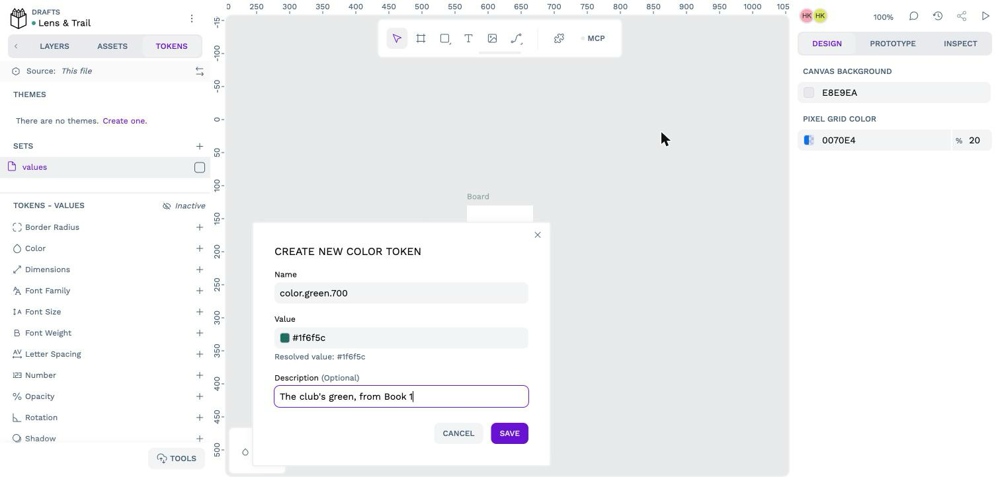
*Figure 4.3: The club's green as a token.*

The dots in the name make **groups**: Penpot shows the token as *color*, then *green*, then *700*, like folders. That's how a list of 101 tokens stays readable, and it's how the token file is organized, too.

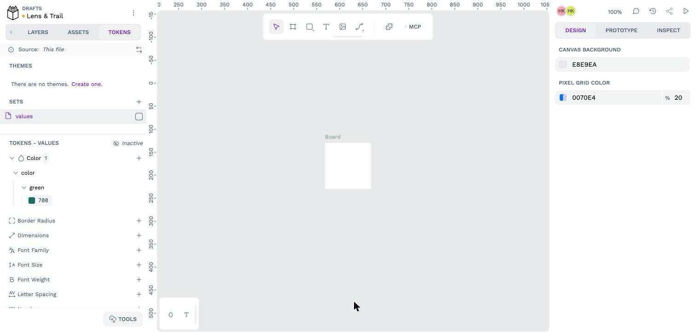
*Figure 4.4: The token, in its groups.*

### A role that points at a value

Now a role. *Action* is the color for links, buttons and focus rings, and in light mode it's the club's green. We could type `#1f6f5c` again, but then the two would only be the same by accident: change the green, and the button stays the old color. Instead, the role **refers** to the value.

1. Next to **Sets**, click **+**, type `light` and press **Enter**.
2. With `light` selected, click **+** next to **Color**.
3. In **Name**, type `color.action`.
4. In **Value**, type `{color.green.700}`, with the curly brackets. Curly brackets around a token's name mean "the value of that token", and Penpot shows the result below the field: `#1f6f5c`.
5. In **Description**, type `Links, buttons, focus rings`, and click **Save**.

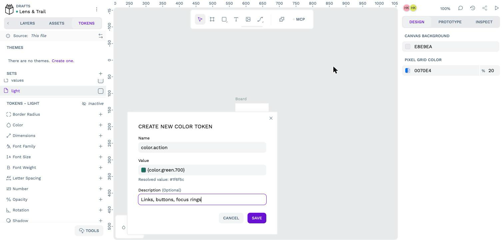
*Figure 4.5: A role that refers to a value. The green swatch is worked out from the reference.*

In the token list, `action` appears in red, with a crossed-out eye. That's Penpot telling you that the token can't be used yet: neither of our sets is active. A theme fixes that.

### A theme

1. Under **Themes**, click **Create one**. The **Add new theme** form opens.
2. In **Group**, type `Mode`. A group holds themes that rule each other out: the site is in light mode or in dark mode, never both.
3. In **Theme**, type `Light`.
4. Tick both sets, `values` and `light`. These are the sets the theme switches on.
5. Click **Save theme**.

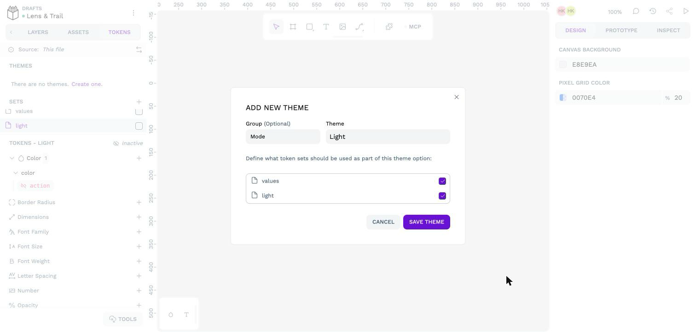
*Figure 4.6: A theme for light mode. Behind the form, the inactive `action` token is shown in red.*

Penpot shows the **Themes list**, with the *Mode* group and the *Light* theme in it, switched off. Click the switch next to **Light** to turn it on, and then **Close**.

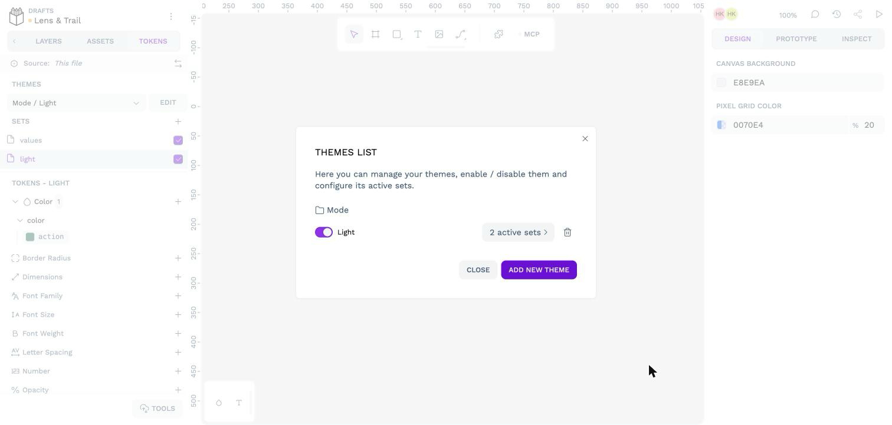
*Figure 4.7: Switching the theme on. Behind the list, both sets are now ticked, and `action` is green.*

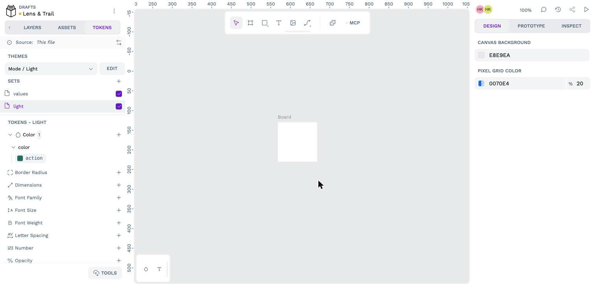
*Figure 4.8: The theme is active, so both sets are, and every token can be used.*

The **Themes** menu now says *Mode / Light*, both sets are ticked, and `action` is an ordinary green token. That's the whole idea behind the club's dark mode, in three tokens: a value, a role that refers to it, and a theme that switches them on together. Dark mode is one more set, `dark`, where `action` refers to a lighter green, and one more theme, *Dark*, that uses it instead of `light`.

### The rest, from a file

The club has 101 tokens: three color scales of eleven steps, eleven roles in each mode, the spacing scale, the corners, the fonts, the type sizes and more. Typing them all in is a good way to make a typo, so the book has them in a file, `code/chapter04/lens-and-trail-tokens.json`, and Penpot can import it.

Before you import, look at what's in it. It's a JSON file, and its first level is the sets: `values`, `light`, `dark`, `phone` and `wide`. Inside each set are the groups and the tokens, the same tree you saw in the Tokens tab. This is the club's green, in the `values` set, with the description we typed:

<!-- include: code/chapter04/lens-and-trail-tokens.json lines=33-37 -->

Every token has a `$value` and a `$type`, and may have a `$description`. The names starting with a dollar sign come from the W3C's design tokens format; the dollar sign keeps them apart from the names of groups and tokens. And this is the start of the `light` set, where every role refers to a value:

<!-- include: code/chapter04/lens-and-trail-tokens.json lines=324-350 -->

At the end of the file are two entries that aren't sets: `$themes`, the four themes and the sets each one switches on, and `$metadata`, the order of the sets and which themes are active after importing. Here are the club's themes:

<!-- include: code/chapter04/lens-and-trail-tokens.json lines=490-525 -->

There are two theme groups. *Mode* has *Light* and *Dark*, as above. *Screen* has *Phone* and *Wide*, and their sets hold the type scale at its two ends: on a 360-pixel phone, body text is 17 pixels, and on a 1280-pixel screen it's 18, with every other step growing to match (Chapter 3's fluid type scale). Penpot draws a page at one width at a time, so it needs one size per step; the theme picks which end. The next chapter turns the two ends into the `clamp()` values the browser uses between them.

> **Penpot's sizes are in pixels.** Penpot reads unitless sizes, and sizes in `px`, as pixels; the W3C format allows `rem`, and Penpot says it will too, but not yet. That's fine for drawing. When the next chapter turns the tokens into CSS, it converts them to `rem`, so they follow the visitor's font size.

Now import it:

1. At the bottom of the Tokens tab, click **Tools**, then **Import**.
2. Read the warning: importing "will override all your current tokens, sets and themes". That's what we want. The file has the two tokens we made by hand, too, with the same values and descriptions, so nothing is lost.
3. Click **Import single JSON file**, and choose `code/chapter04/lens-and-trail-tokens.json` from your copy of the book's repository.

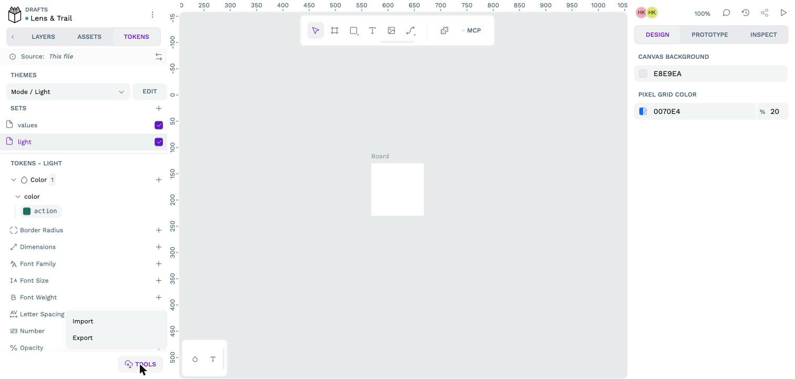
*Figure 4.9: Import and Export are under Tools.*

*Figure 4.10: Importing replaces every token, set and theme in the file.*

*Figure 4.11: The club's tokens, imported. Scroll the Sets list to see all five sets.*

The **Themes** menu says *2 active themes*. Open it, and you'll see why: one theme from each group is on, *Light* and *Phone*. Choosing *Dark* switches *Light* off, because they're in the same group, and leaves *Phone* alone.

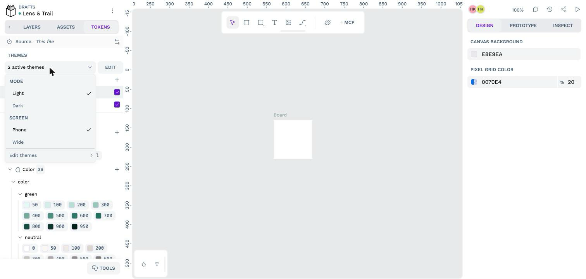
*Figure 4.12: One theme from each group.*

> **Try it:** Choose **Dark** in the Themes menu, and watch the checkboxes in the Sets list: `light` goes off, `dark` comes on. Click the `dark` set (scroll the list to find it), right-click `action` in the token list, and choose **Edit token**. Which value does it refer to? Click **Cancel**, and compare it with `action` in the `light` set. Then choose **Light** again. Every color in the club's design changes like this between the modes, which is why the theme's CSS only ever uses the roles.

## The club's fonts in Penpot

The club's two fonts are already in Penpot. It offers the whole Google Fonts collection, and Bricolage Grotesque and Atkinson Hyperlegible Next are both in it, under the same open license as the copies in the book's `design/fonts/` folder. The `font.family.heading` and `font.family.body` tokens name them, and Penpot finds them by those names, so there's nothing to install.

We did try uploading our own copies first, because the themes will use those files and it would be nice if the design used the very same ones. Penpot has a page for that (on the dashboard, **Fonts** under **Sources**), and it takes TTF files like ours. But our fonts are **variable** fonts, all their weights in one file (Chapter 3), and Penpot read each file as a single style, *Regular*, without even a family name. So in Penpot, the club uses Penpot's copies, in seven weights from 200 to 800; Atkinson Hyperlegible Next has italics, too. What Penpot's copy of Bricolage Grotesque doesn't have is the width and optical size axes. The design doesn't need them: the browser uses them in the themes, where our own files are.

![Penpot's Fonts page after choosing BricolageGrotesque[opsz,wdth,wght].ttf: one font added, shown as Regular, with an empty space where the family name should be, and Upload and Dismiss buttons](images/04-font-upload-variable.png)
*Figure 4.13: Penpot reads a variable font as one style without a name. We clicked Dismiss all, and uploaded nothing.*

## The hike card

Now the tokens get used. The first thing we draw is the **hike card** from Chapter 3: the photo, the date, the title, the badges, a teaser and the area. It's the club's most used piece (the front page, the hikes list, the sidebar and the archive all show hikes as cards), so it becomes a **component**: a piece drawn once and reused everywhere, where a change to the original changes every copy. That's the same idea as the Drupal components we'll build later in the book, and the card in Penpot is their blueprint.

### A page for components

A Penpot file can have several **pages**, like a sketchbook. The club's file will have one for components and one for each group of wireframes.

1. In the left panel, click **Layers**. At the top is the list of **Pages**, with one page, named after the file.
2. Double-click the page's name, type `Components` and press **Enter**.

### A board with a layout

Everything on a Penpot page sits on a **board**: a frame with a size, like an artboard in other tools. A board can arrange what's inside it with a **layout**, and a **flex layout** is the same idea as CSS flexbox: the things inside it go in a row or a column, with a gap between them, and the board can grow to fit them. Drawing with flex layouts is a little slower than placing things by hand, but it's how the card will behave in the browser, so what you see in Penpot is close to what you'll get.

1. In the toolbar at the top of the canvas, click the **Board** tool (the square with corner marks), or press **B**.
2. Drag a board on the canvas. Then, in the **Design** panel on the right, set **W** to `328` and **H** to `450`. 328 pixels is a 360-pixel phone minus the page's side margins (`space.s`, 16 pixels on each side). The height doesn't matter, because the card will soon fit its content.
3. In the **Layers** list, double-click the board's name, and name it `Hike card`.
4. In the **Design** panel, click **+** next to **Layout**, and choose **Flex layout**. Then click the downward arrow in the layout's direction buttons, so the things inside go in a **column**.

### The photo

The card's photo is Book 1's photo of the hike: Turnhouse Hill across Glencorse Reservoir, by dave souza, under CC BY-SA 4.0. It's in Book 1's repository as `examples/photos/turnhouse-hill-glencorse.jpg`.

1. With the card selected, click the **Image** tool in the toolbar (or press **Shift+K**), and choose the photo. Penpot puts it inside the card, at its full size, which is much too big.
2. In the **Design** panel, click the lock next to **W** and **H**, so the two can change separately. Then set **W** to `328` and **H** to `219`: the club's 3:2 shape (Chapter 3). Penpot crops the photo to fill the shape rather than squashing it.
3. Name the layer `Photo`.

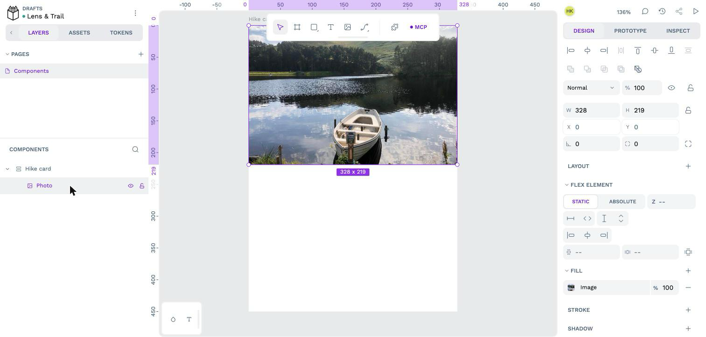
*Figure 4.14: The photo, cropped to 3:2.*

### The text, and its spacing

Below the photo, the card's text needs some space around it and between its lines. That's a second board inside the card, with a layout of its own.

1. Choose the **Board** tool again, and drag a board inside the card, below the photo. Penpot puts it in the card's layout, after the photo. Name it `Body`.
2. Give it a **Flex layout** too, in a **column**.
3. Under **Flex element** in the **Design** panel, set its width to **Fill** (the arrows pointing outwards), so it's always as wide as the card, and its height to **Fit content**.

Now the spacing, from the tokens. In the club's design, the inside of a card has `space.s` (16 pixels) around it and `space.2xs` (8 pixels) between its parts.

1. With `Body` selected, open the **Tokens** tab and click the `values` set, to see its tokens.
2. Under **Spacing**, **right-click** `s`. Penpot shows everything a spacing token can be used for: gaps, paddings and margins.
3. Under **Paddings**, choose **All**.
4. Right-click `2xs`, and choose **Row Gap**.

*Figure 4.15: Right-click a token to choose what it's used for.*

In the **Design** panel, the padding and the gap now show their values in a little outlined box: that's Penpot's sign that the value comes from a token. Hover over a token in the Tokens tab, and Penpot shows its name, its value, and its resolved value.

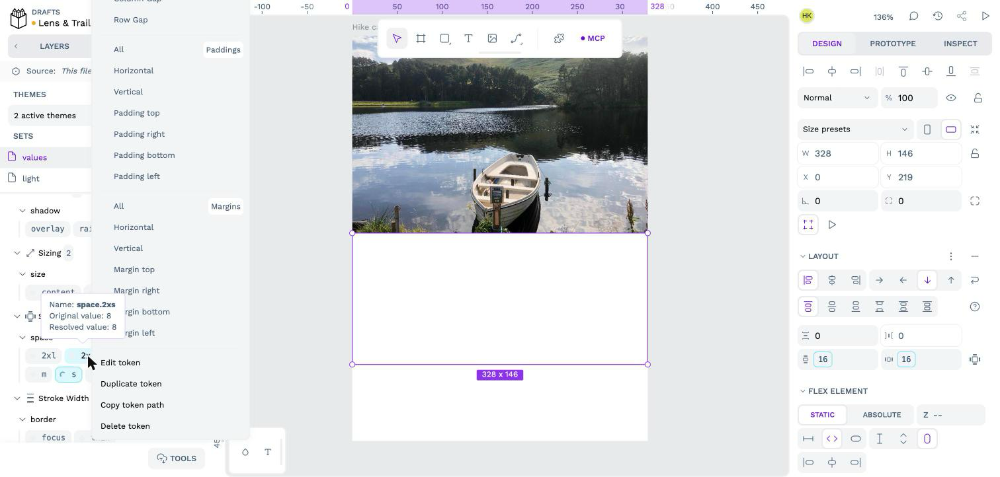
*Figure 4.16: The paddings come from `space.s`. A value from a token is outlined.*

Now the first piece of text, the date:

1. Choose the **Text** tool (**T**), and drag a text box inside `Body`. Wait for the blinking cursor before you type.
2. Type `Sat 21 November · 9:30`, then press **Escape**. Name the layer `Date`.
3. With the text selected, apply its tokens by **clicking** them (a click uses a token for the most likely property, and for a font token on a text, that's the font):
   - in the `values` set: `font.family.body` and `font.weight.bold`;
   - in the `light` set: right-click `color.muted` and choose **Fill** (a text's color is its fill);
   - in the `phone` set: `font.size.step--1`.

> **Watch the number keys.** With something selected on the canvas, Penpot reads the number keys as a shortcut for opacity: **2** makes it 20% opaque, **5** 50%, **0** 100%. If you start typing a date before the text box is ready, the board you're in may turn pale. It happened to us. If something looks faded, look at the **%** next to **Normal** at the top of the **Design** panel.

The other texts are made the same way, each with a font, a size, a weight and a color from the tokens:

| Layer | Text | Font | Size | Weight | Color |
|---|---|---|---|---|---|
| `Date` | Sat 21 November · 9:30 | `font.family.body` | `step--1` | `bold` | `color.muted` |
| `Title` | Turnhouse Hill and Carnethy Hill | `font.family.heading` | `step-2` | `semibold` | `color.text` |
| `Teaser` | Two summits of the Pentlands from Flotterstone car park. | `font.family.body` | `step--1` | `regular` | `color.muted` |
| `Area` | Turnhouse Hill | `font.family.body` | `step--1` | `bold` | `color.muted` |

Set each text's width to **Fill** under **Flex element**, so long titles wrap inside the card instead of running out of it.

The two **badges** (difficulty and distance) are small boards of their own: a text in a board with a flex layout, a `color.tint` fill, `color.on-tint` text, a `radius.round` corner, `space.xs` padding at the sides and `space.3xs` at the top and bottom. Both go in a board called `Badges`, a row with a `space.2xs` gap, between the title and the teaser. To put a text in a board of its own, select it, right-click, and choose **Selection to board**.

Last, the card itself: a `color.surface` fill, a `border.thin` stroke in `color.border` (right-click the color token and choose **Stroke**), a `radius.medium` corner, **Clip content** on, so the photo's corners are rounded too, and its height set to **Fit content**, so it's always as tall as what's in it.

%% Author: the steps up to the date were done by hand in Penpot, as written. The rest of the card (title, badges, teaser, area, and the card's own fill, stroke, corner and clipping) was built through Penpot's MCP server with the same properties and tokens; walk them by hand once more before the chapter is final, to check the clicks. The difficulty icon is "▲▲" in text for now; the Lucide icon comes with the icons. Chapter 3 says a photo's credit is shown even on a card, but its card figure has none: where does the credit go on the card (over the photo's corner, or in small type under it)? %%

*Figure 4.17: The hike card. Every color, size and space in it is a token.*

### A component, and a variant

1. Select the `Hike card` board in the **Layers** list.
2. Press **Ctrl+K** (**Cmd+K** on a Mac).

The board's icon in the Layers list changes to a diamond, and the **Design** panel gets a **Component** section that says *Main*: this is the **main component**, the original. Copies of it, which Penpot calls **instances**, follow every change you make here. You'll find the component in the **Assets** tab, ready to drag onto the wireframes.

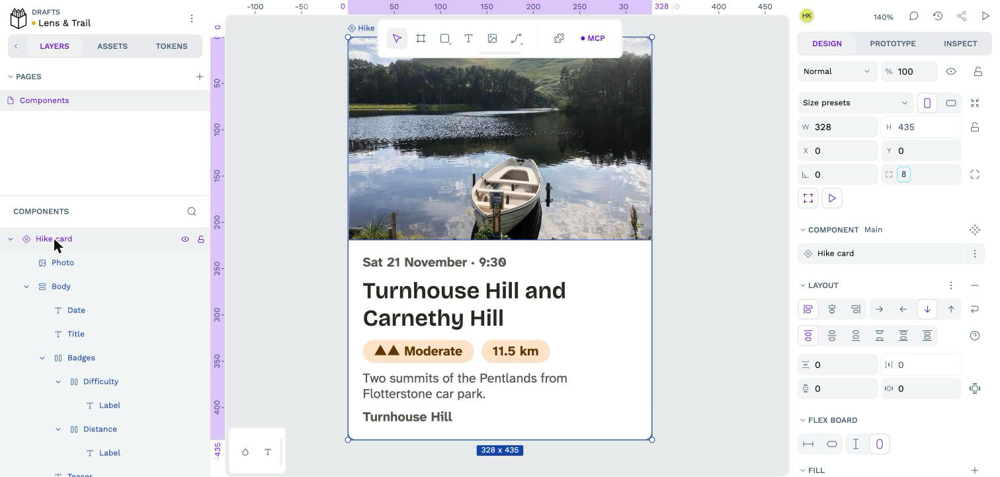
*Figure 4.18: The card is now a component.*

Chapter 3 gave the card two layouts: the photo on top in a narrow space, and the photo beside the text when the card's container is at least 30 rem (480 pixels) wide. In Penpot, two versions of a component are **variants**.

1. In the **Component** section, click the menu (**⋮**) next to the component's name, and choose **Create variant**.

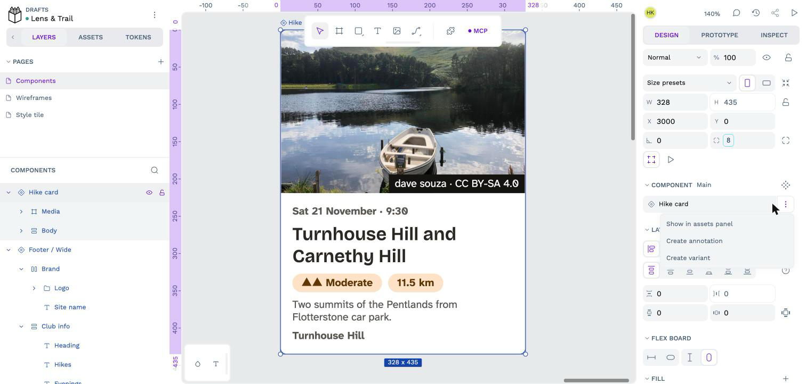
*Figure 4.19: Creating a variant.*

Penpot puts the card and a copy of it in a new board with a purple outline, the **variant group**, and gives the copy a property: *Property 1*, with the value *Value 2*.

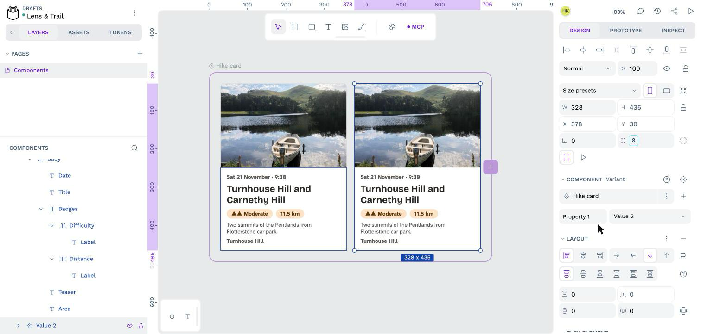
*Figure 4.20: Two variants, not different yet.*

2. Rename the property to `Layout`, and give the two variants the values `Photo on top` and `Photo beside`.
3. Make the second one different: select it, set its layout's direction to a **row**, its width to `600`, and its photo to `240` by `160` (3:2 again).

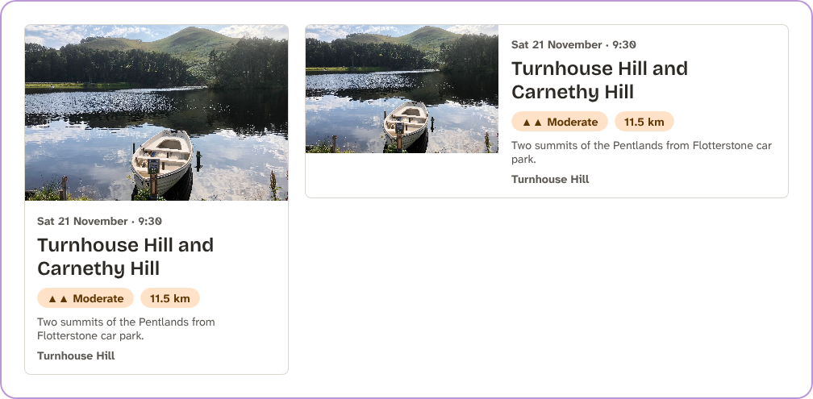
*Figure 4.21: The hike card's two variants, Photo on top and Photo beside.*

> **Try it:** Choose **Dark** in the Themes menu, and look at the card. Nothing in it was drawn twice: every color is a role, and the roles point at the dark values now.

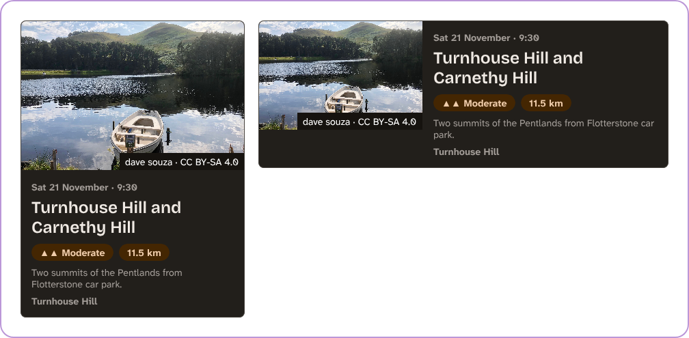
*Figure 4.22: The same card with the Dark theme. That's what the two tiers of tokens are for.*

## The hike page on a phone

The card is a part. A **wireframe** is a whole page, and the first one is the page a member opens most: a hike, on a phone, on the morning of the walk. Chapter 3 drew it in grey (Figure 3.13); now it gets the club's tokens, the card's photo, and a button.

### A page for wireframes

1. In the **Layers** tab, click **+** next to **Pages**. Penpot adds *Page 1*. Double-click it and name it `Wireframes`.
2. Choose the **Board** tool (**B**) and drag a board on the canvas. Its size doesn't matter yet.
3. In the **Design** panel, open **Size presets**. Penpot has the sizes of many phones, tablets and screens; type `Mini` in the search box and choose **iPhone 12 Mini**, which is 360 by 780 pixels. The search looks at the names, not the sizes, so typing `360` finds nothing.

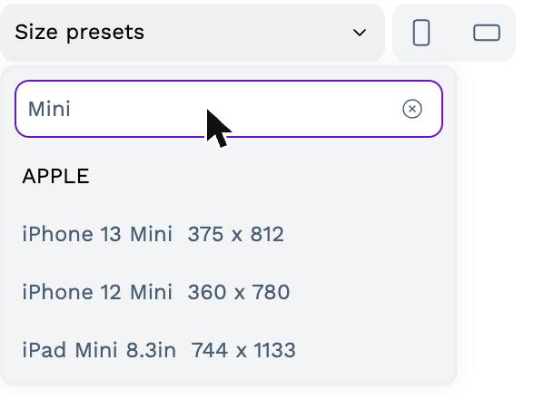
*Figure 4.23: A board the size of a small phone. Chapter 3 designs for 360 pixels wide.*

4. Name the board `Hike page, phone`.
5. Give it a **Flex layout** in a **column**, like the card.
6. With the board selected, open the **Tokens** tab, click the `light` set and click `color.background`: the page gets the club's warm off-white. Then, in the `values` set, right-click `space.s` and choose **Paddings → All**, and right-click it again and choose **Row Gap**.

The height of 780 pixels is a phone's screen, but a page is as long as its content. Once there's something in the board, Penpot makes it taller to fit, because a board with a layout fits its content unless you give it a fixed height.

### The key facts, in a grid

The four key facts sit in two columns and two rows. That's a job for Penpot's other layout, the **grid layout**: the same idea as CSS grid, which is how the theme will build it too.

1. Choose the **Board** tool and drag a board inside the page. Name it `Key facts`.
2. In the **Design** panel, remove its white **Fill** with the **−** next to it, and set its width to **Fill** under **Flex element**, so it's as wide as the page's content.
3. Click **+** next to **Layout** and choose **Grid layout**. Penpot draws two columns and two rows in pink: a 2-by-2 grid is what you get by default, and that's what the facts need.
4. Open the **Tokens** tab and right-click `space.2xs`. Under **Gaps**, choose **All**, for 8 pixels between the facts in both directions.

> **Click in the Layers list.** A click on the canvas selects the outermost board under the pointer. To select a board inside another one, click its name in the **Layers** list.

The grid's rows are still **1fr** each: equal shares of the board's height. A fact's height should come from its text, so:

1. Click **Edit grid** in the **Layout** section.
2. Click **Rows 2** to show the two rows, and change each one from **FR** to **AUTO**.
3. Click **Done** at the top of the canvas.

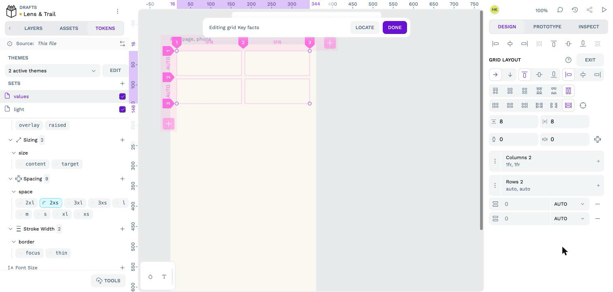
*Figure 4.24: Editing the grid. Two equal columns, and rows as tall as what's in them.*

Each fact is a small board in one of the grid's cells, with a label and a value:

| Part | Font | Size | Weight | Color |
|---|---|---|---|---|
| The fact's board | | | | `color.surface` fill, `border.thin` in `color.border`, `radius.small`, `space.xs` padding, `space.3xs` row gap |
| `Label` (Meeting place) | `font.family.body` | `step--1` | `regular` | `color.muted` |
| `Value` (Flotterstone car park) | `font.family.body` | `step-0` | `bold` | `color.text` |

Make one, then select it and press **Ctrl+D** (**Cmd+D** on a Mac) three times: in a grid, each copy goes in the next empty cell. (Once the grid is full, Penpot makes room for another copy by adding a column. If that happens, press **Ctrl+Z** to undo it.) Change the copies' texts to *Distance: 11.5 km*, *Difficulty: Moderate* and *Area: Turnhouse Hill*. Set each fact's height to **Fill**, so the two facts in a row are the same height even when *Flotterstone car park* wraps onto two lines.

### A button from the Components page

The page has one button, **Directions**. The club's sites will have more buttons, all the same shape, so the button is a component, like the card. It's on the `Components` page as `Button`: a board with a flex layout, a `color.action` fill, a `radius.small` corner, `space.m` padding at the sides and `space.xs` at the top and bottom, and a label in `font.family.body`, `step-0`, `bold`, `color.on-action`. It's 45 pixels high, so it's above the 44-pixel tap target (`size.target`) from Chapter 3.

To use it on the hike page:

1. Open the **Assets** tab, and open **Components**. The button and the hike card are there, as pictures.
2. Drag the button onto the hike page.
3. In the **Layers** list, drag it to directly below `Key facts`. (Where you drop it on the canvas, Penpot puts it inside the board under the pointer, and that may be the map's board rather than the page. The Layers list is the reliable way to put it in the right place.)
4. Under **Flex element**, set its width to **Fill**: on a phone, the one button of the page is as wide as the page.
5. Name the layer `Directions`.

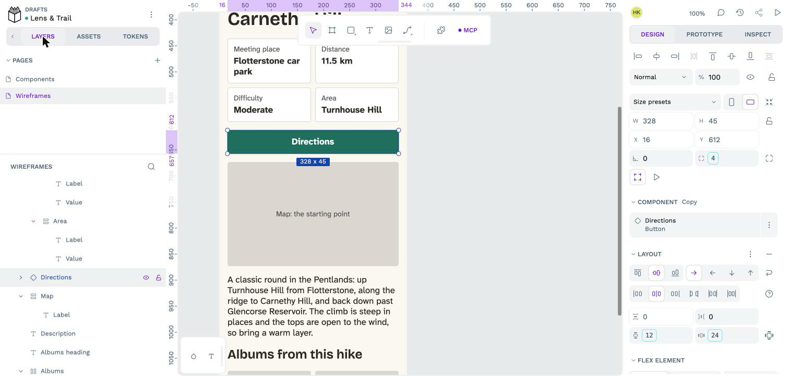
*Figure 4.25: A copy of the button. The **Component** section says it's a **Copy** of **Button**.*

That copy is an **instance**. Change the main `Button` on the `Components` page (a bigger corner, say), and every copy of it changes too, on every page. You can change a copy's text without breaking that link: Penpot keeps the change, and takes everything else from the main component.

### The rest of the page

Everything else on the page is a text, a photo or a box you already know how to make. From the top:

| Layer | What it is | Tokens |
|---|---|---|
| `Header` | A board in a **row**, with **Justify** set to space between: the site name and the menu button | |
| `Site name` | *Lens & Trail* | `font.family.heading`, `step-1`, `bold`, `color.text` |
| `Menu button` | A board with the text *Menu*, 44 pixels high | `size.target` height, `color.surface` fill, `border.thin` in `color.border`, `radius.small` |
| `Photo and credit` | A board in a column with the photo, at 16:9 (328 by 185), and its credit | `space.3xs` row gap, `radius.small` on the photo |
| `Credit` | *Photo: dave souza · CC BY-SA 4.0* | `font.family.body`, `step--1`, `regular`, `color.muted` |
| `Date` | *Saturday 21 November · 9:30* | `font.family.body`, `step-0`, `bold`, `color.muted` |
| `Title` | *Turnhouse Hill and Carnethy Hill* | `font.family.heading`, `step-4`, `semibold`, `color.text` |
| `Key facts` and `Directions` | From the last two sections | |
| `Map` | A board, 200 pixels high, with the text *Map: the starting point* in the middle | `color.border` fill, `radius.small` |
| `Description` | A paragraph about the walk | `font.family.body`, `step-0`, `regular`, `color.text` |
| `Albums heading` | *Albums from this hike* | `font.family.heading`, `step-2`, `semibold`, `color.text` |
| `Albums` | A board in a **row**, with two square photos, 160 by 160 | `space.2xs` column gap, `radius.small` on the photos |

The map stays a grey box: it's a placeholder for something the theme builds later in the book, and a wireframe only has to say where it goes. The two album photos are Book 1's *Carnethy Hill from Turnhouse Hill* by Jim Barton and *Carnethy Hill views* by Alan O'Dowd, both under CC BY-SA 2.0.

*Figure 4.26: The hike page on a phone, with the club's tokens.*

> **Try it:** Choose **Dark** in the Themes menu again. The page, the facts, the button and the map all change, because every color on the page is a role. The Directions button turns light green with dark text: that's `color.action` and `color.on-action` in the `dark` set, chosen in Chapter 3 to keep their contrast.

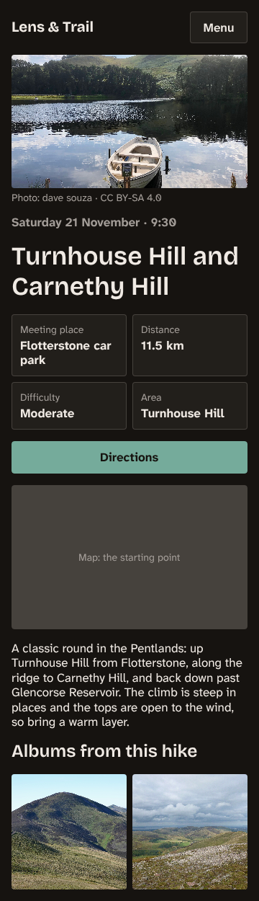
*Figure 4.27: The hike page with the Dark theme.*

%% Author: done by hand in Penpot, as written: the Wireframes page, the board from the iPhone 12 Mini preset, its layout, fill, padding and gap, the Key facts board with its grid layout, row gap and auto rows, and dragging the button from Assets. Done through the MCP server with the same tokens: the column gap of Key facts (the token menu was too tall for the screen: its top, with Gaps → All, was cut off; check how a reader on a laptop gets to it), the four facts, the Button main component, and the rest of the page. Checked by hand: Ctrl+D in a full grid adds a third column; Ctrl+D into an empty cell wasn't tried (the grid was already full). Figures 4.26 and 4.27 are exported at 1x (360 pixels wide) and could use a 2x export for print. The card's photo credit is still open (over the photo's corner, or under it); the card has none yet. %%

%% Author: next sections (to come): the other wireframes, exporting `design/tokens.json` and the Penpot file. %%
