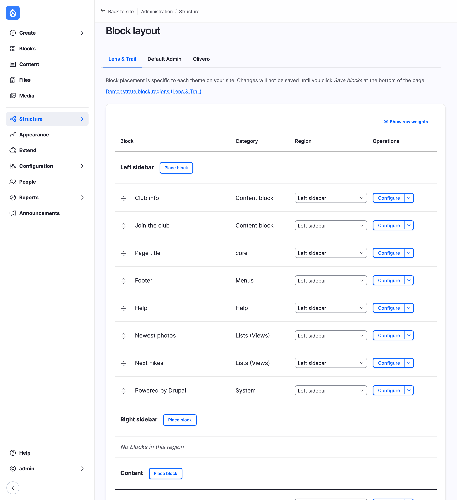
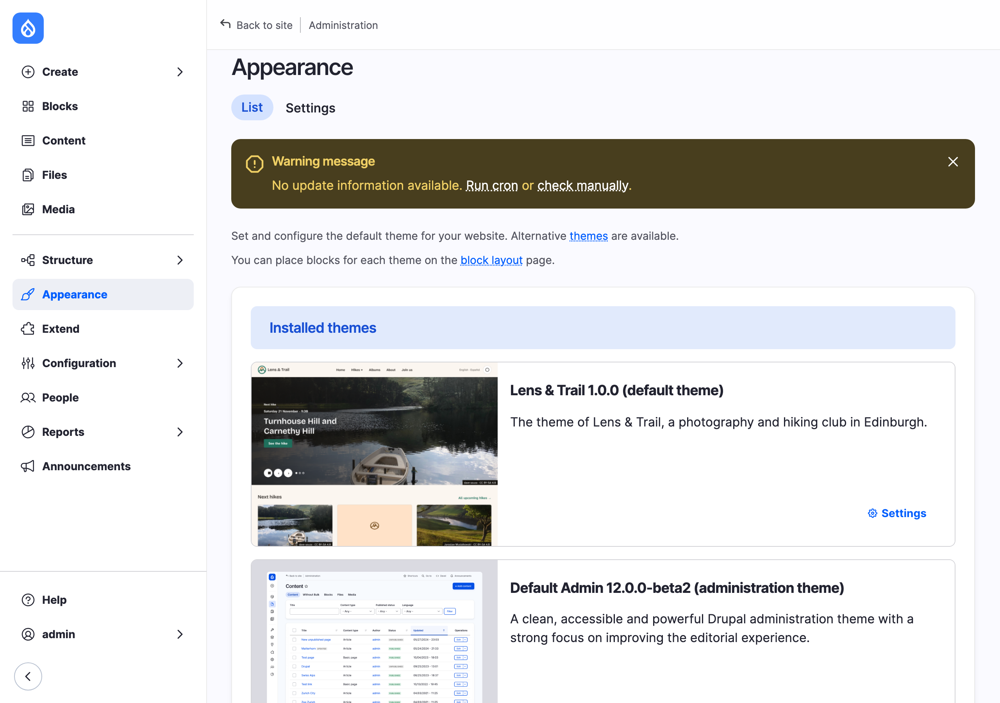
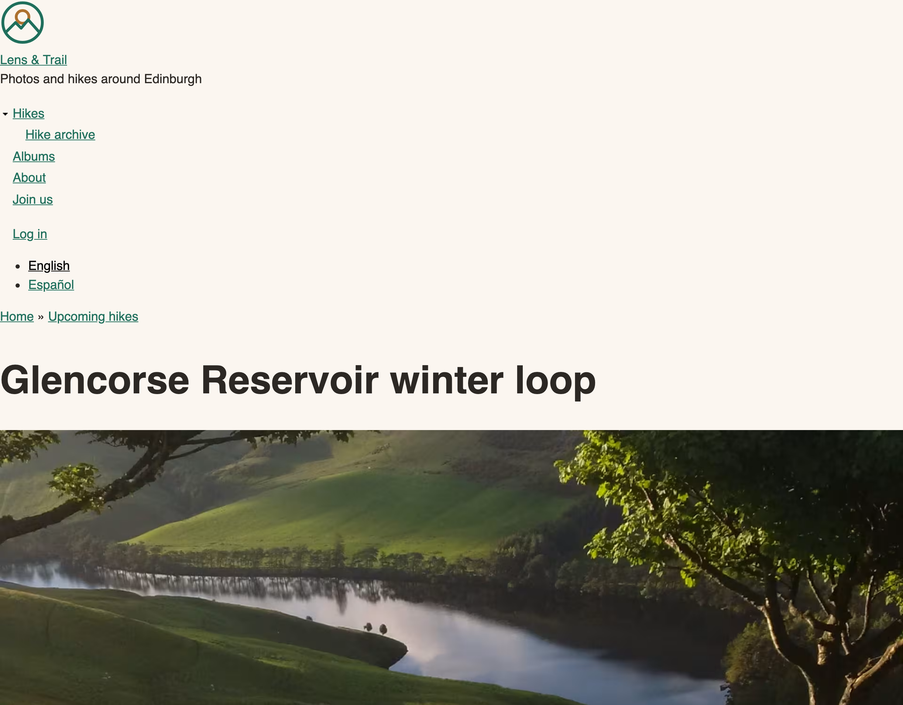
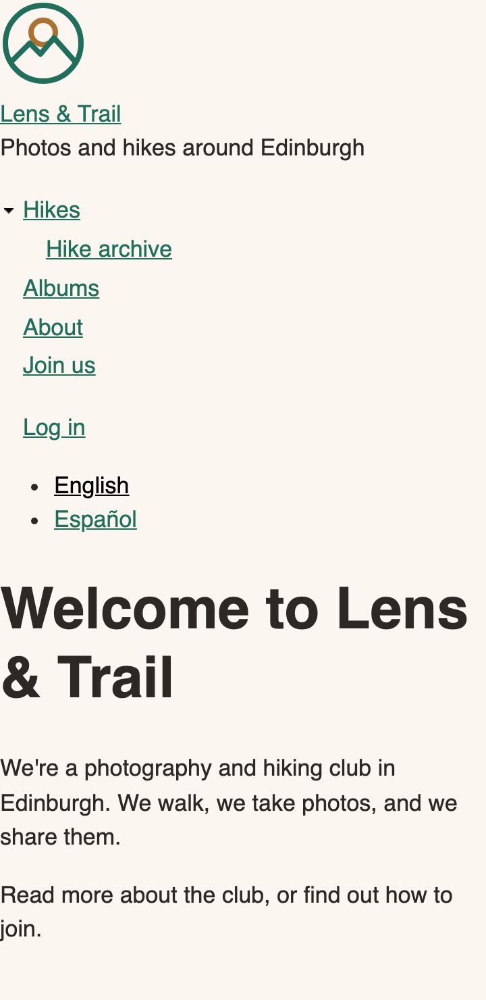
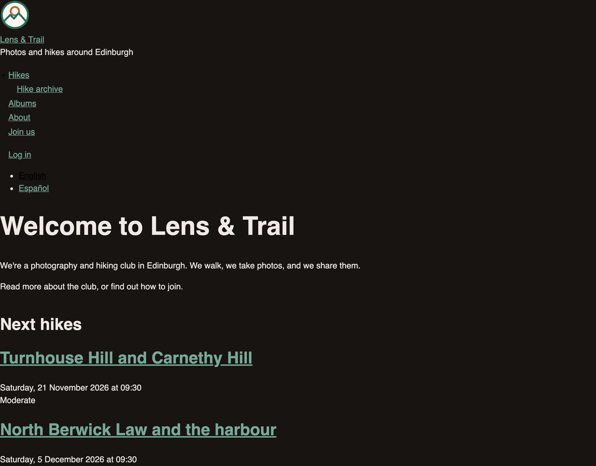

# Generating the Core Site's Theme

The club's design is finished: Chapter 3 made the decisions, and Chapter 4 put them in Penpot and exported them as `design/tokens.json`. Now it's time for code. This chapter gives the core site a theme of its own, `lens_trail`, and the next chapter does the same for the Drupal CMS site.

On the core site, the theme comes from **Starterkit**, a theme in Drupal core that exists only to be copied. One command makes a new theme from it, with every file you need to start, and the copy is yours: nothing in core will change it afterward. We'll look at every part of what that command made, switch the site over from Olivero, and see what the site looks like with a theme that has (almost) no style of its own. That's a sobering sight, and a useful one: from here, every line of style on the site is one the club chose.

Then we'll do two things to make the theme the club's own. We'll remove the files we don't need, because a file in your theme is a file you look after. And we'll write a small Python script, `tokens.py`, that turns the design tokens from Penpot into CSS, so the theme's colors, fonts and sizes come straight from the design. The script is shared by both sites: the next chapter teaches it a second trick for the Drupal CMS site.

The site starts where Book 1 left it: Drupal {{ number:drupal_12_version }}, with Olivero as its theme. Olivero isn't part of core in Drupal 12 any more; Book 1's site installs it from drupal.org, like any other contributed theme.

%% Author: drafted 2026-11-08 on feature/chapter-05-themes. Chapter 5 was split in two (the author, 2026-11-08): this chapter is the core site, the next one the Drupal CMS site. The author's choices: show the bare Starterkit theme first ("we start with a clean slate"); remove the 21 templates that are the same as core's, keep the other 55 until the CSS chapter. %%


*Figure 5.1: The hike page in Olivero, as Book 1 left it.*

## Generating the theme

Starterkit is in core, in `core/themes/starterkit_theme`. It's hidden: you won't find it on the **Appearance** page, because it isn't meant to be used as a theme. You make a theme *from* it, with a command:

```bash
ddev exec vendor/bin/dr generate-theme lens_trail --name "Lens & Trail" --description "The theme of Lens & Trail, a photography and hiking club in Edinburgh." --path web/themes/custom
```

Run it in the core site's folder. Piece by piece:

- `ddev exec` runs the command inside the site's web container, where the right PHP version is.
- `vendor/bin/dr` is Drupal's own command-line tool. It's not Drush: it's a small tool that comes with core, for a handful of jobs such as installing a site, clearing the cache, and generating a theme. Run `ddev exec vendor/bin/dr list` to see them all.
- `generate-theme lens_trail` makes a theme with the machine name `lens_trail`. A machine name is the name Drupal uses in code and in file names: lowercase letters, numbers and underscores, and it can't start with a number. Choose it carefully, because changing it later means renaming every file and everything that refers to it.
- `--name` and `--description` are what the **Appearance** page shows.
- `--path web/themes/custom` is where the theme goes. Themes you write live in `themes/custom`; themes you download from drupal.org go in `themes/contrib`, where Composer puts them.

```
Generating theme Lens & Trail (lens_trail) from starterkit_theme starterkit.
Theme generated successfully to web/themes/custom/lens_trail
```

> **Older tutorials use `php core/scripts/drupal generate-theme`.** That script still works, but it's deprecated since Drupal 11.4 and goes in Drupal 13: the `dr` tool replaces it. If you see `core/scripts/drupal` in a tutorial, the options are the same. The `dr` tool is new, and drupal.org still calls it experimental, so its list of commands may grow.

> **Drupalism:** **Starterkit** isn't a *base theme*. A base theme is a theme that other themes inherit from: they name it as their `base theme`, and they get its templates, CSS and settings, and every change to it, for as long as they run. A starterkit is copied once, and that's the end of the relationship. The difference matters in two or three years: a theme that inherits from a base theme can break when the base theme changes, and a generated theme can't, because it doesn't use Starterkit at all after the copy. Chapter 2 compared the two approaches.

## What Starterkit made

The command made 142 files in `web/themes/custom/lens_trail`. Most of them are copies of core's own files, and only a few are new:

| Path | What it is |
|---|---|
| `lens_trail.info.yml` | The theme's ID card: its name, its type, and what it needs. Without it, Drupal doesn't know the folder is a theme. |
| `lens_trail.libraries.yml` | The theme's **libraries**: its CSS and JavaScript files, in groups Drupal can add to a page. |
| `src/Hook/LensTrailHooks.php` | PHP code that changes what Drupal gives a template. Starterkit's does one small job for the image upload field. |
| `css/components/` | 31 small CSS files for Drupal's own interface: tabs, messages, pagers, forms, dropbuttons. |
| `templates/` | 81 **Twig templates**, in 11 folders: the HTML of pages, regions, blocks, nodes, fields, forms, menus and views. |
| `images/icons/` | 24 icons that the CSS uses: file types, warnings, the menu arrows. |
| `logo.svg` | The logo the site shows if you haven't uploaded one. A Drupal drop, for now. |
| `screenshot.png` | The picture on the **Appearance** page. |
| `README.md` | One line, saying where the theme came from. |

### The info file

<!-- include: code/chapter05/steps/01-generate/core/lens_trail/lens_trail.info.yml -->

Line by line:

- `name`, `description`: what the **Appearance** page shows. The `&` in the name needs the quotes, so Starterkit added them.
- `type: theme`: an info file can also describe a module or a profile.
- `'base theme': false`: the theme inherits from nothing. Every template and every line of CSS it uses comes from the theme itself or from core's modules.
- `version: 1.0.0`: the theme's own version. It's yours to change when you release a new version of the theme.
- `libraries`: the libraries on every page. `lens_trail/base` and `lens_trail/messages` are in the theme's own `lens_trail.libraries.yml`; `core/normalize` is core's copy of normalize.css, which irons out the differences between browsers.
- `libraries-extend`: "whenever Drupal uses this library, add mine too". When a page uses core's dropbutton, for example, the theme's dropbutton CSS comes along.
- `core_version_requirement: ^12`: the Drupal versions the theme works on. Starterkit writes the version it was generated on. The core site runs Drupal 12, so `^12` is right; a theme for both Drupal 11 and 12 would say `^11.3 || ^12`.
- `generator`: which starterkit made the theme, and on which version of Drupal. It's for you, years later, when you wonder what your theme was copied from.

Two things aren't there. There's no `regions` key, so the theme gets Drupal's default regions: **Header**, **Primary menu**, **Secondary menu**, **Highlighted**, **Breadcrumb**, **Help**, **Content**, **Left sidebar**, **Right sidebar** and **Footer** (and two hidden ones, **Page top** and **Page bottom**, for things like the toolbar). The chapter on regions gives the club's theme its own. And there's no `logo` key: a theme's logo is `logo.svg` in its folder unless the info file says otherwise.

### The libraries

`lens_trail.libraries.yml` is 110 lines long. The first library, `base`, is the one on every page:

<!-- include: code/chapter05/steps/01-generate/core/lens_trail/lens_trail.libraries.yml key=base -->

Each CSS file has a **category** (`component` here) and a **weight**: Drupal sorts a page's CSS by category first (base, layout, component, state, theme), then by weight. `version: VERSION` means "the Drupal version", which Drupal adds to the files' addresses so browsers fetch them again after an update. `aggregate_target: css: true` asks Drupal to put these files in their own aggregate, the file Drupal combines a page's CSS into. The chapter on libraries explains all of this; for now, it's enough to know where the theme's CSS is listed.

### The hooks class

<!-- include: code/chapter05/steps/01-generate/core/lens_trail/src/Hook/LensTrailHooks.php -->

A **hook** is a function Drupal calls at a certain moment, so a module or a theme can change what happens. This one runs before the image upload widget is drawn, and removes the preview when the visitor isn't allowed to see it. A theme writes its hooks as methods in a class like this one, with a `#[Hook]` attribute naming the hook. Older themes put them in a `lens_trail.theme` file, as functions: you'll see that in many tutorials, but the `.theme` file is deprecated since Drupal 11.5. The chapter on preprocess functions comes back to this. (The `@file` comment inside the class is a small leftover from Starterkit's older `.theme` file. It does no harm.)

### The templates

Twig templates are the theme's HTML. Each one draws one thing: `node.html.twig` a piece of content, `field.html.twig` a field, `page.html.twig` the whole page between `<body>` and `</body>`. When a theme has a template with the same name as one of core's, Drupal uses the theme's. That's called **overriding** the template.

Starterkit copies 81 of them, and that's worth a pause. Every template in your theme is a copy you now own: when core fixes a bug or an accessibility problem in its version, your copy doesn't get the fix. Starterkit does it on purpose: it gives you a snapshot of core's markup, with the classes its CSS needs, so that a core update never changes your theme's HTML behind your back. That's a real benefit. But a template you never change is a copy with all the cost and none of the benefit, and we'll come back to that in a moment.

## Switching the site over

1. Go to **Appearance** (`/admin/appearance`). Under **Uninstalled themes**, you'll find **Lens & Trail 1.0.0**, with the description you gave it, and a screenshot that still says *Classy*: Starterkit's screenshot was made for a theme core removed years ago.
2. Click **Install and set as default** under Lens & Trail.


*Figure 5.2: The new theme on the Appearance page, before it's installed.*

Drupal installs the theme and makes it the **default theme**, the one visitors see. The administration pages keep their own theme (**Default Admin**, in Drupal 12), so nothing changes when you're editing content. If you prefer the command line: `ddev drush theme:install lens_trail`, then `ddev drush config:set system.theme default lens_trail`.

### The blocks

Book 1's Chapter 14 placed the club's blocks in Olivero's regions, and Book 1's Chapter 16 showed what happens to them when a site gets a new theme: Drupal copies the default theme's block placements to the new theme. A block whose region exists in the new theme goes into the region with the same name. A block whose region doesn't exist goes into the new theme's first region, to be moved by hand.

Go to **Structure** > **Block layout**. The **Lens & Trail** tab is selected, because it's the default theme now.


*Figure 5.3: Every block from a region Olivero has and Lens & Trail doesn't ended up in the first region, Left sidebar.*

The main menu, the account menu, the language switcher, the branding, the breadcrumbs, the messages and the content found regions with the same name. Eight blocks didn't: Olivero's **Content Above**, **Sidebar**, **Footer Top** and **Footer Bottom** regions don't exist in Lens & Trail, so their blocks all went to **Left sidebar**, the page title among them. Move them for now:

| Block | Region |
|---|---|
| Page title | Content, at the top (drag it above Main page content) |
| Help | Help |
| Join the club, Next hikes | Right sidebar |
| Newest photos, Club info, Footer, Powered by Drupal | Footer |

Then click **Save blocks** at the bottom of the page. These regions are a stopgap: the chapter on regions gives the theme the regions from the club's wireframes, and the blocks move once more.

## A clean slate

Now open the hike page again, and the front page.


*Figure 5.4: The same hike page in Lens & Trail, straight from Starterkit.*

This is what a page looks like with almost no style at all: the browser's own defaults, Times-like serif type, blue underlined links, and photos at the size their HTML gives them. The hike's photo says `width="1280"`, so it's 1280 pixels wide whatever the window: on a phone, it's four times wider than the screen. Starterkit's 31 CSS files are there, but they only style Drupal's interface (tabs, messages, forms), not the content.


*Figure 5.5: The front page, with no style of its own.*

It's not pretty, but look at what *is* there: every block, every link, every heading, in a sensible order. That's Book 1's site building, and the HTML Drupal writes, doing their job. A page that makes sense without CSS is a page that works for a screen reader, for a search engine, and for a visitor on a slow connection whose CSS hasn't arrived yet. Everything from here on is presentation, and every line of it will be one the club chose.

> **Try it:** Use the site with the keyboard only: press **Tab** to move from link to link, and **Enter** to follow one. Every link is reachable, in the order you see them, and the browser shows where you are with its own focus ring. Our CSS must keep it that way: the club's design has its own focus ring (Chapter 3), and we'll check it in every chapter that adds style.

## Making it the club's

Two of Starterkit's files are placeholders: the logo and the screenshot.

**The logo.** Copy the club's logo from the book's `design/` folder over the theme's:

```bash
cp design/logo.svg web/themes/custom/lens_trail/logo.svg
```

(Run it from wherever you keep the book's files, or download `design/logo.svg` from the book's repository.) In Book 1, the club uploaded its logo in Olivero's settings, so Olivero had it and the new theme didn't. A logo in the theme's folder is the theme's default, and it's in version control with the rest of the theme, so it's the better place for a logo that's part of the design. Chapter 3 redrew the mark on a cream disc of its own, so it shows on light pages, on dark pages, and in forced colors mode.

**The screenshot.** The screenshot is a PNG, 588 by 438 pixels, named `screenshot.png`. Ours is the top of the front-page wireframe from Chapter 4, `design/wireframes/front-page-wide.png`, scaled down. Any image editor can do it: crop the wireframe to the top 1280 by 954 pixels, and scale it to 588 by 438. Or use ours, from `code/chapter05/steps/02-logo/core/lens_trail/screenshot.png`.

The screenshot is the theme as it *will* look, not as it looks today, and that's fine: it's what the theme is for.


*Figure 5.6: The theme with the club's screenshot. The logo is in the header of every page now too.*

## Fewer templates

Back to the 81 templates. The club's rule for this book, from the first chapter, is to override as little as possible: every template a theme owns is a template that doesn't get core's fixes. So which of Starterkit's templates is the club really using?

We compared each one with the core template it replaces, ignoring the comments. 21 are **the same as core's**, line for line. They change nothing: the page is exactly the same with them or without them. 55 are different, mostly because they add classes that Starterkit's CSS uses, such as `messages--status` or `field--label-inline`. Five have no template of the same name in core: they're more specific versions, such as `field--text.html.twig` for text fields.

The 21 identical ones can go. Delete these files from `web/themes/custom/lens_trail/templates/`:

| Folder | Templates |
|---|---|
| `content-edit` | `file-upload-help`, `file-widget-multiple` |
| `field` | `image-formatter`, `image-style` |
| `form` | `checkboxes`, `confirm-form`, `container`, `dropbutton-wrapper`, `field-multiple-value-form`, `form-element-label`, `form`, `input`, `select` |
| `layout` | `page` |
| `navigation` | `links`, `menu-local-action`, `pager`, `vertical-tabs` |
| `views` | `views-view-grid`, `views-view-list`, `views-view-unformatted` |

Each file name ends in `.html.twig`. Then clear the cache (**Configuration** > **Performance** > **Clear all caches**, or `ddev drush cache:rebuild`), so Drupal looks for templates again. Without a template in the theme, Drupal uses the one in the core module that defines it, which is the same markup.

We checked: we saved the HTML of ten of the club's pages before and after, the front page, a hike, the hikes list, an album, the login form, the Spanish front page and four more, and the only differences were the random IDs Drupal gives each request. The theme now has 60 templates.

`page.html.twig` is on the list, and the chapter on regions will copy it back, because that's where the club's page layout goes. That's the right moment to own a template: when you're about to change it. The other 55 stay for now, because Starterkit's CSS needs their classes. The chapter on libraries and CSS trims the CSS, and their templates go with it.

> **How to find identical templates yourself.** For each template in your theme, find the core template with the same name (`find web/core -name page.html.twig`), and compare the two with `diff`. Ignore the comment at the top (`{# ... #}`): Starterkit rewrites it as "Theme override to display...". The book's `code/chapter05/steps/03-fewer-templates/` has the theme after this step, so you can compare your folder with ours.

## From tokens to CSS

The design's colors, fonts and sizes are in `design/tokens.json`, the file Chapter 4 exported from Penpot. A theme doesn't read JSON: it needs CSS, in the form of **custom properties** (sometimes called CSS variables), such as `--color-action: #1f6f5c;`. Any rule can then use the value as `var(--color-action)`, and when the design changes, the value changes in one place.

We could copy the values out of the JSON by hand. There are 101 of them, and Penpot can export a new file any day, so a person copying them would sooner or later miss one. A small script does it the same way every time.

> **Why not Style Dictionary?** The best-known tool for turning design tokens into code is **Style Dictionary**, an open source project that reads tokens and writes CSS, Sass, iOS and Android files, and more. It runs on Node.js, though, and the core site's theme has no Node and no npm: that was the plan from the start (Chapter 2), so that the theme still works in years, with nothing to upgrade. The club needs one output, CSS, from one file. That's about 140 lines of Python, using only what comes with Python, and the script is yours to read and change. If your project already uses Node, Style Dictionary is a fine choice.

### Where the script goes

The script belongs to the site's project, not to the theme: it's a tool for the person who builds the theme, not something Drupal runs. Put it in a `scripts/` folder at the top of the core site's project (next to `web/` and `composer.json`), and the tokens next to it in `design/`:

```
lens-and-trail-theme/
├── composer.json
├── design/
│   └── tokens.json          <- exported from Penpot (Chapter 4)
├── scripts/
│   └── tokens.py            <- turns the tokens into CSS
└── web/
    └── themes/custom/lens_trail/
        └── css/tokens.css   <- what the script writes
```

Copy `design/tokens.json` from the book's repository, or from your own Penpot export, and `code/chapter05/scripts/tokens.py` from the book's repository. You need Python 3, which macOS and most Linux systems come with; on Windows, install it from python.org, or run the script inside DDEV with `ddev exec python3`.

### Reading the tokens

Recall the shape of Penpot's file from Chapter 4: a top-level key for each **set** (`values`, `light`, `dark`, `phone`, `wide`), groups inside them (`color`, `green`), and the tokens themselves, each with a `$type` and a `$value`. A value can be a **reference** to another token in curly braces, such as `{color.green.700}`.

The script starts by flattening a set: walking through the groups, and making a list of every token with its full path.

<!-- include: code/chapter05/scripts/tokens.py function=flatten -->

The path becomes the custom property's name, with dashes between the parts: the token `color.green.700` becomes `--color-green-700`.

<!-- include: code/chapter05/scripts/tokens.py function=css_name -->

### Values as CSS

Penpot stores sizes as plain numbers of pixels. The script writes most of them in **rem**: 1rem is the browser's font size, 16 pixels unless the visitor has changed it. A size in rem grows when the visitor makes the text bigger in their browser's settings, and that's what you want for text, space and the size of things you tap (WCAG asks for text that can be resized to 200%). Borders stay in pixels: a 1-pixel line should stay thin.

<!-- include: code/chapter05/scripts/tokens.py function=rem -->

The `value` function turns any token into CSS. A reference becomes `var()` of the token it points to, so the CSS keeps the design's structure: a role points at a value, as in Penpot. The other types each get their unit, and fonts get a generic family after them, `sans-serif`, for the moment before the font file arrives. Penpot has no type for durations, so `duration.fast` and `duration.slow` are plain numbers; the script recognizes them by their description, which begins with "Milliseconds".

<!-- include: code/chapter05/scripts/tokens.py function=value -->

### Light and dark

The `light` and `dark` sets have the same 11 role tokens, with different values. CSS has a function made for this: `light-dark(a, b)` is `a` when the page is in light mode, and `b` in dark mode. So each role becomes one line:

```css
--color-action: light-dark(var(--color-green-700), var(--color-green-400));
```

Which mode is that? The one the page's **`color-scheme`** says: with `color-scheme: light dark`, the browser follows the visitor's system setting. The club's design also has a toggle (Chapter 3): later, the theme sets `color-scheme` to `light` or `dark` when the visitor chooses, and every role follows, without a second copy of any color.

`light-dark()` has been in every major browser since {{ number:light_dark_newly }}. It's "Baseline newly available", and becomes "widely available", the label for features you can use without a second thought, in {{ number:light_dark_widely }}. A browser older than that ignores the property, and the page falls back to the browser's own colors: readable, if plain.

### The fluid type scale

The `phone` and `wide` sets hold each step of the type scale twice: its size on a 360-pixel phone, and on a 1280-pixel screen. Chapter 3 turned them into `clamp()`, a size that grows smoothly with the width of the window between a minimum and a maximum. The script does the arithmetic Chapter 3 promised:

<!-- include: code/chapter05/scripts/tokens.py function=fluid -->

The line through the two sizes has a **slope** (how many pixels the size grows for each pixel of window width) and an **intercept** (the size it would have in a window 0 pixels wide). In CSS, the slope becomes `vw`, where 1vw is 1% of the window's width, and the intercept becomes `rem`, so that the size still follows the visitor's font size. Body text, step 0, goes from 17 pixels to 18:

- the slope is (18 − 17) ÷ (1280 − 360) = 0.00109, which is 0.109vw;
- the intercept is 17 − 0.00109 × 360 = 16.61 pixels, which is 1.038rem;
- so the size is `clamp(1.062rem, 1.038rem + 0.109vw, 1.125rem)`.

### Putting it together

`build` writes the file: a comment at the top saying where it came from, the values, the roles, and the type scale, all inside `:root`, the page's root element, so every element on the page can use them.

<!-- include: code/chapter05/scripts/tokens.py function=build -->

The breakpoints are the one kind of token that can't be a custom property: a media query such as `@media (width >= 40rem)` doesn't accept `var()`. So the script lists them in the comment at the top, for the CSS that writes the media queries to copy from.

The complete script, with the constants at the top and `main`, which reads the file and writes the result:

<details><summary>The complete file</summary>

<!-- include: code/chapter05/scripts/tokens.py -->

</details>

### Running it

From the top of the core site's project:

```bash
python3 scripts/tokens.py design/tokens.json web/themes/custom/lens_trail/css/tokens.css
```

```
Wrote web/themes/custom/lens_trail/css/tokens.css
```

The start of the file it wrote:

<!-- include: code/chapter05/steps/04-tokens/core/lens_trail/css/tokens.css lines=1-23 -->

And the end, with the roles and the type scale:

<!-- include: code/chapter05/steps/04-tokens/core/lens_trail/css/tokens.css lines=76-97 -->

The tokens come out in the order Penpot exported them, which is why `--space-s` comes before `--space-xs`. That doesn't matter to the browser, and keeping Penpot's order means a new export changes only the lines whose tokens changed.

> **Try it:** Open `tokens.css` and find `--color-action`. Follow it to the value it points at in light mode, `--color-green-700`, and compare that with `color.green.700` in `design/tokens.json`, and with Chapter 3's table of roles. It's the club's green from Book 1, `#1f6f5c`. The file says "Don't edit this file" at the top, and means it: an edit here is gone the next time someone runs the script. To change a color, change it in Penpot, export, and run the script.

## A first stylesheet

The tokens are only names and values: nothing uses them yet. The theme needs a few rules that do, and both files need to be in a library, so Drupal adds them to the page.

Add `css/base.css` to the theme:

<!-- include: code/chapter05/steps/04-tokens/core/lens_trail/css/base.css -->

These are the first rules of the club's own design, and only the few that make the page look like the club's: the page's background and text color, the fonts, the type scale on the body text and headings, the color of links, and photos that fit their space. `color-scheme: light dark` on `:root` is what makes `light-dark()` follow the visitor's system setting.

Then add both files to the `base` library in `lens_trail.libraries.yml`:

<!-- diff: code/chapter05/steps/03-fewer-templates/core/lens_trail/lens_trail.libraries.yml code/chapter05/steps/04-tokens/core/lens_trail/lens_trail.libraries.yml -->

They're in the `base` category, so Drupal puts them before the `component` files: the tokens are defined before anything uses them, and Starterkit's component CSS can still override the base rules where it needs to. Clear the cache, and reload the front page.


*Figure 5.7: The front page with tokens.css and base.css.*

It's still one long column, with lists where the menus should be. But the colors are the club's: the cream background (`color.background`), the dark brown text (`color.text`), the green links (`color.action`). The type scale is there too: the page title is step 5, the block titles step 3.

The fonts aren't the club's yet. Bricolage Grotesque and Atkinson Hyperlegible Next aren't on most computers, so the browser uses its `sans-serif` font instead, the one the script put after each family. The chapter on libraries and CSS adds the font files to the theme, with `@font-face`.


*Figure 5.8: The hike page. The photo fits the window now: `max-width: 100%`.*

On a phone, the type scale shows what it's for: the headings are smaller than on a wide screen, because each step's size is somewhere between its phone size and its wide size.


*Figure 5.9: The front page, 360 pixels wide. Step 5 is 42 pixels here, and 55 on a wide screen.*

> **Try it:** Switch your computer to dark mode (on macOS, **System Settings** > **Appearance** > **Dark**; on Windows, **Settings** > **Personalization** > **Colors** > **Dark**), and reload the page. You can also stay in light mode and ask the browser to pretend: in Chrome's developer tools, press **Ctrl+Shift+P** (**Cmd+Shift+P** on a Mac), type `dark`, and choose **Emulate CSS prefers-color-scheme: dark**.


*Figure 5.10: Dark mode, with no extra CSS. Two things stay black: the active English link and the menu arrow.*

Every color in our CSS changed, because every one is a role. Two things didn't, and they're instructive. The active language link, **English**, is black: Starterkit's `css/components/links.css` has `ul.links a.is-active { color: #000; }`, and `menu.css` has the same for menu links. The small triangle beside **Hikes** is black too: it's `images/icons/menu-expanded.png`, a picture of a black triangle. Both are colors typed straight into the CSS, not tokens, and dark mode is the quickest way to find them. Both files are on the list for the chapter on libraries and CSS, where we trim Starterkit's CSS. Until then, they fail the contrast check in dark mode, and we know it.

## The theme in version control

A theme is code, and it belongs in version control with the rest of the site, as Book 1 did with the club's site in Git. Commit all of it:

- the whole `web/themes/custom/lens_trail/` folder;
- `scripts/tokens.py` and `design/tokens.json`;
- and the **generated** `css/tokens.css`.

Committing a generated file can look odd: it can be made again from the other two. But the site needs it to run, and a server shouldn't need Python, or anything else, to show a page. The rule we follow in this book: everything the site needs to run is committed, and every generated file says at the top how it was made.

The order matters when the design changes: change it in Penpot, export `tokens.json`, run the script, check the pages, and commit `tokens.json` and `tokens.css` together. Then a diff of the commit shows what changed in the design, and in the CSS, side by side.

> **Coming from WordPress?** A WordPress child theme names its parent in `style.css`, and inherits everything else from it: the parent can be updated, and the child keeps working, mostly. A Drupal sub-theme works the same way, with `base theme` in its info file. A theme generated from Starterkit is different: it's a copy, with no parent at all. It's closer to starting a WordPress theme from a starter theme such as Underscores (`_s`), which you copy once and then own. The `theme.json` file of a WordPress block theme holds that theme's design tokens; here, they're in `tokens.json`, and `tokens.py` writes the CSS that `theme.json` makes WordPress write.

## Summary

You can now:

- generate a theme from core's Starterkit with `dr generate-theme`, and say what each of its files does;
- explain the difference between a starterkit and a base theme, and why a generated theme doesn't change when core does;
- install a theme and make it the site's default, and fix the block placements Drupal copied from the old theme;
- give a theme its own logo and screenshot;
- find the templates a theme overrides without changing them, remove them, and check that the pages are the same;
- turn design tokens from Penpot into CSS custom properties with a Python script: values in rem, roles with `light-dark()`, and a fluid type scale with `clamp()`;
- add CSS files to a theme's library, and see dark mode work from the tokens alone;
- decide what to commit, including generated files.

## Exercises

1. Generate a second theme, `lens_trail_try`, with the same command, and compare it with `lens_trail` using `diff -r web/themes/custom/lens_trail_try web/themes/custom/lens_trail`. Which differences did this chapter make, and which come from the name? Then delete `lens_trail_try`: it was never installed, so deleting the folder is enough.
2. In Penpot, change `color.action` in the `dark` set from `green.400` to `green.300`. Export the tokens over `design/tokens.json`, run `tokens.py`, and run `git diff`. How many lines changed in `tokens.json`, and how many in `tokens.css`? Look at the front page in dark mode, then set the token back.
3. Go to **Structure** > **Block layout** and click **Demonstrate block regions (Lens & Trail)**. Which of Drupal's default regions does the club's design (Chapter 4's wireframes) need, and which would it rather not have?
4. Find every color typed straight into the theme's CSS: `grep -rn "#[0-9a-fA-F]\{3,6\}\b" web/themes/custom/lens_trail/css/components/`. Which of them would you notice in dark mode, and which tokens would replace them? *(challenge)*
5. Change `PHONE_WIDTH` in `tokens.py` from 360 to 320, and run it again. What happens to the `clamp()` values, and to body text on a 320-pixel screen? Why is it better to change the design (in Penpot, and Chapter 3's decisions) than the script? Set it back afterward. *(challenge)*

## Want to know more?

- Drupal.org: [Starterkit theme](https://www.drupal.org/docs/core-modules-and-themes/core-themes/starterkit-theme), and [Defining a theme with an .info.yml file](https://www.drupal.org/docs/develop/theming-drupal/defining-a-theme-with-an-infoyml-file).
- The change records for [the `dr` tool](https://www.drupal.org/node/3584928), which replaces `core/scripts/drupal`, and for [the deprecated `.theme` file](https://www.drupal.org/node/3581222).
- On MDN: [using CSS custom properties](https://developer.mozilla.org/en-US/docs/Web/CSS/Guides/Cascading_variables/Using_custom_properties), [`light-dark()`](https://developer.mozilla.org/en-US/docs/Web/CSS/color_value/light-dark), [`color-scheme`](https://developer.mozilla.org/en-US/docs/Web/CSS/Reference/Properties/color-scheme) and [`clamp()`](https://developer.mozilla.org/en-US/docs/Web/CSS/Reference/Values/clamp).
- [Utopia](https://utopia.fyi), on fluid type and space scales, and a calculator that does the same arithmetic as `tokens.py`.
- [Style Dictionary](https://styledictionary.com), the Node.js tool for turning design tokens into code for many platforms.
- Python's documentation for the [`json`](https://docs.python.org/3/library/json.html) and [`pathlib`](https://docs.python.org/3/library/pathlib.html) modules, the two the script uses.
