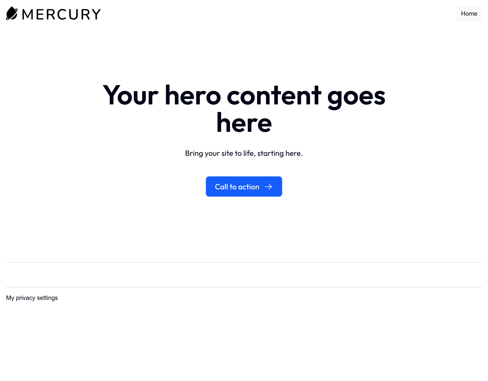
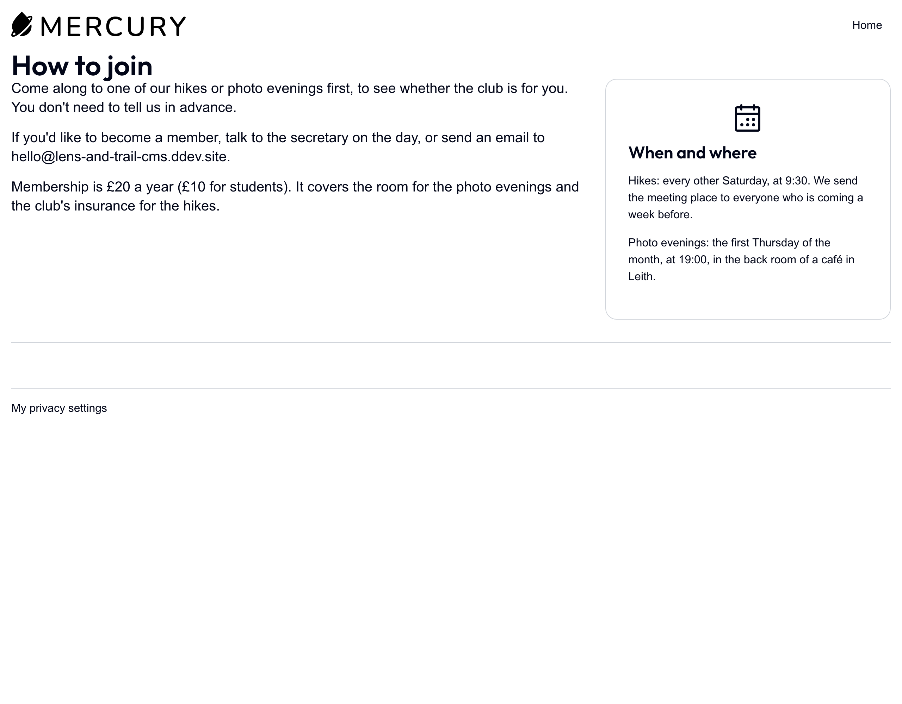
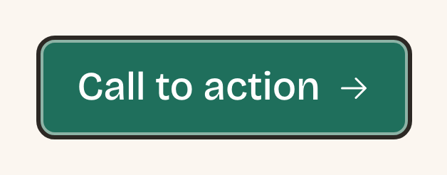
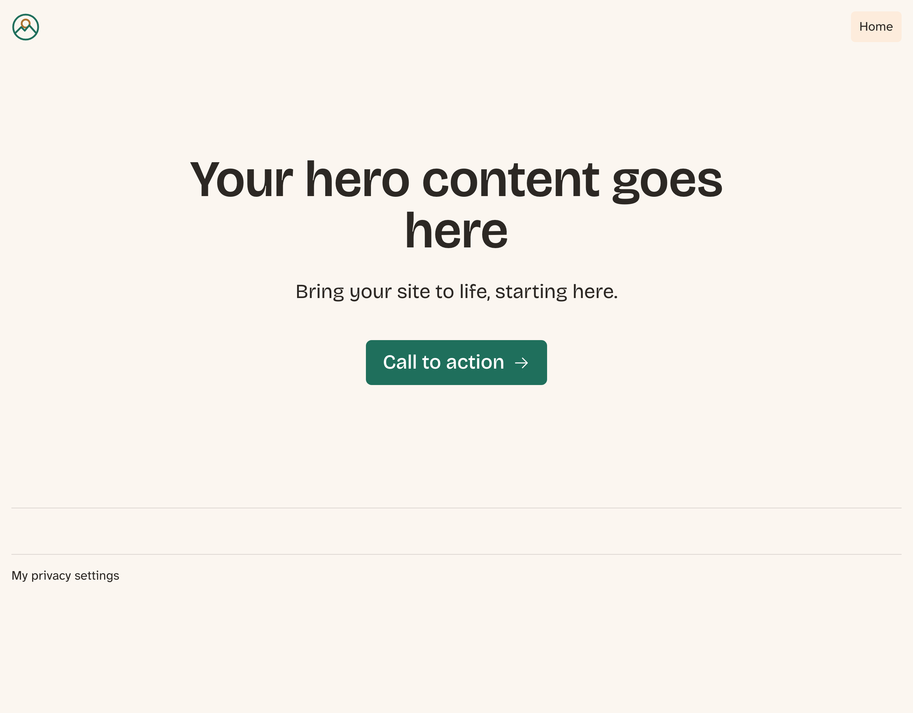
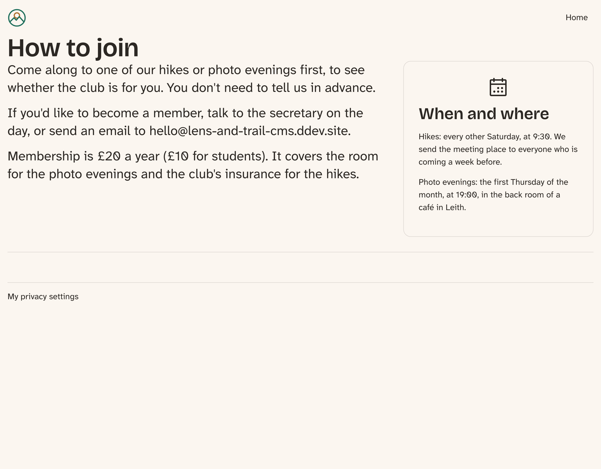
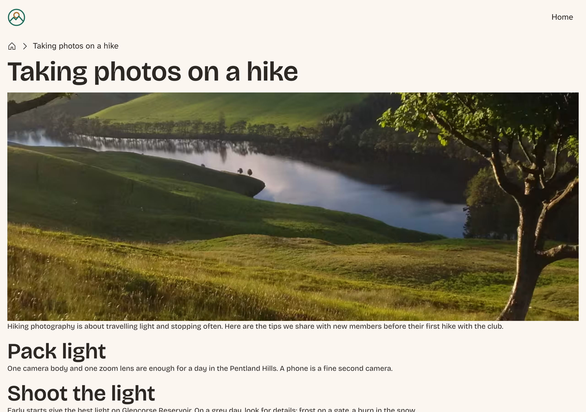
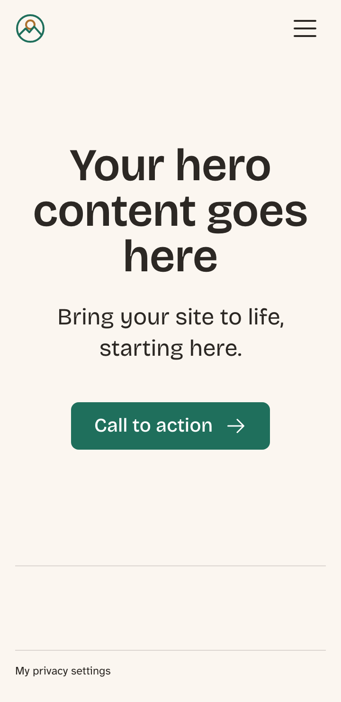
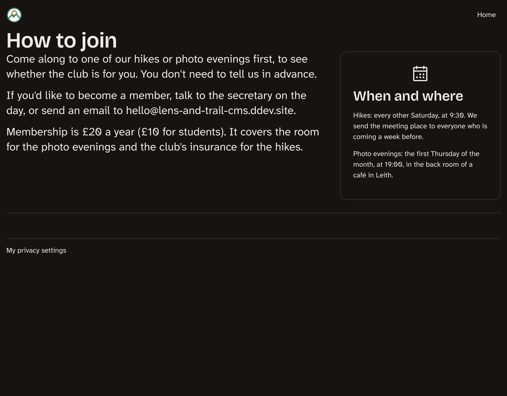

# Generating the Drupal CMS Site's Theme

The core site has its theme. Now it's the Drupal CMS site's turn, and the road is a different one. Drupal CMS comes with a theme called **Mercury**, built with **Tailwind CSS**, and the site's pages are already made of Mercury's components. In this chapter we copy Mercury into our own project, so it's ours to change, and we give it the club's colors, type and logo from the same `design/tokens.json` the core site used.

Three things are new compared with the previous chapter. There's a build step this time, with Node.js and npm. Our tokens have to get along with a naming system that was there first. And instead of starting from a clean slate, we start from a finished design and change only what makes it the club's.

The site starts where Book 1 left it: Drupal {{ number:drupal_version }} with Drupal CMS, Mercury {{ number:mercury_version }} as its theme, and pages built in Canvas. One thing is added. Book 1 builds the hikes only on the core site, and its Drupal CMS site has no Hike content type, so there's nothing there for a hike page or a Hike card to show. This book themes hikes on both sites, so the test site gets Book 1's Hike content type, the areas, and the six hikes with their photos, in English and Spanish. `tools/setup.sh` does that for you (Appendix C tells how), and if you worked through Book 1 yourself, the same appendix shows how to add them to your own site.


*Figure 6.1: The front page in Mercury, as Book 1 left it.*


*Figure 6.2: A Canvas page in Mercury.*

## Starterkit or Mercury?

On the core site we generated a theme from Starterkit: a bare copy, with almost no styling. Mercury could be treated the same way, but it's a different kind of starting point. It's a complete theme, with a design and 25 components, and the club's Canvas pages already use them: 45 component instances on three pages, each one stored under a name that starts with `sdc.mercury`.

That name is the reason for this chapter's first decision: **our copy keeps the machine name `mercury`**. If we renamed the theme, every one of those 45 instances would point at a component that no longer exists, and we'd have to rebuild the pages. Keeping the name means that nothing else on the site has to change: no theme switch, no block placements to move, no pages to touch.

The price is that the copy is ours to look after. Mercury's future releases won't reach it. We'll come back to what that means in the chapter on keeping a theme up to date.

## Copying Mercury

Run these in the Drupal CMS site's folder.

1. Copy the theme from where Composer put it to where your own themes live:

   ```bash
   cp -R web/themes/contrib/mercury web/themes/custom/mercury
   ```

2. Open `web/themes/custom/mercury/mercury.info.yml`, and delete the lines at the end, from `# Information added by Drupal.org packaging script` down. They have a `version`, a `project` and a `datestamp`, and they tell Drupal's update report that this is Mercury from drupal.org. Ours isn't any more, and without those lines the report stops offering to replace it.

3. Tell Composer about the module Mercury needs, and then remove Mercury itself:

   ```bash
   ddev composer require drupal/cva:^1
   ddev composer remove drupal/mercury
   ddev drush cache:rebuild
   ```

The order matters in step 3. Mercury's components use **CVA** (class variance authority), a small helper that picks Tailwind classes for a component's variants, and in Drupal it comes as the `drupal/cva` module. You didn't ask for it: Composer installed it because Mercury needed it. So `composer remove drupal/mercury` would remove it too, and the theme's components would stop working. Mercury's own `CUSTOMIZING.md` doesn't mention this, so it's a good one to remember. Requiring `drupal/cva` yourself first makes it your site's dependency.

What if you forget to remove the contributed copy? Then the site has two themes named `mercury`, and Drupal uses the one in `themes/custom`. We tried it. It works, but two copies with one name will confuse someone, most likely you, so remove it.

Reload the front page: it should look exactly as it did. That's the test.

## Tailwind in a few minutes

Before we build anything, let's learn to read what we're building. Mercury is styled with **Tailwind CSS**, and from here on, every Twig file in Mercury, and every component we add to it, is full of Tailwind's classes. They look strange at first: `px-6`, `xl:py-3.5`, `hover:bg-primary/85`. Once you know the handful of rules behind them, you can read any of them.

Tailwind is a CSS framework, but not the kind that gives you a ready-made button and a grid. It gives you **utility classes**: small classes that each do one thing, such as `flex` (`display: flex`) or `font-medium` (a font weight of 500). You style an element by putting the classes it needs in its `class` attribute, in the HTML, instead of writing a rule for it in a stylesheet. Then Tailwind's build step reads your templates, finds the classes you used, and writes a CSS file with a rule for each of them, and for no others. That build step is why this site needs Node.js, as the next section shows.

That's the opposite of the core site, where the theme has a stylesheet per component and the HTML only carries a name for it (`hike-card`). Neither is wrong, and we'll compare them at the end of this section. On the Drupal CMS site, we use Tailwind because Mercury does: its 25 components are written that way, and working with them is easier than working against them.

### Reading a button

Mercury's Button component is a good one to learn on, because it uses nearly every kind of class there is. Here's how it decides its classes (we'll come back to `html_cva` in a moment; for now, read the strings):

<!-- include: code/chapter06/steps/03-fonts/cms/mercury/components/button/button.twig lines=6-37 as=components/button/button.twig -->

And here's one of Mercury's buttons on the front page, the hero's **Call to action**, as Drupal renders it:

<!-- include: code/chapter06/snippets/button-rendered.html as=html -->

Take the classes in groups:

- **One class, one property.** `flex`, `items-center`, `rounded-lg`, `font-medium`, `cursor-pointer`: each is one CSS declaration, named after it. `w-fit` is `width: fit-content`.
- **Numbers are steps on a scale.** `px-6` is padding on the left and right (the *x* axis; `py` is top and bottom) of 6 spacing steps. A step is `--spacing`, which Mercury sets to 4 pixels, so `px-6` is 24 pixels. `gap-3` is 12 pixels between the button's children. `text-lg` is a step on the type scale, and `rounded-lg` one on the radius scale. Because every value comes from a scale, the spacing on a page stays consistent without anyone checking.
- **A prefix and a colon add a condition.** `xl:py-3.5` is `py-3.5` *on screens at least 80rem wide*. The prefixes are Tailwind's breakpoints: `sm` 40rem, `md` 48rem, `lg` 64rem, `xl` 80rem and `2xl` 96rem. A class without a prefix applies everywhere, and the prefixed ones take over from their width up, so Tailwind is **mobile first**: you write the phone's style, then what changes on wider screens. `hover:`, `focus-visible:` and `disabled:` work the same way, for a state of the element instead of a screen width.
- **A slash is an opacity.** `hover:bg-primary/85` is the primary color at 85% when the pointer is over the button. `focus-visible:ring-ring/50` is the focus ring's color at 50%.
- **Square brackets are a value of your own.** `focus-visible:ring-[3px]` is a ring 3 pixels wide, a size that isn't on Tailwind's scale. Anything goes in the brackets, and Tailwind trusts you with it.
- **`group` marks a parent** for its children. The arrow in the button has `group-hover:translate-x-1`: it moves one step to the right when the pointer is over the *group*, the button, not only over the arrow.

That's what Tailwind's build makes of a few of those classes. We've made the minified file readable, but the rules are exactly what's in it:

<!-- include: code/chapter06/snippets/button-rules.css as=build/main.min.css -->

A few things worth noticing. Each rule is the class name, escaped where it has a colon, a slash or a bracket. The `xl:` rule is inside a media query. The `hover:` rules are inside `@media (hover: hover)`, so a phone, where there's no pointer to hover with, never gets stuck in the hover style after a tap. The opacity comes with a fallback: browsers that understand `color-mix()` get the 85% color, and the others the full color. And `group-hover:` became a selector that looks for a hovered `.group` around the element. You'll never write these rules, but when a class doesn't do what you expect, looking for its rule in `build/main.min.css` is the quickest way to find out why.

The forms the rest of this book uses, in one place:

| Class | Means | CSS it becomes, roughly |
|---|---|---|
| `p-4`, `px-6`, `mt-2` | padding, padding left and right, margin on top, in spacing steps | `padding: calc(var(--spacing) * 4)` |
| `md:grid-cols-3` | from 48rem up | `@media (min-width: 48rem) { ... }` |
| `hover:`, `focus-visible:`, `disabled:` | in that state | `:hover`, `:focus-visible`, `:disabled` |
| `open:grid`, `backdrop:bg-black` | a `<dialog>` or `<details>` that's open; a dialog's backdrop | `:is([open], :popover-open, :open)`, `::backdrop` |
| `after:content-['']` | the `::after` pseudo-element | `::after { content: '' }` |
| `bg-primary/85` | a color at 85% | `color-mix(in oklab, var(--primary) 85%, transparent)` |
| `ring-[3px]`, `z-[-1]` | a value of your own | `3px`, `-1` |
| `size-(--size-target)` | the value of a CSS variable | `width: var(--size-target); height: var(--size-target)` |
| `[&_img]:block` | a selector of your own; `&` is the element, `_` a space | `& img { display: block }` |
| `group-hover:`, `in-[.accordion--open]:` | when a parent is hovered, or matches a selector | `:where(.group):hover *`, `:where(.accordion--open) *` |
| `end-0`, `ps-4` | logical: the end and start of a line, which flip in right-to-left languages | `inset-inline-end: 0`, `padding-inline-start` |

### Parents and siblings: `group-`, `peer-` and `in-`

A Tailwind class sits on the element it styles, so styling an element because of *another* element needs a way to point at it. There are three:

- **`group` and `group-*:`**. Put `group` on the parent, and a child's `group-hover:`, `group-focus-visible:` or `group-open:` applies when the parent is in that state. That's the button's arrow. Groups can be named, `group/card` and `group-hover/card:`, when one sits inside another.
- **`peer` and `peer-*:`**. Put `peer` on an element, and a *later sibling's* `peer-checked:` or `peer-invalid:` applies when that element is checked or invalid: a label that turns red when the field before it is wrong. It only works for siblings that come after, because CSS can only look that way.
- **`in-[...]:`**. Applies when *any* parent matches the selector in the brackets, with no `group` needed. Mercury's accordion uses it: its panel has classes that start with `in-[.accordion--open]:`, so the panel opens when the accordion around it gets the class `accordion--open`, which the accordion's script sets.

### Variants, the CVA way

Back to `html_cva` in the Button. A component often has a few fixed versions: small, medium and large; primary and secondary. **CVA**, short for *class variance authority*, is a pattern from the JavaScript world for choosing classes by version, and `html_cva()` is its Twig form, from Twig's own HTML extension. Drupal doesn't include it, so Mercury depends on the `drupal/cva` module, whose only job is to make `html_cva()` available in Drupal's Twig. That's the dependency from earlier in this chapter.

`html_cva()` takes a `base`, the classes every version gets, and `variants`, the classes for each choice of each option. The template then asks for a combination with `apply()`:

```twig
button_variants.apply({size: 'large', variant: 'primary', width: 'fit', iconPosition: 'last'}, additional_classes)
```

and gets one string: the base, then `gap-3 px-6 py-3 text-lg xl:py-3.5 xl:text-xl` for large, `bg-primary text-primary-foreground hover:bg-primary/85` for primary, `w-fit`, `flex-row-reverse`, and last any classes the caller passed in. That's exactly the class attribute of the rendered button above. (The duplicate `duration-300 ease-in-out` from the variant is dropped: `apply()` removes repeated classes.)

One thing `apply()` doesn't do is settle conflicts. If you pass `px-2` as an extra class to a large button, the button gets both `px-6` and `px-2`, and which one wins depends on their order in the *CSS file*, not in the class attribute. Some JavaScript projects add a tool, `tailwind-merge`, for that; in Twig there's none. So when you give a Mercury component extra classes, give it ones that don't fight its own.

### Classes the build can't see

Here's the rule that catches everyone once: **Tailwind's build only finds classes that are written out whole in a file.** It doesn't run Twig, PHP or JavaScript. It reads the theme's files as plain text, picks out everything that looks like a class name, and writes rules for the ones it recognizes. A class that's put together from pieces while the page is rendered doesn't exist when the build runs.

We tried it with this template, added to the theme for the test and removed afterward:

<!-- include: code/chapter06/snippets/rotate-test.twig as=components/rotate-test/rotate-test.twig -->

After `npm run build`, the built CSS had a rule for one of them:

<!-- include: code/chapter06/snippets/rotate-test.txt as=terminal -->

The page has both classes in its HTML, and only `rotate-45` does anything. Nothing warns you: the build doesn't know `rotate-12` was ever meant, and the browser ignores a class without a rule.

Mercury itself has a class like that, in its Icon component:

<!-- include: code/chapter06/steps/03-fonts/cms/mercury/components/icon/icon.twig lines=10-21 as=components/icon/icon.twig -->

`min-w:{{ resolved_size }}` becomes `min-w:24` on the page, and it has two problems. It's put together while the page is rendered, so the build never sees it; and it isn't Tailwind's syntax anyway, which would be `min-w-6` or `min-w-[24px]`. There's no rule for it in `build/main.min.css`, so it does nothing. The icons look right because the SVG inside has its own width, so nobody noticed. (Exercise 6 fixes it.)

The cure is to write every class out whole, and choose between whole classes in Twig: a map from a size to a full class name (`{small: 'min-w-6', large: 'min-w-12'}`), as the Button's `html_cva()` does with its variants. When a class really has to come from somewhere the build can't read, such as a value an editor types in, Tailwind 4 has `@source inline("rotate-12")` in `src/main.css`, which tells the build to make that class whether it finds it or not. Use it sparingly: every class in it is in every page's CSS.

### Plain CSS or Tailwind?

The two sites in this book are styled in the two ways, so you'll get to know both. In short:

- **Tailwind** keeps the styling next to the markup: you read an element and see how it looks, and you don't invent class names. The scales keep spacing and type consistent across a team. The CSS file stays small, because only the classes in use are built. The costs: long class attributes that are hard to scan, a build step with Node.js, and styles you can't change for the whole site in one place unless they come from the theme's variables, as the club's tokens do.
- **Plain CSS**, as on the core site, needs no tools at all, and modern CSS has most of what made frameworks necessary: variables, nesting, layers and container queries. The markup stays readable, and a stylesheet per component can be overridden from outside without touching it. The costs: you name everything, and you keep the CSS and the markup in step yourself.

Appendix E, *Build Tools*, puts Tailwind next to the other tools a theme meets, such as Sass, PostCSS and the bundlers.

> **Tutorials for Tailwind 3.** Mercury uses Tailwind 4: its `package-lock.json` pins 4.1.18, and the newest release is {{ number:tailwind_version }}. Version 4 is set up in CSS: `@import "tailwindcss"` and an `@theme` block in `src/main.css`, as you'll see in this chapter. Most tutorials and answers online are still for version 3, which used a `tailwind.config.js` file, `@tailwind base;` lines and a `content` list of files to read. If a page tells you to edit `tailwind.config.js`, it's for version 3, and you'll need the version 4 way: the [upgrade guide](https://tailwindcss.com/docs/upgrade-guide) lists the differences.

## The build tools

Mercury's CSS is built: the file the browser gets, `build/main.min.css`, is made by Tailwind from `src/main.css` and from the classes it finds in the theme's templates and components, as the previous section showed.

To run it we need Node.js, and we want everyone working on the site to have the same version. DDEV takes care of that. Add this line to `.ddev/config.yaml`, and run `ddev restart`:

```yaml
nodejs_version: "26"
```

Node.js {{ number:node_lts }} is the current long-term support line. Mercury's `.nvmrc` file asks for version 24; the build works on both, and we've tested it on 26. Then install the tools, inside the container:

```bash
ddev exec -d /var/www/html/web/themes/custom/mercury npm ci
ddev exec -d /var/www/html/web/themes/custom/mercury npm run build
```

`npm ci` installs exactly what `package-lock.json` lists, the same versions Mercury's authors built with, and it fails if the lock file and `package.json` disagree. That's what we want. Keep the lock file, and commit it. (`npm install` would be free to change the lock file.)

Depending on your npm version, you may see a note that install scripts were held back for `esbuild` and `@parcel/watcher`. Newer versions of npm don't run a package's install scripts until you approve them, which is a sensible protection, because an install script can do anything your user can. Mercury's build worked for us without approving them. `npm install-scripts ls` shows what's waiting.

`npm run build` runs two tools: Tailwind for the CSS, and **esbuild** to bundle `src/motion.js` into `build/motion.js`. Mercury also has a `format` script, which runs Prettier, a tool that tidies code; we don't need it here.

### A build that changes nothing should change nothing

Here's a small mystery. Run the build on the unchanged theme, and compare `build/main.min.css` with the file Mercury shipped. They differ by about 500 bytes: there are two new classes, `drop-shadow` and `ease-in`, that no component uses.

Tailwind looks for class names in every file in the theme that Git doesn't ignore. Mercury's `.gitignore` ignores `build/` and then takes that back with `!build/`, so Tailwind reads `build/motion.js` too, and finds those words in the middle of the minified JavaScript. Mercury's release was built from an empty `build/` folder; our second build wasn't.

Harmless, but a build should give the same result every time, or you can't trust a diff of its output. One line in `src/main.css`, which you'll see in a moment, tells Tailwind to leave that folder alone.

> **Is all this worth it?** If you only want your own colors and fonts, Mercury has a lighter way. Copy `src/theme.css` or `src/fonts.css` to your web root, next to `index.php`, and change it there: Mercury loads that copy in place of its own. No copy of the theme, no Node, and Mercury keeps getting updates. It's a good choice for many sites. We don't take it because the club's tokens are generated from a design that's shared with another site, and because the rest of this book changes templates and components as well.

## Two naming systems meet

Mercury's colors work in three layers, and it's worth seeing them before we change anything.

`src/theme.css` defines the variables, in the naming used by **shadcn/ui**, a popular component collection: `--background`, `--primary`, `--muted-foreground`, and so on. `src/main.css` then tells Tailwind that these are colors, with an `@theme` block: `--color-primary: var(--primary);`. And that's what makes classes like `bg-primary` exist. Tailwind makes utility classes from whatever is in `@theme`.

So a neat plan suggests itself: put the club's tokens in `@theme` as well, and map the shadcn/ui names to them. The trouble is the names. Our tokens have `color.muted`, `color.background`, `color.border` and `color.green.700`. In `@theme`, those become `--color-muted`, which Mercury already uses for something else, and `--color-green-700`, which is one of Tailwind's own colors.

There's a less visible collision too. Our spacing tokens are called `xs`, `s`, `m`, up to `3xl`. Tailwind's `--spacing-xl` gives you the class `p-xl`, which is what we'd want. But the class `max-w-xl`, which normally means "a comfortable width for a block of text, 36rem", looks for `--spacing-xl` *first*. Mercury uses that class. With a token of that name, the width quietly became 3rem. We found this by comparing every rule in the built CSS before and after the tokens, and that's a comparison we recommend whenever you add names to `@theme`.

The way out is a prefix. In Tailwind, the club's colors and spacing are called `club`: `--color-club-action`, and the classes `bg-club-action` and `p-club-m`. Nothing can collide with that. Type sizes, radii and fonts keep their own names, because they don't clash.

### Teaching the script a second trick

The previous chapter's `tokens.py` writes a `:root` block with one set of names. We need an `@theme` block with another. Copy `code/chapter06/scripts/tokens.py` to `scripts/` in this site's project, and `design/tokens.json` to `design/`. Here's everything that's different from the previous chapter's script:

<!-- diff: code/chapter05/scripts/tokens.py code/chapter06/scripts/tokens.py -->

Without `--tailwind`, the script writes exactly what it did before, so the core site can use this version too. With it, the block opens with `@theme static`, and the names change. The word `static` tells Tailwind to write every token into the CSS, even those no class uses, and we need that: `theme.css` refers to the tokens by name, in a file Tailwind never reads.

Run it:

```bash
python3 scripts/tokens.py --tailwind design/tokens.json web/themes/custom/mercury/src/tokens.css
```

### Choosing what each role means

Now `src/theme.css`. Mercury's version has a value for every shadcn/ui name, once for light and once for dark. Ours says only which of the club's roles each name means, and the tokens' `light-dark()` takes care of the rest, so the `.dark` block of 30-odd values goes away.

| Mercury's name | The club's role | Where you'll see it |
|---|---|---|
| `--background`, `--foreground` | `background`, `text` | the page |
| `--card`, `--card-foreground` | `surface`, `text` | cards |
| `--primary`, `--primary-foreground` | `action`, `on-action` | the main buttons |
| `--secondary`, `--accent` and their foregrounds | `tint`, `on-tint` | secondary buttons, the current menu item |
| `--muted`, `--muted-foreground` | `tint`, `muted` | quieter text and panels |
| `--border`, `--input` | `border` | lines, form fields |
| `--ring` | `action` | the focus ring |

The destructive color, the shadows and the monospace font stay as Mercury had them: the design has no opinion on those. Here's the file.

<!-- include: code/chapter06/steps/02-tokens/cms/mercury/src/theme.css as=src/theme.css -->

`--ring` deserves a word, because Mercury's copy doesn't define it. Its buttons ask for `focus-visible:ring-ring/50`, but with no value behind that name, the ring doesn't get a usable color. It's reported in Mercury's issue queue and fixed there, but not yet in a release. We set it in this file, and we also tell Tailwind about it in `main.css`.

### Dark mode

`color-scheme: light dark` on `:root` tells the browser that the page works in both, and the tokens' `light-dark()` then follows the visitor's system setting, like the core site. That changes what Mercury's setting means. On **Appearance** > **Settings** for Mercury there's a **Color scheme** choice of **Light** or **Dark**:

- **Dark** adds the class `dark` to the page, and our `.dark` rule forces dark mode for every visitor.
- **Light** adds nothing, and now that means *follow the visitor's setting*. The label isn't quite right any more, so leave it on **Light** and remember what it does.

### The focus ring

Press Tab until you reach a button. Mercury draws a three-pixel ring with `--ring` at half opacity, and on the club's cream background that works out at 2.1:1. WCAG asks for at least 3:1 for a focus indicator, because someone who uses a keyboard has to be able to find it. Changing Mercury's button component is one way, but the last rule in `theme.css` is cheaper, and it covers every focusable thing at once.

It works because of how Mercury loads this file: `theme.css` isn't processed by Tailwind and isn't in a **cascade layer**. Everything Tailwind writes is in layers, and a rule outside any layer beats a rule inside one, so this rule wins over the `outline-none` class on the button. It uses the same `--border-focus` width and the same offset as the design.


*Figure 6.3: A focused button.*

### The changes to main.css

Four small changes, and that's all we touch in Mercury's main stylesheet:

<!-- diff: code/chapter06/steps/01-copy/cms/mercury/src/main.css code/chapter06/steps/02-tokens/cms/mercury/src/main.css as=src/main.css -->

From the top: the `@source not` line fixes the mystery from earlier, the `@import` brings in the tokens, `--color-ring` makes the ring class work, and the `--text-*` lines point Mercury's type sizes at the club's fluid scale. `text-base` is now `--text-step-0`, and so on up to `text-4xl`, which is `--text-step-5`.

`text-xs` and everything from `text-5xl` up stay Mercury's, because the club's scale has no steps for them. One small oddity follows: on a wide screen `text-4xl` can reach 55 pixels, a little larger than `text-5xl` at 48. Mercury uses those sizes for its largest headings at different screen widths, and nothing on the club's pages looks wrong, but it's the kind of thing to look at when you design a page that uses both.

Build it, and rebuild the cache:

```bash
ddev exec -d /var/www/html/web/themes/custom/mercury npm run build
ddev drush cache:rebuild
```

> **Try it:** Change the value of `--primary` in `src/theme.css` to `var(--color-club-sand-500)` and rebuild the cache, without running the build. The buttons change: `theme.css` is loaded as it is. Now put it back. A change to `main.css`, or a new class in a template, would need `npm run build`.

## The club's fonts and logo

Mercury's type is Outfit and Inter. The club's is Bricolage Grotesque for headings and Atkinson Hyperlegible Next for text, and the files are in `design/fonts/`. To change over:

1. Delete `fonts/Outfit/` and `fonts/Inter/` from the theme.
2. Copy `design/fonts/bricolage-grotesque/` and `design/fonts/atkinson-hyperlegible-next/` into the theme's `fonts/` folder, each with its `OFL.txt`, the font's license. The fonts are free to use and to pass on, as long as the license goes along with them. The code in a Drupal theme is normally under the GPL, but the OFL is a different license: the Free Software Foundation lists it as a free license for fonts, and doesn't say whether it's compatible with the GPL. So we don't treat the fonts as part of the GPL code: they stay under their own license, in their own folders, with that license beside them. Mercury ships Outfit and Inter the same way.
3. Replace `src/fonts.css`:

<!-- include: code/chapter06/steps/03-fonts/cms/mercury/src/fonts.css as=src/fonts.css -->

4. Change the two preload links, which tell the browser to fetch the fonts early:

<!-- diff: code/chapter06/steps/01-copy/cms/mercury/templates/includes/preload.twig code/chapter06/steps/03-fonts/cms/mercury/templates/includes/preload.twig as=templates/includes/preload.twig -->

5. In `src/theme.css`, set `--font-sans` to `var(--font-family-heading)` and `--font-body` to `var(--font-family-body)`. In spite of its name, `--font-sans` is what Mercury uses for headings.

These are TrueType files, and rather large ones: over 400 KB for Bricolage Grotesque. Chapter 8 makes them smaller, as WOFF2 files with only the characters the club needs.

Last come the club's logo and picture, as on the core site. Mercury has two logo files, one for each color scheme. The club's logo has its own cream disc and shows on both, so copy `design/logo.svg` over both `logo-dark.svg` and `logo-light.svg`. Then copy `screenshot.png` from the previous chapter's theme over Mercury's, so the **Appearance** page shows the club's theme.

Run the build and rebuild the cache one more time, and look.


*Figure 6.4: The front page in the club's design. The words are still Mercury's placeholder: they're content, and the site's editors can change them in Canvas.*


*Figure 6.5: How to join.*


*Figure 6.6: A basic page, which isn't built in Canvas, gets the same design.*


*Figure 6.7: The front page on a phone.*


*Figure 6.8: How to join, with the visitor's system set to dark.*

> **Try it:** Press Tab through the front page, with the mouse put away. Can you always see where you are? Then set your system to dark mode and do it again.

We know about a few rough edges that remain. In Mercury's forms, a focused field's label and border use the accent color, which is now a pale tint. Hover effects scale things even for visitors who've asked for reduced motion. Those belong to the chapters on forms and on accessibility, where we'll deal with them properly.

## The theme in version control

The same rule as the previous chapter: everything the site needs to run is committed.

- Commit the whole theme, with `build/`, `src/tokens.css` and `package-lock.json`. A server shouldn't need Node to show a page.
- Commit `scripts/tokens.py`, `design/tokens.json` and the `nodejs_version` line in `.ddev/config.yaml`.
- Don't commit `node_modules/`. Mercury's `.gitignore` already leaves it out: `npm ci` makes it again from the lock file.

When the design changes, the order is: Penpot, export, `tokens.py --tailwind`, `npm run build`, rebuild the cache, check the pages, commit.

> **Coming from WordPress?** The light route above is close to what a block theme's `theme.json` gives you: a place to set colors and fonts, with the theme left alone. Making your own copy of Mercury is closer to forking a theme, where the updates are yours to bring in by hand. The difference from a child theme is that nothing is inherited here.

## Summary

You can now:

- copy a contributed theme into your own project, keep its machine name, and say why that matters for Canvas pages;
- remove the contributed copy without losing a dependency it brought along;
- pin Node.js in DDEV, install with `npm ci`, and run Mercury's build;
- read Tailwind's classes: scales, breakpoint and state prefixes, opacity, square brackets, `group-`, `peer-` and `in-`;
- explain how `html_cva()` picks a component's classes, and why extra classes can fight them;
- write classes so Tailwind's build finds them, and spot one it can't;
- explain how Tailwind's `@theme`, Mercury's `theme.css` and the club's tokens fit together;
- prevent name collisions with a prefix, and find them by comparing the built CSS;
- map a design's roles to shadcn/ui's names, with dark mode coming from the tokens;
- change a theme's fonts, logo and screenshot;
- check keyboard focus, and fix it with one rule outside Tailwind's layers.

## Exercises

1. Run `diff -r web/themes/custom/mercury/src code/chapter06/steps/01-copy/cms/mercury/src` from the book's repository, adjusting the paths. Name the reason for every difference.
2. Change `--secondary` in `theme.css` to the club's `action` role, and look at a page with a secondary button. Which foreground would you need now? Check the pair with a contrast checker, then put it back.
3. In `tokens.py`, take the `club` out of the spacing rule, and run the script and the build. Compare `.max-w-2xl` in `build/main.min.css` before and after. Then put it back.
4. Add a class that isn't in Mercury yet, `bg-club-green-700`, to a component's Twig file. Rebuild the cache without running the build. What happens, and why? Run the build, and look again.
5. Turn on **Dark** under Mercury's **Color scheme**, with your system in light mode, and look at the site. Which CSS rule does the work? Set it back to **Light**. *(challenge)*
6. Fix Mercury's Icon component, from the section on classes the build can't see, so the minimum width works: write whole class names for each size, run the build, and find the rules in `build/main.min.css`. Which icon size would look different if the SVG didn't have a width of its own? *(challenge)*

## Want to know more?

- Drupal.org: [the Mercury theme](https://www.drupal.org/project/mercury), and Mercury's own `CUSTOMIZING.md` in the theme's folder.
- Mercury's issue about [the focus ring and more](https://www.drupal.org/project/mercury/issues/3592157).
- Tailwind CSS: [styling with utility classes](https://tailwindcss.com/docs/styling-with-utility-classes), [hover, focus and other states](https://tailwindcss.com/docs/hover-focus-and-other-states), [responsive design](https://tailwindcss.com/docs/responsive-design), [theme variables](https://tailwindcss.com/docs/theme), [how it finds classes in your files](https://tailwindcss.com/docs/detecting-classes-in-source-files), and the [upgrade guide](https://tailwindcss.com/docs/upgrade-guide) from version 3.
- Twig: [`html_cva`](https://twig.symfony.com/doc/3.x/functions/html_cva.html), and the Drupal module that makes it available, [CVA](https://www.drupal.org/project/cva).
- [shadcn/ui's theming](https://ui.shadcn.com/docs/theming), where the variable names come from.
- npm's documentation for [`npm ci`](https://docs.npmjs.com/cli/commands/npm-ci).
- WCAG 2.2: [Non-text Contrast](https://www.w3.org/WAI/WCAG22/Understanding/non-text-contrast.html).
- The [SIL Open Font License](https://openfontlicense.org), which the club's fonts use.
- The Free Software Foundation's [list of licenses](https://www.gnu.org/licenses/license-list.html), with its entry on the OFL under fonts.
