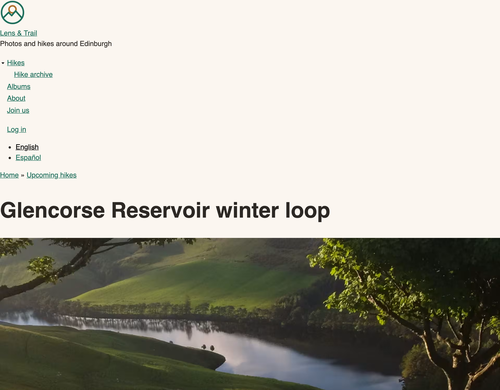
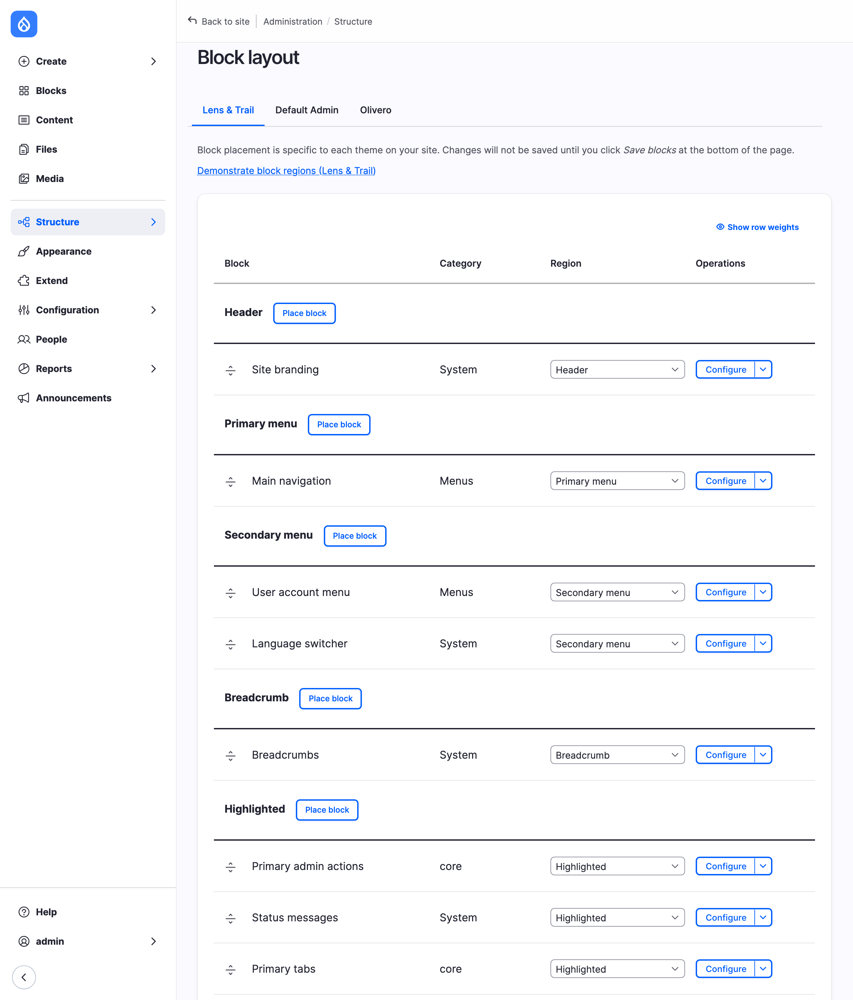
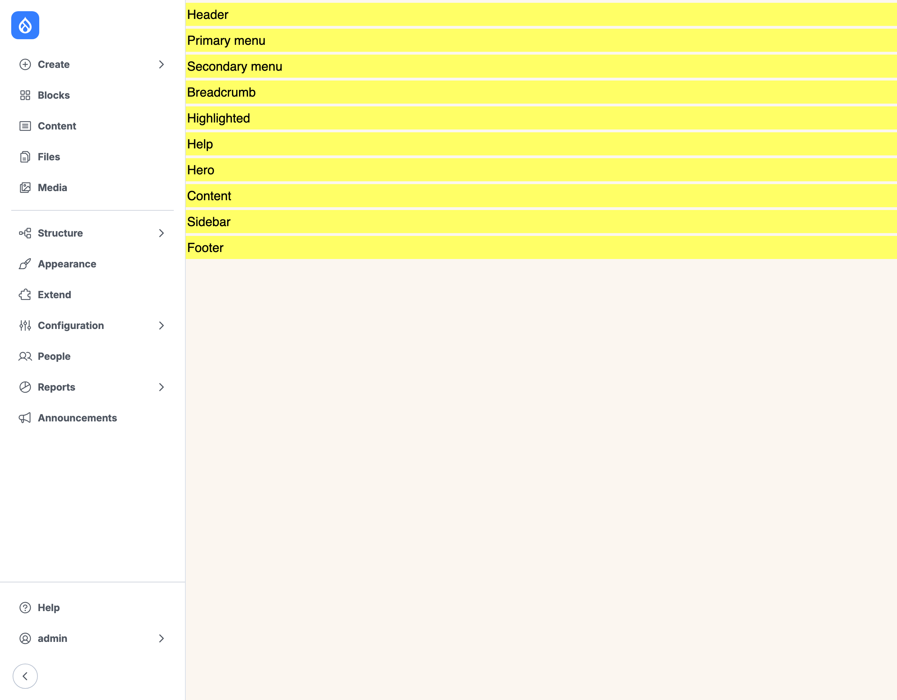
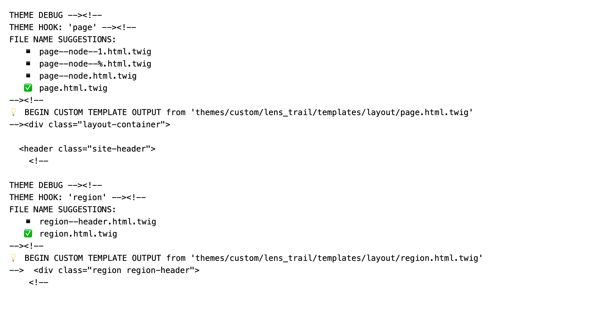
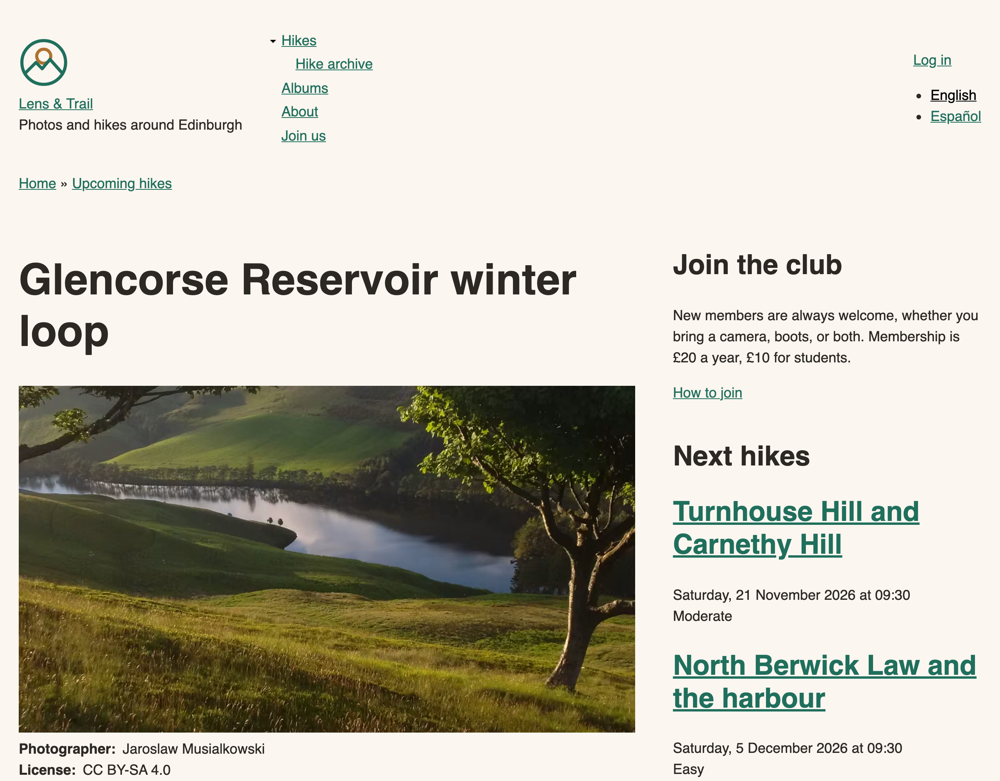
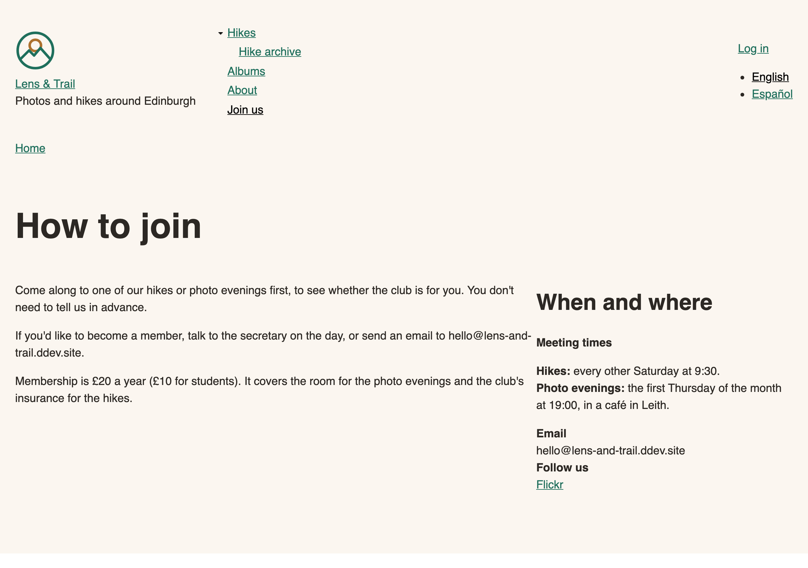
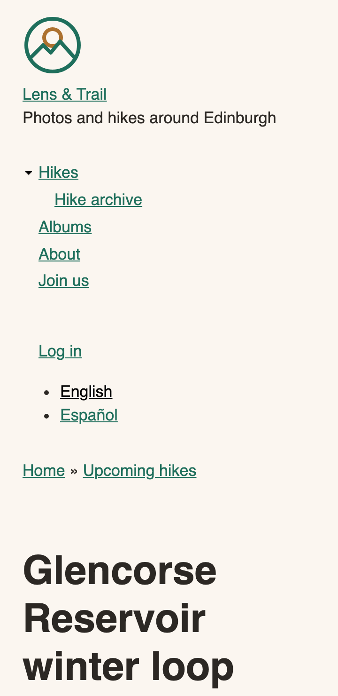
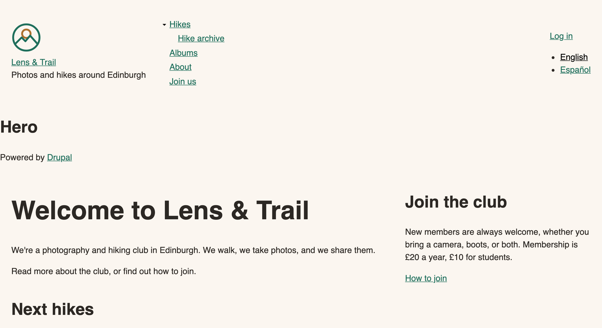

# Regions and the Page Template

The core site has the club's colors now, but its page is still one long column: a logo, a list of links, some more links, and the content. In this chapter we give it the shape of the wireframes. A header in one row. A place for a full-width photo. The content with a sidebar beside it, on the pages that have a sidebar. A footer.

Three pieces of Drupal decide that shape, and we'll work through them in order: the **regions** a theme offers, the **blocks** that sit in them, and the **page template** that says where each region goes in the HTML. Then a small stylesheet with CSS Grid does the rest.

Nearly all of this chapter happens on the core site. The Drupal CMS site does the same job in a very different way, and we'll look at why near the end.

%% Author: drafted 2026-11-08 on feature/chapter-07-regions. All 14 recommendations accepted. One change while building: Join the club and Next hikes keep Book 1's visibility here, because Next hikes shows only on hike pages (hiding it there would hide it everywhere). The hike page chapter settles it. See the report. %%


*Figure 7.1: The hike page at the end of Chapter 5: everything in one column.*

## What each template owns

Two templates draw the frame around everything else on a page.

**`html.html.twig`** owns the document: `<!DOCTYPE html>`, `<html>`, the `<head>` with its title, CSS and JavaScript, and `<body>` with its classes. It's also where the skip link is, the "Skip to main content" link that a keyboard user meets first. The club's theme has its own copy from Starterkit, which adds body classes such as `path-frontpage`, and in this chapter we leave it alone.

**`page.html.twig`** owns what's inside `<body>`: which regions there are on the page, in what order, and inside which HTML elements. That's the one we need.

Between them, `html.html.twig` prints `{{ page }}`, and that's where the whole of `page.html.twig` lands. One template inside the other.

> **Drupalism: region.** A region is a named area of a page that a theme offers, such as Header or Sidebar, and where a site builder can place blocks. Book 1 used regions from the outside, on the **Block layout** page. Outside Drupal, "region" might make you think of ARIA's `region` role or of a geographic setting. It's neither.

## The regions the club needs

Open `lens_trail.info.yml` and look for `regions`. There aren't any. A theme that doesn't list regions gets Drupal's default set: left and right sidebars, content, header, primary and secondary menus, footer, highlighted, help, and breadcrumb. That's why Chapter 5 worked without saying a word about them.

The wireframes want something a little different. There's only ever one sidebar, and the front page has a wide photo that doesn't fit in any of the default regions. So we list our own:

<!-- diff: code/chapter05/steps/04-tokens/core/lens_trail/lens_trail.info.yml code/chapter07/steps/01-regions/core/lens_trail/lens_trail.info.yml as=lens_trail.info.yml -->

The key on the left is the machine name, the value is what **Block layout** shows. As soon as a theme has a `regions` list, it's the whole list: the defaults are gone.

What about three footer columns, in the wireframe? Those could be three regions, but then a site builder would have to know which block goes in which column, and an empty column would leave a hole. One Footer region with its blocks laid out by CSS is less to look after. A region earns its place when the *page* needs another position, not whenever the design has another box.

> **Hidden regions.** Drupal has a second list, `regions_hidden`, for regions that exist for code but aren't offered on **Block layout**. Two are always there, `page_top` and `page_bottom`, which `html.html.twig` prints and modules use: the admin toolbar goes in through `page_top`. You don't need to list them, and the club's theme doesn't need a hidden region of its own.

Put the file in place and rebuild the cache. If you use the **Clear all caches** button on the **Performance** page, Drupal shows a warning; with Drush you won't see one. Either way, something happened.

### What happens to blocks in a removed region

Join the club and Next hikes were in `sidebar_second`, and that region doesn't exist any more. When the cache is rebuilt, Drupal looks at every block of every theme. A block in a region its theme no longer has is **disabled**, and moved to the theme's first region. The warning names each one.

So the blocks aren't lost, which is good, but they're off, and they've been moved to Header. On **Block layout**, for each of the two blocks:

1. Find it under **Header**, marked as disabled.
2. Open its menu of operations and click **Enable**.
3. Change its **Region** to **Sidebar**.

Click **Save blocks** at the bottom. The blocks keep everything else they had, such as their visibility settings.


*Figure 7.2: The blocks in the new regions.*

> **Try it:** Click **Demonstrate block regions (Lens & Trail)** at the top of **Block layout**. Each region is shown in yellow, with its label. It's a quick check of what the info file really says.


*Figure 7.3: The theme's regions, in the order of the info file. Until we add a page template, the Hero and Sidebar regions have nowhere to appear on a real page.*

## Bringing the page template back

In Chapter 5 we removed `page.html.twig` from the theme, because it was identical to core's and a file you don't change is a file you shouldn't keep. Now we have a reason. Could we manage without it? CSS can rearrange what's in the HTML, but three things aren't there at all: an element around the three header regions, a place that prints `page.hero` and `page.sidebar` (core's template doesn't know those names), and an element around the content and sidebar for the grid. So one template comes back.

Copy core's, and don't start from memory:

```bash
cp web/core/modules/system/templates/page.html.twig web/themes/custom/lens_trail/templates/layout/
```

Here's what we change:

<!-- diff: code/chapter07/snippets/page.html.twig.core code/chapter07/steps/01-regions/core/lens_trail/templates/layout/page.html.twig as=templates/layout/page.html.twig -->

Reading it from the top:

- **The three header regions** now share one `<header>`. In core's template, the menus come after it, so a row of logo and menu wasn't possible without odd CSS.
- **`.site-width`** will center the content and limit its width. It goes on the things that need a limit, not on the page as a whole. That's the trick behind the hero: `page.hero` isn't in a `.site-width`, so it can go from edge to edge with no negative margins.
- **The hero is inside `<main>`**, because the photo of the next hike is the page's main content, and after the `main-content` anchor, so the skip link doesn't jump over it.
- **``** prints the `<aside>` only when a block in that region has something to show. An empty `<aside>` would be an empty landmark for someone with a screen reader.
- **`aria-label`** gives that landmark a name. Without one, a screen reader says only "complementary". The `|t` filter makes the words translatable, which matters on a site that also speaks Spanish. We'll meet filters properly in the chapter on Twig.

<details><summary>The complete file</summary>

<!-- include: code/chapter07/steps/01-regions/core/lens_trail/templates/layout/page.html.twig as=templates/layout/page.html.twig -->

</details>

Rebuild the cache again: Drupal needs to discover the new template.

## Which template drew that?

How can you be sure Drupal is using your file? Ask it. Book 1's chapter on appearance showed **Twig development mode**; now we use it. It's on **Configuration** > **Development** > **Development settings**, or from the command line:

```bash
ddev drush theme:dev on
```

Load the About page and look at the page's source (not the browser's inspector alone; **View page source** is the plainest way). Search for `THEME HOOK: 'page'`.


*Figure 7.4: Twig's debug comments around the page template.*

Three things to read here. The **theme hook** is `page`, the name of the thing being drawn. The **file name suggestions** list the templates Drupal would accept, from the most specific at the top, and a check mark shows the one in use. And the last line says which file it was: `themes/custom/lens_trail/...`, ours. A little further down you'll see the same for each `region`, and each `block`.

Suggestions are the subject of the Twig chapter. For now, keep the habit: when you aren't sure which template is at work, look.

Turn it off when you're done, with `ddev drush theme:dev off`. It makes the site slower and fills the HTML with comments.

## The layout

Regions are in place, in the right elements. Now a new file, `css/layout.css`:

<!-- include: code/chapter07/steps/02-layout/core/lens_trail/css/layout.css as=css/layout.css -->

Add it to the theme's library:

<!-- diff: code/chapter07/steps/01-regions/core/lens_trail/lens_trail.libraries.yml code/chapter07/steps/02-layout/core/lens_trail/lens_trail.libraries.yml as=lens_trail.libraries.yml -->

A few things are worth a closer look.

**The phone comes first.** The rules outside the media query are the small-screen layout: one column, in the order of the HTML. The media query at 64rem, the design's `wide` breakpoint, adds the columns. Since the HTML order is also the reading order, a keyboard user moving through the page goes the same way the eye does, on every screen size.

**`max-inline-size` and `padding-inline`** are **logical properties**. They mean "width" and "left and right" in a horizontal language, and the right thing in a language that's written another way. We've got no right-to-left language on the site yet, but it costs nothing to be ready.

**`:has()`** is what picks the layout. `.page-columns:has(> .layout-sidebar)` means "a `.page-columns` with a `.layout-sidebar` directly inside it". No class from Twig, no logic in the template: the CSS looks at what's there. `:has()` has been widely available, in Baseline's terms, since June 2026.

**`repeat(auto-fit, minmax(min(100%, 16rem), 1fr))`** in the footer looks a bit like a magic spell, and it takes a while to get used to. It says: as many columns as fit, none narrower than 16rem, sharing the space equally. The `min(100%, ...)` keeps a column from being wider than a very small screen. There are four blocks in the footer today, and if the club adds a fifth, nothing has to change.

This file has no `@layer`: cascade layers come in the next chapter, along with the plan for all of the theme's CSS.


*Figure 7.5: The hike page with its regions in place. The menu and the links are still plain lists: the header gets its own chapter.*


*Figure 7.6: How to join has no blocks in the sidebar, so it has no second column and no `<aside>`.*


*Figure 7.7: The same page on a phone.*

> **Try it:** The front page's Hero region is still empty. On **Block layout**, place the **Powered by Drupal** block in **Hero**, visible only on `<front>`, and look at the front page. The words start at the very left edge of the window, unlike everything else on the page: the region isn't limited by `.site-width`. Remove the block again. The real hero comes in the chapter on hero sections.


*Figure 7.8: A temporary block in the Hero region, from edge to edge.*

### Check it

Before moving on, four checks that take a couple of minutes, and that belong to every layout.

1. **Landmarks.** One `<main>`, one page-level `<header>` and `<footer>`, and an `<aside>` with a name. Your browser's accessibility panel lists them.
2. **The skip link.** Press Tab once on a fresh page, and then Enter. The next Tab should go to the first link in the content.
3. **Order.** Tab through the page. Does the focus move the way the page reads?
4. **Reflow.** Make the window 320 pixels wide. WCAG asks that nothing needs scrolling sideways at that width. We tested the hike page and the front page; they don't.

## On the Drupal CMS site

Look at Mercury's regions and you'll find three: Header, Content and Footer. Go to **Block layout** for Mercury, and there's nothing placed there at all. So where do the logo and the menu come from?

From Canvas. On this site, Canvas has taken over what blocks and regions do: a **page variant** for the theme holds a tree of components, and Mercury's three regions are the three slots of that tree. The navbar, the footer and the menu blocks inside them are in that tree, and it's edited in Canvas, not on **Block layout**.

Mercury's `page.html.twig` has one more thing to show: `rendered_by_canvas`.

<!-- include: code/chapter06/steps/03-fonts/cms/mercury/templates/layout/page.html.twig lines=53-61 as=templates/layout/page.html.twig -->

Mercury's hooks set that variable to true on Canvas pages. The theme doesn't print the title and breadcrumb there, because the page's own components are in charge of the top of the page.

So there's nothing to add for this chapter: no regions, no grid. Layout on this site lives in the components, section by section, and we'll work with them in the chapters on components.

> **Coming from WordPress?** A classic theme's `header.php` and `footer.php`, or a block theme's template parts, are the nearest thing to what `page.html.twig` does. Regions are closer to WordPress's widget areas: a named place, offered by the theme, where someone without code can put things. The difference is that in Drupal, each block carries its own rules for which pages it's shown on. And the Canvas site above is closer to the Site Editor, where the frame of the page is edited in the same tool as the content.

## Summary

You can now:

- say what `html.html.twig` and `page.html.twig` each own;
- list a theme's regions in the info file, and decide when another region is worth having;
- explain what happens to blocks when their region goes away, and put them back;
- bring back one template from core and change only what the design needs;
- read Twig's debug comments to see which template drew a part of the page;
- lay out a page with CSS Grid, with a sidebar that appears only when there's something in it, and a region that goes from edge to edge;
- check landmarks, the skip link, focus order and reflow;
- explain why the Drupal CMS site doesn't use regions in the same way.

## Exercises

1. Add a `sidebar` block of your own on the About page, using **Pages** in the block's visibility settings. Check the source: when does the `<aside>` appear, and when not?
2. Turn on Twig development mode and find the theme hook and the suggestions for the Footer region. Which file is in use? Which name would you use for a template only for that region?
3. In `layout.css`, change the columns of the page to `3fr 1fr`, and look at a hike page. Which do you like better, and what does it do to the length of the lines in the sidebar? Put it back.
4. Temporarily reorder the regions in `page.html.twig` so that the sidebar comes before the content in the HTML, and set `grid-row: 1` and a `grid-column` so that it looks the same. Tab through the page. What has changed, and for whom? *(challenge)*
5. The front page could have a template of its own, `page--front.html.twig`. Try it, check with Twig's debug comments that Drupal uses it, and decide: does the club need it? What else could do the same job? *(advanced)* (The answer is in Appendix B.)

## Want to know more?

- Drupal.org: [Adding regions to a theme](https://www.drupal.org/docs/develop/theming-drupal/adding-regions-to-a-theme).
- MDN: [CSS grid layout](https://developer.mozilla.org/en-US/docs/Web/CSS/CSS_grid_layout), [`:has()`](https://developer.mozilla.org/en-US/docs/Web/CSS/:has), and [logical properties and values](https://developer.mozilla.org/en-US/docs/Web/CSS/CSS_logical_properties_and_values).
- [Baseline](https://web.dev/baseline), on when a web feature is safe to use.
- WCAG 2.2: [Reflow](https://www.w3.org/WAI/WCAG22/Understanding/reflow.html). The ARIA Authoring Practices on [landmark regions](https://www.w3.org/WAI/ARIA/apg/practices/landmark-regions/).
- WordPress: [template parts](https://developer.wordpress.org/themes/templates/template-parts/).
