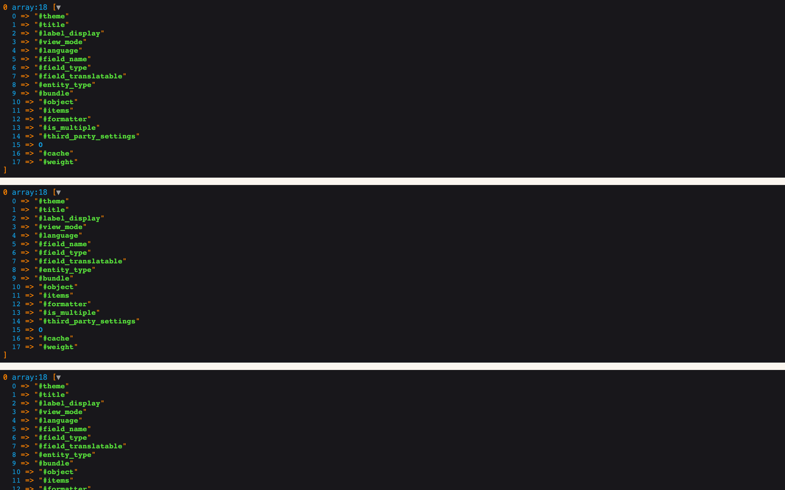
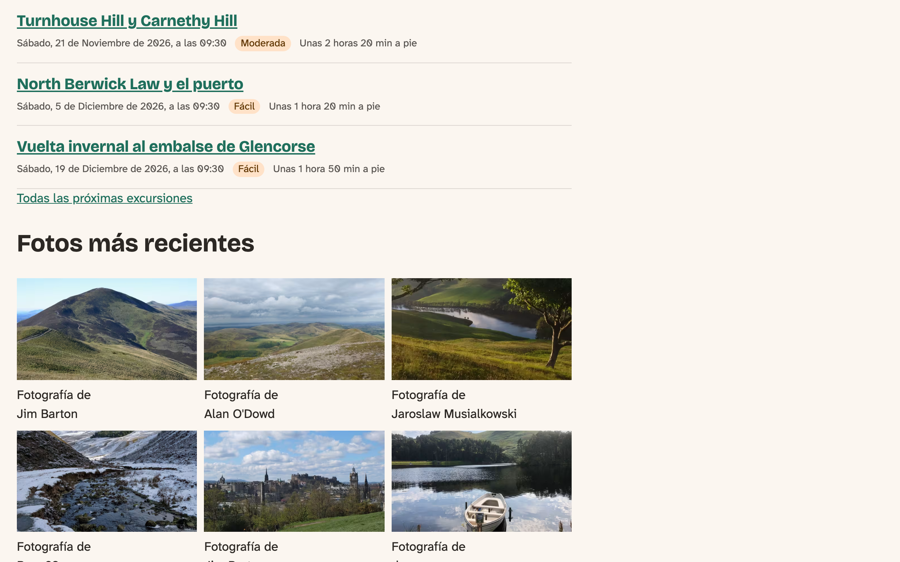

# Twig in Depth

The chapter on Twig basics gave us what we need day to day. This one opens the lid. We'll look at what's actually inside `content`, finish explaining why some ways of printing it lose cache tags, and meet Twig's tools for reusing markup. Then we'll make strings translatable, find out what templates aren't allowed to do, and see how to look inside a template when it misbehaves.

The club's theme doesn't need most of this yet, and we're not going to pretend it does. Adding a macro or a parent template only so a chapter can show one would be exactly the kind of override we argued against in the previous chapter. So, as we did with suggestions there, we'll try each tool on the club's real templates, see what it does, and take it out again. **At the end of the chapter, the theme is the same as when we started**, and there's no new step to copy. When the components chapter arrives, you'll know what it's built on.

The core site starts at the end of the chapter on preprocess functions. Have a copy of `node--hike--card.html.twig` to go back to, or use Git, because we'll be making a mess of it on purpose. The Drupal CMS site gets a short section, with nothing to change.

## Looking inside a template

Turn on development mode first, the one we used to see the template suggestions:

`ddev drush theme:dev on`

Then add this at the top of `node--hike--card.html.twig`, under the comment:

<!-- include: code/chapter11/snippets/dump-keys.html.twig as=node--hike--card.html.twig -->

`dump()` shows you a value. The `keys` filter narrows that down to the names of what's in it, and you'll want that habit: a render array holds whole objects, and a dump of all of it goes on for a very long way.

Reload the front page. The output isn't where you put it:

*Figure 11.1: `dump()` prints at the very top of the page, once for each card that used the template*

It comes before the `<!DOCTYPE>`, above everything else. That can throw the page into the browser's older layout rules, so don't be alarmed if the page looks wrong underneath. And with development mode off, `dump()` prints nothing at all. That's a good safety net, but take your dumps out anyway.

> **Devel.** Older tutorials reach for the Devel module and its `kint()`. Be careful on Drupal 12 for now. Devel 5.5.0 says it supports Drupal 12, but when we installed it on Drupal 12.0.0-beta2, Drush stopped working, and the site gave an error on every page. Removing it took some repair work. On the Drupal CMS site, which runs Drupal 11, it works, and it's useful for one thing `dump()` can't do: `{{ dpm(page|keys) }}` shows the value in the page's message area, and `{{ devel_dump(page|keys) }}` prints where you put it. Both need development mode, as `dump()` does, and the Twig function `kint()` isn't among the ones Devel offers today. With `dump()` built in, we don't need the module for anything in this book.

## What's in a render array

Here's what the dump said, for the first card:

<!-- include: code/chapter11/snippets/dump-output.txt as=output -->

The first list is `content` on a Card: two fields, the two on the Card display. The second is one of those fields, and it's a **render array**: a set of instructions for making HTML, and the data to do it with.

You can tell the two kinds of key apart at a glance:

- **Keys starting with `#` are properties**, instructions about this piece. `#theme` says which theme hook draws it (here `field`, so `field.html.twig`). `#title` and `#label_display` are the label and where it goes. `#object` is the whole hike, and `#items` is the field's stored values.
- **Keys without `#` are children**, more render arrays inside this one. Key `0` is the field's first value.

That's why `content.field_date` works in the first place: Twig is reaching for a child. And it's why `{{ content.field_date }}` prints a whole field with its wrapper and label, while `{{ content.field_date[0] }}` prints only the value inside.

Drupal turns the array into HTML at the moment Twig prints it, working from the outside in. It takes a while to wrap your head around this: until that moment, nothing is HTML yet, and anything along the way can still change it. It's how `|add_class` could add a class to a field that hadn't been drawn yet.

### Why some printing loses cache tags

In the chapter on Twig basics, we measured what happens to the tag `taxonomy_term:58` when you print a hike's area in different ways, and promised to explain it. Here's the area's first child on the page of the Glencorse Reservoir winter loop:

<!-- include: code/chapter11/snippets/dump-cache.html.twig as=node--hike--full.html.twig -->

And what that shows:

<!-- include: code/chapter11/snippets/dump-cache-output.txt as=output -->

There it is. The tag isn't on the node, or even on the field. It's in `#cache`, on the child that links to the term, the deepest piece that knows about the term. Tags travel upward when that array is rendered, and only then. So we can predict the table from the earlier chapter, and add to it:

| In the template | Is that child rendered? | `taxonomy_term:58` in the tags? |
|---|---|---|
| `{{ content }}` | Yes | Yes |
| `{{ content\|without('field_date') }}` | Yes, the area is still in there | Yes |
| `{{ content.field_area[0] }}` | Yes | Yes |
| `{{ content.field_area[0]['#title'] }}` | **No**, we took a property out of it | **No** |
| `{{ node.field_area.entity.label }}` | **No**, there's no render array at all | **No** |
| ``, never printed | Yes | Yes |

Look at the last row: the tag comes along even though nothing appeared on the page, because rendering is what counts. And `without` works because it hands back a copy of `content` with some keys taken out, and the ones left in still get rendered. Those two rules, *rendering carries the tags* and *a value you pull out by hand doesn't*, explain everything in the table.

### Is this field empty?

Here's a trap that comes straight from what we've learned. The Glencorse hike has no elevation gain, and we'd like a heading only when there is one. This looks right:

<!-- include: code/chapter11/snippets/empty-field.wrong.html.twig as=node--hike--full.html.twig -->

We tried it, and the heading appeared with nothing below it. Here's the empty field:

<!-- include: code/chapter11/snippets/empty-field-output.txt as=output -->

It's an array with two properties in it, and to Twig a non-empty array is true. What we want to know is whether anything comes out when it's drawn, so we ask exactly that:

<!-- include: code/chapter11/snippets/empty-field.right.html.twig as=node--hike--full.html.twig -->

That one correctly shows no heading. It does render the field twice, which is fine for one field and something to think about for a big one. And a field whose formatter produces only white space still counts as having output, so if yours can do that, add `|striptags|trim`.

> **Try it:** Dump `content.field_area|keys` on a hike's full page, then `content.field_area[0]|keys`. Which keys are properties and which are children? Then remove the dump.

## Reusing markup

Twig has four ways of sharing markup between templates, and they're often mixed up. As you try these, remember they're Twig's own features. Drupal's theme system only knows about the template it picked; whatever that template includes is invisible to the suggestions and to the debug comments.

### ``: a template based on another

Say the front page should wrap the hero region in an extra `div`. Copying all of `page.html.twig` to `page--front.html.twig` for one `div` would be a poor deal: now there are two page templates to keep in step. With `extends`, the front page template contains only what's different.

There's a price, and it's paid in the parent. A child can only replace what the parent has marked as a ``, so `page.html.twig` needs one:

<!-- diff: code/chapter10/steps/02-color-scheme/core/lens_trail/templates/layout/page.html.twig code/chapter11/snippets/page.with-block.html.twig as=templates/layout/page.html.twig -->

And then the whole of the new `templates/layout/page--front.html.twig` is this:

<!-- include: code/chapter11/snippets/page--front.html.twig as=templates/layout/page--front.html.twig -->

`parent()` means "what the parent had here". After a cache rebuild, the front page has the wrapper, and hike pages don't. We tried it without the block in the parent, too: no error, no wrapper, and no hint about why. If a child seems to do nothing, check the block's name in the parent first.

`@lens_trail` is a **namespace**, a short name for the `templates` folder of that theme. `` also worked when we tried it, and you'll see that form in other themes, but the namespace says exactly which file you mean.

> **Drupalism:** A Twig `` has nothing to do with a Drupal block, the thing you place in a region. Twig's is a named hole in a template. Both words are here to stay, so watch which one people mean.

### ``: another template, dropped in

`include` puts another template's output where you ask, and lets you give it values. Here's a small file:

<!-- include: code/chapter11/snippets/hike-card-fact.html.twig as=templates/content/hike-card-fact.html.twig -->

And using it from the card:

<!-- include: code/chapter11/snippets/include.html.twig as=node--hike--card.html.twig -->

An included template can see all the variables of the template that included it, unless you say `only`, as we did. Use `only`. When we left it out, the file could quietly print `label` and `walking_time`, and a file that depends on where it's used is hard to reuse. With `only`, everything it needs is listed where it's called.

### Macros: a function that makes markup

A **macro** is like a function for Twig, and it lives in the file that uses it:

<!-- include: code/chapter11/snippets/macro.html.twig as=node--hike--card.html.twig -->

The `tag = 'div'` gives an argument a default value, which has to be a constant, not a calculation. Macros can't see the template's variables at all, not even `label`, so you have to pass in what they need. And Twig still escapes what you give them: when we passed `<b>x</b>` as text, the visitor got to read the characters, tags and all.

Macros are at their best when markup repeats within one file, and especially when it repeats inside itself. That's why you'll find one in core's `menu.html.twig`: a menu has items that have menus that have items, and a macro can call itself.

### ``: include, with holes

`embed` is an `include` where you can also fill in the template's blocks. Here's a box with two blocks:

<!-- include: code/chapter11/snippets/hike-card-box.html.twig as=templates/content/hike-card-box.html.twig -->

And filling in the holes from the card:

<!-- include: code/chapter11/snippets/embed.html.twig as=node--hike--card.html.twig -->

We'll keep this short on purpose, because this is the tool that matters most for components, and the components chapter has the real comparison between `include` and `embed`. For now, the difference is what can vary: `include` takes values, `embed` also takes chunks of markup.

| You want | Use |
|---|---|
| A page or block that's the same as another, with one part different | `extends`, with a `` in the parent |
| The same small piece of markup in several templates | `include`, or better, the component it's about to become |
| Markup that repeats within one file, or inside itself | A macro |
| A shared frame with different markup inside | `embed`, or a component's slots |

Before reaching for any of these, go through the checklist from the previous chapter. A new file you can include is still a new file to look after.

## Translating what a template says

The club's site is in English and Spanish, and most of its words already switch by themselves: Drupal's and the content's. The words a template adds are ours to mark. We've been doing that for two chapters with `|t`, and there are a few more things to know. Here are the three forms:

<!-- include: code/chapter11/snippets/trans.html.twig as=node--hike--card.html.twig -->

`|t` is the right choice for short strings. `` reads better for longer ones. There, Drupal makes the placeholder for you from the variable's name, so translators see *On foot for about @walking_time*. With ``, they get to write both forms, and languages with more than two forms can have them. Inside a `` you can use simple variables and things like `node.id`, but not calculations: `{{ node.id + 1 }}` stops the page with an error.

Placeholders come in three flavors, and we checked what each one does with a value containing HTML:

| Placeholder | What happens to the value |
|---|---|
| `@name` | Escaped. The one you'll usually want. |
| `%name` | Escaped and wrapped in `<em class="placeholder">`. In ``, write `{{ name\|placeholder }}`. |
| `:url` | For the address in a link. |

What matters most is that the whole sentence must be one string, with its variables as placeholders. Word order changes between languages, so a sentence glued together from pieces can't be translated properly. And don't build the text before you translate it:

<!-- include: code/chapter11/snippets/trans.wrong.html.twig as=node--hike--card.html.twig -->

We tried that on the Spanish front page, and three cards put three new strings in the translation list, *Hike: 7*, *Hike: 13* and *Hike: 14*, each waiting for a translator, and none of them would ever be used for anything else.

To see a translation work, the card's walking time is ready as it is. Open the front page in Spanish once, so that Drupal learns the string exists. Then go to **Configuration > Regional and language > User interface translation**, search for *About @time on foot*, and enter *Unas @time a pie*:

*Figure 11.2: The walking time in Spanish. Our sentence is translated, and Drupal's `formatInterval()` has already put the hours and minutes in Spanish*

No code changed: that's what marking the string in the chapter on preprocess functions bought us. We'll come back to this properly in the chapter on translations.

> **Try it:** Translate the color scheme setting's **Color scheme** label the same way. Which language do you need to be using to see it? *(It's a string from our PHP, and it behaves the same way.)*

## What a template isn't allowed to do

Now let's try something rude. We made a page we didn't care about, and put this in a template for that one page:

<!-- include: code/chapter11/snippets/sandbox.html.twig as=node--24.html.twig -->

The page failed, the node was still there afterward, and the log said:

<!-- include: code/chapter11/snippets/sandbox-error.txt as=output -->

That's Twig's **sandbox**. Drupal runs every template inside it, and it decides which methods a template may call on an object. By default, those are the methods whose names start with `get`, `has` or `is`, and `id`, `label`, `bundle`, `get`, `toString` and `__toString`. Everything else stops with this error, and that includes `node.save()` and `node.setTitle()`, which we tried too. The idea is that a template should be able to read and never to change anything. Reading properties, as in `node.field_area.entity.label`, isn't limited this way, which is why that line from the earlier chapter runs at all.

There's one class that's completely open: `Attribute`, because it's meant to be changed from a template. That's why `attributes.addClass()` is fine.

Why go to this trouble? Because Twig isn't only in theme files. Site builders write it in the rewrite settings of a View, for example, and those people shouldn't be able to delete content by typing into a box.

If you meet this error, the fix is nearly always to work out the value in a preprocess function and hand it to the template. You'll find settings that widen the list, `twig_sandbox_allowed_methods`, `twig_sandbox_allowed_prefixes` and `twig_sandbox_allowed_classes` in `settings.php`. We don't recommend them: they change the rule for every template on the site, including the ones typed into a box.

Note, too, what the sandbox doesn't do. It doesn't escape your output (that's auto-escaping, from the chapter on Twig basics), and it doesn't check who's looking. A template that's been given something private will print it.

## On the Drupal CMS site

It's the same Twig, and Mercury uses all four of these tools, each for a good reason. Look in the `mercury` theme:

- `templates/block/block--system-branding-block.html.twig` starts with ``.
- `templates/layout/html.html.twig` has an `include` of `@mercury/includes/preload.twig`, which pulls one chunk out of a long file.
- `templates/navigation/menu.html.twig` has the recursive macro we talked about.
- `components/accordion-container/accordion-container.twig` has `embed`, around a component. Most of the `include` and `embed` tags in the theme are like this, with names such as `mercury:icon` instead of a path. That's where we're going next.

There's nothing to change on this site in this chapter.

## Clean up

Take out everything you tried, so the theme is as it was:

1. Remove any `dump()`, and any of the new templates: `page--front.html.twig`, `hike-card-fact.html.twig`, `hike-card-box.html.twig`, and any full-page or one-page node templates.
2. Put `page.html.twig` and `node--hike--card.html.twig` back. If you're using Git, `git restore` does it. Otherwise, copy them from `code/chapter10/steps/02-color-scheme/core/lens_trail/templates/`.
3. Turn development mode off with `ddev drush theme:dev off`, and rebuild the cache with `ddev drush cache:rebuild`.

## Summary

You can now:

- look inside a template with `dump()` and `|keys`, and read a render array's properties and children;
- explain when a cache tag reaches the page, and when it doesn't;
- test correctly whether a field has anything to show;
- choose between `extends`, `include`, a macro and `embed`, and say when none is worth it;
- write strings translators can work with, in `|t` and ``, with plurals;
- say what the sandbox stops and why, and what to do when you hit it.

The club's theme hasn't changed. Next up, it gets some JavaScript.

## Exercises

1. Dump `content.field_difficulty[0]|keys` on a card. Which key holds the text? Why shouldn't you print that key on its own?
2. Show a *Climb* heading on the hike's full page only when there's something under it, and test it on a hike with an elevation gain and one without.
3. Change the card's walking time to ``. What does the string look like in the translation list now? What happens to the Spanish translation you entered?
4. Read the macro in core's `menu.html.twig`. Draw what happens for a menu three levels deep. Could this be done without a macro? *(challenge)*
5. Write a macro for the walking time that takes the time and, optionally, the HTML tag to use. If there's no time, it should say so, in words a translator can get at. *(advanced)* (The answer is in Appendix B.)

## Want to know more?

- Twig's documentation: [`extends`](https://twig.symfony.com/doc/3.x/tags/extends.html), [`include`](https://twig.symfony.com/doc/3.x/tags/include.html), [`macro`](https://twig.symfony.com/doc/3.x/tags/macro.html), [`embed`](https://twig.symfony.com/doc/3.x/tags/embed.html), [`dump`](https://twig.symfony.com/doc/3.x/functions/dump.html), and [the sandbox](https://twig.symfony.com/doc/3.x/sandbox.html).
- Drupal.org: [Debugging Twig templates](https://www.drupal.org/docs/develop/theming-drupal/twig-in-drupal/debugging-twig-templates) and [Translation in Twig templates](https://www.drupal.org/docs/develop/theming-drupal/twig-in-drupal/translation-in-twig-templates).
- Drupal API: [the Render API overview](https://api.drupal.org/api/drupal/core%21lib%21Drupal%21Core%21Render%21theme.api.php/group/theme_render) and [cacheability of render arrays](https://www.drupal.org/docs/drupal-apis/render-api/cacheability-of-render-arrays).
