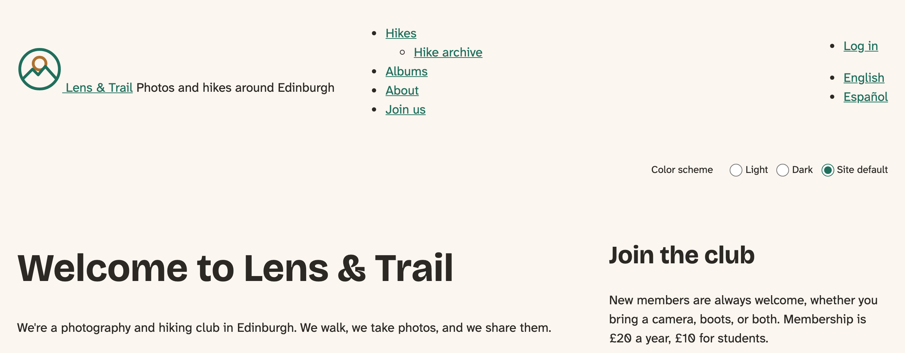
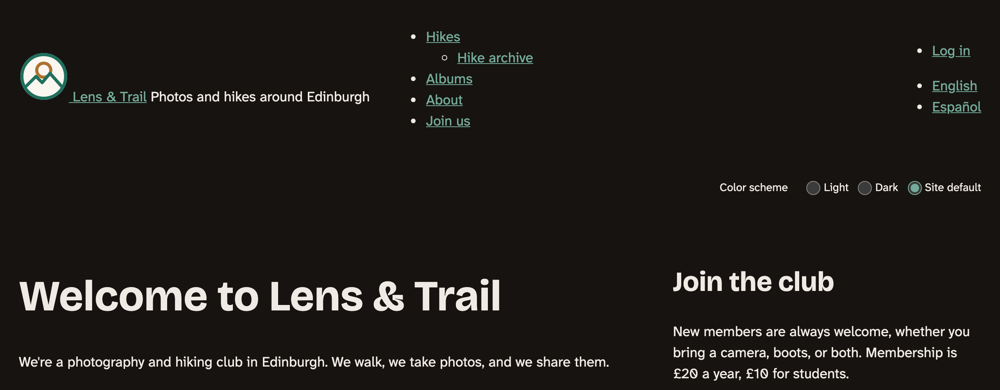
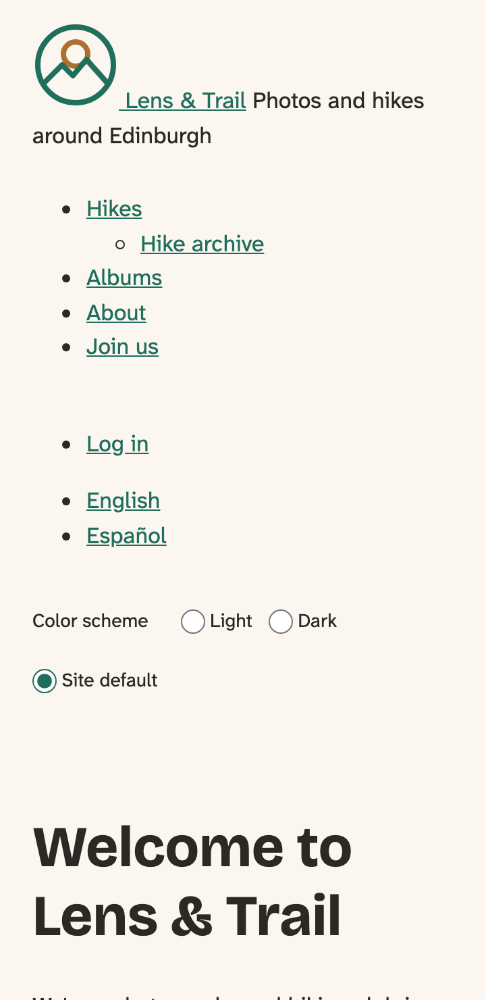
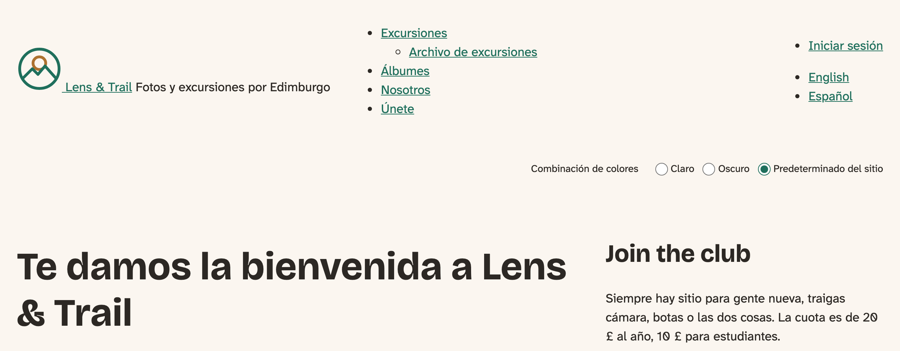

# JavaScript the Drupal Way

Back in the design chapter, the club asked for a toggle: visitors should be able to choose light, dark or the system's setting, and we promised to build it when we got to JavaScript. Here we are. It's a small feature with a surprising amount in it. It has to survive Drupal's page cache, it has to act before the page appears, and it has to leave visitors without JavaScript no worse off.

Building it will take us through what makes JavaScript in Drupal a little different from JavaScript elsewhere: attaching scripts with libraries, **behaviors**, `once()`, `drupalSettings`, and translated strings. There's no framework, no jQuery and no build step on the core site, because none of it is needed.

The core site starts at the end of the chapter on Twig in depth, which left the theme as the preprocess chapter had it. The Drupal CMS site gets a short section, with nothing to change.

## Start without JavaScript

The first decision is what happens when there's no JavaScript at all: a script fails to load, a network drops out halfway, someone has turned it off. The club's site already does the right thing without any: `color-scheme: light dark` follows the visitor's device, and the administrators' setting from the preprocess chapter can fix the colors. That's a working site, and JavaScript will only add to it. This approach is called **progressive enhancement**, and the menu in a later chapter depends on it, too.

So the toggle will be **created by JavaScript**. If it were in a template, visitors without JavaScript would see three radio buttons that do nothing. If the script makes it, they never know it exists, and they lose nothing. A pleasant side effect: we need no template, and no new override.

As for the control itself, we're using three real radio buttons in a `fieldset`. The browser then does the hard parts for us. The arrow keys move between them, a screen reader says which is chosen and what the group is called, and they look right in forced colors. Building that from `div`s would take a lot of ARIA, to end up with what the browser had already.

## The problem with stored pages

Now the part that makes this interesting. For anonymous visitors, Drupal stores one finished copy of each page and sends it to everyone. So the server can't write one visitor's choice into the HTML: the next visitor would get it too. The choice has to live in the visitor's browser, and it's the browser that has to apply it. We tested this: a visitor who'd chosen Dark received the same stored page (`X-Drupal-Cache: HIT`) as a visitor who hadn't, and each saw their own colors.

We'll use `localStorage`, a small store in the browser that lasts between visits. The script sets the same `data-color-scheme` attribute that our CSS has responded to since the preprocess chapter, so **the CSS doesn't change at all**.

But when should it run? Scripts in Drupal normally load at the end of the page. By then, the browser may already have painted the page in the wrong colors, and a visitor who chose Dark gets a flash of white on every page. It's the sort of thing that makes people turn a feature off.

The answer is to split the work in two. A tiny script runs in the `<head>`, before the browser has anything to paint:

<!-- include: code/chapter12/steps/01-toggle/core/lens_trail/js/color-scheme-early.js as=js/color-scheme-early.js -->

It's the one script in the theme that doesn't follow the rules in the next section, and that's deliberate. It has nothing to attach to yet, because the page doesn't exist so far. It doesn't touch the Drupal object, and it wraps the storage in `try`, because browsers can block `localStorage`, and then reading it throws an error.

Libraries normally put their scripts at the bottom, and `header: true` is what moves this one up. Here are the two new libraries:

<!-- diff: code/chapter10/steps/02-color-scheme/core/lens_trail/lens_trail.libraries.yml code/chapter12/steps/01-toggle/core/lens_trail/lens_trail.libraries.yml as=lens_trail.libraries.yml -->

We want them on every page, so they go in the info file, alongside `lens_trail/base`:

<!-- diff: code/chapter10/steps/02-color-scheme/core/lens_trail/lens_trail.info.yml code/chapter12/steps/01-toggle/core/lens_trail/lens_trail.info.yml as=lens_trail.info.yml -->

We measured whether this works, by having the browser note the attribute at the moment the `<body>` element appeared, with Dark stored and aggregation on:

| | `data-color-scheme` when `<body>` starts |
|---|---|
| With the early script | `dark` |
| Without it | Nothing yet: the page starts out light |

Because it blocks the browser from going on until it's run, a script like this has to stay tiny. This one is, and it shouldn't grow.

## Behaviors and once()

Now for the toggle itself. Coming from elsewhere, you might write this:

<!-- include: code/chapter12/snippets/dom-content-loaded.js as=js/example.js -->

Drupal pages change after they've loaded, though. To see what that does, we turned on AJAX for the `/hikes` View for a moment, ran that script, and filtered by difficulty:

| | Rows on the page | Rows the script had found |
|---|---|---|
| After loading | 5 | 5 |
| After filtering with AJAX | 2 | **0** |

The two new rows came in after the script had finished, and it never saw them. Drupal's answer is a **behavior**: a function you register, which Drupal calls when the page is ready *and* each time new content arrives. When we watched those calls, the filter's update passed in the `div` holding the View, the piece that had changed. That's the **context**, and it's why a behavior searches inside `context`, not the whole `document`.

> **Drupalism: behavior.** It's nothing to do with how anything behaves. A *behavior* is a function in `Drupal.behaviors`, run on the page and on each new piece of it.

There's a catch, and you can guess it. Being called many times means that it can run on the same element more than once:

<!-- include: code/chapter12/snippets/without-once.js as=js/example.js -->

When we made Drupal attach behaviors twice, the header ended up with two lines from that code. That's what `once()` is for. It returns only the elements it hasn't seen under that name before, and marks them. Our toggle, tested the same way, stayed at one. You'll rarely see a behavior without it.

Here's the whole of the toggle:

<!-- include: code/chapter12/steps/01-toggle/core/lens_trail/js/color-scheme-toggle.js as=js/color-scheme-toggle.js -->

The last lines are the behavior, and everything else is the feature. Notice the very first and last lines, too. The whole file is a function that's called straight away and handed `Drupal`, `drupalSettings` and `once`. That keeps our variables out of the global space, and says at a glance what the file relies on. Each of those three is also in the library's `dependencies`, because Drupal only loads what's asked for: a page for an anonymous visitor comes with very little JavaScript, and the library is how you say what you need.

A bit of CSS, in `css/components/color-scheme-toggle.css`:

The complete file

<!-- include: code/chapter12/steps/01-toggle/core/lens_trail/css/components/color-scheme-toggle.css as=css/components/color-scheme-toggle.css -->

After a cache rebuild:

*Figure 12.1: The toggle in the header. It's plain on purpose: the header chapter gives the whole header its design and its proper place*

*Figure 12.2: The same page on a device set to dark*

*Figure 12.3: On a phone*

The labels are at least 44 pixels high, as the design asks for everything in the header. We checked the toggle with the keyboard (the arrow keys change the choice, and the focus ring is there), at 320 pixels wide with no sideways scrolling, and in forced colors. The radio buttons' green has a contrast of 5.6:1 in light mode and 7.1:1 in dark. And there's no transition on the colors, so there's nothing to turn off for people who've asked for reduced motion.

> **Try it:** Choose Dark, and load a few pages. Then open your browser's developer tools, look under **Application** (or **Storage**) at Local Storage, and find `lensTrailColorScheme`. Delete it and reload.

## Passing a value from PHP

There's one thing left. What should **Site default** do on a site whose administrators have set the color scheme to Dark? Just what it says: go back to what the site has chosen. Otherwise the setting would stop working for anyone who'd ever touched the toggle. So the script needs to know the setting. The early script may already have overwritten the attribute, so the page can't tell it.

That's what `drupalSettings` is for: values from PHP, handed to JavaScript as part of the page. It's one more line in the hook from the preprocess chapter:

<!-- diff: code/chapter10/steps/02-color-scheme/core/lens_trail/src/Hook/LensTrailHooks.php code/chapter12/steps/01-toggle/core/lens_trail/src/Hook/LensTrailHooks.php as=src/Hook/LensTrailHooks.php -->

On the page, it arrives as JSON, and `drupalSettings.lensTrail.colorScheme` is the value. Name your settings after your theme, so they can't collide with anyone else's. And remember that everything in it is visible in the page's source, so never put a secret there.

We tested it with the setting at Dark. A new visitor got dark colors with **Site default** selected. Choosing **Light** gave light, and it stayed light after a reload. Choosing **Site default** again brought back dark.

## Strings in JavaScript

`Drupal.t()` is the JavaScript twin of `|t`, and it's in the toggle above. Two things are worth knowing about it.

First, Drupal finds the strings by reading your file as text, and so they have to be written out in full inside the call. `Drupal.t(someVariable)` can't be found.

Second, look at the `context` in the toggle's calls. We almost missed this: on the Spanish site, the word *Light* already had a translation, *Fina*, because core uses it for a font's weight. A **context** keeps the same English word apart when it means different things, and it's worth using for short, common words like these.

Once the strings are translated, under **User interface translation** as in the previous chapter:

*Figure 12.4: The toggle in Spanish, on Drupal 12.0.0-beta2 with JavaScript aggregation turned off*

> **Watch out, while Drupal 12 is in beta.** That caption matters. On 12.0.0-beta2, with JavaScript aggregation on, the translations didn't reach the page: the file with them was there and correct, but the page didn't load it, so the labels stayed in English. With aggregation off, as above, it worked. If yours stay in English, that's the first thing to check.

## JavaScript modules

Modern JavaScript can be split into files that `import` from one another, without any build step, and browsers have supported that for years. In Drupal, you ask for it with an attribute on the file in the library:

<!-- include: code/chapter12/snippets/module.libraries.yml as=lens_trail.libraries.yml -->

<!-- include: code/chapter12/snippets/hike-tools.js as=js/hike-tools.js -->

<!-- include: code/chapter12/snippets/time.js as=js/time.js -->

We tried that on the core site, and it worked with aggregation on: the import was found and the behavior ran. Drupal left the file out of its aggregated files and loaded it by itself, which is what keeps the `./time.js` address working. It also means one more request for each file, so a theme with many small modules pays for it. A module also runs later than a classic script, and it has no shared variables, which is why it doesn't need the wrapping function.

Our toggle stays a classic script. It's one file with nothing to import. When you've got code to share between files, modules are a good way of doing it, as we're about to see.

Not that you need jQuery for any of this, by the way. `once()` and everything else here work without it.

## On the Drupal CMS site

Open `lib/component.js` in the `mercury` theme. It's a small framework of Mercury's own, and by now you can read it. Each component's script, such as `components/navbar/navbar.js`, imports `ComponentType` from it. Inside, it registers a **behavior** named after the component, with `attach`, and it calls `once()` with the component's selector and `context`. It's the same pattern as ours, written once so that every component can share it. The component's `.component.yml` marks its script with `type: module`, the attribute we met above.

Mercury does have a build step, and it's worth seeing what it's for. `npm run build` runs Tailwind, and then esbuild on exactly one file, `src/motion.js`:

`esbuild ./src/motion.js --bundle --minify --format=iife --outfile=./build/motion.js`

Motion is an animation package from npm, and a browser can't import a name like `"motion"` by itself. esbuild pulls it into one file that can be loaded as a classic script. Everything Mercury wrote itself runs as it is, with no build. That's a good rule of thumb: a bundler is for bringing in other people's packages, and if you've got none, you don't need one.

Mercury already has its own color scheme setting, so the toggle stays on the core site. There's nothing to change here.

## Summary

You can now:

- attach JavaScript with a library, and say why its dependencies are listed;
- build a feature that leaves people without JavaScript no worse off;
- keep a visitor's choice in the browser, when the page itself is shared;
- put a small script in the `<head>` when timing matters, and keep it small;
- write a behavior with `context` and `once()`, and explain why each is there;
- hand a value from PHP to JavaScript with `drupalSettings`;
- use `Drupal.t()`, with a context when a word is ambiguous;
- load a JavaScript module from a library, and know what it costs.

The club's visitors can choose their colors now, and the choice follows them from page to page, with no flash.

## Exercises

1. Without the `try`, what happens in the toggle when storage is blocked? Try it in a private window, or by overriding `localStorage` in the developer tools.
2. Log the `context` in the toggle's behavior. Turn on AJAX for the `/hikes` View (**Use AJAX**, under **Advanced** in the View's settings), and filter. What do you see? Turn it off again.
3. Pass the name of the site to JavaScript in `drupalSettings`, and use it in the toggle's legend. Is that better than having it in the markup? Why, or why not?
4. Replace the radio buttons with one button that cycles through the three choices. What do you have to add for keyboard and screen reader users, that the radio buttons did for free? *(challenge)*
5. Open the site in two tabs, and change the toggle in one. The other doesn't notice until you reload. Make it notice. *(advanced)* (The answer is in Appendix B.)

## Want to know more?

- Drupal.org: [JavaScript API overview](https://www.drupal.org/docs/drupal-apis/javascript-api/javascript-api-overview) and [Adding assets to a Drupal theme via libraries.yml](https://www.drupal.org/docs/develop/theming-drupal/adding-assets-css-js-to-a-drupal-theme-via-librariesyml).
- The [`once` library](https://git.drupalcode.org/project/once).
- MDN: [`localStorage`](https://developer.mozilla.org/en-US/docs/Web/API/Window/localStorage), [JavaScript modules](https://developer.mozilla.org/en-US/docs/Web/JavaScript/Guide/Modules), and [the `storage` event](https://developer.mozilla.org/en-US/docs/Web/API/Window/storage_event).
- web.dev: [`light-dark()`](https://web.dev/articles/light-dark).
- The [radio group pattern](https://www.w3.org/WAI/ARIA/apg/patterns/radio/) in the ARIA Authoring Practices Guide, for what a native radio group does for you.
