# Images

The club is a photography club, so its pages are mostly photos. A hike page opens with a big one, and an album is nothing *but* photos. In the first book, the site got its image styles, a Banner and an Album view mode for photos, and a responsive Banner. That's a good start, but it was built before the site had a theme, so it couldn't know how wide the theme's columns are, or that the design wants a different shape of photo on a phone.

This chapter does the theme's half of the work. The banner loads first and in the right size; a phone gets a 4:3 crop instead of a thin 16:9 strip, and the crop keeps what matters in the photo; every photo carries its credit in the design's way; and albums become a grid of squares that opens a photo at a time in a lightbox, with or without JavaScript. Then we do the same on the Drupal CMS site, which has its own image styles, and Canvas, which has its own way of making images responsive.

Every image is in this chapter except one: the big photo on the front page, the hero, gets a chapter of its own.

The core site starts where the chapter on components left it, with the styleguide pages from Appendix D. The Drupal CMS site starts there too, but now it has the hikes and albums as well: since the chapter on components, `tools/setup.sh` adds the first book's hikes and albums to it with a recipe, so both sites have the same pages to theme.

## What the sites already have

Open the hike *Glencorse Reservoir winter loop* on the core site, and look at its photo. The first book set it up like this:

- The **Hike** shows its **Photo** field as a rendered media item, in the media **Banner** view mode.
- That view mode shows the image with the **Responsive image** formatter and the **Banner** responsive image style: three copies, **Banner small** (640 by 360), **Banner** (1280 by 720) and **Banner large** (1920 by 1080), all cut to 16:9 with **Scale and crop**, and a `sizes` line measured on Olivero. Below the photo, the credit fields: photographer, license and source.
- Albums show each photo in the media **Album** view mode, at **Max 1300x1300**, whole, one under the other, each with its credit.

Every one of those image styles ends with the effect **Convert to AVIF**. That's worth a word, because it does more for the club's pages than anything else in this chapter.

### AVIF and WebP

A photo from a camera is a JPEG. JPEG is from 1992, and newer formats squeeze the same picture into far fewer bytes. **WebP** came from Google in 2010; **AVIF**, from 2019, is based on the AV1 video format and is smaller again, often half the size of a JPEG of the same quality. Both handle transparency, which JPEG can't.

Drupal's **Convert to AVIF** effect writes AVIF when the server's image library can, and falls back to the format in its settings, WebP on our styles, when it can't. Ours can: DDEV's PHP has AVIF support in its GD library. Here's what that does for the Glencorse photo, the original upload and the copies the banner uses:

<!-- include: code/chapter14/snippets/banner-sizes.txt as=output -->

The original is over a megabyte. The copy a phone downloads is 16 kilobytes, about one seventieth of it. Some of that is the size, and a lot of it is the format.

AVIF has been in every major browser since January 2024, and is widely available on Baseline's scale since July 2026. The file name tells you what happened: `glencorse-reservoir-portrait_1.jpg.avif` is the JPEG, converted. The browser's developer tools say it too: open them (F12 in most browsers), choose the **Network** tab, filter on **Img**, and reload the page. The **Type** column says `avif`, and **Size** says how much came over the wire.

%% Author: a screenshot of Chrome's DevTools Network tab here (Img filter, the hike page, the Type and Size columns showing avif), as Figure 14.1? Playwright can't capture DevTools, so this one needs your hands. Then renumber the figures below. %%

> **Drupalism:** An **image style** isn't CSS. It's a recipe of effects (scale, crop, convert) that Drupal runs on the server the first time someone asks for a photo in that style. It saves the result as a new file, a **derivative**, under `sites/default/files/styles/`, and sends that file from then on. Change a style, and Drupal throws its derivatives away and makes them again. If you come from WordPress, it's close to an image size registered with `add_image_size()`, except that Drupal makes the file when it's first needed, not when the photo is uploaded.

## Load the banner first

The banner is usually the biggest thing on a hike page, and the first thing a visitor sees, so it decides how fast the page *feels*. Google's measure for that is **Largest Contentful Paint**: the time until the largest image or block of text in the first screen is drawn.

The first book left the Banner display's image on **Lazy** loading, Drupal's default. `loading="lazy"` tells the browser not to fetch an image until it's about to scroll into view. That's right for photos further down, but for the banner it means a delay: the browser can't know where the photo is until it has the CSS and has laid out the page, so the photo waits for both. Fix it where it's set:

1. Go to **Structure** › **Media types** › **Image** › **Manage display**, and open the **Banner** tab.
2. Open the gear of **Image**, and set **Image loading** to **Eager**.
3. **Update**, and **Save**.

That's half of it. The browser now fetches the banner as soon as it reads the ``, but at the same priority as everything else it found by then: fonts, the logo, scripts. `fetchpriority="high"` tells it to put this one first. Drupal has no setting for that, so the theme adds it.

Where? A template would do it, but we'd copy the whole field template to add one attribute to an image inside it. The attribute belongs on the image's render array, before it's rendered, and that's what a preprocess function can reach:

<!-- diff: code/appendix-d/steps/01-sections/core/lens_trail/src/Hook/LensTrailHooks.php code/chapter14/steps/01-loading/core/lens_trail/src/Hook/LensTrailHooks.php as=src/Hook/LensTrailHooks.php -->

`hook_preprocess_field` runs for every field Drupal renders, so the first lines leave out everything but the image field of a media item in the Banner view mode. Each item's `content` is the render array the formatter made. The **Responsive image** formatter takes the ``'s attributes in `#attributes`. The plain **Image** formatter calls them `#item_attributes` instead, so if you ever switch the banner back, change that word too.

After a cache rebuild, the page's source has `` for the banner. Keep it to the few images that really come first: if everything has high priority, nothing does. The only other one on the club's pages is the logo, which gets `fetchpriority="high"` from Drupal itself, in core's template for the site branding block.

`fetchpriority` has been in every major browser since October 2024. A browser that doesn't know it ignores it, so it's safe to use either way.

> **Try it:** Open the Network tab again, and add the **Priority** column (right-click the column headers). Reload the hike page with the step before and after. The banner goes from **Low** to **High**.

## A different crop on a phone

Look at the hike on a phone, about 390 pixels wide. The banner is a strip of 16:9 across the column, a little over 190 pixels tall, and the Glencorse photo, which is a tall photo, loses almost everything: the reservoir is a thin band, and the hills and the trees are gone. The design in Chapter 3 has an answer for that: a 4:3 photo on phones, and 16:9 from the medium breakpoint up.

A different crop at a different width is called **art direction**. It's a different thing from the sizes the first book set up. With sizes, the browser gets the *same* picture in several widths and picks one; it's the browser's choice, and it may take a large copy on a small, sharp screen. With art direction, the *theme* decides: below 40rem, this shape; from 40rem, that one. In HTML, the first is an `` with `srcset` and `sizes`, and the second needs a `<picture>` element with a `<source>` for each shape.

Two things go into it in Drupal: the theme's breakpoints, and a crop that knows what matters in the photo.

### The theme's breakpoints

A **breakpoint** is a screen width where the layout changes. In CSS, they're media queries; in Drupal, a theme can also *declare* them, in a `.breakpoints.yml` file, so that site builders can use them in settings. Responsive image styles are where they're used. Here are the club's, from Chapter 3:

<!-- include: code/chapter14/steps/02-art-direction/core/lens_trail/lens_trail.breakpoints.yml as=lens_trail.breakpoints.yml -->

Each breakpoint has a name made of the theme's name and its own (`lens_trail.narrow`), a label, the media query, and a `weight`, which puts them in order from narrow to wide. `multipliers` are the screen sharpnesses the breakpoint offers separate image styles for. With `sizes`, the browser handles sharpness by itself, so `1x` is all we need. `narrow` has an empty media query: it applies everywhere, until a wider one takes over. The file goes next to `lens_trail.info.yml`, and Drupal reads it on a cache rebuild.

The theme's breakpoints are for art direction only. The first book's Banner used the **Responsive Image** module's own group, which has one breakpoint, "everything", and that stays the right choice for any image whose shape doesn't change: one list of copies, and a `sizes` line. The album later in this chapter keeps it. Not every theme agrees: some themes make every responsive image style use their breakpoints, with a separate image style at each. That's more to set up and maintain, and the browser makes a worse choice with it than with `sizes`, because it only knows about the copies listed for the breakpoint it's in.

> **Drupalism:** "Breakpoint" in Drupal is a piece of configuration a theme or a module provides, with a name, a group and a media query. Your CSS doesn't read them: the `@media` rules in your stylesheets are separate, and Drupal doesn't check that they agree. Keep them in step yourself. Ours are in Chapter 3's design tokens, and the CSS and this file use the same numbers.

### Focal Point

Cutting a 16:9 or a 4:3 out of a photo is what **Scale and crop** does, and it always cuts around the middle. For a landscape, that's often fine. For the Glencorse photo, a portrait, the middle of the photo is grass:

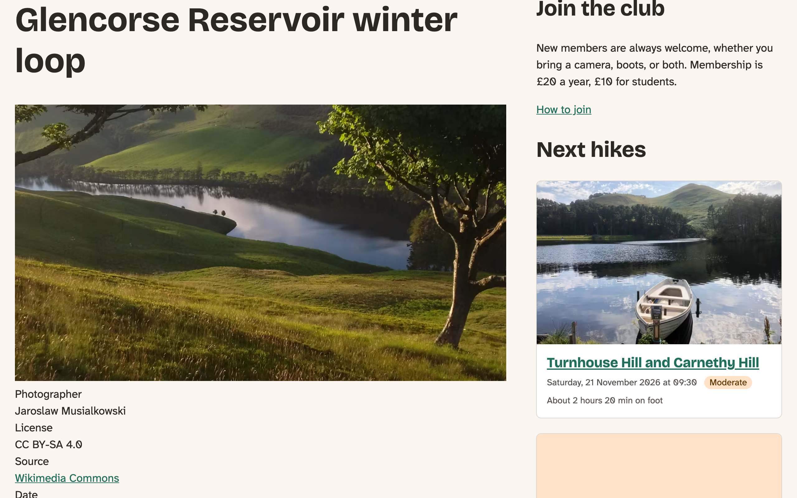
*Figure 14.1: Scale and crop cuts from the middle of the photo*

What the crop needs is a person saying where the interesting part of a photo is. **Focal Point** is a contributed module that does exactly that, and nothing more. It adds a small crosshair to the image field of a media item's form: the editor drags it onto the part of the photo that matters, once, when they upload it. Focal Point then gives Drupal a new image effect, **Focal Point Scale and Crop**, which works like Scale and crop, but cuts the shape around that point, as close to the middle of the crop as the photo's edges allow. One point serves every shape: the 16:9 banner, the 4:3 banner on phones, and the squares in the album.

Focal Point stores the point with the **Crop API** module (`crop`), which keeps crop information for a file, apart from the file itself. That's a module for other modules: you install it because Focal Point needs it, and never see it.

There are other ways to choose a crop, and we looked at two:

- **Image Widget Crop** lets an editor draw a rectangle on the photo for each shape. That's exact, but it's one rectangle per shape per photo: with three shapes on the club's site, three times the work for every upload, and a new shape later means going back to every photo.
- **Smart Crop** guesses: it looks for the busiest part of the photo and crops around that. No editor work at all, but on a landscape photo, the busiest part is often a patch of heather.

Focal Point is one click per photo, it serves every shape we'll ever add, and it's what Drupal CMS uses already, so both sites work the same way. It's what we chose.

> **Focal Point on Drupal 12.** The core site runs Drupal 12, and when we wrote this (November 2026), Focal Point and Crop API had no release for it yet. Both have merge requests in their issue queues that make them work on Drupal 12, so we install the current releases with those merge requests applied as patches. Changing the version line in the modules' `.info.yml` files isn't enough: Drupal 12 no longer finds plugins that are only described in annotations, and both modules still use annotations for their image effect and crop type. The steps, run in the site's folder:
>
> <!-- include: code/chapter14/site/02-focal-point.sh lines=10-23 as=terminal -->
>
> `mglaman/composer-drupal-lenient` is a Composer plugin that lets Composer install a module whose release doesn't list your version of Drupal; you name the modules it may do that for. The patches are in the book's repository, under `code/chapter14/patches/`; `composer-patches`, which the site already has, applies them when it installs the modules. On the Drupal CMS site, which runs Drupal 11, none of this is needed: Focal Point comes with it.

%% Author: shrink this box to a pointer when Book 1 teaches modules without a release for your Drupal version (Book 1 follow-ups in PROJECT-LOG), and remove it when Focal Point and Crop API have Drupal 12 releases. %%

With the module installed, the image field's widget has to be the Focal Point one, on both of the image's forms:

1. Go to **Structure** › **Media types** › **Image** › **Manage form display**.
2. On the **Default** tab, set the widget of **Image** to **Image (Focal Point)**, and **Save**.
3. Do the same on the **Media library** tab, the form editors see when they upload from inside the media library.

Now give the Glencorse photo its point. Open the hike, and use the contextual links on its photo to edit the media item (the site has three photos with that name, and this way you get the right one). Below the file name is the photo, with a crosshair in the middle. Drag it onto the far shore, a third of the way down from the top, where the hills meet the water:

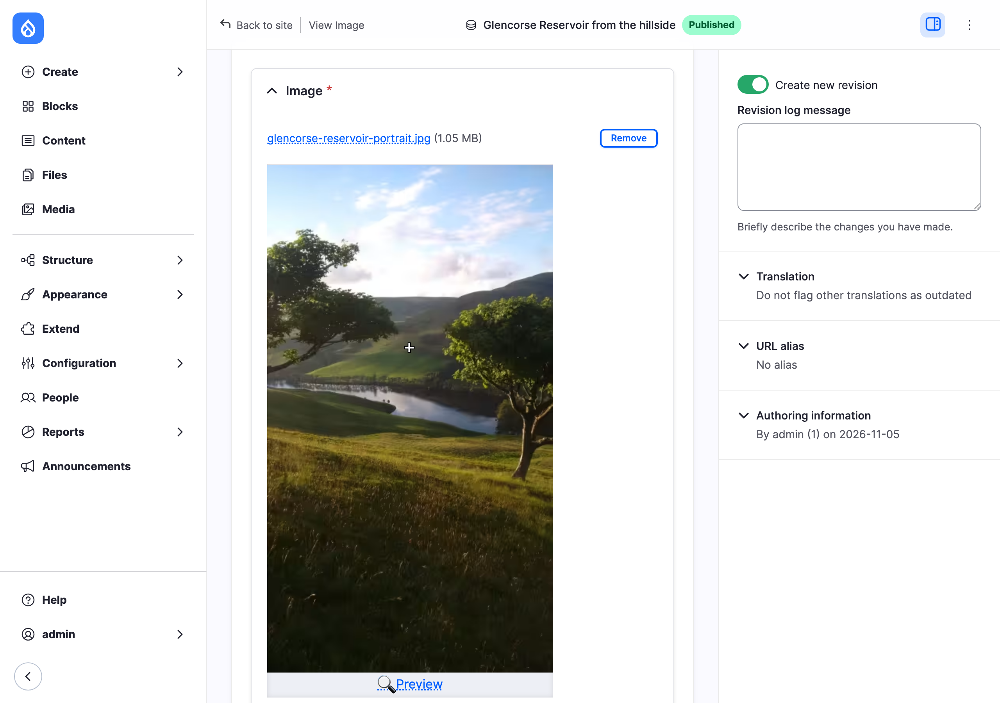
*Figure 14.2: The focal point, on the far shore of the reservoir*

**Preview**, below the photo, opens every image style that uses a focal point, as it would crop the photo. **Save** the media item.

### Five image styles

The three Banner styles get the new effect instead of Scale and crop. For each of **Banner small**, **Banner** and **Banner large**, in **Configuration** › **Media** › **Image styles**:

1. Delete the **Scale and crop** effect.
2. Add **Focal Point Scale and Crop**, with the same width and height as before (640 by 360, 1280 by 720 and 1920 by 1080).
3. Drag it above **Convert to AVIF**, and **Save**.

Then two new styles for phones, in the same way: **Banner phone**, 480 by 360, and **Banner phone large**, 960 by 720, each with **Focal Point Scale and Crop** and then **Convert to AVIF** (with **WebP** as its fallback, like the others).

Why only two for phones? The narrowest phone column is about 270 pixels, and the widest, a little below 40rem, about 590. 480 pixels covers most phones at their real size, and 960 covers sharp screens at twice that. A third style would cost an extra file for every photo, for a gain nobody would see.

### The Banner, art-directed

Last, the responsive image style puts it all together. Go to **Configuration** › **Media** › **Responsive image styles**, and edit **Banner**:

1. Set **Breakpoint group** to **Lens & Trail**, and **Save**. The form now has a section for each of the theme's breakpoints.
2. Open **1x Narrow**. Choose **Select multiple image styles and use the sizes attribute**, type `calc(100vw - 3rem)` as **Sizes**, and check **Banner phone** and **Banner phone large**.
3. Open **1x Medium**, choose the same, type `(min-width: 80rem) 790px, (min-width: 64rem) 62vw, calc(100vw - 3rem)` as **Sizes**, and check **Banner small**, **Banner** and **Banner large**.
4. Leave **1x Wide** on **Do not use this breakpoint**: from 64rem, Medium's styles and its `sizes` line still apply.
5. Keep **Banner** as the **Fallback image style**, and **Save**.

The `sizes` lines are the theme's measurements, and they're why this is the theme's job and not the first book's. Below 64rem, the content column is the screen minus the page's gutters, 1.5rem on each side. From 64rem, the sidebar takes its share, and the column is about 62% of the screen. From 80rem, the page stops growing, and the column stays at 790 pixels. We measured those widths in the browser at a dozen screen widths, with the developer tools, and rounded up. A `sizes` line that's a little too big costs a slightly larger file; one that's too small gives a blurry photo.

After a cache rebuild, the banner is a `<picture>`. This is the page's HTML, with the long file paths shortened:

<!-- include: code/chapter14/snippets/banner-picture.html as=html -->

The browser goes through the `<source>` elements in order, and takes the first whose `media` matches: on a screen of at least 40rem, the 16:9 copies; anywhere else, the 4:3 ones. (Drupal writes them widest first, so the order works.) Each `<source>` has its own `sizes` and its own `width` and `height`, which tell the browser the shape of *that* crop, so it can keep the right space for the photo before it arrives, and the page doesn't jump. The `` at the end does two jobs: it carries the alt text, `loading` and our `fetchpriority` for whichever source wins, and it's the photo for a browser that doesn't understand `<picture>` at all.

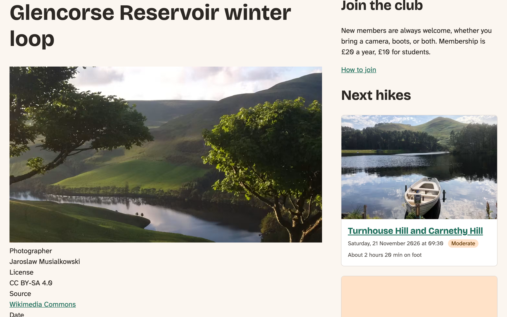
*Figure 14.3: The same 16:9 crop, around the focal point*

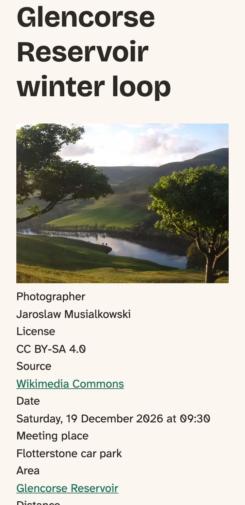
*Figure 14.4: On a phone, a 4:3 crop around the same point*

> **Try it:** Make the browser window narrower than 40rem (640 pixels) and wider again, with the Network tab open. The browser fetches the 4:3 copy when you cross the line, because the source changed. Now make it wider within one breakpoint: nothing new comes, or a larger copy does, but never a smaller one. A browser doesn't throw away a sharper copy it already has.

## The photo credit

Every photo on the club's site is under a Creative Commons license, and the licenses ask for a credit where the photo is used. The first book made sure the credit is always there, as three fields of the media item under the photo. The design in Chapter 3 puts it in the photo's bottom corner instead, small, white on black, as photo sites do: "Photo: Jaroslaw Musialkowski · CC BY-SA 4.0", with the name linking to where the photo came from.

The same photo-with-a-credit comes back in the album, and in the lightbox, so it's a component. It takes the photo as a slot, and the credit's parts as props:

<!-- include: code/chapter14/steps/03-photo/core/lens_trail/components/photo/photo.component.yml as=components/photo/photo.component.yml -->

`credit` decides where the credit goes: `over` the corner, as on a hike page, or `below` the photo, with a caption before it, as in an album. The markup:

<!-- include: code/chapter14/steps/03-photo/core/lens_trail/components/photo/photo.twig as=components/photo/photo.twig -->

A `<figure>` and a `<figcaption>`, because that's what they're for: the caption belongs to the photo, and screen readers say so. And the credit is text, not part of the image. Some sites burn the credit into the photo, but text can be selected, translated, read aloud and clicked, and it doesn't need a new image when someone corrects a name.

The CSS puts it in the corner, and makes sure it's readable on any photo:

<!-- include: code/chapter14/steps/03-photo/core/lens_trail/components/photo/photo.css as=components/photo/photo.css -->

The credit's colors don't follow dark mode, on purpose: it sits on a photo, not on the page, and the photo is the same in both. White on `neutral-950` has a contrast of over 17:1. And `CC BY-SA 4.0` stays on one line: broken at the hyphen, it reads as two things.

The component has two demos, so the styleguide shows both placements, with the default photo standing in for a real one.

### The Banner's template

The hike page shows its photo through the media item's Banner view mode, so the place to call the component is the media template for that view mode, `media--image--banner.html.twig`. It's the most specific suggestion there is: only image media, only in the Banner view mode.

<!-- include: code/chapter14/steps/03-photo/core/lens_trail/templates/media/media--image--banner.html.twig as=templates/media/media--image--banner.html.twig -->

The rendered image goes into the slot, field and all, so Drupal's formatter still makes the `<picture>`. The credit's fields go in as props, which want plain text, so we take their values from the media item, `media.field_photographer.value`, and not their rendered versions from `content`. One exception: the license field stores a short key, and shows a label for it; the label is what we want, and it's in the rendered field, `content.field_license.0['#markup']`. `title_suffix.contextual_links` keeps the editors' pencil that leads to the media item, the one you used to set the focal point.

The credit fields no longer show by themselves on the Banner display, because the template doesn't print them: only what the template prints reaches the page. Leave them enabled in **Manage display** anyway. If someone switches the theme, the credits come back below the photo, which is what the first book had.

*Figure 14.5: The credit in the corner of the banner*

## The album

An album in the first book is a list of photos, one under the other, at up to 1300 pixels each. The design makes it a grid of squares: two across on a phone, three from 40rem, four from 64rem. Each square is a link to the photo, large. With JavaScript, the link opens the photo in a **lightbox** instead, over the page, with the next and previous photos a click or a key away.

%% Author: the wireframe's album grid has no credits under the thumbnails. We added them (Photo: name · license, small, below each square), because the licenses ask for a credit where a photo is used, and a square crop is a use. Is that right, or would you rather show the credits only in the lightbox? %%

### Squares

Two more image styles, made like the phone banners: **Album square**, 320 by 320, and **Album square large**, 640 by 640, each with **Focal Point Scale and Crop** and **Convert to AVIF**. The focal point you set for the banner decides the squares too.

Then a responsive image style, **Album**, in the **Responsive Image** group this time, because the shape doesn't change:

1. **Add responsive image style**, label `Album`, **Breakpoint group** **Responsive Image**, and **Save**.
2. Under **1x Viewport Sizing**, choose **Select multiple image styles and use the sizes attribute**. Check **Album square** and **Album square large**, and type the grid's sizes:
   `(min-width: 80rem) 185px, (min-width: 64rem) calc(15vw - 0.75rem), (min-width: 40rem) calc(33vw - 1.6rem), calc(50vw - 2rem)`
3. **Album square** as the fallback, and **Save**.

Read the `sizes` line from the end: on a phone, half the screen less the gutters and the gap; from 40rem, a third; from 64rem, a quarter of the content column, which is 62% of the screen, so about 15%; from 80rem, a fixed 185 pixels. On the media **Album** display, set **Image** to **Responsive image** with the **Album** style, no link, and **Lazy** loading: an album is long, and the photos further down can wait until someone scrolls to them.

### The grid and the lightbox, as a component

The Album component is the grid, and the lightbox that goes with it:

<!-- include: code/chapter14/steps/04-album/core/lens_trail/components/album/album.component.yml as=components/album/album.component.yml -->

It has no props, and one slot: the photos, each in its own `<li>`. `libraryOverrides` adds the two core libraries its script uses, `Drupal.t()` and `once()`, as in the chapter on JavaScript.

<!-- include: code/chapter14/steps/04-album/core/lens_trail/components/album/album.twig as=components/album/album.twig -->

A list, because an album *is* a list of photos, and screen readers say how many items a list has before they go through it.

Two templates feed it. The album's **Photos** field is drawn by `field--node--field-photos--gallery.html.twig`, which hands each photo to the component as a list item:

<!-- include: code/chapter14/steps/04-album/core/lens_trail/templates/field/field--node--field-photos--gallery.html.twig as=templates/field/field--node--field-photos--gallery.html.twig -->

And each photo is a media item in the **Album** view mode, drawn by `media--image--album.html.twig`. It makes the square into a link, and puts it in the Photo component, with the credit below:

<!-- include: code/chapter14/steps/04-album/core/lens_trail/templates/media/media--image--album.html.twig as=templates/media/media--image--album.html.twig -->

The link needs a target: the photo, large. The image formatter can link an image to its file, but that's the original upload, which is over a megabyte, a JPEG, and often much bigger than the screen. We want the first book's **Max 1300x1300** copy, uncropped and in AVIF, and a list of sizes for the lightbox. No setting gives that, so a preprocess function makes it:

<!-- diff: code/chapter14/steps/03-photo/core/lens_trail/src/Hook/LensTrailHooks.php code/chapter14/steps/04-album/core/lens_trail/src/Hook/LensTrailHooks.php as=src/Hook/LensTrailHooks.php -->

`buildUrl()` gives the address of a photo in an image style, whether the derivative exists yet or not; Drupal makes it on the first request. `large.href` is the link, and `large.srcset` lists all three Max styles with their widths, for the lightbox. The template writes them into the link, with the media item's name as the caption.

### Without JavaScript

That's already a working album. Each square is a link to a large copy of the photo; the browser shows it, and Back returns to the album. It's not pretty, but nothing is lost: no photo you can't see, and no button that does nothing. Everything the script adds next is on top of that, which is what the chapter on JavaScript called **progressive enhancement**.

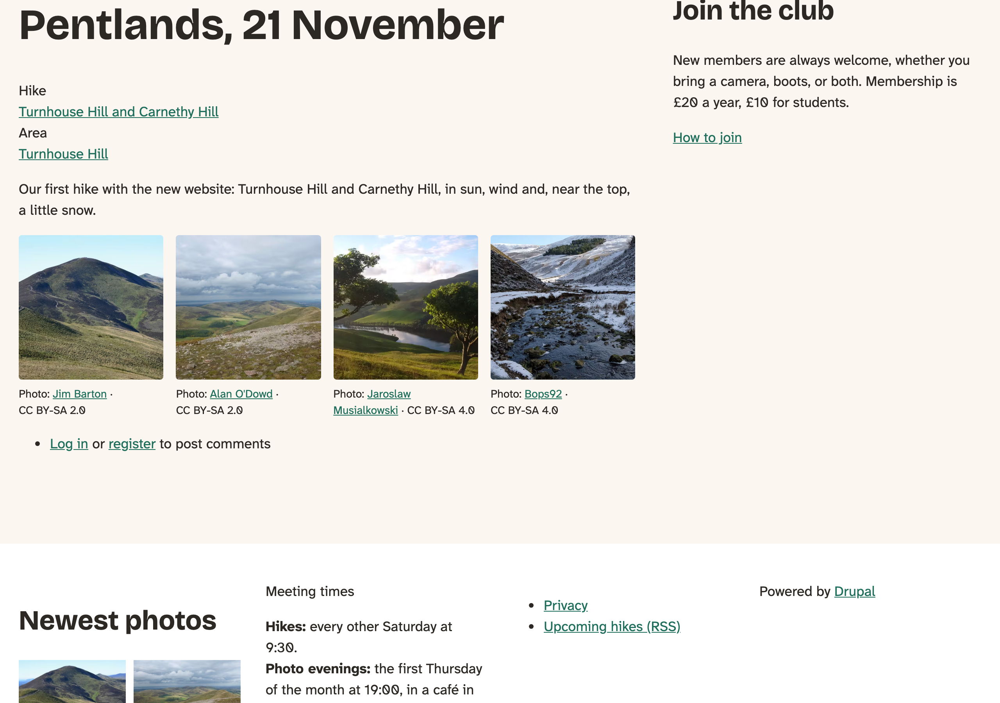
*Figure 14.6: An album on a wide screen, four squares a row*

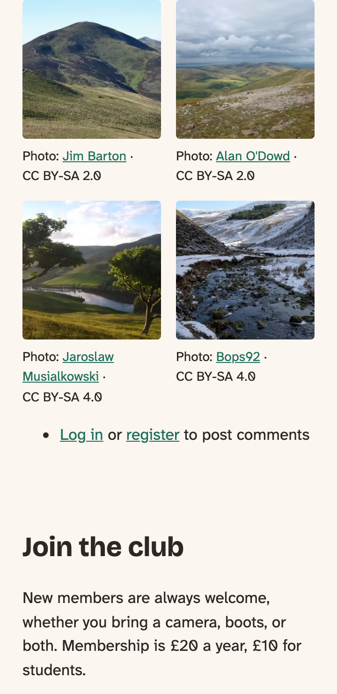
*Figure 14.7: On a phone*

### The lightbox

There are lightbox modules for Drupal, and two are well known. **Colorbox** is one of the oldest: it adds a formatter that opens images in a lightbox made by the Colorbox library, a jQuery plugin. **PhotoSwipe** does the same with the PhotoSwipe library, which has swipe gestures and pinch to zoom, and no jQuery. Both need their JavaScript library downloaded into the site, both bring their own markup and styles to theme over, and both mean one more module to keep up to date.

We wrote our own instead, because the browser now does the hard parts. The `<dialog>` element, opened with `showModal()`, is a box over the page, with a backdrop behind it. While it's open, the rest of the page can't be reached with the keyboard or a screen reader; Escape closes it; and it's on top of everything else, without `z-index` battles. That's most of what a lightbox library used to be for. `<dialog>` has been in every major browser since March 2022.

The script, `album.js`, is attached by the component, so it's on every page with an album and no other:

<!-- include: code/chapter14/steps/04-album/core/lens_trail/components/album/album.js as=components/album/album.js -->

The shape is the chapter on JavaScript's: a behavior, and `once()` so each album is set up one time, however often Drupal attaches behaviors. Then, for each album:

- **One dialog per album**, made in JavaScript, because without JavaScript there's nothing to open. The buttons have their labels in visually hidden text, so a screen reader says "Previous photo", not "‹".
- **A click on a square** opens the dialog at that photo, *unless* it's a click with Ctrl or Cmd, Shift, or the middle button: those mean "open in a new tab or window", and a link should still do that.
- **The photo** gets the link's `href` as its `src`, and its `srcset` with `sizes="100vw"`, so the browser takes the Max copy that fits the screen. The alt text comes from the square, and the caption and credit are copied from the square's own figure.
- **The count**, "2 of 4", is in an `aria-live` region, so a screen reader says it when it changes.
- **The arrow keys** and the buttons go to the previous and next photo, and round: after the last comes the first. A click on the dark area around the photo closes the dialog, like Escape and the Close button.
- **When the dialog closes**, the focus goes back to the square of the photo the visitor was looking at, which may not be the one they opened. Without that, a keyboard user would be sent back to the top of the page.

The CSS for the grid and the lightbox is in `album.css`. The lightbox is dark around the photo in both color schemes, like a slide projector, and its focus ring is white, so it shows on the dark background. On a phone, the count and Close go above the photo and the arrows below it, in a grid. From 40rem, the arrows move to either side of the photo, and that took us a try:

<!-- include: code/chapter14/steps/04-album/core/lens_trail/components/album/album.css lines=129-153 as=components/album/album.css -->

The arrows are positioned absolutely, halfway down. But they were also grid items with a `grid-area`, and an absolutely positioned grid item with an area is placed against that area, not the dialog: 50% was halfway down the arrows' own row, at the bottom of the screen. `grid-area: auto` lets them go.

The complete file

<!-- include: code/chapter14/steps/04-album/core/lens_trail/components/album/album.css as=components/album/album.css -->

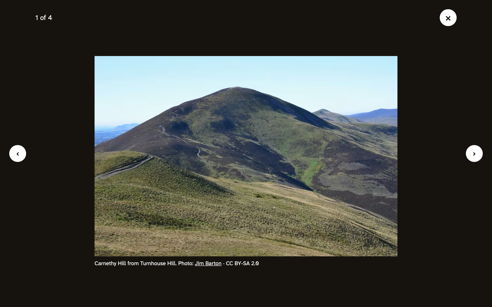
*Figure 14.8: The lightbox*

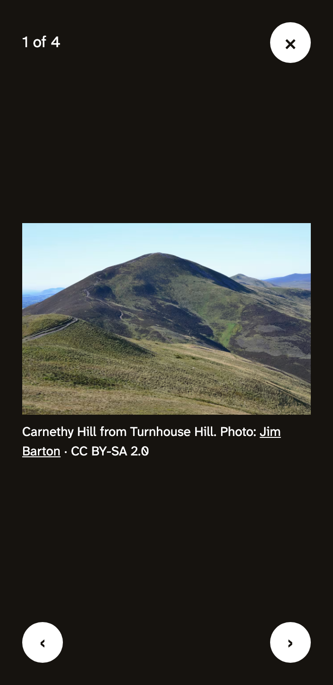
*Figure 14.9: On a phone, the arrows go below the photo*

We tried the album with the keyboard: Tab reaches each square, Enter opens it, the arrow keys move, Tab stays inside the dialog, Escape closes it, and the focus lands on the right square. With JavaScript turned off, each square opened its large copy. And with Ctrl-click, a new tab, as a link should.

The Album gets a demo for the styleguide too, so you can try the grid and the lightbox at any width without an album page. Its one slot is the list of photos. A demo can't render a media item, but SDC Styleguide renders a slot written as text as a Twig template, so the demo can loop over four made-up photos and call the real Photo component for each:

<!-- include: code/chapter14/steps/04-album/core/lens_trail/components/album/album.demo.four-photos.yml as=components/album/album.demo.four-photos.yml -->

The link around each photo copies what `media--image--album.html.twig` makes, so if you change one, change the other. The photos are the club's default photo, the same as in the Photo component's demos. We tried the lightbox in the styleguide: it opened at the photo we clicked, the arrow keys moved, and Escape brought the focus back to the right square.

> **Try it:** Open an album, open a photo, and look at the Network tab as you go to the next one. The browser fetches one Max copy per photo, in the size that fits your screen, and only when you get to it.

## On the Drupal CMS site

The Drupal CMS site has the same hikes and albums, and the same Banner and Album view modes, through the recipe. But it starts from a different place when it comes to images, so let's look before we change anything.

### What Drupal CMS brings

Drupal CMS comes with Focal Point and Crop API installed and on its image forms (with releases for Drupal 11, which it runs), and with dozens of image styles, all cropped around the focal point and all in WebP. Their machine names say what they are: `16_9_1008x567_focal_point_webp` is 16:9, 1008 by 567 pixels. There's a set for each common shape (16:9, 4:3, 3:2, square, and portrait shapes) and a set of `uncropped_` ones that only scale.

It has responsive image styles too, one for each shape and size, `16_9_wide`, `4_3_medium` and so on, and the recipe maps the first book's Banner to `16_9_wide`. They all use one breakpoint group, `custom`, with breakpoints at 500, 700, 1000 and 1300 pixels. Those aren't Mercury's: they're made by an **ECA** model. ECA (Events, Conditions, Actions) is a module that lets site builders describe "when this happens, do that" without code, and Drupal CMS uses it for a lot of its setup; one of its models, `define_breakpoints`, adds those four. And every one of those styles has `sizes="100vw"`: Drupal CMS can't know how wide Mercury's columns are, so it assumes the whole screen. That's safe, but a photo in a narrow column downloads a copy far bigger than it needs.

So the theme's job is the same as on the core site, with what's already there.

### Breakpoints, and the two styles

Mercury gets the club's breakpoints too, in `mercury.breakpoints.yml`. They're the core theme's, with Mercury's name:

<!-- include: code/chapter14/steps/05-cms/cms/mercury/mercury.breakpoints.yml as=mercury.breakpoints.yml -->

The responsive image styles are made in the same forms as on the core site, with Drupal CMS's image styles. No new image styles this time: everything we need is there already. The focal points aren't, though: they're stored on this site, not in the photo, so the recipe's photos came in with Focal Point's default, the middle. Set the Glencorse photo's point on the far shore, as on the core site.

- **Banner**, on the **Mercury** breakpoint group. **Narrow**: `calc(100vw - 2rem)`, with `4_3_500x375`, `4_3_700x525` and `4_3_960x720` (all `_focal_point_webp`). **Medium**: `16_9_704x396`, `16_9_1008x567`, `16_9_1312x738` and `16_9_1800x1080`, with the sizes below. Fallback `16_9_1008x567_focal_point_webp`. The media **Banner** display uses it, with **Eager** loading.
- **Album**, on **Responsive Image**, with `1_1_300x300` and `1_1_600x600`, and the grid's sizes. The media **Album** display uses it, with **Lazy** loading.

The `sizes` lines are where the theme comes in. Mercury's page is Tailwind's `container`, which doesn't grow smoothly with the screen: it jumps to a fixed width at each of Tailwind's breakpoints, 40, 48, 64, 80 and 96rem, less 1rem of padding on each side. So the banner's line is a list of fixed widths:

`(min-width: 96rem) 1504px, (min-width: 80rem) 1248px, (min-width: 64rem) 992px, (min-width: 48rem) 736px, 608px`

and the album's, with two, three and four columns in those widths:

`(min-width: 96rem) 364px, (min-width: 80rem) 300px, (min-width: 64rem) 236px, (min-width: 48rem) 235px, (min-width: 40rem) 192px, calc(50vw - 1.5rem)`

(The 235 at 48rem is three columns of a wider container; the 236 at 64rem is four of a wider one still.)

Last, the banner's `fetchpriority`, and the album's large links. They're the same preprocess functions as on the core site, in Mercury's `ThemeHooks` class, with Drupal CMS's uncropped styles for the lightbox, 500, 720 and 960 pixels wide:

<!-- diff: code/chapter14/steps/04-album/cms/mercury/src/Hook/ThemeHooks.php code/chapter14/steps/05-cms/cms/mercury/src/Hook/ThemeHooks.php as=src/Hook/ThemeHooks.php -->

### The components, with Tailwind

The Photo and Album components, and the three templates that use them, are the core theme's, in Mercury's way: Tailwind classes instead of a stylesheet, and `mercury:photo` and `mercury:album` instead of `lens_trail:`. The Photo component, for example:

<!-- include: code/chapter14/steps/05-cms/cms/mercury/components/photo/photo.twig as=components/photo/photo.twig -->

The lightbox's script is where Mercury differs most. Its components' scripts are **JavaScript modules**: files that `import` what they need from other files, instead of finding it in a global. Mercury keeps the shared part in `lib/component.js`: `ComponentType` makes the Drupal behavior and calls `once()`, and creates a `ComponentInstance` for each element it finds, with the element as `this.el`. A component only writes what's its own. Ours does what the core theme's `album.js` does, in that frame:

<!-- include: code/chapter14/steps/05-cms/cms/mercury/components/album/album.js lines=1-30 as=components/album/album.js -->

The complete file

<!-- include: code/chapter14/steps/05-cms/cms/mercury/components/album/album.js as=components/album/album.js -->

For the browser to load it as a module, the component's library says so:

<!-- include: code/chapter14/steps/05-cms/cms/mercury/components/album/album.component.yml key=libraryOverrides as=components/album/album.component.yml -->

The new Tailwind classes need a build, as in the chapter on components:

<!-- include: code/chapter13/snippets/mercury-build.sh as=terminal -->

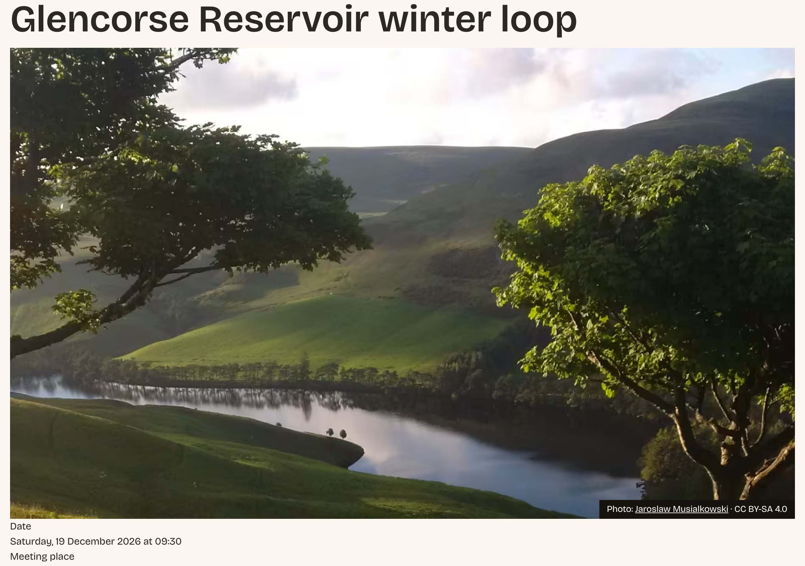
*Figure 14.10: A hike on the Drupal CMS site*

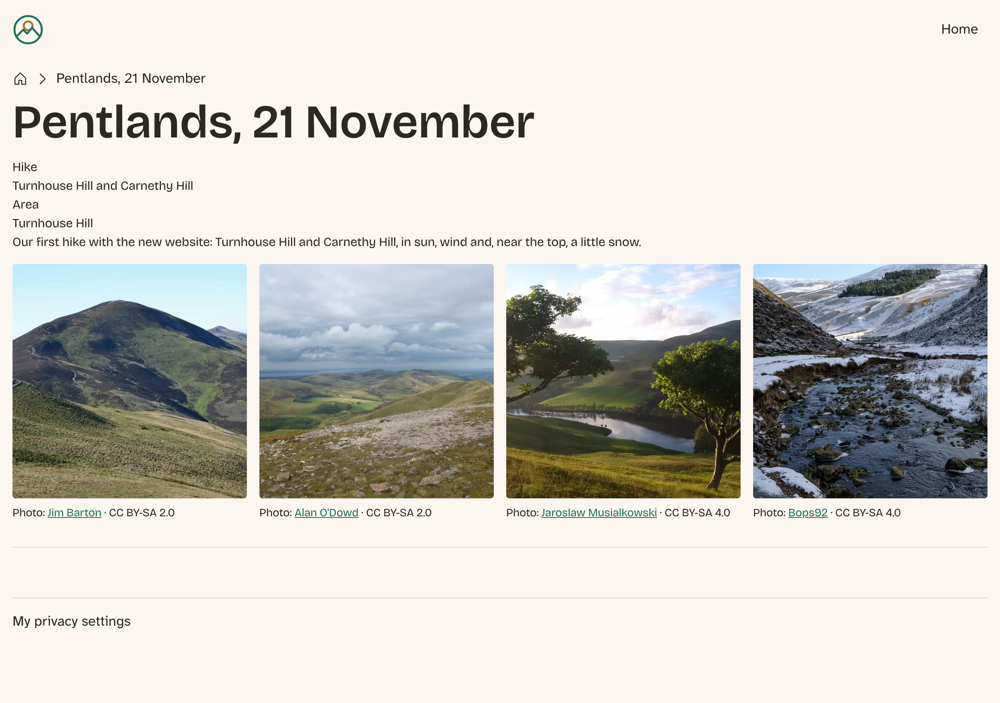
*Figure 14.11: An album on the Drupal CMS site*

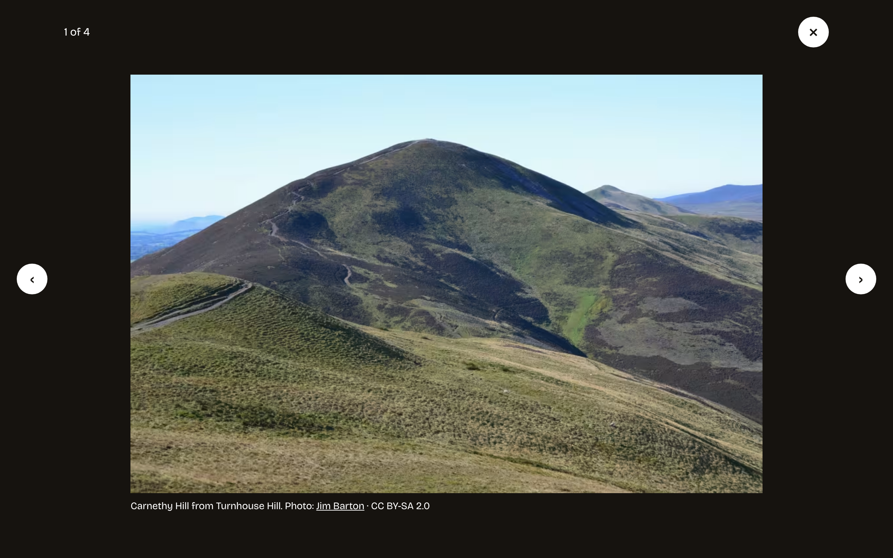
*Figure 14.12: Its lightbox*

### Images in Canvas

The pages editors build in Canvas don't go through view modes or responsive image styles at all. When an editor chooses a photo for a component, such as Mercury's **Image** or our Hike card from the chapter on components, the component gets the photo as an object with `src`, `alt`, `width` and `height`. Canvas makes the sizes itself, with one image style, **Canvas parametrized width** (`canvas_parametrized_width`). Its address has a `{width}` in it, and Canvas fills in a width from a fixed list: 16, 32, 48 and so on up to 3840 pixels. A Twig filter, `toSrcSet`, turns that into a `srcset`, and Canvas's own `canvas:image` component writes the ``. Mercury's Image component includes it. Our Hike card didn't: it wrote its own `` with the photo's `src`, which in Canvas is the original upload. A 1.1-megabyte JPEG in a card a third of the screen wide.

So the card now includes `canvas:image` as well:

<!-- diff: code/chapter14/steps/04-album/cms/mercury/components/hike-card/hike-card.twig code/chapter14/steps/05-cms/cms/mercury/components/hike-card/hike-card.twig as=components/hike-card/hike-card.twig -->

The card gives it a `sizes` line, and that line has a story. Left alone, `canvas:image` writes `sizes="auto 100vw"`. `auto` is new in HTML: for a lazy-loaded image, the browser waits for the layout anyway, so it can use the image's real width, and `sizes` doesn't have to guess. That's exactly right for a component that can be put anywhere. But the spec wants a comma after `auto`, and without one, the browser doesn't see `auto` at all. We tested it in Chromium 148, with the card at 351 pixels wide: with `auto 100vw`, it downloaded the 1920-pixel copy; with `auto, 100vw`, the 384-pixel one. Our card writes the comma, and adds its own guess for browsers that don't know `auto` yet: a third of the screen from 48rem, where the cards are three a row, and the whole screen below that.

`sizes="auto"` is in Chrome and Edge since 2024, but not yet in Firefox or Safari, so it's not on Baseline. It's harmless where it isn't supported: those browsers skip `auto` and use the rest of the line.

Two more things Canvas images don't do. The parametrized style only scales, so a card's 3:2 shape comes from CSS, `object-cover`, which cuts around the middle, not the focal point. And there's no art direction: one `srcset`, one shape. For the club's editors, that's a fair trade for a photo that works in any component without a responsive image style for each. Mercury's Image component uses the default `sizes`, so its photos are as big as the screen whatever their column; it's Mercury's component, so we leave it, and Exercise 4 is about it.

%% Author: Canvas's `sizes="auto 100vw"` (no comma) is logged in PROJECT-LOG "Bugs found in other projects"; we didn't find an issue for it. The core issue #3587098 would add `auto` to Drupal's own responsive images. Check both before publication. %%

## Other ways to do it

Everything in this chapter happens inside Drupal: it makes the copies, and the theme decides which one a browser gets. That's not the only way, and for some sites it's not the best one. Three others are worth knowing.

### Optimize before Drupal

The smallest file is one that was small before it was uploaded. A photo straight from a camera can be 6000 pixels wide and 10 megabytes, and Drupal keeps that original forever, even if no page ever shows it. The first book's media type can refuse uploads above a size, and the club could ask members to resize photos before they upload them, with a tool such as **Squoosh**, a free web app from Google's Chrome team that compresses an image in the browser and shows the result side by side with the original.

On the server, **ImageAPI Optimize** is a contributed module that runs Drupal's image derivatives through optimizers after the image style has made them: command-line tools such as `jpegoptim` or a web service, chosen in "pipelines" you attach to image styles. It squeezes out bytes the image library leaves in. With AVIF, the gain is smaller than it was with JPEG, but for a site with a lot of photos, it adds up.

Neither is theming, and neither changes what this chapter does. They're worth a look when the hosting bill or the disk is the problem.

### A CDN or an image service

A **CDN**, a content delivery network, keeps copies of a site's files on servers around the world, and sends each visitor the copy nearest to them. Put one in front of the club's site, and the image derivatives are sent from the CDN's servers, not Drupal's; Drupal makes each derivative once, and the CDN does the rest. Many CDNs can also convert images on the way, to AVIF or WebP, depending on what the visitor's browser says it accepts.

An **image service** goes further: services such as Cloudinary, imgix or Cloudflare Images make the sizes themselves, from the original, from a URL with the size in it. That's what Canvas's parametrized style does inside Drupal. With a service, Drupal sends the original once, and image styles become a few URL parameters; there are contributed modules that connect Drupal to most of them. The price is a monthly bill, and a site that depends on someone else's service for its photos.

For the club, with a few hundred photos and visitors mostly in Scotland, neither is needed. For a news site with a million images and readers everywhere, it's often the first thing to do.

### A `<picture>` by hand

Everything we did went through Drupal's formatters, which write the `<picture>` and `` for us. You can also write one by hand in a Twig template, with the image style URLs made for you. Core has no Twig function for an image style's URL, but **Twig Tweak**, one of the most used contributed modules, has: `{{ uri|image_style('banner') }}` gives the address of a photo in a style. With it, a template can write any `<picture>` it likes, with `media` and `sizes` it controls.

That's tempting, and occasionally right: for a photo that's part of the design rather than the content, or for markup no formatter makes. But it means the theme, not the site, now decides which image styles a photo uses, and a site builder can no longer change it in **Manage display**. It's the "override as little as possible" rule again: if site building and a preprocess function can do it, as they did for every image in this chapter, a hand-made `<picture>` is a fork of something Drupal would have kept up to date for you.

## Summary

You can now:

- explain what AVIF and WebP do for a page, and see in the browser which format and size came;
- make the most important image load first, with eager loading and `fetchpriority`, from a preprocess function;
- declare a theme's breakpoints, and know when to use them (art direction) and when not (everything else);
- crop every shape of a photo around a point an editor chooses, with Focal Point, and install a module that has no release for your Drupal version yet;
- art-direct a photo with a responsive image style, and read the `<picture>` it makes;
- write a `sizes` line from the theme's real column widths;
- put a credit on every photo with a component, from a media template;
- build an album as a grid that works without JavaScript, and a lightbox on top of it with `<dialog>`;
- do the same on the Drupal CMS site, with its image styles and Mercury's way of writing component scripts;
- make a Canvas component's photos responsive with `canvas:image`, and know what `sizes="auto"` does.

Every photo on both sites now comes in the right shape, the right size and the right format, with its credit. Only the hero on the front page is left, and it gets its own chapter.

## Exercises

1. Open a news item with a photo. It has the 4:3 crop on a phone and the credit in the corner already. Why, without any work on news?
2. Give the album *cover* art direction: on the list of albums, show each album's first photo as 4:3 on phones and 16:9 from 40rem. Which view mode does the list use, and which image styles can you reuse? *(challenge)*
3. Add swiping to the lightbox: a swipe to the left goes to the next photo, a swipe to the right to the previous one. Use Pointer Events, so it works with a finger and a pen, and make sure a vertical swipe still scrolls the caption on a small screen. *(challenge)*
4. On the Drupal CMS site, add Mercury's **Image** component to a page in Canvas, and look at which copy the browser downloads (the Network tab). Then give the component a better `sizes`. Where would you put the change, so a Mercury update doesn't undo it?
5. The Hike card's default photo, the club's logo for hikes without a photo, has no `srcset` and no image style. Should it? Why, or why not? *(advanced)* (The answer is in Appendix B.)

## Want to know more?

- Drupal.org: [Responsive Image module overview](https://www.drupal.org/docs/core-modules-and-themes/core-modules/responsive-image-module) and [Working with breakpoints in Drupal](https://www.drupal.org/docs/develop/theming-drupal/working-with-breakpoints-in-drupal).
- The modules: [Focal Point](https://www.drupal.org/project/focal_point), [Crop API](https://www.drupal.org/project/crop), [Image Widget Crop](https://www.drupal.org/project/image_widget_crop), [Smart Crop](https://www.drupal.org/project/smart_crop), [Colorbox](https://www.drupal.org/project/colorbox), [PhotoSwipe](https://www.drupal.org/project/photoswipe), [ImageAPI Optimize](https://www.drupal.org/project/imageapi_optimize) and [Twig Tweak](https://www.drupal.org/project/twig_tweak).
- [composer-drupal-lenient](https://github.com/mglaman/composer-drupal-lenient), for modules without a release for your Drupal version.
- MDN: [Responsive images](https://developer.mozilla.org/en-US/docs/Web/HTML/Guides/Responsive_images), [The picture element](https://developer.mozilla.org/en-US/docs/Web/HTML/Reference/Elements/picture) and [The dialog element](https://developer.mozilla.org/en-US/docs/Web/HTML/Reference/Elements/dialog).
- web.dev: [Optimize Largest Contentful Paint](https://web.dev/articles/optimize-lcp), [Optimize resource loading with the Fetch Priority API](https://web.dev/articles/fetch-priority) and [Browser-level image lazy loading](https://web.dev/articles/browser-level-image-lazy-loading).
- [Squoosh](https://squoosh.app/), to see what a format and a quality setting do to a photo.
- The core issue that would add `sizes="auto"` to Drupal's own responsive images: [#3587098](https://www.drupal.org/project/drupal/issues/3587098).
