# The Header and the Footer

The header and the footer are on every page of the club's site, so they're the parts a visitor sees most. They're also where a theme meets the most of Drupal at once: the logo and the site's name, the main menu, the language switcher, the user account menu, the footer menu, a content block with the club's details, and a small block that says *Powered by Drupal*. All of them are blocks, made by core and by the first book's site building. The theme's job is to put them in their places and give them the design's look, without forking any of them.

This chapter does that on both sites. On the core site, the header gets its row from the wireframe: the logo and the name on the left, the main menu in the middle, the languages and the color scheme toggle on the right. The toggle becomes the round button the design asked for, which opens Chapter 12's three choices. The footer gets the logo, the club's details and a line of small print with the license. Then we do the same on the Drupal CMS site, where the header and the footer aren't blocks in regions but components in Canvas's page template.

Two things are left for the next chapter: the main menu's dropdown, and the Menu button that hides the menu on a phone. Here the menu is a plain row of links that wraps when it runs out of room.

The core site starts where the images chapter left it. Its header is unstyled: the logo, the name and the slogan, the menu as a bulleted list, Log in and the language switcher as two more lists, and the toggle's radio buttons on a line of their own.

## What's in the header, and what isn't

The wireframe from the Penpot chapter has five things in the header: the logo with the club's name, the main menu, the two languages, and the round toggle button. That's fewer blocks than the header has now, so we had a few decisions to make first.

**Log in moves to the footer.** The club's members log in to add photos and hikes, a few times a month. Visitors never do. A link they never use, in the most valuable strip of the page, isn't worth its room, so the user account menu goes to the footer, where the members know to find it.

**No search.** The club's site is small: six hikes a season, a few albums, a handful of pages. The main menu gets you to all of it in one click. A search box would take room in the header for very little, and a site that grows can add one later. (Search forms, the club's own and Drupal's, have their place in the chapter on forms.)

**No slogan in the header.** "Photos and hikes around Edinburgh" is a good line, but next to the logo, the name and five menu links, it's one thing too many. It moves to the footer, where it has room.

**A header that scrolls away.** Many sites keep the header on screen when you scroll, with `position: sticky`. The club's doesn't. We'll come back to why, after the header is built.

## The logo and the name

The logo and the name come from the **Site branding** block. It shows any of three things, each switched on in the block's settings: the logo (from the theme's settings), the site's name, and the slogan (both from **Configuration** > **Basic site settings**). The first book placed it in the Header region.

So the slogan is the first change, and it isn't code at all: on **Block layout**, click **Configure** next to **Site branding**, uncheck **Site slogan** under **Toggle branding elements**, and save. The block stops printing it.

The logo and the name need a template, though. This is what core's template prints:

<!-- include: code/chapter15/snippets/branding-core.html as=html -->

Two links to the same page, one after the other. A screen reader user tabbing through the header hears "Home, link" and then "Lens & Trail, link", and wonders whether they're different places. And the logo's alt text, *Home*, describes where the link goes, which is right for a logo on its own, but not when the name of the site is right next to it.

The design chapter said what to do about this: next to the name, the logo is decoration. So we want one link, with the logo and the name inside it, and an empty alt text on the logo. A screen reader then says "Lens & Trail, link", once.

CSS can't merge two links, so this is a job for a template, and it's the only one the header needs. Twig's debug comments name the suggestions for the block; the most specific one that fits every branding block is `block--system-branding-block.html.twig`. We put it in `templates/block/`:

<!-- include: code/chapter15/steps/01-header/core/lens_trail/templates/block/block--system-branding-block.html.twig as=templates/block/block--system-branding-block.html.twig -->

It **extends** core's `block.html.twig`, as Chapter 11 showed, and fills in only the `content` block: the wrapper `div`, the contextual links and the block's title stay core's. The `set` at the top adds a class to the wrapper; it runs before the parent template prints `attributes`, so the class gets there. And the template still prints the slogan when the block is set to show it. We'll need that in the footer.

The `width` and `height` on the logo tell the browser its size before the file arrives, so the header doesn't jump. Core's template also gives the logo `fetchpriority="high"`, which we left out: in the images chapter, the banner photo is the thing that should load first, and two images fighting for "high" is the same as none.

The template's CSS, in `css/components/site-branding.css`:

<!-- include: code/chapter15/steps/01-header/core/lens_trail/css/components/site-branding.css as=css/components/site-branding.css -->

> **Drupalism:** In Drupal, the **logo** and the **favicon** are theme settings, not content. Each theme has its own, under **Appearance** > **Settings** > the theme. By default a theme uses the `logo.svg` and `favicon.ico` in its own folder; you can upload others there, and the theme settings form turns them into a URL that the branding block and the page's `<link rel="icon">` use.

### The favicon

The design chapter promised a favicon, the small icon in the browser's tab, made from the logo. The logo is already an SVG with its own background, and at 32 pixels its sun and hills are still clear, so the favicon can be the same file. Every current browser shows an SVG favicon; Safari was the last, in version 26 (September 2025).

Drupal looks for a `favicon.ico` in the theme's folder, not an SVG. So we copy `logo.svg` to `favicon.svg` and point the theme's settings at it: on **Appearance** > **Settings** > **Lens & Trail**, uncheck **Use the favicon supplied by the theme** under **Favicon**, and enter `themes/custom/lens_trail/favicon.svg` as the **Path to custom icon**. For a new install of the theme, the same settings go in its `config/install/lens_trail.settings.yml`:

<!-- include: code/chapter15/steps/01-header/core/lens_trail/config/install/lens_trail.settings.yml as=config/install/lens_trail.settings.yml -->

Drupal now writes `<link rel="icon" href="/themes/custom/lens_trail/favicon.svg" type="image/svg+xml">` into every page.

## The header's row

Chapter 7 gave the header a grid of three columns on wide screens, one for each region: Header, Primary menu and Secondary menu. That still works. We change two things in `page.html.twig`: the header's band stays as wide as the window, but what's in it lines up with the content below, with Chapter 7's `.site-width`; and the Secondary menu region gets a wrapper, `site-header__tools`, which is where the toggle will go.

<!-- diff: code/chapter14/steps/05-cms/core/lens_trail/templates/layout/page.html.twig code/chapter15/steps/01-header/core/lens_trail/templates/layout/page.html.twig as=templates/layout/page.html.twig -->

And the layout CSS:

<!-- diff: code/chapter14/steps/05-cms/core/lens_trail/css/layout.css code/chapter15/steps/01-header/core/lens_trail/css/layout.css as=css/layout.css -->

The complete file

<!-- include: code/chapter15/steps/01-header/core/lens_trail/css/layout.css as=css/layout.css -->

On a phone, the grid has one column, so everything is stacked in the order of the HTML: the logo, the menu, then the languages and the toggle. It would be tempting to put the toggle up next to the logo, with `order` or a grid area. We didn't, because then the order you *see* and the order you *tab through* would differ: a keyboard user would jump from the logo down to the menu, then back up to the toggle. WCAG calls this **Focus Order** (2.4.3). The menus chapter changes the phone's header anyway, with the Menu button next to the logo, and does it without reordering anything.

### The main menu

The main menu block prints a nested list, with Hike archive under Hikes. Until the menus chapter turns that into a dropdown, the second level has nowhere to go, so the block shows one level: on **Block layout**, **Configure** next to **Main navigation**, set **Number of levels to display** to **1**, and save. (Hike archive is still linked from the hikes page.)

The rest is CSS on the markup Drupal gives, in `css/components/main-menu.css`:

<!-- include: code/chapter15/steps/01-header/core/lens_trail/css/components/main-menu.css as=css/components/main-menu.css -->

Every link is at least 44 pixels high (the design's `--size-target`), so it's comfortable to hit with a thumb. The menu doesn't need a class of its own: `.region-primary-menu` is unique on the page, and the menu is the only thing in it.

The current page is marked with `aria-current="page"`, and we didn't add it. Drupal does that for visitors who aren't logged in: before it sends the page, it looks for links whose `data-drupal-link-system-path` is the current page, and adds `aria-current="page"` and the class `is-active`. (For logged-in users, a small script does it in the browser, because their pages are cached differently.) So the CSS styles the attribute, which screen readers also announce, and not a class that only the eye can see.

### English · Español

The language switcher is a list of links, one for each language, with the current one marked `aria-current="page"` too. The wireframe shows it as "English · Español", and CSS can do that alone:

<!-- include: code/chapter15/steps/01-header/core/lens_trail/css/components/language-switcher.css as=css/components/language-switcher.css -->

The dot is generated content, which screen readers usually read out. The `/ ""` after it is **alternative text** for generated content, the same idea as an image's alt text: here it's empty, so the dot is only for the eye. All the main browsers support it since July 2024 (Baseline calls it "widely available" in January 2027). A browser that doesn't understand the slash throws away the whole `content` line, so it shows no dot at all, which is a gap and not a broken page.

Two small templates finish the switcher. The Language module turns the block into a navigation landmark (`role="navigation"`), but doesn't give it a name, so a screen reader's list of landmarks shows "Main navigation" and then a bare "navigation". Its block template, `block--language-block.html.twig`, gives it one:

<!-- include: code/chapter15/steps/01-header/core/lens_trail/templates/block/block--language-block.html.twig as=templates/block/block--language-block.html.twig -->

It's a template that extends core's and only sets an attribute. That's as small as a template gets, and it's the right tool here: the block's attributes are printed by the template, and nothing in the block's settings can add one.

The second is about the word *Español*. A screen reader reading an English page uses an English voice, and an English voice mangles Spanish words. The `lang` attribute tells it which language a piece of text is in. The switcher's links are made by core's `links.html.twig`, with the suggestion `links--language-block.html.twig`; our copy adds one attribute:

<!-- include: code/chapter15/steps/01-header/core/lens_trail/templates/navigation/links--language-block.html.twig as=templates/navigation/links--language-block.html.twig -->

The links are keyed by their language code, so `for langcode, item in links` hands us exactly what `lang` wants. Everything else is core's template, as it was.

The three new CSS files go in a `header` library, attached to every page in the info file, like the base library:

<!-- diff: code/chapter14/steps/05-cms/core/lens_trail/lens_trail.libraries.yml code/chapter15/steps/01-header/core/lens_trail/lens_trail.libraries.yml as=lens_trail.libraries.yml -->

<!-- diff: code/chapter14/steps/05-cms/core/lens_trail/lens_trail.info.yml code/chapter15/steps/01-header/core/lens_trail/lens_trail.info.yml as=lens_trail.info.yml -->

## The toggle, as one button

Chapter 12 built the color scheme toggle as three radio buttons in a fieldset, and left its place to this chapter. The wireframe has one round button instead, and the design chapter promised "a button that opens three choices".

That's a pattern with a name: a **disclosure**. A button shows and hides something next to it, and says whether it's showing it with `aria-expanded="true"` or `"false"`. Screen readers announce "Color scheme, button, collapsed", and "expanded" after a press. The choices themselves stay Chapter 12's radio buttons, which already work with the arrow keys and already say which one is chosen. We only put them behind a button.

Here's the toggle's script, changed:

<!-- diff: code/chapter14/steps/05-cms/core/lens_trail/js/color-scheme-toggle.js code/chapter15/steps/01-header/core/lens_trail/js/color-scheme-toggle.js as=js/color-scheme-toggle.js -->

The complete file

<!-- include: code/chapter15/steps/01-header/core/lens_trail/js/color-scheme-toggle.js as=js/color-scheme-toggle.js -->

What it does, piece by piece:

- **The button** is a real `<button type="button">`, so it works with Enter and Space without any key handling of our own. Its name, "Color scheme", is visually hidden text inside it; the icon, half a circle filled in, has `aria-hidden="true"`, so it adds nothing to the name. `aria-controls` points at the fieldset it opens.
- **The fieldset** starts with the `hidden` attribute. Opening and closing sets `hidden` and `aria-expanded` together, in one function, so they can't disagree.
- **Closing** happens four ways: the button again, Escape (which puts the focus back on the button, so the keyboard user isn't lost), a click anywhere else, and tabbing out of the choices. The last two are what people expect from anything that pops up.
- **The place** is now `.site-header__tools`, the wrapper in the page template, so the toggle sits after the languages.

Choosing a radio button doesn't close the choices. The page changes color at once, and someone trying Light and Dark wants to see both before deciding.

And the CSS, which replaces Chapter 12's:

<!-- include: code/chapter15/steps/01-header/core/lens_trail/css/components/color-scheme-toggle.css as=css/components/color-scheme-toggle.css -->

One rule in it is worth a second look. `[hidden] { display: none }` is the browser's own rule, and it's weak: any `display` of ours beats it. The fieldset has `display: grid`, so without the `&[hidden]` rule it would never hide. It's a classic bug, and one that's hard to spot, because the button's `aria-expanded` still changes as if all were well.

The choices open on top of the page (`position: absolute`), under the button and lined up with its right edge, with the design's overlay shadow.

## The header, done

With the theme's changes and the site building above (the slogan, the menu's one level, the favicon, and the user account menu moved down to the Footer region for now), the header is done.

%% Author: on the test site, the site building was done by code/chapter15/site/01-header.php (same result as the steps in the text). %%

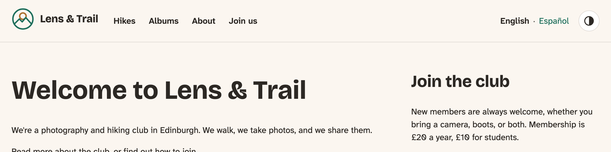
*Figure 15.1: The header on a wide screen*

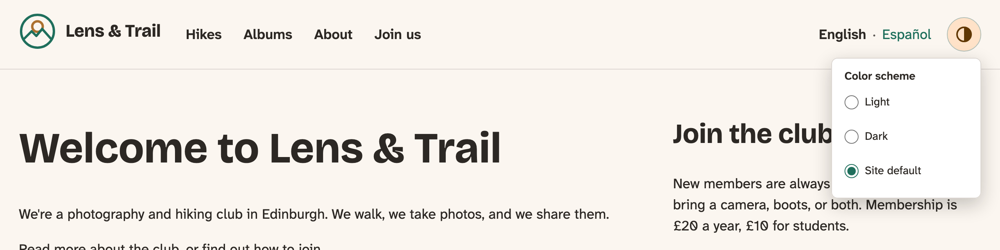
*Figure 15.2: The toggle, open*

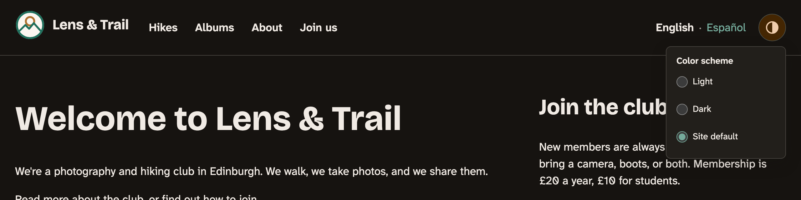
*Figure 15.3: In dark mode*

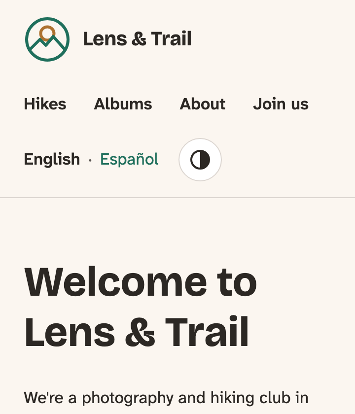
*Figure 15.4: On a phone, in the order of the HTML*

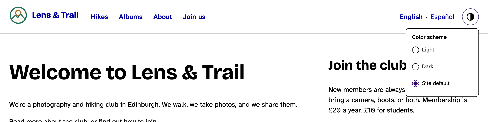
*Figure 15.5: In forced colors mode, the button and the box keep their outlines, and the logo keeps its background*

We checked it with the keyboard: Tab goes from the skip link to the logo, the four menu links, English, Español and the button; Enter opens the choices, Tab goes into them, the arrow keys choose, Escape closes them and puts the focus back on the button. At 320 pixels wide nothing scrolls sideways. And the choice survives a reload, through Chapter 12's early script.

> **Try it:** Turn on a screen reader (VoiceOver on a Mac with Cmd-F5, Narrator on Windows with Ctrl-Win-Enter, or the free NVDA), and tab to the toggle. Listen for "collapsed" and "expanded" as you press it. Then open the screen reader's list of landmarks (VoiceOver: the rotor, Ctrl-Option-U; NVDA: Insert-F7) and find the language switcher by its name.

### Should the header stick?

A sticky header stays at the top of the window as you scroll, with one line of CSS on the `header`: `position: sticky; top: 0`. Plenty of sites do it, and it seems kind: the menu is always there. It has three costs, though, and they add up on the club's site.

- **Room.** The club's header is about 80 pixels high on a wide screen, and taller on a phone before the menus chapter. On a phone held sideways, the window can be under 400 pixels high, so a sticky header takes a fifth of it, all the time, on a site that's mostly photos.
- **Hidden focus.** When a keyboard user tabs down a page, the browser scrolls the focused link into view, but it doesn't know about the sticky header, and can scroll the link right under it. WCAG 2.2 added a success criterion for exactly this, **Focus Not Obscured** (2.4.11, level AA): the focused thing mustn't be entirely hidden by content the site put on top of it.
- **Jumps to a heading.** The same happens to a link to `#somewhere` on the page, such as the skip link: the heading lands under the header.

CSS has a fix for the last two: `scroll-padding-top` on the `html` element tells the browser to leave that much room at the top when it scrolls something into view, for focus and for `#` links alike. It needs the header's height, which changes when the menu wraps.

> **Try it:** Make the header sticky in the browser's developer tools: select the `<header>`, and add `position: sticky; top: 0; z-index: 10; background: var(--color-background)` in the Styles panel. Open a hike page, and tab down through it. Does a link disappear under the header? Then select the `<html>` element, add `scroll-padding-top: 6rem`, and tab again.

The club decided against it: the header is one scroll away, and the room is worth more to the photos. If you make a header sticky, test it with the keyboard, and set `scroll-padding-top`.

## The footer

The footer had four blocks, side by side in Chapter 7's auto-fit grid: Newest photos, the Club info block, the footer menu (Privacy, and Upcoming hikes as RSS), and Powered by Drupal. Now it has the user account menu too. The wireframe wants three columns and a line of small print:

- the logo and the name, with the slogan under them;
- **Meet us**: when the club meets, its email address, and Flickr;
- the footer menu;
- and under them, on one line: the license, Log in, and Powered by Drupal.

### Newest photos

Newest photos was in the footer of every page, which the first book did to have something to put there. On a hike or an album, a row of other photos at the bottom is noise; on the front page, it's the point. But look at the front page: its layout, built with Layout Builder in the first book, already has a *Newest photos* section. With the footer's block, the front page showed the same photos twice.

So the block goes. On **Block layout**, open the drop-down next to **Newest photos** and choose **Disable**. Disabling keeps its settings, should the club want it back somewhere.

### A region for the small print

The small print is a different kind of thing from the three columns, and it spans the whole width under them. We could get there with CSS alone, by giving the last three blocks a grid column each, but then the CSS would have to know which blocks are the small print, by their machine names, which a site builder can change any day. A **region** says it better: the theme offers a place called *Footer bottom*, and the site builder decides what goes in it. That's what regions are for, as Chapter 7 put it.

A new region is one line in the info file, and a place in the page template:

<!-- diff: code/chapter15/steps/01-header/core/lens_trail/lens_trail.info.yml code/chapter15/steps/02-footer/core/lens_trail/lens_trail.info.yml as=lens_trail.info.yml -->

<!-- diff: code/chapter15/steps/01-header/core/lens_trail/templates/layout/page.html.twig code/chapter15/steps/02-footer/core/lens_trail/templates/layout/page.html.twig as=templates/layout/page.html.twig -->

The `<footer>` is printed when either region has something in it. The new region's layout goes with the footer's in `layout.css`: a line of blocks that wraps, under a thin rule.

<!-- diff: code/chapter15/steps/01-header/core/lens_trail/css/layout.css code/chapter15/steps/02-footer/core/lens_trail/css/layout.css as=css/layout.css -->

After a cache rebuild, **Footer bottom** is on **Block layout**, and we moved three blocks into it: the user account menu, Powered by Drupal, and a new one, the license line.

### The license line

The club's photos and texts are shared under CC BY-SA 4.0, as the first book decided for every photo with a credit. The footer says so, on every page: "Photos and text: CC BY-SA 4.0", with a link to the license.

That's content, not theme: the club could change its license, and the line has to be translated. So it's a **content block**, of the first book's Basic type: on **Block layout**, **Place block** in **Footer bottom**, **Add content block**, with the description **License** and the body below (in the Basic HTML format, with the link on "CC BY-SA 4.0"), and uncheck **Display title** when you place it. Its Spanish translation is "Fotos y textos: CC BY-SA 4.0", linking to the license's Spanish page.

### Meet us

The Club info block is a content block of the first book's own type, *Club info*, with three fields: Meeting times, Email and Follow us. Its block's title was hidden, and its fields printed their labels as plain `div`s. We want a heading, *Meet us*, and each field's label as a small heading of its own, so a screen reader can jump between them.

The title is site building: in the block's settings, **Title** **Meet us**, and **Display title** checked. In Spanish, *Encuéntranos*, through the block's **Translate** tab. And the email address should be a link that opens an email: on **Structure** > **Block types** > **Club info** > **Manage display**, the **Email** field's format becomes **Email**, which writes a `mailto:` link.

The headings need templates. Twig's debug comments show what the content block module offers for a block that shows a content block:

<!-- include: code/chapter15/snippets/club-info-suggestions.txt as=html -->

The first and the `id` ones are for this one placed block, by its machine name, and the long one with a UUID is for this one piece of content. The `type` one is for any block that shows a Club info, wherever it's placed and whatever it's called. That's the one we want: the template is about the kind of content, not one copy of it.

<!-- include: code/chapter15/steps/02-footer/core/lens_trail/templates/block/block--block-content--type--club-info.html.twig as=templates/block/block--block-content--type--club-info.html.twig -->

It only adds classes, to the wrapper and to the title's `h2`. The fields' labels are printed by the field template, and its suggestions include one per entity type and bundle, `field--block-content--club-info.html.twig`, which covers all three fields at once:

<!-- include: code/chapter15/steps/02-footer/core/lens_trail/templates/field/field--block-content--club-info.html.twig as=templates/field/field--block-content--club-info.html.twig -->

<!-- include: code/chapter15/steps/02-footer/core/lens_trail/css/components/club-info.css as=css/components/club-info.css -->

### The logo again, and the menus

The footer's first column is a second **Site branding** block, placed in the Footer region with all three things checked: logo, name and slogan. It uses the same template as the header's, which is why that template kept the slogan.

The two menus in the footer, the footer menu and the user account menu, are lists of links, and they get one set of rules in `css/components/footer.css`:

<!-- include: code/chapter15/steps/02-footer/core/lens_trail/css/components/footer.css as=css/components/footer.css -->

The footer's links are smaller than the header's: at least 32 pixels high. WCAG 2.2's **Target Size (Minimum)** (2.5.8, level AA) asks for 24, and the header's 44 is the stricter level AAA, which the design keeps for the things people use most.

The two new CSS files are a `footer` library, attached like the header's.

### Powered by Drupal

The last block in the footer came with Drupal: the standard install puts **Powered by Drupal** in the footer of a new site, and the first book left it there. It's worth asking whether to keep it.

You don't have to. Drupal's license, the GPL, is about the code: you can run it, change it and share it, and if you share it, you share it under the same terms. It asks nothing of the websites built with it. No credit line, no link. Disable the block, and nobody can say a word.

It's also no secret either way. Drupal tells every browser what it is, in a `<meta name="Generator" content="Drupal 12 (https://www.drupal.org)">` in every page and an `X-Generator` header on every response, and anyone who knows Drupal recognizes `/sites/default/files/` in an image's address. Hiding the block hides nothing from an attacker. Keeping the site updated is what protects it.

So it's a choice about what the club wants to say. The club kept it. Lens & Trail is a volunteer club that got a whole website for free, made by thousands of people who also gave their work away. The one link costs nothing, it's in the small print, and it points the next club that wants a website to where this one came from. That's how most people find Drupal, and it's part of how open source keeps going.

> **Coming from WordPress?** WordPress themes often print "Proudly powered by WordPress" in their footer template, and the way to remove it is to edit or override the template. In Drupal it's a block, so it's a site builder's choice on **Block layout**, with no code. The same goes for most of a footer: in a classic WordPress theme, `footer.php` decides what's there; in a block theme, a template part does, much like Drupal's regions.

## The footer, done

%% Author: on the test site, the footer's site building was done by code/chapter15/site/02-footer.php (same result as the steps in the text). %%

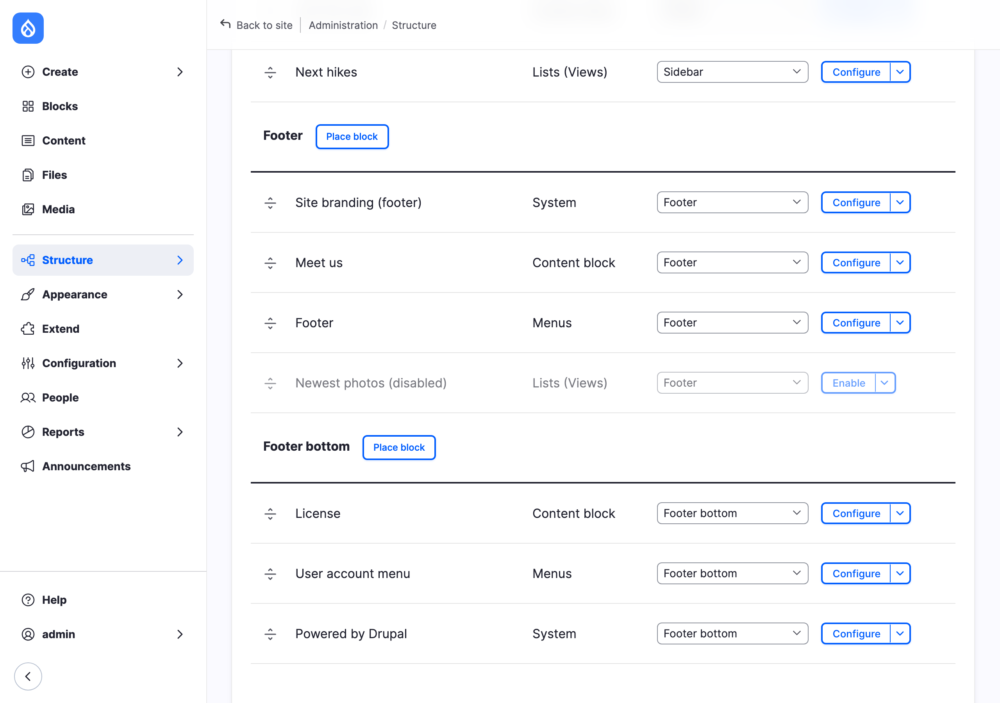
*Figure 15.6: The footer's blocks on Block layout, with the new region*

*Figure 15.7: The footer*

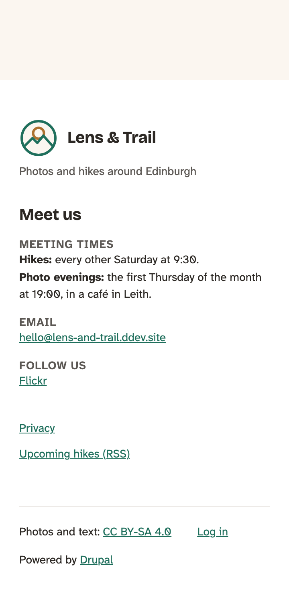
*Figure 15.8: On a phone*

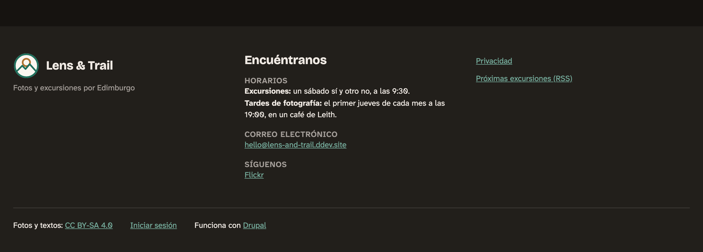
*Figure 15.9: In Spanish, in dark mode*

We checked the footer with the keyboard, at 320 pixels wide, in dark mode and in forced colors (where Chapter 8's line over the footer takes the place of its background). On the front page, Newest photos is there once, in the page's own layout.

## On the Drupal CMS site

On the Drupal CMS site, as Chapter 7 found, there's nothing on **Block layout**. The header and the footer are two of Mercury's components, **Navbar** and **Footer**, in Canvas's **page template** for the theme, and the blocks are components in their slots. This section does the same design there, with three kinds of change: Mercury's templates, a new component, and the page template in Canvas.

The site starts with a navbar that shows the logo and one menu link, Home, and a footer with only "My privacy settings". The first book's Drupal CMS site has fewer pages than the core site: a Home page, How to join and a privacy policy, plus the hikes and albums the book's setup adds. So its main menu gets Home and **Join us** (How to join), added on **Structure** > **Menus** > **Main navigation**.

### The page template in Canvas

Open any page in Canvas. In the **Page data** panel on the right, under **Page template**, it says **Site default**, with an **Edit template** button:

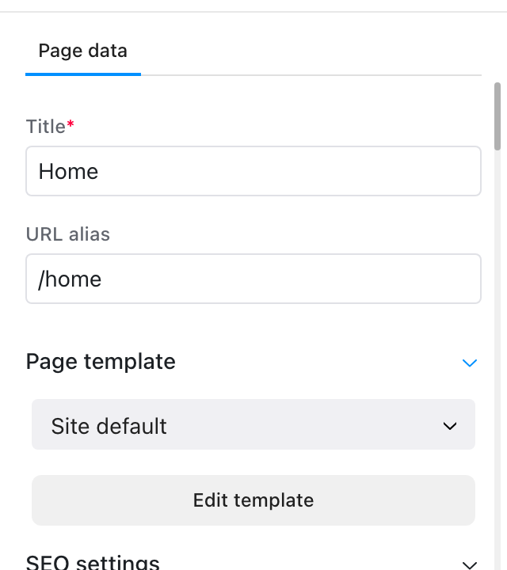
*Figure 15.10: Where Canvas keeps the page template*

The template opens in the same editor as a page. Its **Layers** panel shows the tree: the theme's page template component, with Mercury's three regions as its slots; the Navbar in Header, with its slots **Site logo**, **Navigation menu** and **CTAs**; the **Page content** marker in Content, where each page's own components go; and the Footer, with **Branding & Social**, **Call to action**, **Utility links** and **Copyright text**.

What we put in the slots:

1. **Site logo**: the **Site branding** block, with **Site name** checked as well as the logo.
2. **CTAs**: the **Language switcher** block, and our new **Color scheme toggle** component (below). Mercury's own example buttons go.
3. **Branding & Social**: another **Site branding**, logo and name.
4. **Call to action**: a **Heading**, *Meet us*, at the size **heading-responsive-xl**, and a **Text** with the meeting times, the email address and Flickr, at **text-xs**. This site has no content blocks, so the Club info block isn't here; in Canvas, an editor changes these texts where they are.
5. **Utility links**: the footer menu that's already there, and the **User account menu** block. Canvas doesn't offer that block until it's enabled, on **Appearance** > **Components**.
6. **Copyright text**: a **Text** with the license line, and the **Powered by Drupal** block.

Then **Review changes**, and publish.

*Figure 15.11: The page template, with the header and the footer filled in*

%% Author: on the test site, the page template was filled in by code/chapter15/site/03-cms.php (same result); the panel's labels and Figures 15.10 and 15.11 are from the real editor, but the drag-and-drop steps weren't walked by hand. %%

One thing works differently from **Block layout**: a block in Canvas has no **Translate** tab, so the Meet us text and the license line are English on the Spanish pages until they're translated with Canvas's **Translate** tool.

### Mercury's templates

Mercury has its own `block--system-branding-block.html.twig`, and it had the bug we fixed on core, and one more: the logo's alt text was the site's name, which is empty when the name is switched off in the block, as it was on this site. The header's only link then had no name at all. Our version puts the logo and the name side by side in one link, and gives the logo "Home" as its alt text only when there's no name next to it:

<!-- diff: code/chapter14/steps/05-cms/cms/mercury/templates/block/block--system-branding-block.html.twig code/chapter15/steps/03-cms/cms/mercury/templates/block/block--system-branding-block.html.twig as=templates/block/block--system-branding-block.html.twig -->

The main menu's links were pills that turn green on hover. The club's are bold text with an underline for the current page, as on core:

<!-- diff: code/chapter14/steps/05-cms/cms/mercury/templates/navigation/menu--main.html.twig code/chapter15/steps/03-cms/cms/mercury/templates/navigation/menu--main.html.twig as=templates/navigation/menu--main.html.twig -->

The language switcher gets the core theme's two templates. The block template is the same file. The links template is the same too, with Tailwind's classes where the core theme has its CSS file:

<!-- include: code/chapter15/steps/03-cms/cms/mercury/templates/navigation/links--language-block.html.twig as=templates/navigation/links--language-block.html.twig -->

The links themselves are made by Drupal, so we can't put classes on them in this template. Tailwind's arbitrary variants from the Tailwind section of Chapter 6 reach them from the list: `[&_a]:text-primary` means "any `a` inside this element". And `[&+&]:before:content-['·'_/_'']` is the dot: "this element's `::before`, when it comes right after another one like it", with underscores for spaces, as Tailwind writes them in a class name.

In the Navbar component, the CTAs slot lines its contents up in a row, also on the phone's menu panel. And in the Footer, the logo keeps its header size, and the small print wraps:

<!-- diff: code/chapter14/steps/05-cms/cms/mercury/components/navbar/navbar.twig code/chapter15/steps/03-cms/cms/mercury/components/navbar/navbar.twig as=components/navbar/navbar.twig -->

<!-- diff: code/chapter14/steps/05-cms/cms/mercury/components/footer/footer.twig code/chapter15/steps/03-cms/cms/mercury/components/footer/footer.twig as=components/footer/footer.twig -->

Mercury's colors were already the club's: Chapter 6 set Mercury's variables (`--primary`, `--border`, `--card`) from the club's tokens, so restyling the Navbar and the Footer was a matter of a few classes, not colors.

### The toggle, as a component

Chapter 12 left the toggle on the core site, because Mercury has its own **Color scheme** setting. The design wants a toggle on both sites, though, and the two work together: Mercury's setting decides the site's default, and the toggle lets a visitor choose for themselves.

On this site, the header is made of components, so the toggle becomes one, in `components/color-scheme-toggle/`. Its template is an empty `div`: the script builds the button, so visitors without JavaScript don't see a toggle that can't work, as in Chapter 12.

<!-- include: code/chapter15/steps/03-cms/cms/mercury/components/color-scheme-toggle/color-scheme-toggle.component.yml as=components/color-scheme-toggle/color-scheme-toggle.component.yml -->

<!-- include: code/chapter15/steps/03-cms/cms/mercury/components/color-scheme-toggle/color-scheme-toggle.twig as=components/color-scheme-toggle/color-scheme-toggle.twig -->

The script is the core theme's, written in Mercury's way from Chapter 12: a class for each toggle on the page, and `ComponentType` to register the behavior.

components/color-scheme-toggle/color-scheme-toggle.js

<!-- include: code/chapter15/steps/03-cms/cms/mercury/components/color-scheme-toggle/color-scheme-toggle.js as=components/color-scheme-toggle/color-scheme-toggle.js -->

The one real difference is *Site default*. On core, the script had to know the site's setting, from `drupalSettings`. Mercury puts its setting on the page itself: a site set to Dark gets `class="dark"` on `<html>`. So *Site default* only removes our `data-color-scheme` attribute, and the class takes over. Two rules in `src/theme.css` let the visitor's choice win over the setting, because `:root[data-color-scheme]` is more specific than `.dark`:

<!-- diff: code/chapter14/steps/05-cms/cms/mercury/src/theme.css code/chapter15/steps/03-cms/cms/mercury/src/theme.css as=src/theme.css -->

The core theme's early script comes along unchanged, as `js/color-scheme-early.js` in a library that loads in the `<head>`. And the component's CSS is a plain CSS file next to it, with Mercury's variable names; it isn't Tailwind, because a component's own `.css` file is attached by Drupal as it is, without the build:

components/color-scheme-toggle/color-scheme-toggle.css

<!-- include: code/chapter15/steps/03-cms/cms/mercury/components/color-scheme-toggle/color-scheme-toggle.css as=components/color-scheme-toggle/color-scheme-toggle.css -->

The last rule is new. On a phone, Mercury's Navbar puts its CTAs at the bottom of the menu panel, and choices that open downwards would open below the screen. So there they open upwards.

The templates have new Tailwind classes, so build Mercury's CSS again, as in Chapter 6:

<!-- include: code/chapter15/snippets/mercury-build.sh as=terminal -->

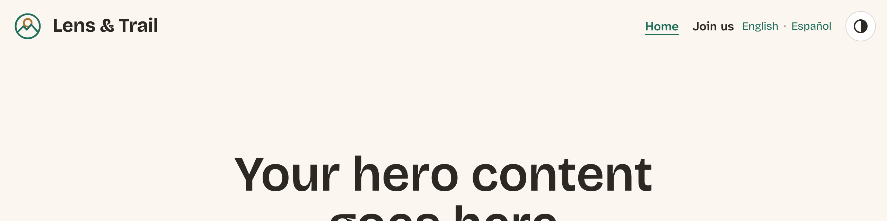
*Figure 15.12: The Drupal CMS site's header*

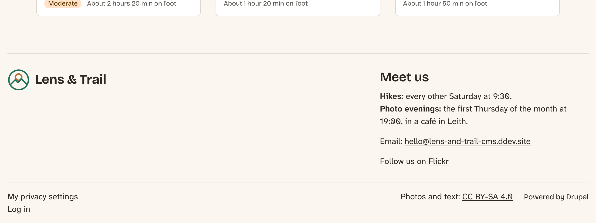
*Figure 15.13: The footer*

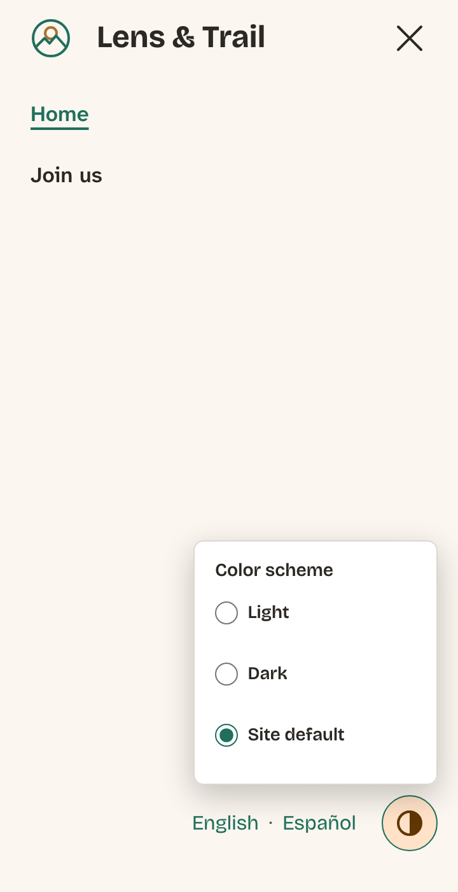
*Figure 15.14: On a phone, the toggle is in Mercury's menu panel, and its choices open upwards*

## Summary

You can now:

- choose what belongs in a header and a footer, and move blocks between them with good reasons;
- write one template for a block, by extending core's and filling in only what changes, and know when site building does the job instead;
- make a logo decorative next to the site's name, and set a theme's logo and SVG favicon;
- build a header row with the page template and CSS Grid, and keep the visual order and the tab order the same;
- style Drupal's menus and language switcher by the markup and attributes Drupal gives, `aria-current` included;
- give a landmark a name and a word its language, with two small templates;
- turn a group of radio buttons into a disclosure, with `aria-expanded`, Escape and a click outside;
- weigh a sticky header against Focus Not Obscured and `scroll-padding-top`;
- add a region for a new place on the page, and theme a content block by its type;
- decide whether to keep *Powered by Drupal*, and explain why it's there;
- do the same on the Drupal CMS site, in Canvas's page template, with Mercury's templates and a component of our own.

The frame of every page is now the club's own. What's left in it is the main menu, which gets a dropdown, a Menu button and a side panel in the next chapter.

## Exercises

1. Put the slogan back in the header, under the name, and make it disappear on screens narrower than 40rem with CSS only. Is it better there or in the footer? Why?
2. The header's toggle has no visible label, only its icon and a hidden name. Add a tooltip that shows "Color scheme" when the button is hovered or focused, with CSS only, and check that it doesn't cover the choices when they open.
3. Give the footer menu a heading, *The club*, visible on screen. Where do you change it: in the block's settings, in a template, or in CSS? Check what happens to the visually hidden `h2` the menu block already has.
4. On the Drupal CMS site, add the slogan to the site (**Configuration** > **Basic site settings**), and show it under the logo in the footer only. What do you change in Canvas, and what in the theme?
5. Rebuild the toggle's choices with the Popover API: the `popover` attribute on the fieldset and `popovertarget` on the button. Which parts of our script can go, what does the browser do for you, and what do you lose? *(advanced)* (The answer is in Appendix B.)

## Want to know more?

- Drupal.org: [Blocks](https://www.drupal.org/docs/core-modules-and-themes/core-modules/block-module), [Adding regions to a theme](https://www.drupal.org/docs/develop/theming-drupal/adding-regions-to-a-theme) and [Working with Twig templates](https://www.drupal.org/docs/develop/theming-drupal/twig-in-drupal/working-with-twig-templates).
- The W3C's ARIA Authoring Practices Guide: [the Disclosure pattern](https://www.w3.org/WAI/ARIA/apg/patterns/disclosure/) and [Landmark regions](https://www.w3.org/WAI/ARIA/apg/practices/landmark-regions/).
- WCAG 2.2: [Understanding Focus Not Obscured (Minimum)](https://www.w3.org/WAI/WCAG22/Understanding/focus-not-obscured-minimum.html), [Understanding Focus Order](https://www.w3.org/WAI/WCAG22/Understanding/focus-order.html) and [Understanding Target Size (Minimum)](https://www.w3.org/WAI/WCAG22/Understanding/target-size-minimum.html).
- MDN: [`position: sticky`](https://developer.mozilla.org/en-US/docs/Web/CSS/Reference/Properties/position), [`scroll-padding`](https://developer.mozilla.org/en-US/docs/Web/CSS/Reference/Properties/scroll-padding), [the `content` property](https://developer.mozilla.org/en-US/docs/Web/CSS/Reference/Properties/content) (with alternative text), [`lang`](https://developer.mozilla.org/en-US/docs/Web/HTML/Reference/Global_attributes/lang) and [the Popover API](https://developer.mozilla.org/en-US/docs/Web/API/Popover_API).
- [Can I use: SVG favicons](https://caniuse.com/link-icon-svg).
- Drupal's [licensing FAQ](https://www.drupal.org/about/licensing), on what the GPL asks of a site.
