# Templates for Content

The club's front page has a header, a menu, a hero and cards. Click a card, and the hike's own page is still what Drupal gives every piece of content: the title, then each field with its label over it, one under the other, in the order they were added. "Date", then the date. "Meeting place", then the meeting place. It's all there, and it reads like a form.

Chapter 3 designed that page as something a member would want to look at on a Friday evening, deciding whether to come: the photo, then the date and the title, the four facts you need in boxes, then the description. And it designed a second version, for paper, because some members print the hike and take it with them. This chapter builds both, and then the club's other pages:

1. **The hike page**: what the display decides and what the template decides, the page's title after the photo, the facts as a description list with one field template for all of them, and the walking time under the distance.
2. **Print**: a print stylesheet, after Chapter 3's handout.
3. **News, albums, lists, term pages and comments**: shorter, because by then the pattern is familiar.
4. **Structured data**: the hike as a Schema.org Event, in JSON-LD, for search engines.
5. **The same on the Drupal CMS site**, in Mercury, and a word on Canvas's content templates.

The core site starts where the hero chapter left it: the front page has its slider, and every content page is still in core's templates. The Drupal CMS site starts the same way, with Home built in Canvas and the hike pages in Mercury's.

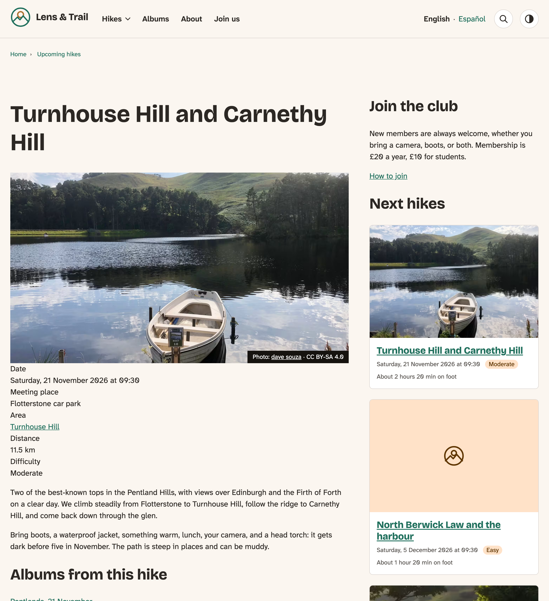
*Figure 18.1: Turnhouse Hill's page before this chapter: every field, labeled, one under the other.*

## Which template?

Chapter 9 showed how Drupal picks a template: it makes a list of **theme hook suggestions**, from the most specific name to the most general, and uses the first one it finds in the theme. For a hike on its own page, the list starts with `node--7--full.html.twig` (this one hike), then `node--hike--full.html.twig` (every hike, on its own page), `node--hike.html.twig` (every hike, anywhere), and ends with `node.html.twig`. With Twig debugging on, the page source shows the list in a comment above each piece, with an `x` beside the file that won.

The club wants every hike's page to look the same, wherever it is shown on its own, so the name is `node--hike--full.html.twig`. Not `node--hike.html.twig`: that one would also catch hikes in the Card view mode, which has its own template since Chapter 9.

Before writing it, a question we've asked in every chapter: what belongs in the template, and what belongs to the site builder? The **display** (**Manage display** on the content type) decides which fields show, with which formatter, and whether their labels show. The **template** decides the HTML around them, and their order on the page. Doing the first part in the display means an editor can still change it without touching the theme, and the template stays short.

## The hike page

### The display first

On **Structure** › **Content types** › **Hike** › **Manage display**, on the **Default** tab:

1. **Date**: label **Hidden**. The date sits over the title, and needs no label.
2. **Hike leader**: label **Hidden**. The template writes "Led by" before the name.
3. **Meeting place**, **Distance**, **Difficulty** and **Area**: label **Above**. These are the four facts, and the field template we make in a moment prints their labels in its own way.
4. **Elevation gain**: drag it to **Disabled**. It isn't one of the four facts in the design, and it's already in the walking time.
5. **Save**.

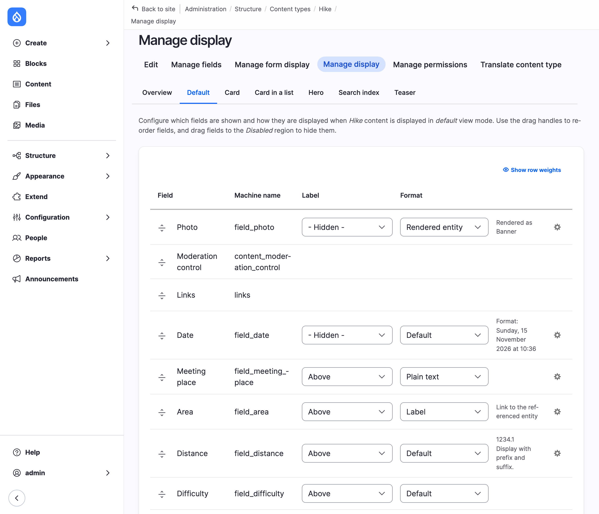
*Figure 18.2: The hike's Default display, ready for the template.*

%% Author: on the test sites this was done by code/chapter18/site/01-hike-page.php. %%

### The template

Copy core's `node.html.twig` from `core/modules/node/templates` to the theme's `templates/content` folder, rename it `node--hike--full.html.twig`, and rebuild the cache. Then replace its body, in the order of the design:

<!-- include: code/chapter18/steps/01-hike-page/core/lens_trail/templates/content/node--hike--full.html.twig as=templates/content/node--hike--full.html.twig -->

Each part of the page is one piece of `content`, printed where the design wants it: the photo, then a `<header>` with the date and the title, then the facts, then the description. At the end, `content|without(...)` prints everything the template hasn't printed yet. Today that's nothing on most hikes, but it's what keeps a field that a site builder adds next year from silently disappearing: it shows up at the bottom of the page until someone gives it a place. And it keeps the cache tags of the fields that are printed elsewhere, which Chapter 17 showed can get lost when a template takes `content` apart.

`add_class('hike__date')` on the date is the filter from Chapter 11: it adds a class to the field's outer element without a field template of its own.

### The page's title

The page now has two h1s: the template's, and the **Page title** block's, above the photo. The design wants only the template's, under the photo and the date.

The first idea is Block layout: hide the Page title block on hikes. Its **Visibility** settings do have a **Content type** condition, but it can only say "show this block *only* for hikes", not "show it for everything *except* hikes". Only the **Pages** condition has the **Show for the listed pages** and **Hide for the listed pages** choice, and a list of paths (`/hikes/*`) breaks the day a hike's address doesn't start with `/hikes`. The other way, a second Page title block for everything else, means listing every other content type, and remembering to add the next one.

So the theme does it, in the page's preprocess. Chapter 10 introduced `hook_preprocess_page()`. It runs before `page.html.twig`, with every block of every region in `$variables['page']`, and a hike's page also has the hike in `$variables['node']`:

<!-- include: code/chapter18/steps/01-hike-page/core/lens_trail/src/Hook/LensTrailHooks.php function=preprocessPage -->

Each block in a region is a render array with its plugin's name in `#plugin_id`, and the Page title block's is `page_title_block`. Taking it out of the region means it's never rendered. It doesn't matter what the site builder named the block, or which region they put it in next year: the hook only looks in `content`, where the club's theme has always had it, and if it ever moves, the page shows two titles instead of none, which is the failure you'd want.

### The facts, as a description list

The four facts are pairs: a label and a value. HTML has an element for that, the **description list**: `<dl>` around the list, `<dt>` for each label (the term) and `<dd>` for each value. A screen reader announces it as a list, with the number of items, and moves from label to value; a `
` with two ``s says none of that.

The template already has the `<dl>`. Each field inside it has to print a `<dt>` and a `<dd>` instead of core's `
`s, so the fields need a template of their own. Field templates have suggestions too: `field--node--field-distance--hike.html.twig` would be the Distance field on hikes. Four fields would mean four copies of the same template, and Chapter 3's design uses the same pattern for an album's hike and area. One template for all of them needs one name, and a name that Drupal doesn't suggest by itself can come from the theme, with `hook_theme_suggestions_HOOK_alter()`. For fields, that's `hook_theme_suggestions_field_alter()`:

<!-- include: code/chapter18/steps/01-hike-page/core/lens_trail/src/Hook/LensTrailHooks.php function=themeSuggestionsFieldAlter -->

`$facts` lists which fields of which content type are facts, and only on the `full` view mode: the same Distance field in the Card view mode stays as it was. The suggestion `field__fact` (double underscores in the suggestion, double hyphens in the file name) makes Drupal look for `field--fact.html.twig`:

<!-- include: code/chapter18/steps/01-hike-page/core/lens_trail/templates/field/field--fact.html.twig as=templates/field/field--fact.html.twig -->

The label is always a `<dt>`, even when the display hides it: then it gets core's `visually-hidden` class, so screen readers still hear "Difficulty" before "Moderate". A field with several values gets several `<dd>`s, which is what a description list allows. And `extra` is a line under the value, which comes next.

The CSS is split in two. `fact.css` is the fact itself, a small label over a bold value, wherever it is:

<!-- include: code/chapter18/steps/01-hike-page/core/lens_trail/css/components/fact.css as=css/components/fact.css -->

`hike.css` is the page, and it decides that on a hike's page the facts are boxes, two to a row:

<!-- include: code/chapter18/steps/01-hike-page/core/lens_trail/css/components/hike.css as=css/components/hike.css -->

Two columns even on a phone, because the four facts are short, and the design wants all four on the first screen. Each file gets a library, `lens_trail/fact` and `lens_trail/hike`, in `lens_trail.libraries.yml` like the others since Chapter 8, and each template attaches its own.

### The walking time, under the distance

Chapter 10 worked out a walking time for hike cards, with Naismith's rule. The design puts it on the hike's page too, under the distance: "11.5 km", then "About 2 hours 20 min on foot". It belongs to the Distance fact, so it's the `extra` that `field--fact.html.twig` prints. The field's preprocess adds it, for the Distance field of a hike on its own page:

<!-- include: code/chapter18/steps/01-hike-page/core/lens_trail/src/Hook/LensTrailHooks.php function=preprocessField -->

(The rest of the function is the Banner's `fetchpriority`, from Chapter 14.)

Two hooks now need the walking time, so it moved out of `preprocessNode()` into a method of its own. It returns the whole sentence, translated, instead of a number of minutes:

<!-- include: code/chapter18/steps/01-hike-page/core/lens_trail/src/Hook/LensTrailHooks.php function=walkingTime -->

<!-- include: code/chapter18/steps/01-hike-page/core/lens_trail/src/Hook/LensTrailHooks.php function=preprocessNode -->

So the card's template prints the sentence as it comes:

<!-- diff: code/chapter17/steps/05-cms/core/lens_trail/templates/content/node--hike--card.html.twig code/chapter18/steps/01-hike-page/core/lens_trail/templates/content/node--hike--card.html.twig as=templates/content/node--hike--card.html.twig -->

### The leader and the date

Under the title, "Led by" and the leader's name, when the hike has one. The template renders the field, strips its HTML, and puts what's left in a sentence that can be translated: `'Led by @name'|t(...)`. It doesn't read the name from `node.field_hike_leader.entity` directly. Rendering the field is what passes the user's cache tags up to the page, so when the leader changes their name, the page changes too.

> **Try it:** On the core site, Turnhouse Hill has no leader, and its page has no "Led by". Arthur's Seat at sunrise has one, `jordi`. That's the account's **username**, which is also its display name, because the club's accounts have no name field. A club that wants "Jordi Puig" on the page adds a name field to accounts and changes the display name with `hook_user_format_name_alter()`; the template doesn't change.

The date needs nothing. Core's **Default** date formatter already writes it in a `<time>` element with a machine-readable `datetime` attribute, in UTC, beside the readable date. Look at the page source: `<time datetime="2026-11-21T09:30:00Z">Saturday, 21 November 2026 at 09:30</time>`. Calendar extensions and search engines read the attribute; people read the text.

*Figure 18.3: The hike's page, as Chapter 3 designed it.*

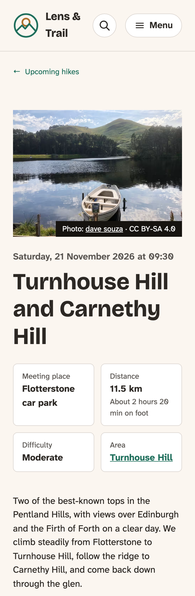
*Figure 18.4: On a phone, the four facts still fit on the first screen.*

> **Try it:** Open the Spanish version of Turnhouse Hill. The facts' labels come from the fields' translations, "Alrededor de 2 horas 20 min a pie" from the interface translation, and on Arthur's Seat at sunrise, "Guía: jordi". Add the two new strings in **Configuration** › **Regional and language** › **User interface translation**, if your site doesn't have them yet.

%% Author: the Spanish strings were added by code/chapter18/site/translations.php on both test sites. "About @time on foot" had no Spanish since Chapter 10; this chapter adds it. %%

## On paper

Some members print a hike and take it with them, and Chapter 3 designed what they get: the club's logo and name, the date, the title, the facts as a plain list, and the description. No menu, no photo (on a home printer, a photo is mostly ink), no sidebar, no footer. Black on white, even if the screen was dark.

Browsers have a way to do that without a second page: a **print stylesheet**, CSS that only applies when the page is printed (or saved as PDF). A library can load a file for print only, with `media: print`:

<!-- include: code/chapter18/steps/02-print/core/lens_trail/lens_trail.libraries.yml key=print -->

The browser still downloads it, but it doesn't wait for it before showing the page on screen. The library goes on every page, in `lens_trail.info.yml`, and the file goes in a layer of its own, `print`, added last to the order in `layers.css` from Chapter 8:

<!-- diff: code/chapter18/steps/01-hike-page/core/lens_trail/css/layers.css code/chapter18/steps/02-print/core/lens_trail/css/layers.css as=css/layers.css -->

Last means it wins over every other layer, whatever their selectors, without `!important`. That's the whole reason for the layer: a print stylesheet's job is to overrule the screen.

<!-- include: code/chapter18/steps/02-print/core/lens_trail/css/print.css as=css/print.css -->

A few things in it are worth a second look:

- **`color-scheme: light`** on the root is all it takes to print light. The club's colors are `light-dark()` pairs since Chapter 8, so this one line switches all of them, whatever the visitor chose with the toggle.
- **`@page`** sets the paper's margins. Browsers add their own header and footer (the date, the page's title, its address) in the margin, unless the person printing turns them off.
- **Links to other sites** get their address written after them, with `attr(href)`: on paper, you can't click. The club's own links don't, because their addresses are as long as they are useless on a walk.
- **`break-after: avoid`** keeps a heading with what follows it, and `break-inside: avoid` keeps a photo from being cut over two pages.

The last rule shows a line that's only for paper: where the page came from. It's in `page.html.twig`, with the `hidden` attribute, so it's never seen on screen:

<!-- diff: code/chapter18/steps/01-hike-page/core/lens_trail/templates/layout/page.html.twig code/chapter18/steps/02-print/core/lens_trail/templates/layout/page.html.twig as=templates/layout/page.html.twig -->

`url('<current>')` is the page's own address, with the language prefix, so the Spanish page says `/es/excursiones/...`. The sentence needs Spanish too: "Impreso desde @url".

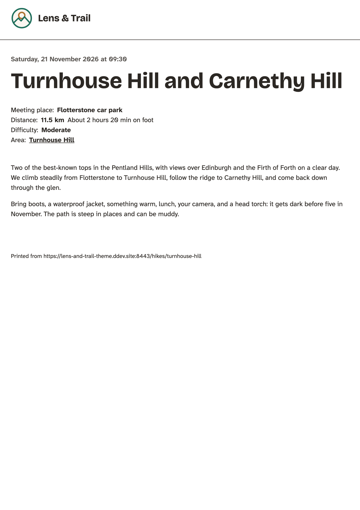
*Figure 18.5: The same page on paper.*

> **Try it:** Open the print preview (**File** › **Print** in most browsers, or Ctrl+P, Cmd+P on a Mac). Switch the site to dark mode first, and check that the preview is still black on white. In Chrome's developer tools, **Rendering** › **Emulate CSS media type** › **print** shows the print version in the window, where you can inspect it like any page.

%% Author: the print header has no slogan. The design's handout has "Photos and hikes around Edinburgh" under the name, but the header's Site branding block doesn't show the slogan (only the footer's does), so the print header has none. Showing it would mean a second branding block, hidden on screen. %%

## News, albums and the rest

The hike page set the pattern: the display picks the fields, the template puts them in order, and a small CSS file per template. The club's other pages follow it, so this part goes faster.

### A news item

A news item is a smaller hike: the photo, then the date and the title under it, then the text. The date is when the item was published, from the node's `created` time, in a `<time>` of its own. "Submitted by admin" goes: news comes from the club, not from an account.

<!-- include: code/chapter18/steps/03-other-pages/core/lens_trail/templates/content/node--news--full.html.twig as=templates/content/node--news--full.html.twig -->

`node.createdtime` is the time as a number. Twig's `date('c')` makes it the machine-readable form for the attribute, and Drupal's `format_date` makes the readable one, in the page's language, with a custom pattern. The h1 is in the template here too, so the page's preprocess now takes the title block off news pages as well:

<!-- diff: code/chapter18/steps/02-print/core/lens_trail/src/Hook/LensTrailHooks.php code/chapter18/steps/03-other-pages/core/lens_trail/src/Hook/LensTrailHooks.php as=src/Hook/LensTrailHooks.php -->

The diff also shows the album's two facts, for the next section, and the walking time in the Teaser view mode, for the lists after it.

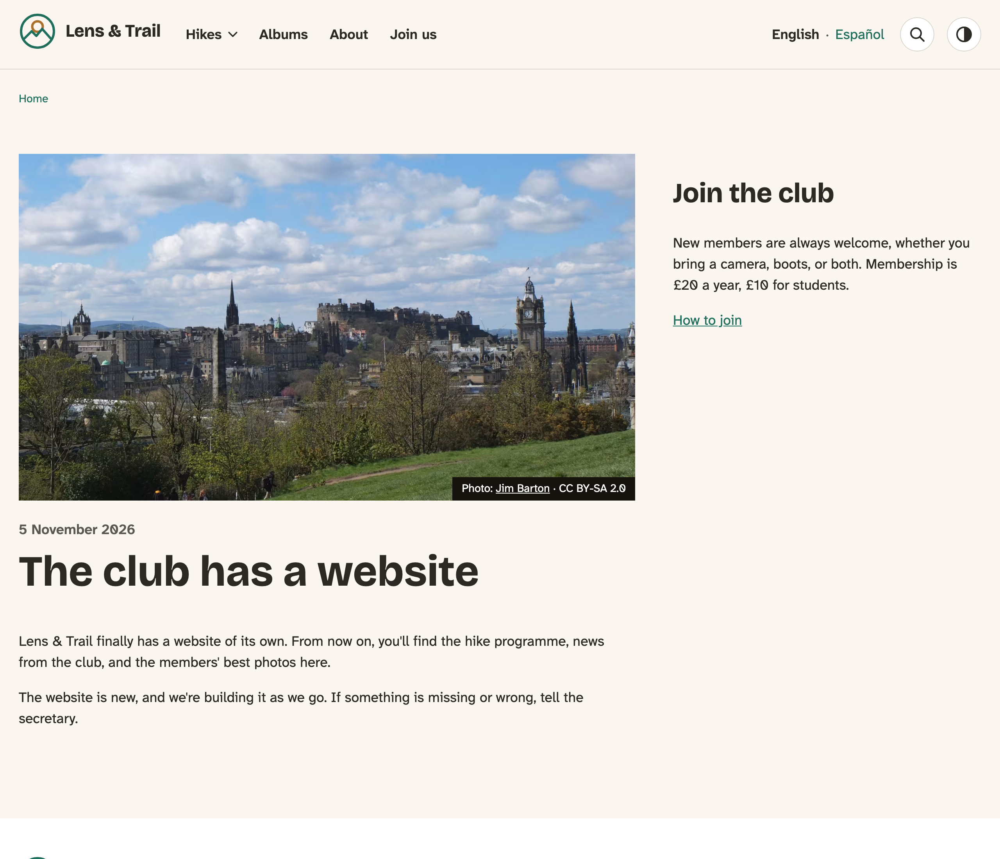
*Figure 18.6: A news item: the same order as a hike.*

### An album

An album keeps the Page title block: its photos are lower down, so the title comes first. Under it, the album's hike and area are facts, through the same `field--fact.html.twig`, but in a line instead of boxes, because they're two short links. Then the text, the photos in the Album component from Chapter 14, and the comments.

<!-- include: code/chapter18/steps/03-other-pages/core/lens_trail/templates/content/node--gallery--full.html.twig as=templates/content/node--gallery--full.html.twig -->

For the labels, set **Hike** and **Area** to **Above** on the album's **Manage display**, as for the hike's facts.

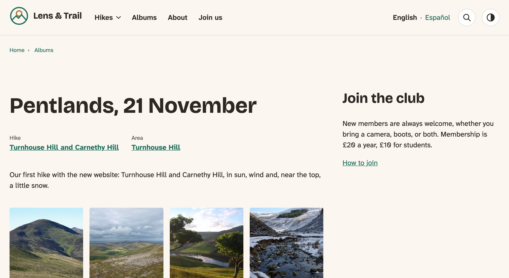
*Figure 18.7: An album, with its two facts in a line.*

### Comments

Each comment has a template too, `comment.html.twig`, with the same suggestions as nodes (`comment--comment--gallery.html.twig` would be the comment field on albums only). Core's prints the comment's subject as a heading, an avatar, "Submitted by lucia on Fri, 6 Nov 2026 - 13:40" and a Permalink. The club's prints who and when in one small line, then what they wrote, in a box:

<!-- include: code/chapter18/steps/03-other-pages/core/lens_trail/templates/content/comment.html.twig as=templates/content/comment.html.twig -->

The subject goes because, unless the writer fills it in, Drupal makes it from the first words of the comment, so it would say the same thing twice. `author` is the commenter's name, linked to their profile when visitors can see profiles; `created` is the date, formatted by core.

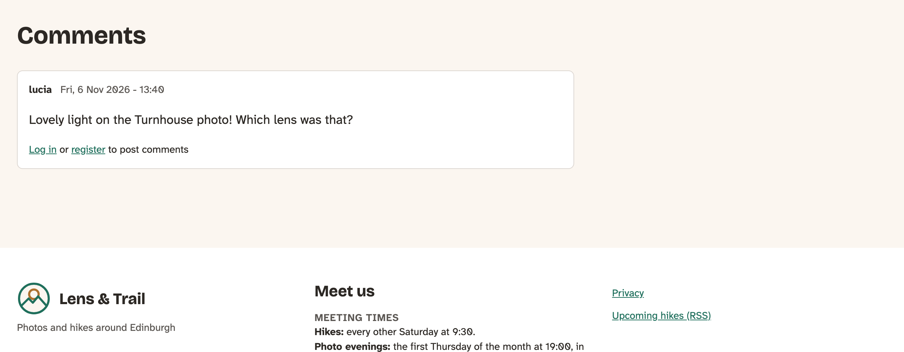
*Figure 18.8: A comment, with who and when in one line.*

The comment *form* isn't styled yet. It's a form, and Chapter 20 is about forms.

> **Try it:** Lucía's comment on the Pentlands album has waited since Book 1's chapter on comments in **Content** › **Comments** › **Unapproved comments**. Publish it, and look at the album.

%% Author: published on the test site by code/chapter18/site/03-other-pages.php, which also sets the album's labels. %%

### Lists: teasers and term pages

A **term page**, such as `/areas/pentland-hills`, is a view (core's **Taxonomy term** view) that shows the term first and then everything tagged with it, in the **Teaser** view mode. So it needs two templates: one for the term, and one for the teasers.

The term's is `taxonomy-term.html.twig`. Its suggestions go from `taxonomy-term--5.html.twig` (one term) through `taxonomy-term--areas.html.twig` (one vocabulary) to the general name. The club's areas have a photo and a description, and the photo themes have only a name, so one template for both is enough: a wrapper, and the fields in the display's order.

<!-- include: code/chapter18/steps/03-other-pages/core/lens_trail/templates/taxonomy/taxonomy-term.html.twig as=templates/taxonomy/taxonomy-term.html.twig -->

For the teasers, a hike in a list should look like a hike in a list anywhere on the site: the Hike card from Chapter 13, with its photo beside the text. Its template only includes the card's:

<!-- include: code/chapter18/steps/03-other-pages/core/lens_trail/templates/content/node--hike--teaser.html.twig as=templates/content/node--hike--teaser.html.twig -->

`include` hands the card's template every variable this one has, including `content`, which is the Teaser display's fields. So the **Teaser** display has to show what the Card display shows: on **Manage display**, on the **Teaser** tab, keep **Photo**, **Date** and **Difficulty**, set up as on the **Card** tab, and disable the rest. The walking time comes from `preprocessNode()`, which now adds it in the `teaser` view mode too.

Everything else in a list, albums and news, gets one general template, `node--teaser.html.twig`: the title as a link, then the rest of the display, and no "Read more", because the title already says where it goes.

<!-- include: code/chapter18/steps/03-other-pages/core/lens_trail/templates/content/node--teaser.html.twig as=templates/content/node--teaser.html.twig -->

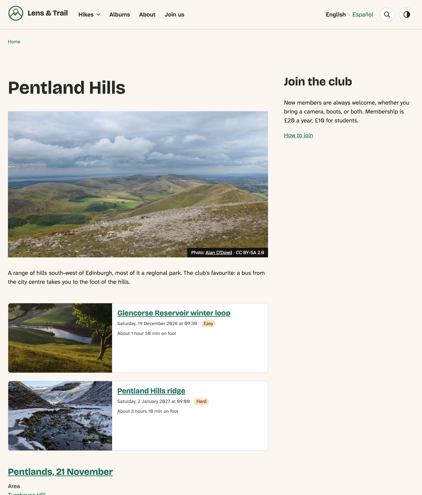
*Figure 18.9: An area's page: the term, then cards and teasers.*

%% Author: the Teaser display was changed on the test site by code/chapter18/site/03-other-pages.php. The "Albums from this hike" block at the end of a hike's page is a view, still unstyled: it's left for Chapter 19, on Views. The photo theme pages (/photo-themes/hills) show only the name: photo themes tag photos, not content, so the term view lists nothing. %%

## The hike for search engines

The hike's page says everything a person needs: when, where, how far. A search engine reads the same page and has to guess which number is the distance and which date is the hike's. **Structured data** tells it outright, in a vocabulary every big search engine shares, **Schema.org**. Schema.org has a type for a hike: an **Event**, with a `name`, a `startDate`, a `location` and an `organizer`. With it, a search engine can show the hike as an event in its results, with the date and the place, and a calendar or a map app can pick it up from the page.

There are three ways to write it in a page, and **JSON-LD** is the one search engines recommend: a `` in it, which would end the script early. `JSON_HEX_TAG` writes every `<` and `>` as `<` and `>`, so no value can close the element. With that taken care of, `JSON_UNESCAPED_SLASHES` and `JSON_UNESCAPED_UNICODE` keep the addresses and the Spanish readable.

> **Try it:** Open a hike's page source, and find the `application/ld+json` script. Copy the JSON into the [Schema Markup Validator](https://validator.schema.org/), or give it the whole page source. It should find one Event, with no errors. Google's [Rich Results Test](https://search.google.com/test/rich-results) checks it against what Google shows in its results, and has its own list of recommended fields (an image, a description, a performer); the validator checks it against Schema.org.

> **A module or the theme?** The contributed [Schema.org Metatag](https://www.drupal.org/project/schema_metatag) module builds JSON-LD from forms in the admin interface, on top of the Metatag module: a site builder picks the type (Event) and fills each property with a token, such as one for the hike's Date field. That's the right choice for a site with many types and a site builder who looks after them, and it works with any theme. The club has one: a hike as an Event. Twenty lines in the template that already has every value, in the same file a developer opens when the hike page changes, are less to install, update and remember. Hilmar uses the same approach for artists' pages on a music site. Choose the module when the people who know what the data should say aren't the people who edit the theme.

%% Author: neither the validator nor the Rich Results Test was run (the test site isn't public); the JSON was only checked for being valid JSON. Run both before publication. %%

## On Drupal CMS

On the Drupal CMS site, the hikes, news items and albums are shown by Mercury's templates, not by Canvas: Canvas only takes over a content type's page when the type has a **content template** (more about those at the end). So the same Twig templates work in Mercury, with a few changes.

### The same templates, in Mercury

The templates are the core theme's, with Mercury's libraries, and with one field renamed: Drupal CMS's content types call the body **Content** (`field_content`), not Body.

<!-- diff: code/chapter18/steps/05-cms/core/lens_trail/templates/content/node--hike--full.html.twig code/chapter18/steps/05-cms/cms/mercury/templates/content/node--hike--full.html.twig as=mercury/templates/content/node--hike--full.html.twig -->

The CSS files are the core theme's too, in Mercury's `css` folder as plain CSS like the main menu's in Chapter 16, with Mercury's names for the club's tokens (`--spacing-club-m`, `--text-step--1`, `--muted-foreground`) and without the layer around them. The title has to be sized in the CSS: Tailwind resets headings to the size of the text, and Mercury's page title gets its size from classes in its template.

The PHP goes into Mercury's `ThemeHooks.php`, beside its own hooks: the fact suggestion, the walking time in the field's and the node's preprocess, and one line in Mercury's page preprocess. Mercury doesn't print the title with a block: its `page.html.twig` prints a `title` variable, which the preprocess makes. On hike and news pages, it's set to nothing:

<!-- diff: code/chapter17/steps/05-cms/cms/mercury/src/Hook/ThemeHooks.php code/chapter18/steps/05-cms/cms/mercury/src/Hook/ThemeHooks.php as=mercury/src/Hook/ThemeHooks.php -->

On the site, the displays get the same settings as on the core site. One thing is different there: Drupal CMS shows the photo on news items and area pages with its 16:9 wide view mode, which lists the photo's Photographer, License and Source under it with labels. The club's **Banner** view mode from Chapter 14 puts the credit on the photo, as on the core site.

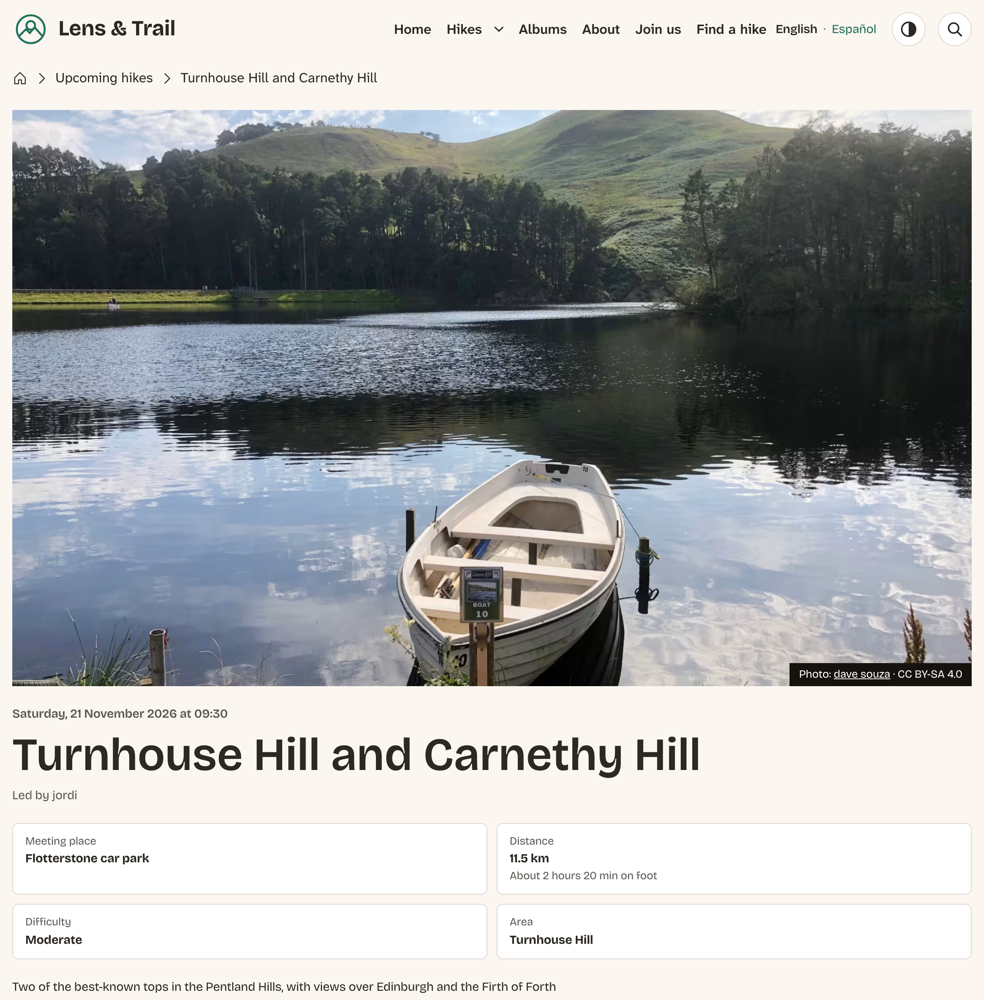
*Figure 18.10: The hike's page in Mercury.*

%% Author: on the test site, the displays were set by code/chapter18/site/05-cms.php, which also takes the 
 tags out of Lucía's plain-text comment (as Book 1 did on its site). %%

### Cards with props

Drupal CMS's views show content in the **Card** view mode, not Teaser, so on an area's page the templates are `node--hike--card.html.twig` and a general `node--card.html.twig`. The hike's should use the Hike card, but the Mercury version of the card is the one from Chapter 13 that editors fill in in Canvas, with props instead of a slot: a title, a link, a date, a difficulty and a photo. So the template hands it values from the node:

<!-- include: code/chapter18/steps/05-cms/cms/mercury/templates/content/node--hike--card.html.twig as=mercury/templates/content/node--hike--card.html.twig -->

The photo is the interesting part. In Canvas, an image prop is an object with `src`, `alt`, `width` and `height`, and Chapter 14 showed that Canvas's `canvas:image` turns `src` into a `srcset`, when the address has the parametrized image style in its query string. Canvas adds a property to every image field that gives exactly that address, `src_with_alternate_widths`. So the card gets the same small images on an area's page as in Canvas.

The component **validates** its props: SDC checks every value against the types in `hike-card.component.yml`, and a wrong type stops the page with an error, which is how we found the two details in the template's comment. `src_with_alternate_widths` is a `GeneratedUrl` object, and its `generatedUrl` is the string. The image's width and height come as strings (`"1200"`), and `+ 0` makes them numbers.

The **Card** display then needs only the photo: the template reads everything else from the node. Rendering `content` at the end, without printing it, passes the photo's cache tags up to the list, as `content|without(...)` does on the hike's page.

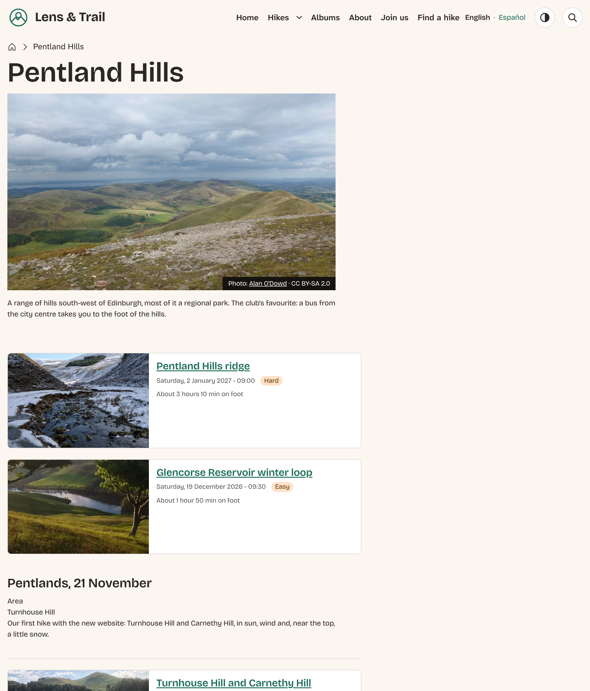
*Figure 18.11: The Hike card on Drupal CMS, filled from the node instead of by an editor.*

### Print in Mercury

The print stylesheet is the core theme's, with Mercury's markup: its header is `header[role="banner"]` with the Navbar in it, the breadcrumb a `nav` labeled "breadcrumb", and the footer `footer[role="contentinfo"]`.

<!-- include: code/chapter18/steps/05-cms/cms/mercury/css/print.css lines=1-46 as=mercury/css/print.css -->

Mercury has no `print` layer to put it in, but most of its CSS is in Tailwind's layers, and CSS outside any layer wins over CSS in one. Two exceptions needed a closer look in the developer tools: the Navbar's own CSS (`.navbar--menu:not(.navbar--menu--open)`) is outside the layers too, with a stronger selector than `.navbar--menu`, and so are this chapter's own files. So those selectors start with a little more: `header[role="banner"] .navbar--menu`, `.hike__facts .fact`.

The "Printed from" line has one more catch. Tailwind hides elements with the `hidden` attribute with `!important`, and an `!important` in a layer beats any `!important` outside it. So in Mercury, the line uses Tailwind's `hidden` *class*, which the print stylesheet can overrule:

<!-- diff: code/chapter17/steps/05-cms/cms/mercury/templates/layout/page.html.twig code/chapter18/steps/05-cms/cms/mercury/templates/layout/page.html.twig as=mercury/templates/layout/page.html.twig -->

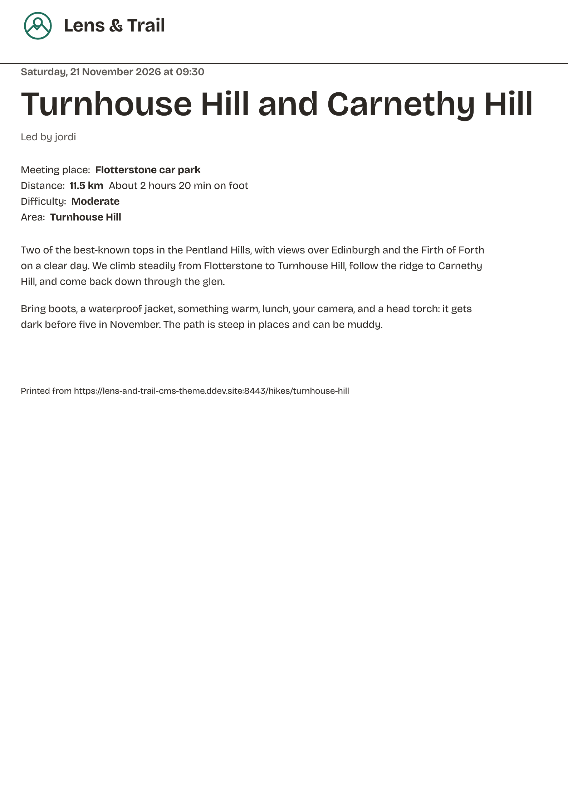
*Figure 18.12: Mercury's hike page on paper.*

> **Content templates in Canvas.** Canvas has its own way to lay out a content type's page: a **content template**, in the **Templates** panel of the Canvas editor. It's a page of components, like Home, where a component's props are linked to the content's fields: the Hike card's Title prop to the hike's title, its Date to the Date field. Once a content type's Full content template is enabled, Canvas renders that type's pages, and Mercury's `page.html.twig` knows it (`rendered_by_canvas`): no Twig template for the node is used. It's the Canvas answer to everything in this chapter, built by a site builder in the browser instead of a developer in a file, and it suits a site where editors are expected to change the layout. The club's Drupal CMS site keeps its content pages in Twig, for two reasons: the core and Drupal CMS sites share the same templates, so the book shows one way to do it, and the print stylesheet, the structured data and the fact template are things a content template doesn't do. The site has one content template, for Basic pages, which isn't enabled.

%% Author: the Canvas content template part is from the Canvas code and the site's configuration (node.page.full, disabled); a content template wasn't built by hand for this chapter, so there's no screenshot. %%

## Summary

You can now:

- choose a template's name from the theme hook suggestions, and decide what belongs in the display and what in the template;
- build a content type's page in the order of a design, and keep the fields you didn't place with `content|without()`;
- take a block off some pages in `hook_preprocess_page()`, when Block layout can't say "everywhere except";
- give several fields one template with `hook_theme_suggestions_field_alter()`, and write a description list that screen readers understand;
- pass an extra value from a field's preprocess to its template, and share a helper between two hooks;
- write a print stylesheet in its own layer, loaded with `media: print`, that prints light whatever the screen was;
- template news items, albums, comments, term pages and teasers, with a general template for what has none;
- add a Schema.org Event in JSON-LD from the template, and print JSON in a `<script>` safely;
- do the same in Mercury, fill a Canvas component's props from a node, and say when Canvas's content templates are the better choice.

The club's pages are done; the lists aren't. The next chapter is about Views: how the hike archive, the albums page and the Albums from this hike block get their markup.

## Exercises

1. Put **Elevation gain** back on the hike's page, as a fifth fact after Distance. What do you change in the display, and what in the hook? Check that the facts still look right on a phone, and in the print preview. Then decide whether the design is better with it, and put it back the way it was if not.
2. Print an album's page. The comments' "Log in or register to post comments" isn't much use on paper: hide it in `print.css`, and check that the comments themselves still print.
3. Run a hike's JSON-LD through the [Schema Markup Validator](https://validator.schema.org/) and Google's [Rich Results Test](https://search.google.com/test/rich-results), as in the chapter. Google recommends a `description`: add one to the Event, with the first 160 characters of the description, without HTML. Which Twig filters do you need?
4. Give albums in lists a template of their own, `node--gallery--teaser.html.twig`, with the album's first photo beside the title, like a Hike card. You need a view mode for the photo's media item, or the Teaser display's photo field set to show only one item. Check it on the Pentland Hills page, and check with Twig debugging that your template is the one used. *(challenge)*
5. Describe an album in JSON-LD too: an `ImageGallery`, with each photo as an `ImageObject` with its address, who took it and under which license. The photographer and the license are fields of the photo's media item. *(advanced)* (The answer is in Appendix B.)

## Want to know more?

- Drupal.org: [Twig template naming conventions](https://www.drupal.org/docs/develop/theming-drupal/twig-in-drupal/twig-template-naming-conventions) and [Working with Twig templates](https://www.drupal.org/docs/develop/theming-drupal/twig-in-drupal/working-with-twig-templates).
- Drupal API: [hook_theme_suggestions_HOOK_alter()](https://api.drupal.org/api/drupal/core%21lib%21Drupal%21Core%21Render%21theme.api.php/function/hook_theme_suggestions_HOOK_alter/11.x) and [hook_preprocess_HOOK()](https://api.drupal.org/api/drupal/core%21lib%21Drupal%21Core%21Render%21theme.api.php/function/hook_preprocess_HOOK/11.x).
- MDN: [`<dl>`: the Description List element](https://developer.mozilla.org/en-US/docs/Web/HTML/Reference/Elements/dl), [Printing](https://developer.mozilla.org/en-US/docs/Web/CSS/CSS_media_queries/Printing) and [`@page`](https://developer.mozilla.org/en-US/docs/Web/CSS/@page).
- Schema.org: [Event](https://schema.org/Event) and [ImageGallery](https://schema.org/ImageGallery); Google Search Central: [Event structured data](https://developers.google.com/search/docs/appearance/structured-data/event) and [Introduction to structured data](https://developers.google.com/search/docs/appearance/structured-data/intro-structured-data).
- Drupal.org: [Schema.org Metatag](https://www.drupal.org/project/schema_metatag) and [Canvas](https://www.drupal.org/project/canvas).
