# Views

Almost every list on the club's site is a view: the hikes, the hike archive, the albums, Next hikes on the front page, Albums from this hike at the end of a hike's page. Book 1 built them, and so far this book has themed what's *in* them: the Hike card, the teasers. The views themselves still wear what Drupal gives every view: a `
` with no class to style by, the albums as a grid of labeled fields, the hike archive's months as "202701 (2)", a pager that is a bulleted list.

This chapter themes the lists themselves:

1. **The club's news**: a News page and a Latest news block, with a news card, because news items had no way in until now.
2. **The markup Views gives**: which templates a view is made of, how their names are chosen, and the wrapper, the pager and the "more" link for every view on the site.
3. **The hikes**: the Difficulty filter's layout, and the archive's months with names.
4. **The albums**: the Albums page in a view mode, Albums from this hike in fields, and what each is good for; and pages for the photo themes, which have been empty since Book 1.
5. **The same on the Drupal CMS site**, where Mercury already does part of this, and Home is a Canvas page.

The core site starts where the previous chapter left it: every content page has its template, and the lists don't. The Drupal CMS site starts the same way.

## The club's news

Book 1 gave the club a News content type, and its chapter on content types promised that "a list of news will use it". The list came in Book 1's chapter on Views, as exercise 1: a page of news items, newest first. So readers who did the exercise have it, and the ones who didn't have news items that no link leads to. This chapter doesn't walk through building it again: on the club's site, it's the view the exercise asks for, with two displays.

- **Page**: `/news`, titled News, five items to a page with a full pager, in the **Teaser** view mode, and a **News** link in the main menu after Albums.
- **Block**: Latest news, the two newest items in the **Card** view mode, with an **All news** link to the page. On the core site, it's in the sidebar of the front page, after Next hikes.

Both show only published news, in the language of the page, with "No news yet." when there's nothing to show. The club also had only one news item, which is not much of a list, so five more joined it, from the days after the website opened. That's content, not theming, but a theme for a list needs a list to try it on: if your site has only Book 1's one item, add five of your own (**Content** › **Add content** › **News**), each with a Spanish translation and most with a photo (leave one or two without, to see how the card looks then), before you go on. Six items make two pages of five, so the pager has something to show.

%% Author: on the test sites this was done by code/chapter19/site/01-news.php (the view, the displays, the Spanish, the block, the Day date format) and 02-more-news.php (five news items in English and Spanish, five to a page). The view's machine name is news. Readers who did Book 1's exercise may have named theirs differently; the template names in this chapter use news. %%

### A news card

A news item in a list should look like a news item, not like a hike: the date, the title as the link, the first lines of the text, and the photo beside them when there's room. The Teaser display shows the photo and the text trimmed to 300 characters; the template does the rest:

<!-- include: code/chapter19/steps/01-news/core/lens_trail/templates/content/node--news--teaser.html.twig as=templates/content/node--news--teaser.html.twig -->

- **The date** is the node's own (`node.createdtime`), in a date format the club added for it, **Day date** (`day_date`): "5 November 2026", and in Spanish "5 de Noviembre de 2026". A date format is configuration, translated like any other (**Configuration** › **Regional and language** › **Date and time formats**, then **Translate**), so the template names the format and each language says how it looks. A pattern typed into the template, `'j F Y'`, can't be translated.
- **The heading level** is 2 on the News page, under the page's h1. In Latest news, the cards sit under the block's h2, so they need h3. The Card template includes this one and says so:

<!-- include: code/chapter19/steps/01-news/core/lens_trail/templates/content/node--news--card.html.twig as=templates/content/node--news--card.html.twig -->

The CSS puts the photo beside the text with a **container query**, not a media query. The same card is 50rem wide on the News page and 20rem wide in the sidebar, on the same screen, so the screen's width says nothing about the card's. `container-type: inline-size` on the card lets its insides ask how wide the card is:

<!-- include: code/chapter19/steps/02-views-markup/core/lens_trail/css/components/news-teaser.css as=css/components/news-teaser.css -->

The two columns are only for a card with a photo (`:has(.news-teaser__photo)`): without one, the text takes the whole width instead of a third of it.

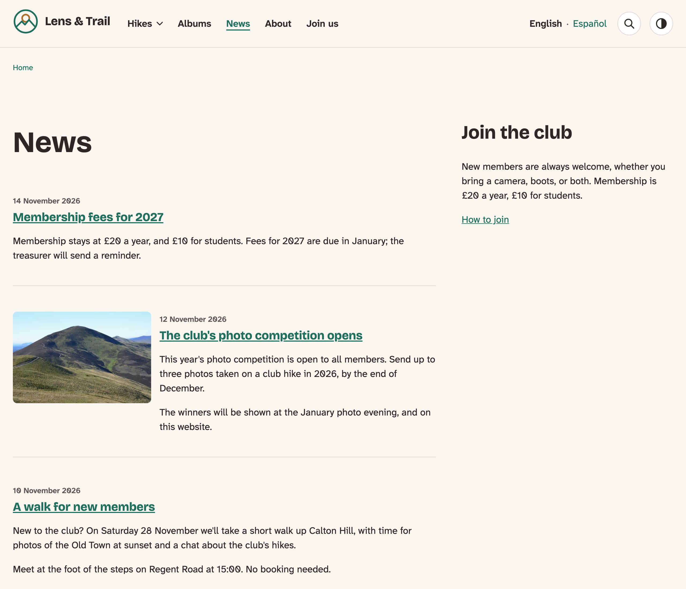
*Figure 19.1: The News page.*

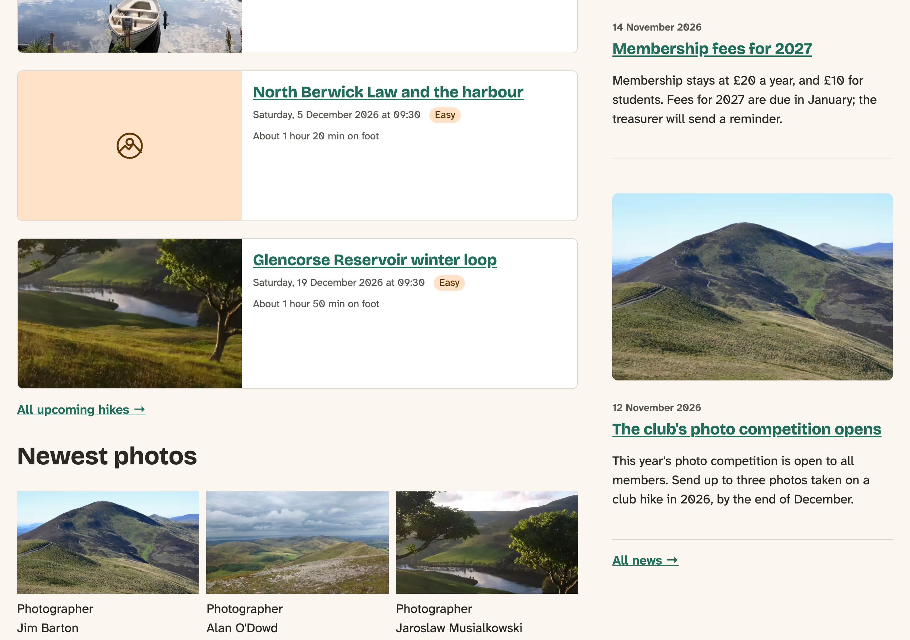
*Figure 19.2: The same cards in the sidebar, where the card is narrow: the photo goes on top.*

> **Try it:** Open `/es/news` on a phone-sized window. The menu says Noticias, the dates are Spanish, and each card shows its Spanish translation. If yours shows the English titles, look at the view's **Rendering Language**, under **Language** in the third column: it belongs to each display, not to the view, so a page display made before the setting was changed keeps the old value. **Interface text language selected for page** is the one the club uses.

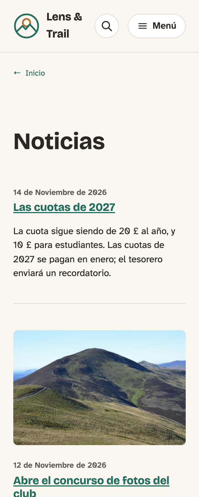
*Figure 19.3: Noticias, on a phone.*

## The markup Views gives

### A view is three templates deep

Every view is put together from three layers of templates, and it helps to know which is which before overriding any of them:

1. **The view**: `views-view.html.twig`. The wrapper around everything: the title, the header, the exposed filters, the rows, the pager, the "more" link, the footer.
2. **The style**, which Views calls the **Format**: the HTML around the rows. **Unformatted list** is `views-view-unformatted.html.twig` (a `
` per row), **HTML List** is `views-view-list.html.twig` (`<ul>` or `<ol>`), **Grid** and **Responsive Grid** are `views-view-grid.html.twig` and `views-view-grid-responsive.html.twig`, **Table** is `views-view-table.html.twig`. The core theme already has a table template, from the starterkit it was generated from in Chapter 5.
3. **The row**, which Views calls **Show**: what each row is. **Content** renders each node in a view mode, with the node templates of the previous chapters. **Fields** renders the fields chosen in the view, with `views-view-fields.html.twig` around them and `views-view-field.html.twig` for each one.

The Format and Show settings are at the top of a view's first column, in the Views UI. Changing them changes which templates are used, which is why we look there first, before opening a template.

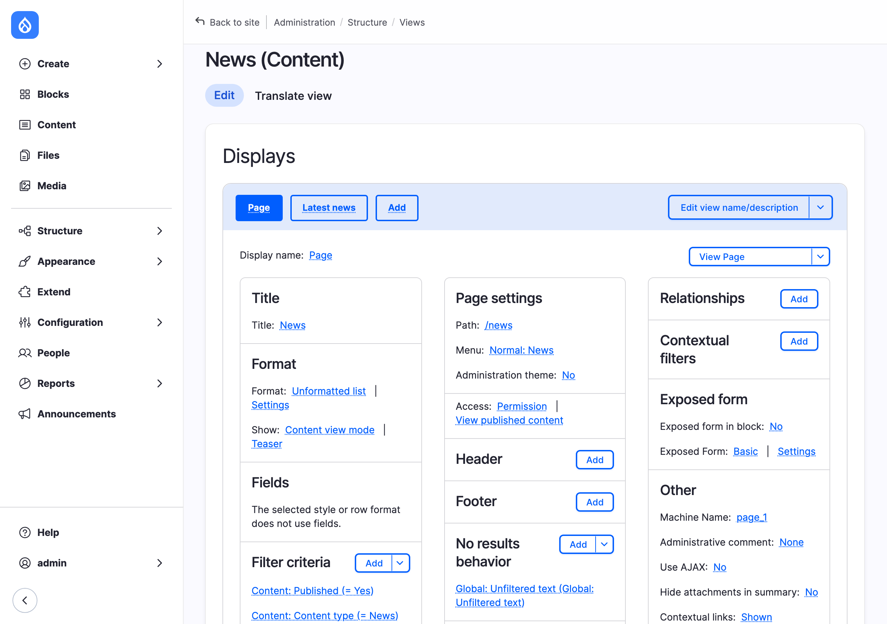
*Figure 19.4: The News view: Unformatted list, rows as Content in the Teaser view mode.*

### Suggestions for a view

A view's templates have suggestions like any other, but Views makes them itself, from the view's machine name and the display's. For the News page (view `news`, display `page_1`, a display of type `page`), the list for the wrapper is, most specific first:

1. `views-view--news--page-1.html.twig`: this display of this view.
2. `views-view--page-1.html.twig`: every view's display called `page_1`. That's rarely what you want: most views have a `page_1`.
3. `views-view--news--page.html.twig`: every page display of this view.
4. `views-view--page.html.twig`: every page display of every view.
5. `views-view--news.html.twig`: every display of this view.
6. `views-view.html.twig`: every view.

The style and the row templates get the same list, with their own names in front: `views-view-unformatted--news--page-1.html.twig`, `views-view-fields--albums--block-1.html.twig`. The machine names are in the Views UI: the view's in the address (`/admin/structure/views/view/news`), the display's under **Advanced** › **Other** › **Machine Name**. In a file name, underscores become dashes.

One thing is different from the rest of the theme: Twig debugging doesn't list these suggestions. The comment above a view says `THEME HOOK: 'views_view'` and names the file it used, but not the files it would have used, because Views hands the theme system its whole list at once, as a list of theme hooks, instead of through the suggestion hooks that the debug comment reads. So the list above is the one to keep at hand.

### The wrapper

Core's `views-view.html.twig` is a `
` with only a `js-view-dom-id-…` class, which changes on every page load. There's nothing to style a particular view by, and nothing to give the rows their spacing. The club's version is for every view, so its name is the last one in the list:

<!-- include: code/chapter19/steps/02-views-markup/core/lens_trail/templates/views/views-view.html.twig as=templates/views/views-view.html.twig -->

- **`view--news`, `view--news--page-1`**: the view and the display, as classes. Most of the club's CSS doesn't need them, but a rule for one list has something to hold on to.
- **`css_class`**: the **CSS class** setting in **Advanced** › **Other**, which a site builder can fill in. Core's template ignores it; printing it gives the site builder a way to style a view without a new template.
- **A wrapper for each part**: `view__content` around the rows, `view__empty` around the empty text, `view__filters`, `view__header`, `view__footer`. The pager and the "more" link have their own classes already.
- **`dom_id`** stays: Views' AJAX (an AJAX pager, filters that update in place) finds the view on the page by that class.

The CSS gives every list the same spacing between its rows. Chapter 7 had put a stopgap in `layout.css`, `.views-row + .views-row`, with a note that lists would get their own layout in the chapter on Views. This is that chapter:

<!-- diff: code/chapter19/steps/01-news/core/lens_trail/css/layout.css code/chapter19/steps/02-views-markup/core/lens_trail/css/layout.css as=css/layout.css -->

<!-- include: code/chapter19/steps/02-views-markup/core/lens_trail/css/components/views.css as=css/components/views.css -->

The rows are a flex column with a gap, instead of a margin on every row but the first. A grid or a table is one element inside `view__content`, so the gap doesn't touch it.

### The "more" link

**All upcoming hikes** and **All news** are the views' **More link** (**Use more link** in the display's **Pager** section). It isn't a Views template: Views gives it to Drupal's general `container` element, with the class `more-link`, and that has its own suggestions, which Twig debugging does show: `container--more-link--news--block-1.html.twig`, down to `container--more-link.html.twig`. The markup is fine as it is, a `
` around the link, so the club only adds CSS, in `views.css` above: the link in the action color, semibold, with an arrow after it. The arrow is CSS content with an empty alternative text (`" →" / ""`), so a screen reader reads "All news", not "All news right arrow".

The Hikes mega menu had its own rule for this link since Chapter 16. It still wins there, being more specific, and the two say the same.

### The pager

Core's pager template, `pager.html.twig`, is better than the view wrapper: it has a class on the list (`pager__items`), one on each item (`pager__item`, `pager__item--next`), `is-active` on the current page, a hidden "Pagination" heading for screen readers, and visually hidden words ("Page", "Next page") beside the numbers and arrows. Nothing to change in the HTML, then, only CSS. But the pager has no library of its own to extend, so the wrapper attaches one when the view has a pager:

<!-- include: code/chapter19/steps/02-views-markup/core/lens_trail/lens_trail.libraries.yml key=pager -->

<!-- include: code/chapter19/steps/02-views-markup/core/lens_trail/css/components/pager.css as=css/components/pager.css -->

Each page is a box at least 2.75rem (44px) on each side, big enough to hit with a thumb: that's the size WCAG asks for in its "target size" success criterion, and Apple's guidelines too.

Views also has a **mini pager** ("Paged output, mini pager"), with only the previous and next pages and "Page 2" between them. It has a template of its own, `views-mini-pager.html.twig`, and that one has no classes at all. The club's version gives it the full pager's, so the same CSS works for both:

<!-- include: code/chapter19/steps/02-views-markup/core/lens_trail/templates/views/views-mini-pager.html.twig as=templates/views/views-mini-pager.html.twig -->

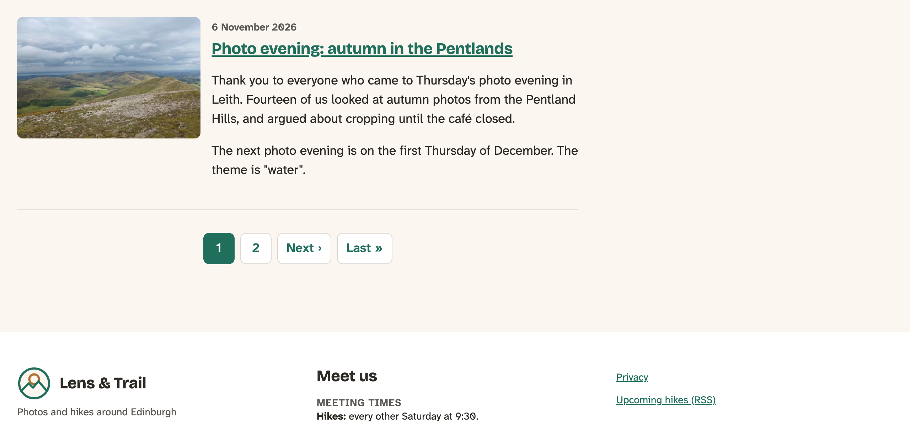
*Figure 19.5: The full pager on the News page.*

> **Try it:** On `/es/news`, the pager says Siguiente and Última. Its words are core's, translated with the rest of the interface, and come through the template untouched.

## The hikes

### The Difficulty filter

The Hikes page has had an **exposed filter** since Book 1: Difficulty, with a select list and an Apply button above the cards. The core theme's `views-exposed-form.html.twig` (from the starterkit, in Chapter 5) puts the form in a `form--inline` `
`; now the view wrapper puts that inside `view__filters`. The layout is a few lines in `views.css`: the filter and the button on one line, lined up at the bottom, wrapping on a phone.

<!-- include: code/chapter19/steps/03-hikes/core/lens_trail/css/components/views.css lines=51-71 as=css/components/views.css -->

The select list and the button themselves are still the browser's. Form controls are the next chapter, which styles every form on the site at once, and this one with them.

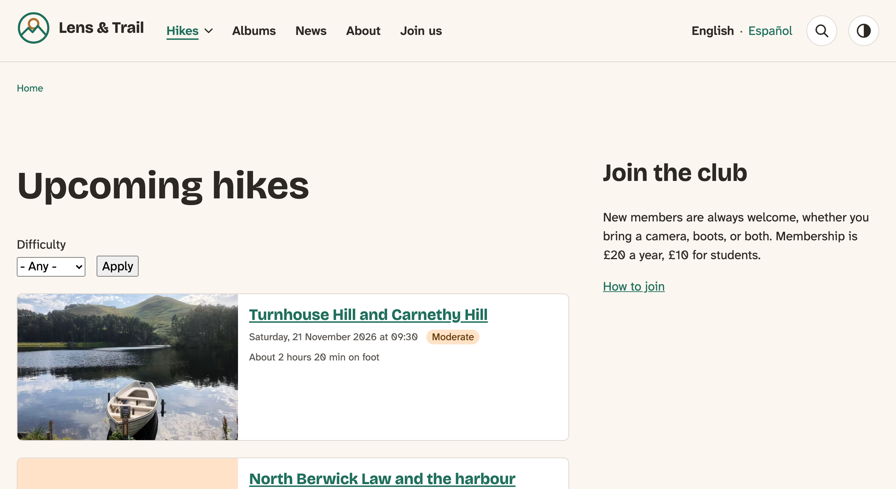
*Figure 19.6: The Difficulty filter, laid out; its controls get their look in the next chapter.*

### The archive's months

The Hike archive (`/hikes/archive`) has a list of months above the hikes, from an **attachment** display with a **contextual filter** on the hike's Date field, granularity year and month, showing a **summary**: one link per month, with the number of hikes. Its links said "202701", and they all went to `/hikes`, the Hikes page, which has no month filter.

The links first, because they're the site builder's part. An attachment has no address of its own, so its summary links to its view's first page display, unless it's told which one. On the attachment, **Advanced** › **Other** › **Link display** › **Page 3** (the Hike archive), and each month goes to `/hikes/archive/202701`, where the same contextual filter shows that month's hikes.

%% Author: done on the test sites by code/chapter19/site/03-archive.php, with the Month and year date format and the Spanish for "Hikes in …" (Excursiones de …). %%

Then the names. Views turns a year and a month into "January 2027" for a node's **Authored on** date, but not for a **date field** like the hike's Date: there the argument plugin (Datetime's `YearMonthDate`) has no method for the summary's text, or the page's title, so both are the raw value. This is a gap in core, and the theme can fill it, in two places.

The summary's months are in the summary template's `rows`, which a preprocess hook can change before the template prints them:

<!-- include: code/chapter19/steps/03-hikes/core/lens_trail/src/Hook/LensTrailHooks.php function=preprocessViewsViewSummary -->

<!-- include: code/chapter19/steps/03-hikes/core/lens_trail/src/Hook/LensTrailHooks.php function=yearMonthArgument -->

<!-- include: code/chapter19/steps/03-hikes/core/lens_trail/src/Hook/LensTrailHooks.php function=monthName -->

- **`yearMonthArgument()`** checks that the view's last contextual filter is a year and month from a date field. Any other summary on the site is left alone.
- **`monthName()`** turns "202701" into a date in the middle of the month (the 15th at noon, so no time zone can move it into the next or the previous month), and formats it with another new date format, **Month and year** (`month_year`): "January 2027", in Spanish "Enero de 2027".

The page's title, "Hikes in 202612", is made before any template sees it. For that, Views has hooks that run while the view is built, and one of them, `hook_views_pre_render()`, also runs in the theme: it's called after the view has its results and its title, before anything is rendered. Views' own comment on it says why: "prerender is a very themey thing".

<!-- include: code/chapter19/steps/03-hikes/core/lens_trail/src/Hook/LensTrailHooks.php function=viewsPreRender -->

The title keeps whatever words the site builder gave it ("Hikes in", "Excursiones de"), and only the month changes.

### The summary template

Core's summary is a `<ul>` with the count in brackets after each link. The club's months are a row of round links, each with the number in a small badge, and the month that's showing filled in. That's a template for this view only, `views-view-summary--hikes.html.twig`:

<!-- include: code/chapter19/steps/03-hikes/core/lens_trail/templates/views/views-view-summary--hikes.html.twig as=templates/views/views-view-summary--hikes.html.twig -->

- **`<nav>` with a name**: the months are a way around the archive, so they're a navigation landmark, named "Hikes by month" for screen readers (a page with two `<nav>`s needs the names to tell them apart).
- **`aria-current="page"`** on the month that's showing, as on the breadcrumb in Chapter 16: a screen reader says "current page", and the CSS doesn't need a second way of knowing.
- **The count** is in its own ``, without brackets.

<!-- include: code/chapter19/steps/03-hikes/core/lens_trail/css/components/summary.css as=css/components/summary.css -->

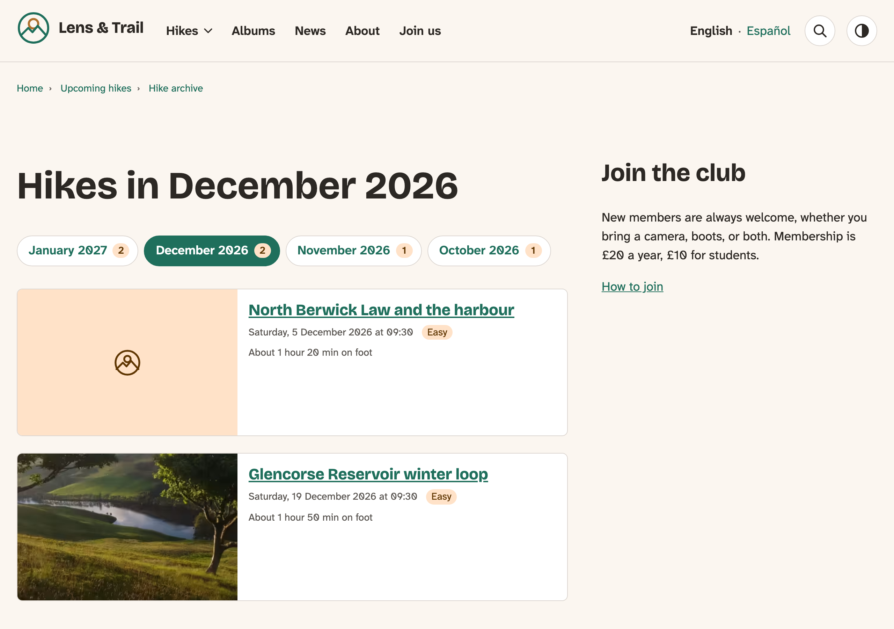
*Figure 19.7: One month of the Hike archive.*

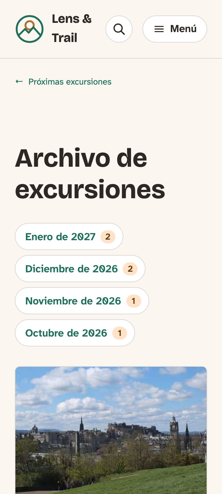
*Figure 19.8: The months in Spanish, from the Month and year format's translation.*

## The albums

### View modes or fields?

The Albums page and the Albums from this hike block are two displays of the same view, and both showed **Fields**: the album's title, its photos (the first one, in the Small view mode, with the photographer under it), the hike as "Hike: Arthur's Seat at sunrise", and the hike's date and time. It's Views' oldest way of building a list, and it's still the first one the **Add view** wizard offers. The other is to show each row as **Content**, in a view mode, as the hikes and the news do.

Both work. Which one fits depends on where the markup should live, and who changes it:

- **A view mode** (Show: **Content**) gives the row to the node's own templates. The album looks the same in every list that uses its Card display, the node template has every field and the node itself (`node.field_photos|length`), and the HTML is in one file. What the list shows is decided in **Manage display**, by content type and view mode.
- **Fields** (Show: **Fields**) decide what to show in the view, field by field, with Views' own settings for each: a label, a link, **Rewrite results**, how many values of a multiple field. A site builder can change a list without touching the theme. But the markup is spread over the view's settings and two templates, the row template only sees the fields the view chose, and two lists of the same content don't share anything.

The club uses both: a view mode for the Albums page, where an album is a card like the hikes and the news, and fields for the block, which is small, used once, and shows two things.

### The Albums page, in a view mode

The album's **Card** display shows its photos as thumbnails; the Albums page shows its rows as **Content**, **Card**. The template takes the first photo as the cover, and adds the date and the number of photos:

<!-- include: code/chapter19/steps/04-albums/core/lens_trail/templates/content/node--gallery--card.html.twig as=templates/content/node--gallery--card.html.twig -->

- **The number of photos** comes from the field (`node.field_photos|length`), not from the display, which renders them all and shows one. Twig's `` with `` gives "1 photo" and "4 photos", and in Spanish "1 foto" and "4 fotos", through the interface translation.
- **The date** is the hike's: an album has no date of its own, but it has a Hike field, and the template follows it to the hike (`node.field_hike.entity`). The album's card is cached with the album's cache tags, so a new date on the hike wouldn't show until the album changed. Printing a render array with only the hike's cache tags (`{'#cache': {'tags': hike.getCacheTags()}}`) prints nothing, and tells the cache that the card depends on the hike too.

<!-- include: code/chapter19/steps/04-albums/core/lens_trail/css/components/album-card.css as=css/components/album-card.css -->

> **Try it:** Add the Spanish for the count in **Configuration** › **Regional and language** › **User interface translation**: search for "1 photo", and the form has a box for each plural form, "1 foto" and "@count fotos". Add "Hikes by month" too, the archive's name for screen readers: "Excursiones por mes". Then open `/es/albumes`.

%% Author: the Spanish strings were added by code/chapter19/site/translations.php on both test sites. %%

The view's Format stays **Responsive Grid**, whose CSS comes from Views: the format and the row are separate settings, and a card fits in a grid cell as well as in a column.

%% Author: the Card display, the view's rows, the block's fields and the Photo themes view were set up on the test sites by code/chapter19/site/04-albums.php. %%

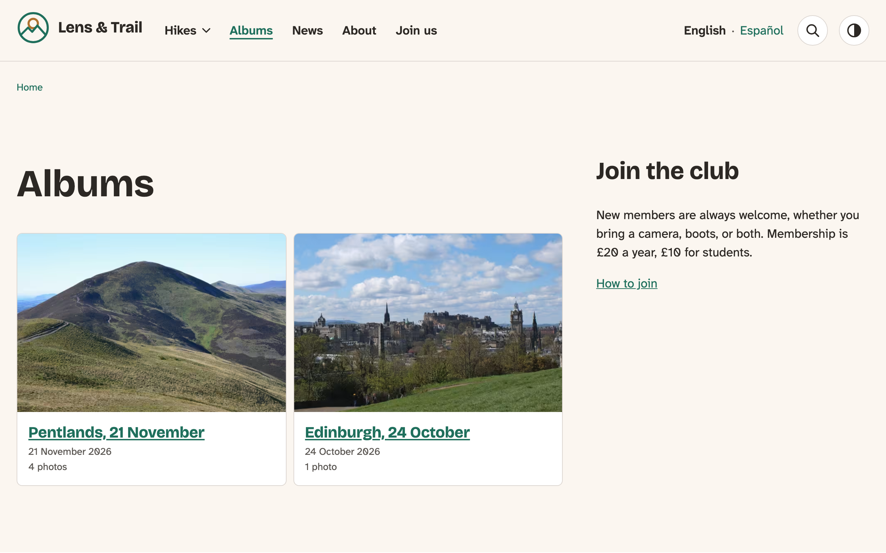
*Figure 19.9: The Albums page, with each album as a card.*

### Albums from this hike, in fields

The block at the end of a hike's page keeps **Fields**, two of them now: the album's **Title**, without a link, and its **Photos** as one thumbnail (**Multiple field settings** › **Display 1 value**). The hike and its date are gone: they're the hike the block is on.

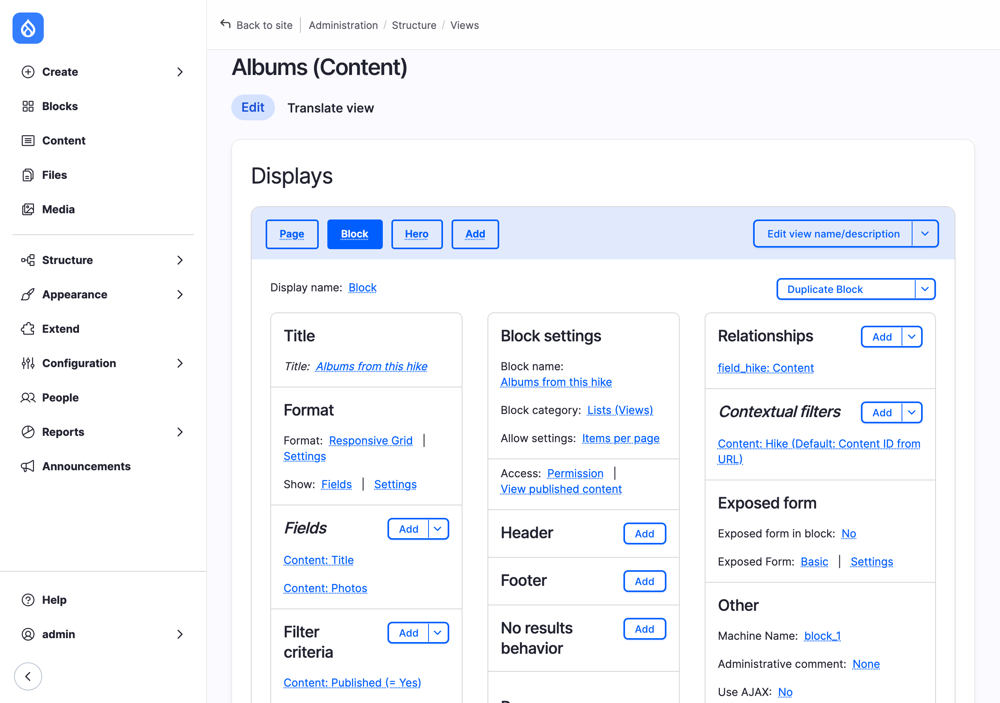
*Figure 19.10: Albums from this hike: the fields are chosen in the view.*

The row template is `views-view-fields.html.twig`, and its name for this display alone is `views-view-fields--albums--block-1.html.twig`. Each field is in `fields`, by its machine name in the view, and `.content` is the field as Views rendered it:

<!-- include: code/chapter19/steps/04-albums/core/lens_trail/templates/views/views-view-fields--albums--block-1.html.twig as=templates/views/views-view-fields--albums--block-1.html.twig -->

The whole card is one link to the album, and that shows the trade-off in a line: a field knows nothing of the row it's in, so the album's address isn't in `fields`. It's in the row: `row.nid` is the album's node ID, and Twig's `path()` makes the address from the route's name (`entity.node.canonical`). The Title field is set not to link, so there's no link inside the link.

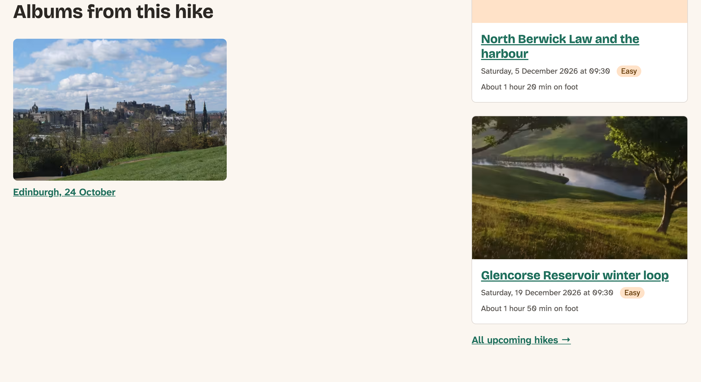
*Figure 19.11: Albums from this hike.*

### Pages for the photo themes

The photo themes (Hills, Water, Winter, City, Landscape) have been a loose end since Book 1. They're a vocabulary, so each one has a page, `/taxonomy/term/69` or its alias, and the page is the core **Taxonomy term** view, which lists the *content* with that term. But photo themes tag *photos*, which are media items, not content, so every page was a title and nothing else.

A view can list media as well as content: **Add view**, **Show: Media of type Image**. The club's view is **Photo themes** (`photo_themes`), with one block display:

- **Contextual filter**: **Media: Photo themes** (the photos' Photo themes field). **When the filter value is not in the URL**: **Provide default value**, **Taxonomy term ID from URL**, with **Load default filter from term page** checked. **Specify validation criteria**: **Taxonomy term ID**, vocabulary **Photo themes**; **Action to take if filter value does not validate**: **Hide view**. On any other page, the block has nothing to show and isn't shown.
- **Show: Media**, in the **Album** view mode: the same photos, with their credits, as on an album's page.
- **Pager**: a mini pager, 24 photos to a page. **No results behavior**: "No photos with this theme yet."
- **Block layout**: the block in the Content region, after the term's own view, visible on **Taxonomy term** pages of the **Photo themes** vocabulary only (the block's **Vocabulary** condition).

The pages still had little to show, because each photo theme was on one photo. So the club tagged its photos with more of them: Hills is now on four photos, Water on three, Landscape on four. Like the news items, that's content, not theming, but one photo doesn't show a grid. Tag a few of your own photos the same way: **Content** › **Media**, edit a photo, and add themes in its **Photo themes** field.

The album's page uses the **Album** component from Chapter 14 for its grid and lightbox, through a field template. The view's rows can go into the same component, through the style template, `views-view-unformatted--photo-themes.html.twig`:

<!-- include: code/chapter19/steps/04-albums/core/lens_trail/templates/views/views-view-unformatted--photo-themes.html.twig as=templates/views/views-view-unformatted--photo-themes.html.twig -->

`` fills the component's `photos` slot with an `<li>` per row, as the field template does with the field's items. The lightbox comes with it: the component's library is attached when the component renders, wherever that is.

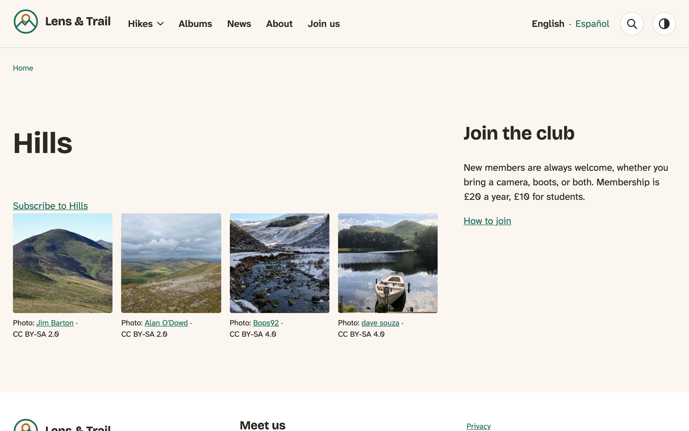
*Figure 19.12: Hills: the photos with that theme, in the Album component.*

> **Try it:** Click a photo on the Hills page. The lightbox opens, and its Next button goes through the Hills photos, not an album's. Then open a node's page, such as a hike, and check in the page source that there's no `view--photo-themes` on it.

%% Author: on the test sites, 04-albums.php gives the six photos their extra themes (the list in the text above). %%

## On Drupal CMS

### What Mercury already has

Mercury's `views-view.html.twig` already does what the core theme's does in this chapter: classes for the view and the display (`view-id-news`, `view-display-id-page_1`), and a wrapper for each part, `view-content` around the rows among them. It has its own pager template too, with Tailwind classes. And something uses those classes: Mercury's **Section** component has a **Views grid** prop, which lays out the `.view-content` of a view placed in it as two, three or four columns. A theme's view template and its components can depend on each other, which is a reason to override Mercury's templates carefully: change `view-content`, and every Section with a view in it falls apart.

So on Drupal CMS, the club adds only what Mercury doesn't have:

<!-- diff: code/chapter18/steps/05-cms/cms/mercury/src/Hook/ThemeHooks.php code/chapter19/steps/05-cms/cms/mercury/src/Hook/ThemeHooks.php as=mercury/src/Hook/ThemeHooks.php -->

- **The months**: the same two hooks as the core theme, in Mercury's hook class, and the same summary template, with Mercury's colors.
- **Cards**: Drupal CMS lists content in the **Card** view mode, so the News page and Latest news use Card (on core, the page uses Teaser), and the news card is `node--news--card.html.twig`, with the news text in the **Content** field. The album card and the Albums from this hike template are the core theme's, with Mercury's colors. The Hike archive shows its hikes as Cards too, with the Hike card from the previous chapter.
- **The "more" link**: a few lines of CSS, `css/views.css`, attached from Mercury's view template.

<!-- include: code/chapter19/steps/05-cms/cms/mercury/templates/content/node--news--card.html.twig as=mercury/templates/content/node--news--card.html.twig -->

%% Author: on the test site, code/chapter19/site/05-cms.php sets the Card rows, places the Photos block in Canvas and adds Latest news to Home. Drupal CMS's news text is in Content (field_content), in the Content text format, and its image styles are Drupal CMS's (3:2, 720 by 480, with the focal point); 01-news.php and 02-more-news.php pick those on that site. %%

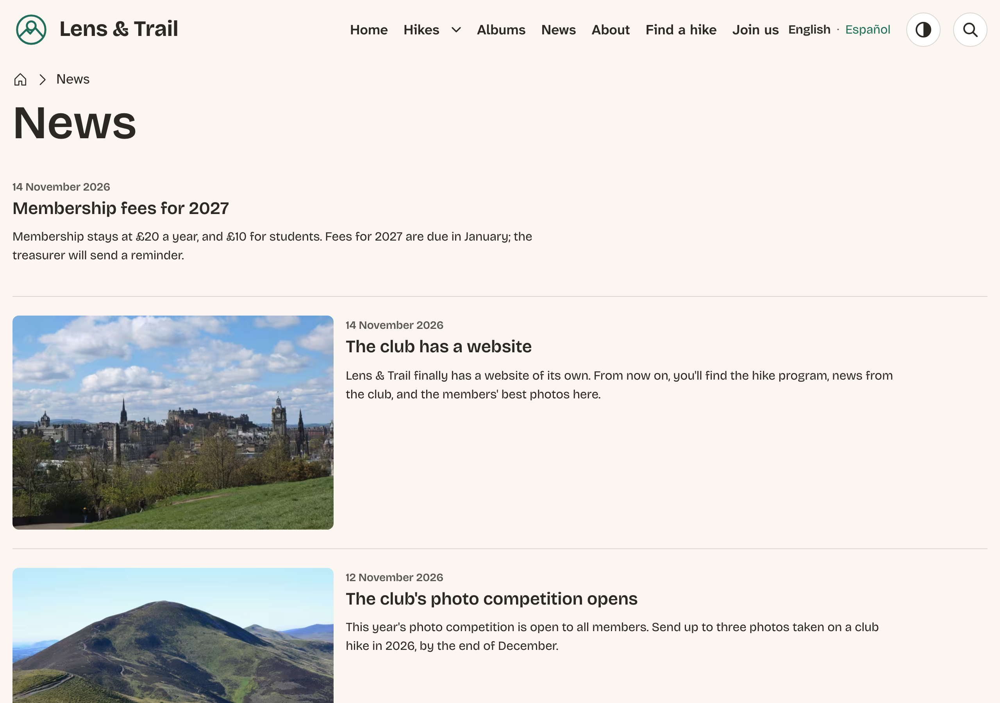
*Figure 19.13: The News page in Mercury.*

### Blocks in Canvas

On the core site, the Photos block went into **Block layout**. Drupal CMS has no Block layout for its front-end theme: the page around the content is a Canvas **page layout**, edited in the Canvas editor under **Page layout**, with slots (Header, Content, Footer) instead of regions. Albums from this hike is already in its Content slot; Photos with this theme goes after it. A block in the page layout has no visibility conditions: it's on every page. That's why the view hides itself where its contextual filter has no term, on the core site as here.

Home is a Canvas page, so Latest news goes into it as a component: a **Section** after Next hikes, with a **Heading** ("Latest news", "Últimas noticias") in its header and the **Latest news** block in its content, and **Views grid** set to **50-50**, so the two news cards sit side by side. Each card is half the section wide, which is wide enough for the container query to put the photo beside the text.

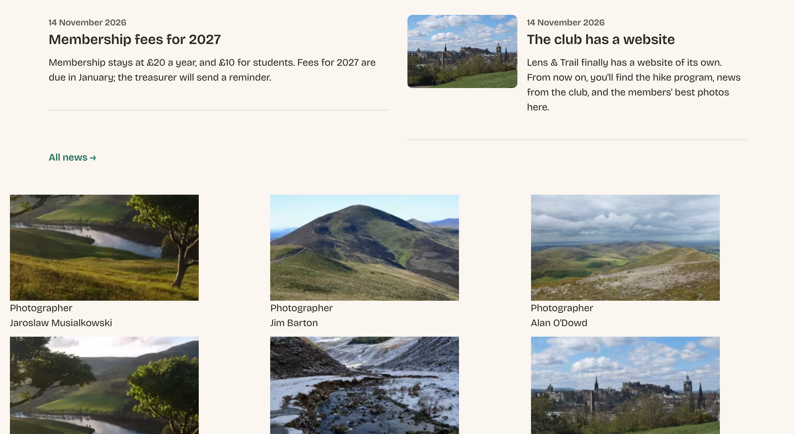
*Figure 19.14: Latest news on Home, in a Section with a Views grid.*

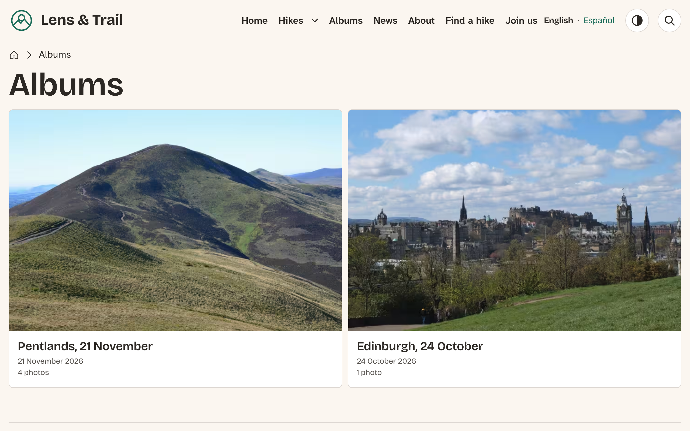
*Figure 19.15: The album cards in Mercury.*

### A card without a photo

The Hike archive on Drupal CMS is the first list that shows North Berwick Law, which has no photo, as a Card. The Hike card template from the previous chapter stopped the page: it passed `photo: null` to the component, and the component's schema wants an object or nothing. The template now builds the props first and adds the photo only when there is one:

<!-- include: code/chapter19/steps/05-cms/cms/mercury/templates/content/node--hike--card.html.twig as=mercury/templates/content/node--hike--card.html.twig -->

`props|merge()` adds to a Twig hash, and `include … with props only` passes it whole. The previous chapter's code has the same change.

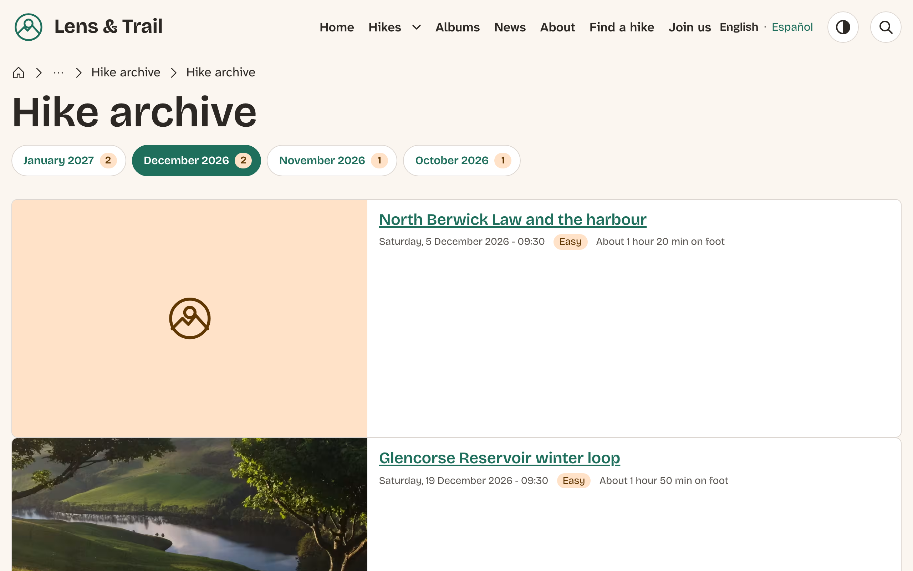
*Figure 19.16: The archive in Mercury, with North Berwick Law's placeholder.*

## Summary

You can now:

- say which three templates a view is made of, and find the Format and Show settings that choose them;
- name a template for one view, one display, or every view, from the suggestions Views makes itself, and know that Twig debugging doesn't list them;
- give every view a wrapper with classes, the site builder's CSS class, and room for spacing;
- style the "more" link as a container, and the full pager as it is, and give the mini pager the same classes;
- lay out an exposed filter, and leave its controls for the chapter on forms;
- fill a gap in a view's output with a preprocess hook and with `hook_views_pre_render()` in the theme;
- choose between a view mode and fields for a list's rows, and write a template for each;
- list media in a view with a contextual filter from the URL, and put the rows into a component;
- do the same in Mercury, and place a view block in a Canvas page or page layout.

The lists are done; the forms aren't. The Difficulty filter's select list and button, the search box, the comment form and the contact form all still wear what the browser gives them. The next chapter is about forms.

## Exercises

1. The Hikes page has no empty text. Add one in the view (**No results behavior** › **Global: Text area**), such as "No hikes with this difficulty yet. Try another, or look at the archive.", and check it by filtering on a difficulty no upcoming hike has. Which class does it get, and where does its look come from?
2. Switch the News page's pager to the mini pager, and look at the page and its source. Which template does it use now, and why does it still look like the full pager? Then switch it back.
3. Change the News page's **Format** from **Unformatted list** to **HTML List**, and look at the source: which template is used now, and what happened to the space between the cards? Make the list look like before with CSS only, in `views.css`, for `view__content` lists. Was the `<ul>` worth it? Put the format back if not.
4. Give the photo theme pages a heading over the photos: "Photos" on the core site, translated as "Fotos". Where does it go: in the view, in the block, or in a template? Try the block's title first, and say why it's better than a template here.
5. Make an **Areas** page show the albums from that area as album cards, under the area's description. Albums have an Area field. You need a block display on the Albums view with a contextual filter from the term in the URL, the Card view mode, and a place for the block on area pages. *(challenge)*
6. At the end of a news item's page, show **More news**: the three newest news items except the one you're reading, as cards, with the All news link. The Latest news block shows the two newest, including the one on the page. *(advanced)* (The answer is in Appendix B.)

## Want to know more?

- Drupal.org: [Twig template naming conventions](https://www.drupal.org/docs/develop/theming-drupal/twig-in-drupal/twig-template-naming-conventions) (its Views section) and [the Views module](https://www.drupal.org/docs/8/core/modules/views).
- Drupal API: [hook_views_pre_render()](https://api.drupal.org/api/drupal/core%21modules%21views%21views.api.php/function/hook_views_pre_render/11.x) and [hook_preprocess_HOOK()](https://api.drupal.org/api/drupal/core%21lib%21Drupal%21Core%21Render%21theme.api.php/function/hook_preprocess_HOOK/11.x).
- MDN: [Container queries](https://developer.mozilla.org/en-US/docs/Web/CSS/CSS_containment/Container_queries) and [`aria-current`](https://developer.mozilla.org/en-US/docs/Web/Accessibility/ARIA/Reference/Attributes/aria-current).
- W3C: [Understanding Success Criterion 2.5.8: Target Size (Minimum)](https://www.w3.org/WAI/WCAG22/Understanding/target-size-minimum.html).
